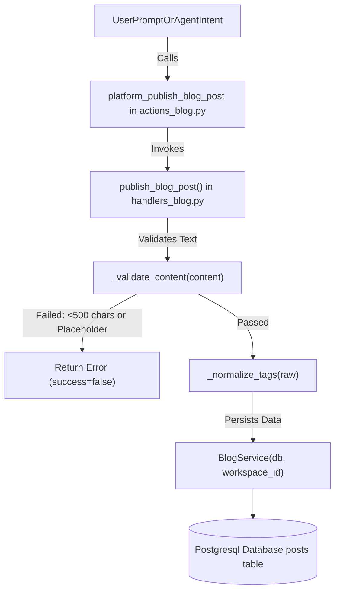
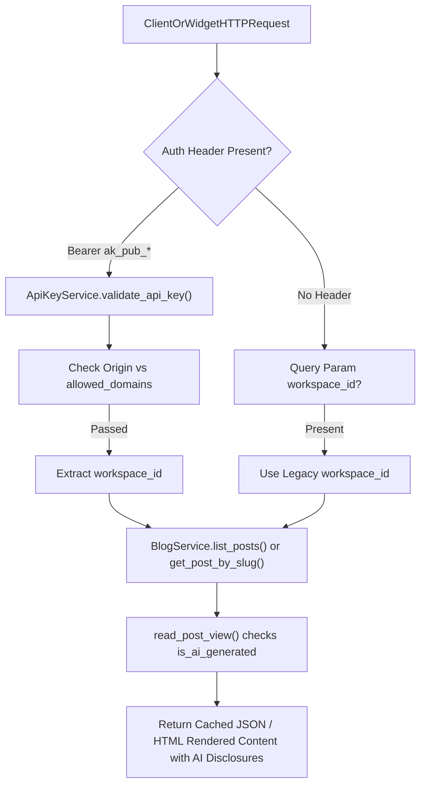

# Blog & Content Deliverables

Relevant source files

The following files were used as context for generating this wiki page:

- [docs/PRDS/PRD-264-EU-AI-ACT-ARTICLE-50.md](docs/PRDS/PRD-264-EU-AI-ACT-ARTICLE-50.md)
- [frontend/lib/ai/models.ts](frontend/lib/ai/models.ts)
- [frontend/lib/llm-defaults.ts](frontend/lib/llm-defaults.ts)
- [orchestrator/alembic/versions/prd264_blog_review.py](orchestrator/alembic/versions/prd264_blog_review.py)
- [orchestrator/api/blog.py](orchestrator/api/blog.py)
- [orchestrator/api/widgets/blog.py](orchestrator/api/widgets/blog.py)
- [orchestrator/core/generation_guard.py](orchestrator/core/generation_guard.py)
- [orchestrator/core/llm/defaults.py](orchestrator/core/llm/defaults.py)
- [orchestrator/core/services/blog_post_view.py](orchestrator/core/services/blog_post_view.py)
- [orchestrator/core/services/blog_review.py](orchestrator/core/services/blog_review.py)
- [orchestrator/core/services/blog_service.py](orchestrator/core/services/blog_service.py)
- [orchestrator/modules/documents/brand_style.py](orchestrator/modules/documents/brand_style.py)
- [orchestrator/modules/socials/recipes/footage.py](orchestrator/modules/socials/recipes/footage.py)
- [orchestrator/modules/socials/recipes/footage_toolkits.py](orchestrator/modules/socials/recipes/footage_toolkits.py)
- [orchestrator/modules/socials/recipes/voice.py](orchestrator/modules/socials/recipes/voice.py)
- [orchestrator/modules/tools/discovery/actions_blog.py](orchestrator/modules/tools/discovery/actions_blog.py)
- [orchestrator/modules/tools/discovery/handlers_blog.py](orchestrator/modules/tools/discovery/handlers_blog.py)
- [orchestrator/scripts/seed_blog_playbook.py](orchestrator/scripts/seed_blog_playbook.py)
- [orchestrator/tests/conftest.py](orchestrator/tests/conftest.py)
- [orchestrator/tests/test_prd251bw3_ai_options.py](orchestrator/tests/test_prd251bw3_ai_options.py)
- [orchestrator/tests/test_prd251w1_generate_tools.py](orchestrator/tests/test_prd251w1_generate_tools.py)
- [orchestrator/tests/test_prd264_art5_footage.py](orchestrator/tests/test_prd264_art5_footage.py)
- [orchestrator/tests/test_prd264_art5_generation_guard.py](orchestrator/tests/test_prd264_art5_generation_guard.py)
- [orchestrator/tests/test_prd264_euai08b_blog_review.py](orchestrator/tests/test_prd264_euai08b_blog_review.py)
- [orchestrator/tests/test_prd264_euai09_wiring.py](orchestrator/tests/test_prd264_euai09_wiring.py)

## Purpose & Scope

Section 28.3 details the **Blog & Content Deliverables** subsystem within Automatos AI. This module bridges autonomous AI agent research with public-facing content publishing. It provides structured platform actions, backend CRUD APIs, public widget read endpoints with origin validation, automated playbook seeds (Blog Pipeline v2), author byline security rules, EU AI Act compliance handling (PRD-264 AI-generated labelling and editorial review workflows), and a React-based deliverables and editor interface.

---

## 1. Blog Platform Actions & Handlers

The blog tool suite allows AI agents to discover existing content, create drafts, and publish verified articles to workspace blogs. Actions are defined in `orchestrator/modules/tools/discovery/actions_blog.py` [orchestrator/modules/tools/discovery/actions_blog.py:1-176]() and implemented in `orchestrator/modules/tools/discovery/handlers_blog.py` [orchestrator/modules/tools/discovery/handlers_blog.py:1-193]().

### Action Definitions

- `platform_publish_blog_post`: Writes or publishes markdown content to the workspace blog, checking against placeholder patterns and minimum character thresholds [orchestrator/modules/tools/discovery/actions_blog.py:9-63]().
- `platform_list_blog_posts`: Lists workspace posts filtered by status (`draft`, `published`, `archived`) or category [orchestrator/modules/tools/discovery/actions_blog.py:65-101]().
- `platform_get_blog_post`: Fetches full markdown content by post UUID or slug [orchestrator/modules/tools/discovery/actions_blog.py:103-134]().
- `platform_create_blog_post`: Dispatches an autonomous research-and-writing mission to the coordinator from a topic string [orchestrator/modules/tools/discovery/actions_blog.py:136-176]().

### Content Validation & Tag Normalization

To ensure autonomous agents do not push placeholder stubs or broken arrays into production feeds, `handlers_blog.py` enforces strict validation rules:
- `_validate_content(content)`: Rejects any post shorter than `MIN_CONTENT_CHARS` (500 characters) or matching `PLACEHOLDER_PATTERNS` (e.g., `[TODO]`, `[insert content here]`, `lorem ipsum`) [orchestrator/modules/tools/discovery/handlers_blog.py:15-41]().
- `_normalize_tags(raw)`: Parses tags from diverse LLM inputs, handling JSON strings, comma-delimited lists, and native array inputs while pruning malformed single-character strings [orchestrator/modules/tools/discovery/handlers_blog.py:44-71]().

Title: Blog Action Validation & Execution Flow

Sources: [orchestrator/modules/tools/discovery/actions_blog.py:1-176](), [orchestrator/modules/tools/discovery/handlers_blog.py:1-193]()

---

## 2. Blog Service & API Architecture

The blog subsystem splits its HTTP interface into authenticated dashboard CRUD endpoints and public read-only widget endpoints, incorporating EU AI Act Article 50 compliance requirements for machine-readable AI content disclosures.

### Authenticated Dashboard API (`/api/blog`)
Defined in `orchestrator/api/blog.py` [orchestrator/api/blog.py:1-185](), these endpoints require hybrid request context authentication and workspace permissions (`documents:create`, `documents:update`, `documents:delete`).
- `POST /api/blog/posts`: Creates a new post draft [orchestrator/api/blog.py:75-96]().
- `GET /api/blog/posts`: Lists all posts across statuses with pagination [orchestrator/api/blog.py:99-125]().
- `GET /api/blog/posts/{post_id}`: Retrieves post detail and content [orchestrator/api/blog.py:127-141]().
- `PUT /api/blog/posts/{post_id}`: Updates post attributes [orchestrator/api/blog.py:143-157]().
- `DELETE /api/blog/posts/{post_id}`: Soft-deletes/archives a post [orchestrator/api/blog.py:159-170]().
- `POST /api/blog/posts/{post_id}/publish`: Changes post status to published [orchestrator/api/blog.py:172-184]().

### Public Widget API (`/api/widgets/blog`)
Defined in `orchestrator/api/widgets/blog.py` [orchestrator/api/widgets/blog.py:1-185](), these endpoints provide read-only access to published blog posts.
- **Workspace Resolution**: The `resolve_blog_workspace` dependency function determines the target workspace. It prioritizes `Authorization: Bearer ak_pub_*` headers, validating the API key and checking the request origin against `allowed_domains`. As a fallback, it accepts a `workspace_id` query parameter for legacy integrations [orchestrator/api/widgets/blog.py:44-104]().
- `GET /api/widgets/blog/posts`: Lists published blog posts for a workspace, with optional filtering by category or tag [orchestrator/api/widgets/blog.py:107-134]().
- `GET /api/widgets/blog/posts/{slug}`: Retrieves a single published post by its slug, including HTML-rendered content. It also increments the post's view count [orchestrator/api/widgets/blog.py:137-159]().
- `GET /api/widgets/blog/categories`: Lists categories with post counts [orchestrator/api/widgets/blog.py:162-172]().
- `GET /api/widgets/blog/tags`: Lists tags with post counts [orchestrator/api/widgets/blog.py:175-185]().
- **Caching**: Responses from public widget endpoints include `Cache-Control` headers to enable client-side and CDN caching [orchestrator/api/widgets/blog.py:133-133](), [orchestrator/api/widgets/blog.py:158-158]().

### AI Act Compliance & Editorial Review (PRD-264 EUAI-08b / EUAI-09)
Under Article 50(4) of the EU AI Act, AI-written text published to inform the public must be disclosed as AI-generated unless a human reviewer takes editorial responsibility. The blog platform integrates review tracking across `blog_posts` table columns (`reviewed_by_user_id`, `reviewed_at`, `reviewed_content_sha256`) introduced via Alembic migration `orchestrator/alembic/versions/prd264_blog_review.py` [orchestrator/alembic/versions/prd264_blog_review.py:1-38]().

- **`BlogService` (`orchestrator/core/services/blog_service.py`)**: Manages metadata in PostgreSQL and full markdown content stored as `.md` files in workspace storage (`content/blog/<slug>.md`) [orchestrator/core/services/blog_service.py:1-195]().
- **`blog_post_view.py` & `blog_review.py`**:
  - `is_ai_generated(post, current_text)` returns `True` when `author_agent_id` is set and no valid editorial review covers the exact current text [orchestrator/core/services/blog_post_view.py:34-37]().
  - `review_covers(post, current_text)` checks whether the SHA-256 hash of the current workspace file content (ignoring surrounding whitespace via `content_sha256()`) matches the stored `reviewed_content_sha256` [orchestrator/core/services/blog_review.py:37-51]().
  - Any edit modifying content or metadata (excluding status changes) automatically clears the review state (`REVIEW_CLEARED`), reverting the post to `ai_generated: true` until re-reviewed [orchestrator/core/services/blog_review.py:27-32]().

Title: Public Widget Resolution & Routing Architecture

Sources: [orchestrator/api/blog.py:1-185](), [orchestrator/api/widgets/blog.py:1-185](), [orchestrator/core/services/blog_service.py:1-195](), [orchestrator/core/services/blog_post_view.py:1-66](), [orchestrator/core/services/blog_review.py:1-72](), [orchestrator/alembic/versions/prd264_blog_review.py:1-38]()

---

## 3. Author Byline Rules & PII Protection

Public widget endpoints expose an `author_name` attribute on every post. To prevent user Personally Identifiable Information (PII) leaks (e.g., exposing an operator's personal email or user account name), the platform strictly isolates author attribution.

### Implementation & Security Rules
- `_resolve_author_name(db, workspace_id)` queries the workspace or brand name (e.g., `"InBuildUK"`) from the `Workspaces` table [orchestrator/api/blog.py:31-41]().
- If the workspace name is missing, null, or whitespace-only, it falls back to a neutral label: `"Workspace Author"` [orchestrator/api/blog.py:31-41]().
- The helper signature accepts only `(db, workspace_id)` and maintains zero reference to user objects, making PII leaks architecturally impossible.

Sources: [orchestrator/api/blog.py:31-41]()

---

## 4. Blog Playbook Seed & Mission Pipeline

Automated blog generation is orchestrated via the Blog Pipeline v2 seed script (`orchestrator/scripts/seed_blog_playbook.py`) [orchestrator/scripts/seed_blog_playbook.py:1-145]().

### Pipeline Architecture
1. **Trigger**: Scheduled via cron expression `0 9 * * 2,5` (Tuesdays and Fridays at 09:00 UTC) [orchestrator/scripts/seed_blog_playbook.py:101-104]().
2. **QUILL Agent**: The content scout agent (`QUILL`) inspects existing workspace posts and memory to select a fresh, non-duplicate, trending topic within the designated category [orchestrator/scripts/seed_blog_playbook.py:26-60]().
3. **Mission Dispatch**: QUILL invokes `platform_create_blog_post`, which spins up a server-side multi-agent mission handling deep research, writing, editing, cover image generation (using `DEFAULT_IMAGE_GEN_MODEL` from `core/llm/defaults.py` [orchestrator/core/llm/defaults.py:19-29]()), and human-review board task gates [orchestrator/scripts/seed_blog_playbook.py:74-135]().

Sources: [orchestrator/scripts/seed_blog_playbook.py:1-145](), [orchestrator/core/llm/defaults.py:1-29]()

---

## 5. Frontend Deliverables & Editor UI

The frontend delivers blog management through a dedicated deliverables view, slide-over editor sheet, and editorial review actions.

### Key UI Components
- **`DeliverablesBlog` (`frontend/components/deliverables/deliverables-blogs.tsx`)**: Renders a grid of blog post cards (`BlogPostCard`), filter tabs, skeleton loaders (`BlogCardSkeleton`), and empty states (`BlogEmptyState`) [frontend/components/deliverables/deliverables-blogs.tsx:1-209](). Status badges use color-coded styling for drafts, published items, archives, and EU AI Act AI-generated/reviewed badges.
- **`BlogEditor` (`frontend/components/deliverables/blog-editor.tsx`)**: Provides a dual-mode interface (manual editing vs. automated mission kick-off), markdown preview, cover image file uploading, and publication confirmation dialogs [frontend/components/deliverables/blog-editor.tsx:1-114]().
- **Markdown Rendering**: The `MarkdownView` component is used for rendering markdown content in the editor preview [frontend/components/deliverables/blog-editor.tsx:5-5]() and mission results [frontend/components/missions/mission-results-panel.tsx:17-17](). This component ensures consistent typography across various markdown surfaces, including chat artifacts [frontend/components/chatbot/text-artifact.tsx:1-1](), [frontend/components/chatbot/sheet-artifact.tsx:1-1](), and skill details [frontend/components/agents/skills/skill-detail-modal.tsx:1-1](). The application uses its own document typography defined in `app/globals.css` rather than `@tailwindcss/typography` [frontend/components/shared/__tests__/markdown-typography.test.ts:49-57]().
- **React Query Hooks (`frontend/hooks/use-blogs-api.ts`)**: Manages caching, stale times, and optimistic mutations for `useBlogPosts`, `useBlogPost`, `usePublishPost`, `useUnpublishPost`, `useDeletePost`, `useCreateBlogMission`, `useUploadCoverImage`, and review marking mutations.

Sources: [frontend/components/deliverables/deliverables-blogs.tsx:1-209](), [frontend/components/deliverables/blog-editor.tsx:1-114](), [frontend/components/missions/mission-results-panel.tsx:17-17](), [frontend/components/chatbot/text-artifact.tsx:1-1](), [frontend/components/chatbot/sheet-artifact.tsx:1-1](), [frontend/components/agents/skills/skill-detail-modal.tsx:1-1](), [frontend/components/shared/__tests__/markdown-typography.test.ts:49-57]()

---