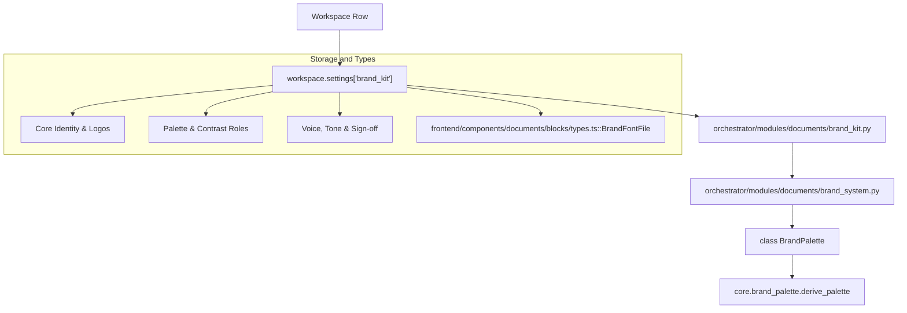
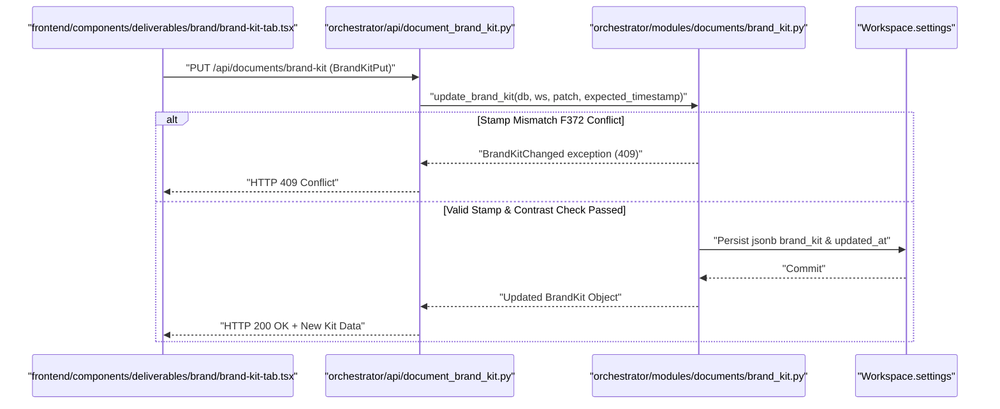
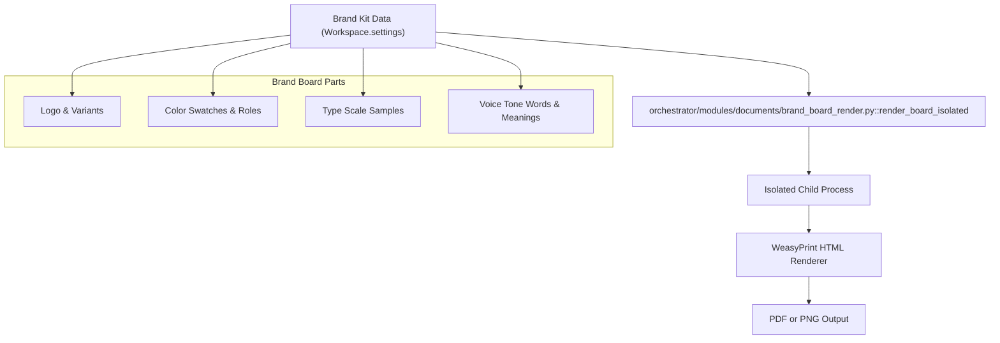
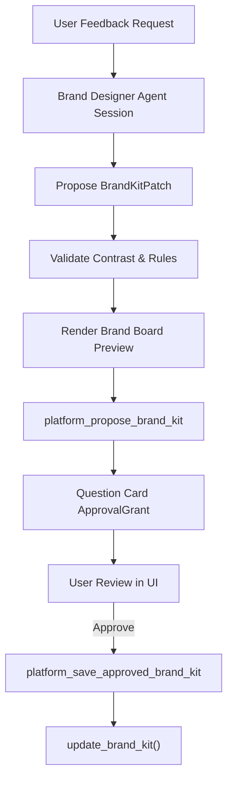
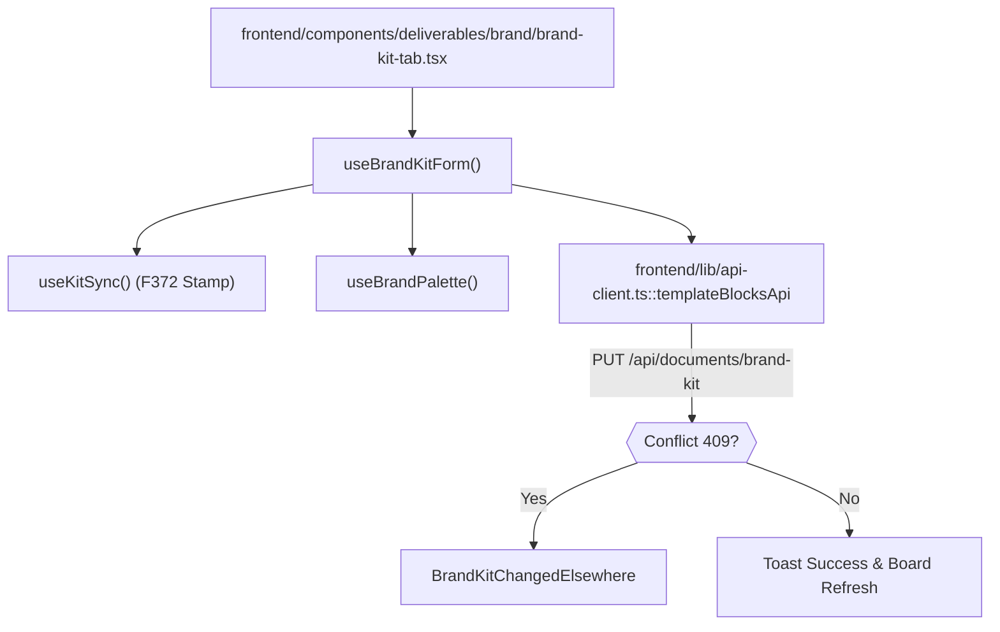

# Brand Kit & Brand Rules

Relevant source files

The following files were used as context for generating this wiki page:

- [frontend/components/deliverables/brand/__tests__/brand-board-preview.test.tsx](frontend/components/deliverables/brand/__tests__/brand-board-preview.test.tsx)
- [frontend/components/deliverables/brand/__tests__/brand-kit-changed-elsewhere.test.tsx](frontend/components/deliverables/brand/__tests__/brand-kit-changed-elsewhere.test.tsx)
- [frontend/components/deliverables/brand/__tests__/brand-kit-tab.test.tsx](frontend/components/deliverables/brand/__tests__/brand-kit-tab.test.tsx)
- [frontend/components/deliverables/brand/__tests__/brand-kit-tone-words.test.ts](frontend/components/deliverables/brand/__tests__/brand-kit-tone-words.test.ts)
- [frontend/components/deliverables/brand/brand-board-preview.tsx](frontend/components/deliverables/brand/brand-board-preview.tsx)
- [frontend/components/deliverables/brand/brand-kit-basics.tsx](frontend/components/deliverables/brand/brand-kit-basics.tsx)
- [frontend/components/deliverables/brand/brand-kit-changed-elsewhere.tsx](frontend/components/deliverables/brand/brand-kit-changed-elsewhere.tsx)
- [frontend/components/deliverables/brand/brand-kit-fields.tsx](frontend/components/deliverables/brand/brand-kit-fields.tsx)
- [frontend/components/deliverables/brand/brand-kit-tab.tsx](frontend/components/deliverables/brand/brand-kit-tab.tsx)
- [frontend/components/deliverables/brand/use-brand-kit-form.ts](frontend/components/deliverables/brand/use-brand-kit-form.ts)
- [frontend/components/deliverables/brand/use-brand-palette.ts](frontend/components/deliverables/brand/use-brand-palette.ts)
- [frontend/components/deliverables/brand/use-kit-sync.ts](frontend/components/deliverables/brand/use-kit-sync.ts)
- [frontend/components/documents/blocks/BrandKitSocial.tsx](frontend/components/documents/blocks/BrandKitSocial.tsx)
- [frontend/components/documents/blocks/api.ts](frontend/components/documents/blocks/api.ts)
- [frontend/components/documents/blocks/types.ts](frontend/components/documents/blocks/types.ts)
- [frontend/hooks/use-brand-kit-stamp.ts](frontend/hooks/use-brand-kit-stamp.ts)
- [orchestrator/api/document_brand_kit.py](orchestrator/api/document_brand_kit.py)
- [orchestrator/modules/documents/brand_kit.py](orchestrator/modules/documents/brand_kit.py)
- [orchestrator/modules/documents/brand_logo.py](orchestrator/modules/documents/brand_logo.py)
- [orchestrator/modules/documents/brand_signing.py](orchestrator/modules/documents/brand_signing.py)
- [orchestrator/modules/documents/brand_system.py](orchestrator/modules/documents/brand_system.py)
- [orchestrator/modules/documents/templates/social/brand-board.json](orchestrator/modules/documents/templates/social/brand-board.json)
- [orchestrator/modules/tools/discovery/actions_brand_kit_update.py](orchestrator/modules/tools/discovery/actions_brand_kit_update.py)
- [orchestrator/services/brand_design_rules.py](orchestrator/services/brand_design_rules.py)
- [orchestrator/services/brand_rules.py](orchestrator/services/brand_rules.py)
- [orchestrator/services/session_brand_files.py](orchestrator/services/session_brand_files.py)
- [orchestrator/tests/test_f336_a_company_placeholder_becomes_the_company_name.py](orchestrator/tests/test_f336_a_company_placeholder_becomes_the_company_name.py)
- [orchestrator/tests/test_f372_b_a_stale_page_never_saves_over_a_change.py](orchestrator/tests/test_f372_b_a_stale_page_never_saves_over_a_change.py)
- [orchestrator/tests/test_f372_the_kit_says_when_it_changed.py](orchestrator/tests/test_f372_the_kit_says_when_it_changed.py)
- [orchestrator/tests/test_prd251w1_brand_kit.py](orchestrator/tests/test_prd251w1_brand_kit.py)
- [orchestrator/tests/test_prd251w1_brand_kit_tools.py](orchestrator/tests/test_prd251w1_brand_kit_tools.py)
- [orchestrator/tests/test_prd255w1_brand_kit_tools.py](orchestrator/tests/test_prd255w1_brand_kit_tools.py)
- [orchestrator/tests/test_prd255w1_kit_fields.py](orchestrator/tests/test_prd255w1_kit_fields.py)
- [orchestrator/tests/test_prd255w1_palette_roles.py](orchestrator/tests/test_prd255w1_palette_roles.py)

This page documents the **Brand Kit & Brand Rules** subsystem of Automatos AI, corresponding to PRD-167 (Section 4), PRD-251 (Section D5), and PRD-255 (Brand Kit v2). The brand kit system provides workspace-level styling, voice definitions, design rules, and automated compliance enforcement. Rather than relying on hardcoded platform branding (such as the legacy Automatos orange `#ff6b35`), every generated document, DOCX export, HTML preview, social media asset, and agent text output automatically incorporates the workspace's specific brand identity.

---

## 1. Brand Kit Data Model & Storage

Per the repository's architecture rule (*"no new table when an existing one fits"*), the brand kit is stored directly on the workspace settings JSONB column under the key `brand_kit` (`workspace.settings['brand_kit']`) [orchestrator/modules/documents/brand_kit.py:3-7]().

### Key Fields & Structure
*   **Core Identity:** `name`, `tagline`, `logo_url`, `logo_path` (server-managed storage path), `logo_mark_url`, `logo_mark_path` (a square mark, separate from the wordmark) [frontend/components/documents/blocks/types.ts:129-156]().
*   **Logo Variants (PRD-255 FR-9):** `logo_dark_path` and `logo_mono_path` for dark and single-colour requirements, uploaded via dedicated endpoints and managed by the server [frontend/components/documents/blocks/types.ts:176-177]().
*   **Color Roles (PRD-255 v2):** Stored sparse under `palette`. Rather than forcing flat colors, v2 assigns semantic roles (`ink`, `heading`, `paper`, `surface`, `surface_2`, `accent`, `accent_2`, `muted`, `rule`). Unspecified roles are dynamically derived at read time from the primary, secondary, and text colors [orchestrator/modules/documents/brand_system.py:1-8]().
*   **Accent Use & Design Rules:** `accent_use` (`sparing` vs `bold`), `type_scale` (seven point-size steps for headings and body), `spacing_unit_pt`, `page_margin_mm`, `logo_rules`, `currency`, `date_style`, and ISO country code [frontend/components/documents/blocks/types.ts:167-184]().
*   **Brand Voice & Socials:** Tone words with optional one-line meanings, banned phrases (up to 50), sign-off phrase for agents to sign work, and `social_handles` keyed by Composio toolkit slug [frontend/components/documents/blocks/types.ts:157-161]().
*   **Font Files:** `font_files` stores uploaded `woff2` files, including `id`, `family`, `weight`, `style`, `path`, `file_name`, and `bytes` [frontend/components/documents/blocks/types.ts:205-213]().

Diagram: Data Model to Code Entity Mapping

Sources:
- [orchestrator/modules/documents/brand_kit.py:3-7]()
- [orchestrator/modules/documents/brand_system.py:1-8]()
- [frontend/components/documents/blocks/types.ts:129-156]()
- [frontend/components/documents/blocks/types.ts:157-161]()
- [frontend/components/documents/blocks/types.ts:167-184]()
- [frontend/components/documents/blocks/types.ts:176-177]()
- [frontend/components/documents/blocks/types.ts:205-213]()

---

## 2. Brand Kit API & Update Actions

The brand kit is exposed via REST endpoints mounted inside the document generation sub-router (`api/document_brand_kit.py`), and mirrored as platform tools for AI agents (`modules/tools/discovery/actions_brand_kit_update.py`).

### REST Endpoints
*   `GET /api/documents/brand-kit`: Returns the effective brand kit with defaults merged, calculated color roles, and source flags (`set` vs `derived`) [orchestrator/api/document_brand_kit.py:121-132]().
*   `PUT /api/documents/brand-kit`: Validates and persists updates. Includes optimistic locking (`if_updated_at`) to prevent race conditions when multiple editors modify the brand kit simultaneously (returning `409 Conflict` on stale stamps) [orchestrator/api/document_brand_kit.py:77-88]().
*   `POST/GET/DELETE /brand-kit/logo`, `/logo-dark`, `/logo-mono`, `/logo-mark`: File management for visual assets [orchestrator/api/document_brand_kit.py:8-38]().
*   `POST /api/documents/brand-kit/fonts` & `GET/DELETE /brand-kit/fonts/{font_id}`: Upload and delete `.woff2` font files [orchestrator/api/document_brand_kit.py:36-38]().
*   `GET /api/documents/brand-kit/board?format=pdf|png`: Renders the brand board live on demand [orchestrator/api/document_brand_kit.py:11-13]().

### Agent Tools
*   `platform_get_brand_kit`: Allows agents to inspect workspace branding parameters [orchestrator/modules/tools/discovery/actions_brand_kit_update.py:1-5]().
*   `platform_update_brand_kit`: Enables authorized admin or owner agents to modify colors, fonts, voice rules, and layout parameters programmatically [orchestrator/modules/tools/discovery/actions_brand_kit_update.py:3-12](). The schema for this tool includes every field of the v2 kit an agent may set, with descriptions to guide the agent [orchestrator/modules/tools/discovery/actions_brand_kit_update.py:11-14]().

Diagram: Brand Update and API Flow

Sources:
- [orchestrator/api/document_brand_kit.py:8-38]()
- [orchestrator/api/document_brand_kit.py:11-13]()
- [orchestrator/api/document_brand_kit.py:77-88]()
- [orchestrator/api/document_brand_kit.py:121-132]()
- [orchestrator/modules/documents/brand_kit.py:1-693]()
- [orchestrator/modules/tools/discovery/actions_brand_kit_update.py:1-5]()
- [orchestrator/modules/tools/discovery/actions_brand_kit_update.py:3-12]()
- [orchestrator/modules/tools/discovery/actions_brand_kit_update.py:11-14]()

---

## 3. Brand Board Rendering & Style Engine

PRD-255 (US-010) introduces the **Brand Board**, a comprehensive visual summary of the workspace identity.

### Rendering Pipeline
1.  **Isolation & Execution:** The brand board is rendered in an isolated child process via `render_board_isolated` to isolate memory and rendering faults [orchestrator/api/document_brand_kit.py:59-61]().
2.  **Formats:** Supports PDF and PNG output (`BOARD_MEDIA_TYPES`) [orchestrator/api/document_brand_kit.py:59-61]().
3.  **Template Mapping:** Renders visual blocks representing logos, variant files, color swatches with contrast ratios, type scale steps, spacing units, and tone vocabulary [frontend/components/documents/blocks/types.ts:77-84]().
4.  **Contrast Guard (FR-5):** On save, the backend executes `require_readable_palette()`, verifying that text roles (`ink`, `heading`, `muted`) achieve at least 4.5:1 contrast against paper and table header surfaces, and accent roles achieve at least 3:1 contrast. Unreadable palettes are rejected with 422 errors detailing specific ratios and background contexts [orchestrator/modules/documents/brand_system.py:92-110]().

Diagram: Brand Board Architecture

Sources:
- [orchestrator/api/document_brand_kit.py:59-61]()
- [orchestrator/modules/documents/brand_system.py:92-110]()
- [frontend/components/documents/blocks/types.ts:77-84]()

---

## 4. Brand Signing & Rules/Hooks Enforcement

To guarantee that agent-generated outputs strictly adhere to brand guidelines, `services/brand_rules.py` applies automated rules and post-processing hooks to all agent communication and document drafting [orchestrator/services/brand_rules.py:1-23]().

### Key Functions
*   **`brand_rules_block()`:** Injects a dynamic prompt block into drafting workflows, informing the agent of the brand name, tone words, sign-off formula, banned phrases, color palette, and logo file references [orchestrator/services/brand_rules.py:10-15]().
*   **`on_brand_text()`:** Performs deterministic post-processing on finished text [orchestrator/services/brand_rules.py:17-23]().
    *   Replaces placeholder signatures (such as `[Your name]`, `[Name]`, or `[Your Company Name]`) with the configured `voice.sign_off` or company name [orchestrator/services/brand_rules.py:17-31]().
    *   Inserts explanatory notes (`BANNED_NOTE_LEAD`) if banned vocabulary is detected in the response [orchestrator/services/brand_rules.py:17-23]().
*   **Caching Layer:** Kit reads are cached per workspace for `KIT_CACHE_SECONDS` (30 seconds) to balance high database query frequency during multi-step drafting runs with prompt responsiveness to brand updates [orchestrator/services/brand_rules.py:48-50, 65]().
*   **Document Signing:** `a_document_is_signed` wraps `DocumentGenerationService.generate` to ensure generated documents incorporate the correct signer or sign-off [orchestrator/modules/documents/brand_signing.py:48-63]().

Diagram: Brand Rules Enforcement Pipeline

```mermaid
graph LR
    AgentRun["Agent Drafting Run"] --> BrandHooks["orchestrator/services/brand_hooks.py"]
    BrandHooks --> RulesBlock["orchestrator/services/brand_rules.py::brand_rules_block"]
    RulesBlock --> ModelGeneration["LLM Generation"]
    ModelGeneration --> RawText["Raw Agent Output"]
    RawText --> PostProcess["orchestrator/services/brand_rules.py::on_brand_text"]
    PostProcess --> FinalText["Polished Brand-Compliant Text"]
```

Sources:
- [orchestrator/modules/documents/brand_signing.py:48-63]()
- [orchestrator/services/brand_rules.py:1-23]()
- [orchestrator/services/brand_rules.py:10-15]()
- [orchestrator/services/brand_rules.py:17-31]()
- [orchestrator/services/brand_rules.py:48-50]()
- [orchestrator/services/brand_rules.py:65]()

---

## 5. Designer Seed and Proposal Cards

Automated brand designer agent workflows and proposal cards enable AI agents to propose brand changes safely.

### Proposal Workflow
1.  **`platform_propose_brand_kit`:** An agent session analyzes brand feedback, validates the proposed patch against brand kit constraints, renders a preview brand board PDF/PNG into the session folder without mutating live workspace settings, and files a structured question card (`ApprovalGrant` of kind `question`) on the agent's ticket.
2.  **Human Review:** The workspace owner reviews proposal cards containing preview swatches and board renders directly inside the Questions tab or ticket view.
3.  **`platform_save_approved_brand_kit`:** When the owner selects "Approve", this platform action retrieves the stored proposal and applies it securely via `update_brand_kit`.

Diagram: Brand Proposal Lifecycle

Sources:
- [orchestrator/tests/test_prd255w1_brand_kit_tools.py:1-16]()

---

## 6. Brand Kit UI Tabs & Frontend Integration

The frontend management surface is anchored by `BrandKitTab` (`frontend/components/deliverables/brand/brand-kit-tab.tsx`), backed by specialized state management hooks [frontend/components/deliverables/brand/use-brand-kit-form.ts:1-15]().

### Frontend Architecture
*   **`useBrandKitForm()`:** Manages form state, merging D5 fallback fields (`withD5Fields`), onboarding suggestions (`withSuggestions`), and palette role selections [frontend/components/deliverables/brand/use-brand-kit-form.ts:37-80]().
*   **`useKitSync()` & Stamp Tracking:** Implements optimistic concurrency check (`F372`). Every save transmits `if_updated_at` corresponding to the load timestamp. If an out-of-band edit occurred, a conflict banner prompts the user to reload or overwrite [frontend/components/deliverables/brand/use-kit-sync.ts:1-25]().
*   **Sub-Components & API Client:**
    *   `templateBlocksApi` provides client methods for brand kit retrieval, updates, asset uploads, and board rendering [frontend/components/documents/blocks/api.ts:51-76]().
    *   Font uploads handle `.woff2` files via `uploadFont()` [frontend/components/documents/blocks/api.ts:99-106]().

Diagram: Frontend Form & Sync Flow

Sources:
- [frontend/components/deliverables/brand/use-brand-kit-form.ts:1-15]()
- [frontend/components/deliverables/brand/use-brand-kit-form.ts:37-80]()
- [frontend/components/deliverables/brand/use-kit-sync.ts:1-25]()
- [frontend/components/documents/blocks/api.ts:51-76]()
- [frontend/components/documents/blocks/api.ts:99-106]()

---