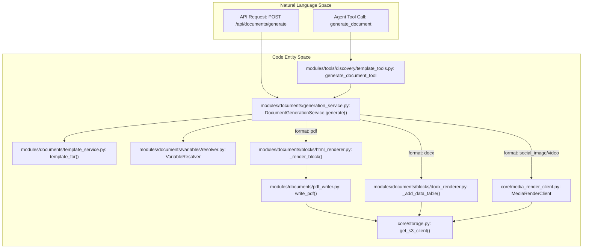
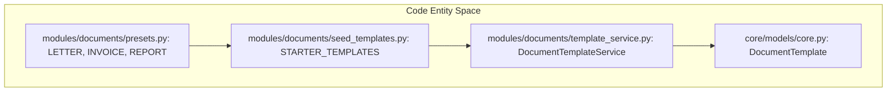
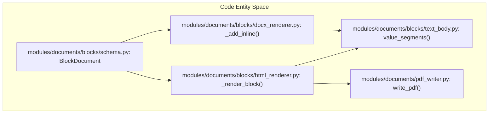
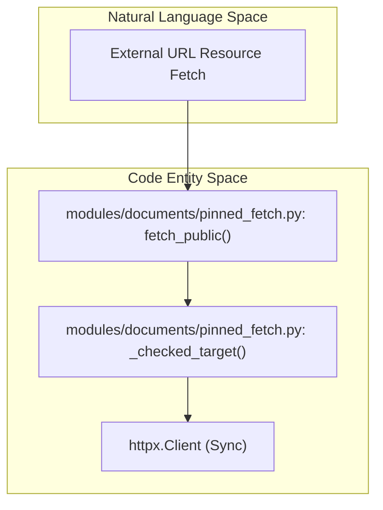
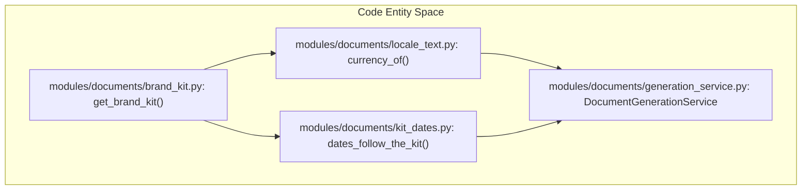
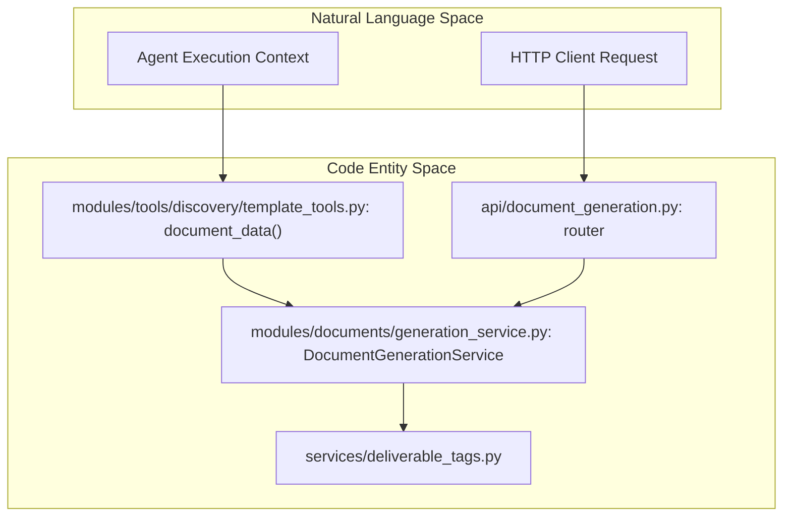

# Document Generation & Templates

Relevant source files

The following files were used as context for generating this wiki page:

- [frontend/components/deliverables/socials/__tests__/socials-template-made-for.test.ts](frontend/components/deliverables/socials/__tests__/socials-template-made-for.test.ts)
- [frontend/components/documents/blocks/__tests__/promptSnippets.test.ts](frontend/components/documents/blocks/__tests__/promptSnippets.test.ts)
- [frontend/components/documents/blocks/promptSnippets.ts](frontend/components/documents/blocks/promptSnippets.ts)
- [orchestrator/api/document_generation.py](orchestrator/api/document_generation.py)
- [orchestrator/consumers/chatbot/socials_turn_note.py](orchestrator/consumers/chatbot/socials_turn_note.py)
- [orchestrator/modules/documents/blocks/data_details.py](orchestrator/modules/documents/blocks/data_details.py)
- [orchestrator/modules/documents/blocks/design_tokens.py](orchestrator/modules/documents/blocks/design_tokens.py)
- [orchestrator/modules/documents/blocks/docx_renderer.py](orchestrator/modules/documents/blocks/docx_renderer.py)
- [orchestrator/modules/documents/blocks/docx_style.py](orchestrator/modules/documents/blocks/docx_style.py)
- [orchestrator/modules/documents/blocks/docx_tables.py](orchestrator/modules/documents/blocks/docx_tables.py)
- [orchestrator/modules/documents/blocks/html_renderer.py](orchestrator/modules/documents/blocks/html_renderer.py)
- [orchestrator/modules/documents/blocks/letterhead_run.py](orchestrator/modules/documents/blocks/letterhead_run.py)
- [orchestrator/modules/documents/blocks/optional_parts.py](orchestrator/modules/documents/blocks/optional_parts.py)
- [orchestrator/modules/documents/blocks/page_starters.py](orchestrator/modules/documents/blocks/page_starters.py)
- [orchestrator/modules/documents/blocks/page_style.py](orchestrator/modules/documents/blocks/page_style.py)
- [orchestrator/modules/documents/blocks/schema.py](orchestrator/modules/documents/blocks/schema.py)
- [orchestrator/modules/documents/blocks/text_body.py](orchestrator/modules/documents/blocks/text_body.py)
- [orchestrator/modules/documents/data_coverage.py](orchestrator/modules/documents/data_coverage.py)
- [orchestrator/modules/documents/generation_service.py](orchestrator/modules/documents/generation_service.py)
- [orchestrator/modules/documents/legacy_jinja.py](orchestrator/modules/documents/legacy_jinja.py)
- [orchestrator/modules/documents/models.py](orchestrator/modules/documents/models.py)
- [orchestrator/modules/documents/presets.py](orchestrator/modules/documents/presets.py)
- [orchestrator/modules/documents/seed_templates.py](orchestrator/modules/documents/seed_templates.py)
- [orchestrator/modules/documents/template_formats.py](orchestrator/modules/documents/template_formats.py)
- [orchestrator/modules/documents/template_lookup.py](orchestrator/modules/documents/template_lookup.py)
- [orchestrator/modules/documents/template_preview.py](orchestrator/modules/documents/template_preview.py)
- [orchestrator/modules/documents/template_service.py](orchestrator/modules/documents/template_service.py)
- [orchestrator/modules/documents/template_summary.py](orchestrator/modules/documents/template_summary.py)
- [orchestrator/modules/documents/templates/basic_report.html](orchestrator/modules/documents/templates/basic_report.html)
- [orchestrator/modules/documents/templates/executive_summary.html](orchestrator/modules/documents/templates/executive_summary.html)
- [orchestrator/modules/documents/templates/invoice.html](orchestrator/modules/documents/templates/invoice.html)
- [orchestrator/modules/documents/variables/catalog.py](orchestrator/modules/documents/variables/catalog.py)
- [orchestrator/modules/documents/variables/chip_text.py](orchestrator/modules/documents/variables/chip_text.py)
- [orchestrator/modules/documents/variables/resolver.py](orchestrator/modules/documents/variables/resolver.py)
- [orchestrator/modules/tools/discovery/social_post_checks.py](orchestrator/modules/tools/discovery/social_post_checks.py)
- [orchestrator/modules/tools/discovery/social_post_results.py](orchestrator/modules/tools/discovery/social_post_results.py)
- [orchestrator/modules/tools/discovery/template_tools.py](orchestrator/modules/tools/discovery/template_tools.py)
- [orchestrator/tests/security/test_template_security.py](orchestrator/tests/security/test_template_security.py)
- [orchestrator/tests/test_996_hosted_workspaces_get_the_current_starters.py](orchestrator/tests/test_996_hosted_workspaces_get_the_current_starters.py)
- [orchestrator/tests/test_f348_a_template_previews_its_own_sample_and_says_what_it_makes.py](orchestrator/tests/test_f348_a_template_previews_its_own_sample_and_says_what_it_makes.py)
- [orchestrator/tests/test_f350_a_branded_starter_prints_like_a_finished_document.py](orchestrator/tests/test_f350_a_branded_starter_prints_like_a_finished_document.py)
- [orchestrator/tests/test_f356_a_every_document_prints_with_one_design_system.py](orchestrator/tests/test_f356_a_every_document_prints_with_one_design_system.py)
- [orchestrator/tests/test_f356_b_each_starter_has_a_finished_layout.py](orchestrator/tests/test_f356_b_each_starter_has_a_finished_layout.py)
- [orchestrator/tests/test_f356_d_the_word_file_matches_the_pdf.py](orchestrator/tests/test_f356_d_the_word_file_matches_the_pdf.py)
- [orchestrator/tests/test_f379_a_autos_post_is_checked_and_its_answer_is_honest.py](orchestrator/tests/test_f379_a_autos_post_is_checked_and_its_answer_is_honest.py)
- [orchestrator/tests/test_f379_c_auto_knows_how_socials_works.py](orchestrator/tests/test_f379_c_auto_knows_how_socials_works.py)
- [orchestrator/tests/test_f379_d_social_media_work_goes_to_the_director.py](orchestrator/tests/test_f379_d_social_media_work_goes_to_the_director.py)
- [orchestrator/tests/test_f383_b_a_named_template_is_kept_or_refused.py](orchestrator/tests/test_f383_b_a_named_template_is_kept_or_refused.py)
- [orchestrator/tests/test_letterhead_contact_line_skips_details_the_kit_lacks.py](orchestrator/tests/test_letterhead_contact_line_skips_details_the_kit_lacks.py)
- [orchestrator/tests/test_prd190_deliverables.py](orchestrator/tests/test_prd190_deliverables.py)
- [orchestrator/tests/test_prd243_data_table_and_presets.py](orchestrator/tests/test_prd243_data_table_and_presets.py)
- [orchestrator/tests/test_prd255w1_document_tokens.py](orchestrator/tests/test_prd255w1_document_tokens.py)
- [orchestrator/tests/test_template_blocks.py](orchestrator/tests/test_template_blocks.py)

## Purpose & Scope

The Document Generation & Templates subsystem (`PRD-63`, `PRD-251`, `PRD-167`) provides programmatic generation of enterprise documents across multiple formats—PDF (via WeasyPrint), DOCX (via `python-docx-template` and canonical block rendering), XLSX (via XlsxWriter), and social media assets (PNG/MP4 via the `media-render` service). It coordinates workspace brand kits, dynamic variable resolution, secure SSRF-guarded image fetching, finalisation blocking for unresolved variables, and persistent storage synchronization to AWS S3.

---

## 1. Core Generation Service & Dispatch Architecture

The central orchestrator for document creation is `DocumentGenerationService`, which acts as the single entry point (`generate`) taking metadata, format specifications, and data payloads, resolving underlying templates, applying decorators (such as signature sign-offs, currency notices, and ISO date styling), and dispatching to format-specific engines [orchestrator/modules/documents/generation_service.py:129-151]().

### Document Generation Data Flow (Natural Language to Code Entities)

Sources: [orchestrator/modules/documents/generation_service.py](), [orchestrator/api/document_generation.py](), [orchestrator/modules/tools/discovery/template_tools.py]()

---

## 2. Document Templates & Category Presets

Templates serve as structured layouts for generation. Rather than forcing users or agents to compose documents from a blank slate, category presets (`presets.py`) define pre-programmed, brand-aware block trees for categories such as letters, invoices, reports, and proposals [orchestrator/modules/documents/presets.py:1-27]().

Categories carry complete block hierarchies:
* Loaded into the editor during **New template → <category>** flows.
* Seeded into database storage via `seed_templates.py` [orchestrator/modules/documents/seed_templates.py:1-9]().
* Enforced against strict data schemas where required legal or business terms (e.g., payment terms, tax calculations) cannot fallback to silent defaults [orchestrator/modules/documents/presets.py:20-27]().

Sources: [orchestrator/modules/documents/presets.py](), [orchestrator/modules/documents/seed_templates.py]()

---

## 3. Block Renderers: HTML/WeasyPrint & DOCX Pipelines

`PRD-167` introduced canonical block-tree rendering, removing the prior dependency on pre-uploaded `.docx` binaries or fragile Jinja templates. A single block tree compiles identically into HTML for WeasyPrint (PDF) and directly into `python-docx` documents for Word [orchestrator/modules/documents/blocks/docx_renderer.py:1-21](), [orchestrator/modules/documents/blocks/html_renderer.py:1-18]().

### Text Body & Markdown Interpretation
Text blocks parse paragraphs, line breaks, bold/italic markers (`**bold**`, `*italic*`), and bullet/ordered list prefixes via `text_body.py` without treating arbitrary author-typed text as executable markup [orchestrator/modules/documents/blocks/text_body.py:1-20](). Every string is HTML-escaped during rendering to prevent Server-Side Template Injection (SSTI) [orchestrator/modules/documents/blocks/html_renderer.py:8-18]().

Sources: [orchestrator/modules/documents/blocks/html_renderer.py](), [orchestrator/modules/documents/blocks/docx_renderer.py](), [orchestrator/modules/documents/blocks/text_body.py]()

---

## 4. Variable Resolver, Catalog & Security

Variables (`{{user.*}}`, `{{company.*}}`, `{{brand.*}}`, `{{date.*}}`, and `{{data.*}}`) are resolved centrally via `VariableResolver` [orchestrator/modules/documents/variables/resolver.py:1-14](). The `CATALOG` in `catalog.py` defines all known static variable paths, categorizing them by source [orchestrator/modules/documents/variables/catalog.py:25-54](). Dynamic `data.*` paths are resolved from the `extra_data` provided at generation time [orchestrator/modules/documents/variables/resolver.py:128-139]().

### Finalisation Gate & Unresolved Variables
Under `P2-09 S3` policy, if a known catalog path resolves empty, or if an unknown path is encountered during rendering, an `UnresolvedDeliverableError` is raised [orchestrator/modules/documents/models.py:9-32](). Deliverables containing visible `[[variable]]` placeholder markers are strictly blocked from final client delivery. The `is_blank` function determines if a value is considered empty [orchestrator/modules/documents/variables/catalog.py:95-107]().

### Pinned Fetch & SSRF Hardening (F375)
When rendering remote images or fetching external assets, documents use `pinned_fetch.py` rather than raw HTTP clients. This enforces a strict resolve-and-pin security pipeline:
1. Resolves hostname addresses via `_safe_url_fetcher` [orchestrator/modules/documents/generation_service.py:29-29]().
2. Sends the request directly to the validated IP while retaining the real hostname in the `Host` header and SNI [orchestrator/modules/documents/blocks/docx_renderer.py:110-131]().
3. Intercepts and re-validates every redirect hop [orchestrator/modules/documents/blocks/docx_renderer.py:124-130]().

Sources: [orchestrator/modules/documents/variables/resolver.py](), [orchestrator/modules/documents/variables/catalog.py](), [orchestrator/modules/documents/pinned_fetch.py](), [orchestrator/modules/documents/models.py](), [orchestrator/modules/documents/generation_service.py:29-29]()

---

## 5. Locale, Currency & Brand Integration

Document formatting adapts dynamically to workspace configurations:
*   **Brand Kits**: Supply logo rules, primary/secondary color palettes, font families, sign-offs, and company profiles [orchestrator/modules/documents/variables/resolver.py:58-104](). The `_sign_off` function determines the signer based on document data, brand kit, or user information [orchestrator/modules/documents/variables/resolver.py:76-84]().
*   **Currency Handling**: Monetary amounts format according to the brand kit's configured currency code (`currency_of`), emitting unpriced amount notices if currency signs are omitted [orchestrator/modules/documents/generation_service.py:58-58](), [orchestrator/modules/documents/variables/resolver.py:100-102]().
*   **Date Styling**: ISO dates automatically print in the brand kit's localized date style [orchestrator/modules/documents/generation_service.py:66-66](), [orchestrator/modules/documents/variables/resolver.py:106-115]().

Sources: [orchestrator/modules/documents/generation_service.py](), [orchestrator/modules/documents/variables/resolver.py](), [orchestrator/modules/documents/locale_text.py]()

---

## 6. The `generate_document` Agent Tool & REST API

Agents and external clients interact with document generation through dedicated endpoints and tool wrappers [orchestrator/api/document_generation.py:1-42](), [orchestrator/modules/tools/discovery/template_tools.py:1-45]().

### REST API Endpoints (`/api/documents`)
*   `POST /api/documents/generate`: Generates a document based on title, format, and data payload, returning a download URL and Deliverable record linkage [orchestrator/api/document_generation.py:79-108]().
*   `GET /api/documents/templates`: Lists available document templates and schemas filtered by workspace and format.

### Agent Tool (`generate_document`)
The agent execution wrapper robustly parses argument types at the boundary:
*   Accepts JSON text representations, automatically parsing lenient formats and escaping apostrophes [orchestrator/modules/tools/discovery/template_tools.py:122-139]().
*   Automatically assigns generated files as Deliverables associated with the active board task (`board_task_id`) or session task (`session_task_id`) [orchestrator/modules/tools/discovery/template_tools.py:55-64]().

Sources: [orchestrator/api/document_generation.py](), [orchestrator/modules/tools/discovery/template_tools.py](), [orchestrator/modules/documents/generation_service.py]()

---