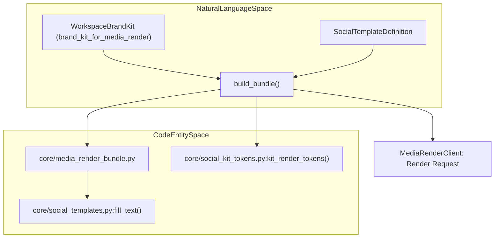
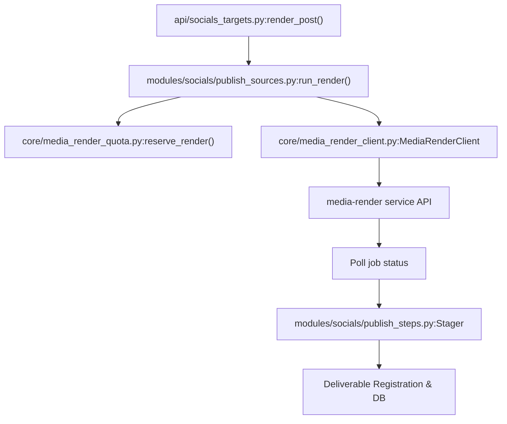
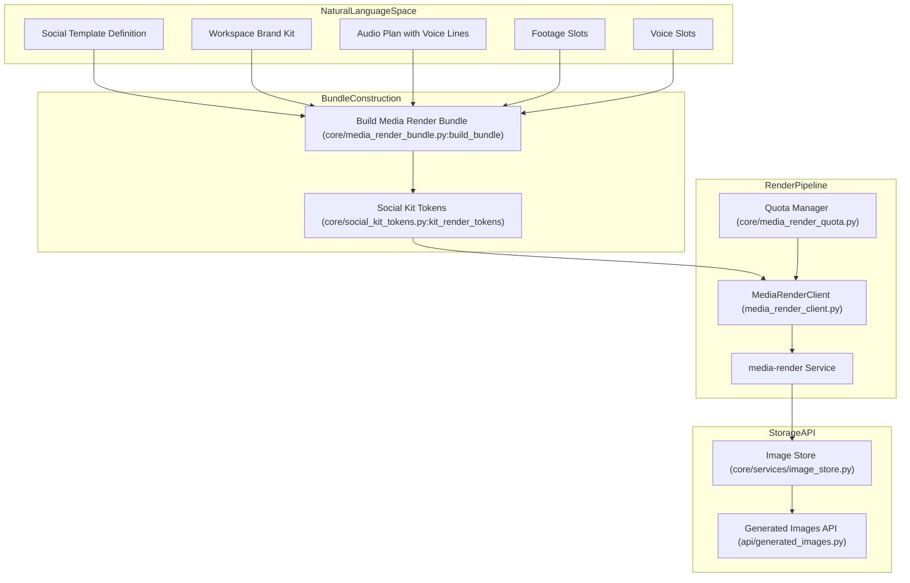

# Media Rendering & Generated Assets

<details>
<summary>Relevant source files</summary>

The following files were used as context for generating this wiki page:

- [docs/PRDS/PRD-264-EU-AI-ACT-ARTICLE-50.md](docs/PRDS/PRD-264-EU-AI-ACT-ARTICLE-50.md)
- [frontend/lib/ai/models.ts](frontend/lib/ai/models.ts)
- [frontend/lib/llm-defaults.ts](frontend/lib/llm-defaults.ts)
- [orchestrator/alembic/versions/prd264_blog_review.py](orchestrator/alembic/versions/prd264_blog_review.py)
- [orchestrator/api/blog.py](orchestrator/api/blog.py)
- [orchestrator/api/widgets/blog.py](orchestrator/api/widgets/blog.py)
- [orchestrator/core/font_stacks.py](orchestrator/core/font_stacks.py)
- [orchestrator/core/generation_guard.py](orchestrator/core/generation_guard.py)
- [orchestrator/core/llm/defaults.py](orchestrator/core/llm/defaults.py)
- [orchestrator/core/media_render_bundle.py](orchestrator/core/media_render_bundle.py)
- [orchestrator/core/services/blog_post_view.py](orchestrator/core/services/blog_post_view.py)
- [orchestrator/core/services/blog_review.py](orchestrator/core/services/blog_review.py)
- [orchestrator/core/services/blog_service.py](orchestrator/core/services/blog_service.py)
- [orchestrator/core/social_kit_tokens.py](orchestrator/core/social_kit_tokens.py)
- [orchestrator/modules/documents/brand_style.py](orchestrator/modules/documents/brand_style.py)
- [orchestrator/modules/documents/font_fallbacks.py](orchestrator/modules/documents/font_fallbacks.py)
- [orchestrator/modules/documents/templates/social/announcement-card.html](orchestrator/modules/documents/templates/social/announcement-card.html)
- [orchestrator/modules/documents/templates/social/brand-board.html](orchestrator/modules/documents/templates/social/brand-board.html)
- [orchestrator/modules/documents/templates/social/carousel.html](orchestrator/modules/documents/templates/social/carousel.html)
- [orchestrator/modules/documents/templates/social/carousel.json](orchestrator/modules/documents/templates/social/carousel.json)
- [orchestrator/modules/documents/templates/social/definition-card.html](orchestrator/modules/documents/templates/social/definition-card.html)
- [orchestrator/modules/documents/templates/social/fact-card.html](orchestrator/modules/documents/templates/social/fact-card.html)
- [orchestrator/modules/documents/templates/social/infographic.html](orchestrator/modules/documents/templates/social/infographic.html)
- [orchestrator/modules/documents/templates/social/quote-card.html](orchestrator/modules/documents/templates/social/quote-card.html)
- [orchestrator/modules/documents/templates/social/stats-card.html](orchestrator/modules/documents/templates/social/stats-card.html)
- [orchestrator/modules/documents/templates/social/title-card.html](orchestrator/modules/documents/templates/social/title-card.html)
- [orchestrator/modules/documents/templates/social/title-card.json](orchestrator/modules/documents/templates/social/title-card.json)
- [orchestrator/modules/socials/recipes/footage.py](orchestrator/modules/socials/recipes/footage.py)
- [orchestrator/modules/socials/recipes/footage_toolkits.py](orchestrator/modules/socials/recipes/footage_toolkits.py)
- [orchestrator/modules/socials/recipes/voice.py](orchestrator/modules/socials/recipes/voice.py)
- [orchestrator/modules/tools/discovery/actions_blog.py](orchestrator/modules/tools/discovery/actions_blog.py)
- [orchestrator/modules/tools/discovery/handlers_blog.py](orchestrator/modules/tools/discovery/handlers_blog.py)
- [orchestrator/scripts/seed_blog_playbook.py](orchestrator/scripts/seed_blog_playbook.py)
- [orchestrator/tests/conftest.py](orchestrator/tests/conftest.py)
- [orchestrator/tests/test_f253_let_auto_pick_renders.py](orchestrator/tests/test_f253_let_auto_pick_renders.py)
- [orchestrator/tests/test_f376_c_the_small_print_is_set_in_the_body_font.py](orchestrator/tests/test_f376_c_the_small_print_is_set_in_the_body_font.py)
- [orchestrator/tests/test_f376_d_a_font_stack_keeps_its_fallbacks.py](orchestrator/tests/test_f376_d_a_font_stack_keeps_its_fallbacks.py)
- [orchestrator/tests/test_prd251bw3_ai_options.py](orchestrator/tests/test_prd251bw3_ai_options.py)
- [orchestrator/tests/test_prd251w1_generate_tools.py](orchestrator/tests/test_prd251w1_generate_tools.py)
- [orchestrator/tests/test_prd251w1_render_lifecycle.py](orchestrator/tests/test_prd251w1_render_lifecycle.py)
- [orchestrator/tests/test_prd251w1_social_templates.py](orchestrator/tests/test_prd251w1_social_templates.py)
- [orchestrator/tests/test_prd264_art5_footage.py](orchestrator/tests/test_prd264_art5_footage.py)
- [orchestrator/tests/test_prd264_art5_generation_guard.py](orchestrator/tests/test_prd264_art5_generation_guard.py)
- [orchestrator/tests/test_prd264_euai08b_blog_review.py](orchestrator/tests/test_prd264_euai08b_blog_review.py)
- [orchestrator/tests/test_prd264_euai09_wiring.py](orchestrator/tests/test_prd264_euai09_wiring.py)

</details>


## Purpose and Scope
The Media Rendering & Generated Assets subsystem provides comprehensive backend services for multimedia content generation and management within Automatos AI. It orchestrates the preparation of rendering bundles, executes render pipelines via the `media-render` service, manages audio synthesis (e.g., Kokoro TTS), enforces workspace rendering quotas, and exposes APIs for generated media assets such as images and videos.

This subsystem bridges high-level content intents—expressed through social templates, brand kits, and audio plans (Natural Language Space)—to concrete rendering operations, asset storage, and delivery mechanisms (Code Entity Space). It handles composition, audio mixing, content credentials and provenance marking, validation, media storage, repair, and preview generation, supporting social publishing workflows at scale.

Sources: `orchestrator/core/media_render_bundle.py:1-82`(), `orchestrator/modules/socials/publish_sources.py:1-26`(), `orchestrator/api/socials_targets.py:1-10`()

---

## Media Render Bundle & Social Kit Tokens

### Overview
The render bundle encapsulates all the resources and variables needed by the `media-render` service to produce social posts or documents with embedded multimedia. It is assembled by merging workspace brand kits (fonts, colours, logos) with a social template's composition definition, associated audio plans, and dynamic slot media references [orchestrator/core/media_render_bundle.py:1-5]().

Brand kits are rendered into CSS custom properties named as `--brand-<token>`, isolating style tokens such as primary colours, fonts, type scale ratios, and brand accents [orchestrator/core/media_render_bundle.py:11-14](). Social kit tokens extend this with additional styling parameters to ensure still images align with the workspace's visual identity [orchestrator/core/social_kit_tokens.py:1-6]().

Footage slots and voice slots within the bundle support filling media URLs or voice audio files dynamically. The bundle supports removing empty slots to let motion graphics play when footage is unavailable and incorporates `keep_slots` to delay removal until files are ready [orchestrator/core/media_render_bundle.py:50-54]().

### Key Implementation Details
- **Brand Tokens & Colour Roles**  
  Colour tokens such as `primary`, `secondary`, `text`, and the palette's accent are defined in the bundle via CSS variables [orchestrator/core/media_render_bundle.py:100-104](). Contrast-aware derived colours (`ink`, `on-ink`, `primary-on-ink`, etc.) ensure WCAG-compliant text visibility across video and image backgrounds [orchestrator/core/media_render_bundle.py:16-19](). The type scale (display and body) is provided as ratios to default font sizes for dynamic layout adjustments [orchestrator/core/media_render_bundle.py:20-24](). The logo chip token determines what background shape is behind the logo on dark backgrounds (transparent or light colour) [orchestrator/core/media_render_bundle.py:28-29]().

- **Font Faces & Files**  
  The bundle includes uploaded brand fonts inline as `@font-face` declarations with base64 data URIs, falling back to built-in fonts of each family as necessary [orchestrator/core/media_render_bundle.py:35-39](). Tokens for `body-font`, `heading-font`, and `mono-font` guarantee consistent typography [orchestrator/core/media_render_bundle.py:106-107](), [orchestrator/core/social_kit_tokens.py:42-43]().

- **Slots and Footage**  
  Slots map slot names to presigned URLs for media files, enabling the renderer to insert user-provided images or videos [orchestrator/core/media_render_bundle.py:50-51](). Unfilled slots remove their DOM elements so static or animated graphics play in their place [orchestrator/core/media_render_bundle.py:51-52](). Slots intended to be kept are preserved until media arrives [orchestrator/core/media_render_bundle.py:53-54]().

- **Audio Plan & Kokoro TTS**  
  The bundle carries an audio plan with voiceline scripts. Voice lines are template text variables, substituted before rendering. Kokoro TTS is invoked within media-render to produce speech directly from these lines into audio assets [orchestrator/core/media_render_bundle.py:55-57, 73-77]().

- **Still Image Generation**  
  For social images, the bundle requests PNG snapshots at the defined "still moments" of videos. This supports carousel images and card stills [orchestrator/core/media_render_bundle.py:62-65]().

### Diagram: Bundle Construction Flow Bridging Natural Language to Code


Sources: `orchestrator/core/media_render_bundle.py:1-82`(), `orchestrator/core/social_kit_tokens.py:1-107`(), `orchestrator/core/social_templates.py:1-67`()

---

## Media Rendering Service & Pipelines

### Media Render Service Responsibilities
The `media-render` service executes the actual composition rendering, which includes:

- Parsing supplied bundles (HTML/CSS templates with slots and tokens) [services/media-render/media_render/bundle.py]()
- Overlaying provided footage, image, and audio assets into the composition [services/media-render/media_render/pipeline.py]()
- Performing audio rendering and mixing, including Kokoro TTS speech synthesis [services/media-render/media_render/tts.py]()
- Running music integration and audio normalization (e.g., LUFS normalization) [services/media-render/media_render/pipeline.py]()
- Probing rendered pixels for quality and validation checks [services/media-render/media_render/pipeline.py]()
- Embedding content credentials and cryptographic provenance metadata (e.g., C2PA/XMP AI transparency watermarks compliant with EU AI Act Article 50) [docs/PRDS/PRD-264-EU-AI-ACT-ARTICLE-50.md:1-40]()
- Rendering preview frames and generating still images or short video reels per the social template specifications [services/media-render/media_render/pipeline.py]()
- Validating media outputs using `hyperframes check` and reporting errors [services/media-render/media_render/pipeline.py]()

### Render Pipeline in Automatos Backend
The backend integrates with `media-render` over HTTP API calls:

- **Render Request Submission**  
  The social post render endpoint (`/api/socials/posts/{id}/render`) reserves quota and submits the bundle via `MediaRenderClient` [orchestrator/tests/test_prd251w1_render_lifecycle.py:34-35]().
  
- **Async Job Polling and Completion**  
  The backend polls the render job’s status until completion or error, then retrieves renders (video, images) and audio files [orchestrator/core/media_render_client.py:23-24]().

- **Post-Processing and Asset Storage**  
  Rendered outputs are verified (e.g., SHA-256 digest), stored in object storage, and mapped as `Deliverable` records for downstream use (e.g., publishing, preview) [orchestrator/modules/socials/publish_steps.py:117-128]().

- **Preview Generation**  
  The pipeline includes rendering short preview videos and small PNG frames at key moments, facilitating fast UI previews without full video download [orchestrator/core/media_render_client.py:24-25]().

- **Errors & Validation**  
  `hyperframes check` validates the render correctness. Validation failures yield informative error responses and prevent asset registration [orchestrator/core/media_render_client.py:89-90]().

### Diagram: Media Render Pipeline Flow


Sources: `orchestrator/api/socials_targets.py:1-10`(), `orchestrator/modules/socials/publish_sources.py:1-26`(), `orchestrator/core/media_render_quota.py:1-94`(), `orchestrator/core/media_render_client.py:1-32`(), `orchestrator/modules/socials/publish_steps.py:87-133`()

---

## Quota Management & Render Reservations

Quota enforcement is essential to control resource usage across workspaces.

- **Reservation per Render**  
  Each render request attempts to reserve an estimated number of rendering seconds (converted to minutes) against the workspace’s monthly quota [orchestrator/tests/test_prd251w1_social_templates.py:23-24]().

- **Preventing Overages and Concurrency**  
  If the reservation would exceed the workspace’s allowed minutes, a `RenderQuotaExceeded` error aborts the render early [orchestrator/core/media_render_quota.py:70-72]().

- **Quota Tracking**  
  The system tracks all render reservations, consumption, and remaining balances in PostgreSQL tables (not detailed here) [orchestrator/core/media_render_quota.py:1-94]().

Sources: `orchestrator/tests/test_prd251w1_social_templates.py:23-24`(), `orchestrator/core/media_render_quota.py:1-94`()

---

## Image Store and Generated Images API

### Image Store
The platform manages generated images and other media assets via a dedicated image store backed by object storage such as S3.

- Supports storage of generated images, thumbnails, and intermediate assets.
- Supports ranged requests to allow partial streaming or preview.
- Includes metadata and safety handling (e.g., MIME type and `nosniff` CSP headers).

### Generated Images API
- Public API endpoint `/api/generated-images/{image_id}` streams images using unguessable UUIDs.
- Supports HTTP Range requests with proper `206 Partial Content` responses.
- Contains safe headers to prevent execution or download abuse in browsers.

### Diagram: Generated Images API Flow Bridging Code Entities
```mermaid
graph TD
    Client["HTTP Client"] -->|GET /api/generated-images/{image_id}| API["orchestrator/api/generated_images.py:get_generated_image()"]
    API --> Store["core/services/image_store.py:get_image_store()"]
    Store --> ObjectStore["S3 / Backend Storage"]
    API --> Response["StreamingResponse with Range support"]
```

Sources: `orchestrator/api/generated_images.py:1-81`(), `orchestrator/core/services/image_store.py:1-40`()

---

## Footage and Voice Slots

### Footage Slots
Social templates may define footage slots representing video or image placeholders to be filled by users or processes [orchestrator/core/media_render_bundle.py:50-51]().

- The slots hold presigned URLs to video clips or images [orchestrator/core/media_render_bundle.py:50-51]().
- Slots can be left empty (elements removed from the composition) [orchestrator/core/media_render_bundle.py:51-52]().
- Footage generation recipes handle booking quota costs before generating or uploading footage assets using workspace-specific toolkits like Composio [orchestrator/modules/socials/capabilities.py:10-11](). The `plan_for` function in `modules.socials.recipes.footage` determines which slots need generation, which can be reused, and which fall back to motion graphics [orchestrator/modules/socials/recipes/footage.py:131-156](). The cost is checked against the post's cap and the workspace's monthly media cap before submission [orchestrator/modules/socials/recipes/footage.py:71-73]().

### Voice Slots & Audio Synthesis
Voice lines within audio plans can be synthesized via:

- **Kokoro TTS**: Built into the media-render service for on-the-fly speech from templated text lines [orchestrator/core/media_render_bundle.py:73-74]().
- **Connected Voice Toolkits**: Recipes can use ElevenLabs, Fish Audio, or other external voice providers, with synthesized audio uploaded to the media store under `assets/voice/` and referenced in the bundle during rendering [orchestrator/core/media_render_bundle.py:74-77](), [orchestrator/modules/socials/capabilities.py:14-15](). The `modules.socials.recipes.voice` module handles the generation of voice files, including cost estimation and booking [orchestrator/modules/socials/recipes/voice.py:1-10]().

The pipeline ensures that voice lines are properly named and no longer contain raw text once voice files replace them [orchestrator/core/media_render_bundle.py:76-77]().

Sources: `orchestrator/core/media_render_bundle.py:50-52, 73-77`(), `orchestrator/modules/socials/capabilities.py:10-11, 14-15`(), `orchestrator/modules/socials/recipes/footage.py:1-801`(), `orchestrator/modules/socials/recipes/voice.py:1-10`()

---

# Summary Diagram: From Natural Language to Code Entity Space in Media Rendering & Assets



Sources: `orchestrator/core/media_render_bundle.py:1-82`(), `orchestrator/core/social_kit_tokens.py:1-107`(), `orchestrator/core/media_render_client.py:1-32`(), `orchestrator/core/media_render_quota.py:1-94`(), `orchestrator/api/generated_images.py:1-81`(), `orchestrator/core/services/image_store.py:1-40`()

---