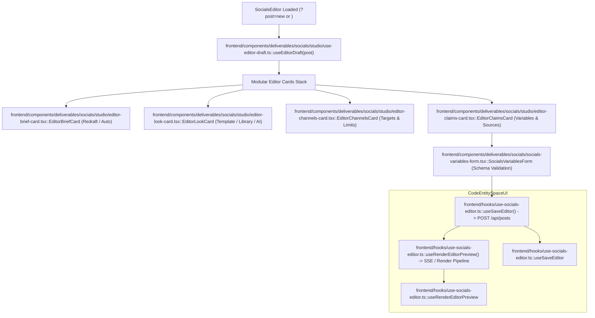

# Socials Composition & Templates

<details>
<summary>Relevant source files</summary>

The following files were used as context for generating this wiki page:

- [docs/PRDS/prd251b-w1-owner-test.md](docs/PRDS/prd251b-w1-owner-test.md)
- [frontend/components/deliverables/socials/__tests__/socials-auto-needs.test.ts](frontend/components/deliverables/socials/__tests__/socials-auto-needs.test.ts)
- [frontend/components/deliverables/socials/__tests__/socials-editor-harness.tsx](frontend/components/deliverables/socials/__tests__/socials-editor-harness.tsx)
- [frontend/components/deliverables/socials/__tests__/socials-editor-look.test.tsx](frontend/components/deliverables/socials/__tests__/socials-editor-look.test.tsx)
- [frontend/components/deliverables/socials/__tests__/socials-editor.test.tsx](frontend/components/deliverables/socials/__tests__/socials-editor.test.tsx)
- [frontend/components/deliverables/socials/__tests__/socials-fields-at-length.test.ts](frontend/components/deliverables/socials/__tests__/socials-fields-at-length.test.ts)
- [frontend/components/deliverables/socials/socials-channel-row.tsx](frontend/components/deliverables/socials/socials-channel-row.tsx)
- [frontend/components/deliverables/socials/socials-composer-model.ts](frontend/components/deliverables/socials/socials-composer-model.ts)
- [frontend/components/deliverables/socials/socials-variables-form.tsx](frontend/components/deliverables/socials/socials-variables-form.tsx)
- [frontend/components/deliverables/socials/studio/editor-brief-card.tsx](frontend/components/deliverables/socials/studio/editor-brief-card.tsx)
- [frontend/components/deliverables/socials/studio/editor-look-ai.tsx](frontend/components/deliverables/socials/studio/editor-look-ai.tsx)
- [frontend/components/deliverables/socials/studio/editor-look-card.tsx](frontend/components/deliverables/socials/studio/editor-look-card.tsx)
- [frontend/components/deliverables/socials/studio/editor-look-photo.tsx](frontend/components/deliverables/socials/studio/editor-look-photo.tsx)
- [frontend/components/deliverables/socials/studio/editor-look-sources.tsx](frontend/components/deliverables/socials/studio/editor-look-sources.tsx)
- [frontend/components/deliverables/socials/studio/socials-editor.tsx](frontend/components/deliverables/socials/studio/socials-editor.tsx)
- [frontend/hooks/use-socials-composer.ts](frontend/hooks/use-socials-composer.ts)
- [frontend/hooks/use-socials-editor.ts](frontend/hooks/use-socials-editor.ts)
- [orchestrator/api/socials_compose.py](orchestrator/api/socials_compose.py)
- [orchestrator/api/socials_media_upload.py](orchestrator/api/socials_media_upload.py)
- [orchestrator/core/social_cuts.py](orchestrator/core/social_cuts.py)
- [orchestrator/core/social_templates.py](orchestrator/core/social_templates.py)
- [orchestrator/modules/documents/field_requirements.py](orchestrator/modules/documents/field_requirements.py)
- [orchestrator/modules/documents/templates/social/app-promo.json](orchestrator/modules/documents/templates/social/app-promo.json)
- [orchestrator/modules/documents/templates/social/cinematic-product-promo.json](orchestrator/modules/documents/templates/social/cinematic-product-promo.json)
- [orchestrator/modules/documents/templates/social/data-story.html](orchestrator/modules/documents/templates/social/data-story.html)
- [orchestrator/modules/documents/templates/social/data-story.json](orchestrator/modules/documents/templates/social/data-story.json)
- [orchestrator/modules/documents/templates/social/ui-story-promo.json](orchestrator/modules/documents/templates/social/ui-story-promo.json)
- [orchestrator/modules/socials/compose.py](orchestrator/modules/socials/compose.py)
- [orchestrator/modules/socials/compose_checks.py](orchestrator/modules/socials/compose_checks.py)
- [orchestrator/modules/socials/compose_facts.py](orchestrator/modules/socials/compose_facts.py)
- [orchestrator/modules/socials/compose_given.py](orchestrator/modules/socials/compose_given.py)
- [orchestrator/modules/socials/compose_sources.py](orchestrator/modules/socials/compose_sources.py)
- [orchestrator/modules/socials/media_store.py](orchestrator/modules/socials/media_store.py)
- [orchestrator/modules/socials/template_gallery.py](orchestrator/modules/socials/template_gallery.py)
- [orchestrator/tests/test_f377_a_cut_asks_only_for_what_it_shows.py](orchestrator/tests/test_f377_a_cut_asks_only_for_what_it_shows.py)
- [orchestrator/tests/test_f377_a_figure_written_as_text_is_a_number.py](orchestrator/tests/test_f377_a_figure_written_as_text_is_a_number.py)
- [orchestrator/tests/test_f377_no_seeded_video_default_sells_automatos.py](orchestrator/tests/test_f377_no_seeded_video_default_sells_automatos.py)
- [orchestrator/tests/test_f377_the_data_story_is_a_business_numbers_story.py](orchestrator/tests/test_f377_the_data_story_is_a_business_numbers_story.py)
- [orchestrator/tests/test_f377_the_software_videos_say_whom_they_are_for.py](orchestrator/tests/test_f377_the_software_videos_say_whom_they_are_for.py)
- [orchestrator/tests/test_f378_c_compose_adds_no_fact_nobody_gave.py](orchestrator/tests/test_f378_c_compose_adds_no_fact_nobody_gave.py)
- [orchestrator/tests/test_f378_d_compose_fills_every_field_or_asks.py](orchestrator/tests/test_f378_d_compose_fills_every_field_or_asks.py)
- [orchestrator/tests/test_f378_g_a_claims_source_holds_its_figure.py](orchestrator/tests/test_f378_g_a_claims_source_holds_its_figure.py)
- [orchestrator/tests/test_prd251bw1_compose.py](orchestrator/tests/test_prd251bw1_compose.py)
- [orchestrator/tests/test_prd251bw1_cuts.py](orchestrator/tests/test_prd251bw1_cuts.py)
- [orchestrator/tests/test_prd251bw1_durations.py](orchestrator/tests/test_prd251bw1_durations.py)
- [orchestrator/tests/test_prd251bw1_upload.py](orchestrator/tests/test_prd251bw1_upload.py)
- [orchestrator/tests/test_prd251bw3_plan_visuals.py](orchestrator/tests/test_prd251bw3_plan_visuals.py)
- [orchestrator/tests/test_prd251w1_seeded_templates.py](orchestrator/tests/test_prd251w1_seeded_templates.py)
- [orchestrator/tests/test_prd251w2_brand_neutral_templates.py](orchestrator/tests/test_prd251w2_brand_neutral_templates.py)
- [orchestrator/tests/test_prd251w2_compose.py](orchestrator/tests/test_prd251w2_compose.py)
- [orchestrator/tests/test_prd251w3_youtube.py](orchestrator/tests/test_prd251w3_youtube.py)
- [orchestrator/tests/test_socials_compose_fills_every_field.py](orchestrator/tests/test_socials_compose_fills_every_field.py)
- [scripts/ci/social_reference_text.json](scripts/ci/social_reference_text.json)
- [scripts/ci/social_template_previews.py](scripts/ci/social_template_previews.py)

</details>


## Purpose and Scope

The **Socials Composition & Templates** subsystem (governed by PRD-251 and PRD-251B) provides an automated pipeline that converts brief text entries into structured, brand-aligned social post draft proposals [orchestrator/modules/socials/compose.py:1-27](). It orchestrates single or multi-round LLM model calls via the platform's LLM manager, enforces strict guardrails against hallucinated data or template schema violations, manages interactive template galleries, extracts dynamic field requirements, and powers the Studio post editor and variables configuration UI.

---

## 1. Composition Service & Model Pipeline

The composition service acts as the bridge between raw user briefs and fully realized social draft payloads. Entry points reside in `orchestrator/api/socials_compose.py` via `POST /api/socials/compose`, which triggers the backend composing engine in `orchestrator/modules/socials/compose.py` [orchestrator/api/socials_compose.py:5-15]().

### Request Handling & Constraints
- **Request Schema (`ComposeRequest`)**: Validates input parameters including the raw `brief` (up to 4,000 characters), selected `channels` (capped at 10), post `format` (`image`, `video`, `text`), specific `template_id`, and `length_seconds` [orchestrator/api/socials_compose.py:77-87]().
- **Workspace Scoping**: Templates are queried strictly within the active workspace context, filtering for active social formats (`social_image` or `social_video`) and excluding archived designs [orchestrator/api/socials_compose.py:102-115]().
- **Usage Tracking**: LLM invocation calls track metrics under `request_type='socials_compose'` [orchestrator/modules/socials/compose.py:3-5]().

### Multi-Round Filling and Budgets
When an initial model output leaves required variables empty or incomplete, the composition service performs iterative follow-up calls (`_filled`) up to `FILL_ROUNDS` (3 rounds) within a strict call budget `PROPOSE_BUDGET_CALLS` (4 calls) and batch limit `FILL_BATCH` (25 variables per call) [orchestrator/modules/socials/compose.py:18-26, 71-76]().

```mermaid
graph TD
    A["POST /api/socials/compose"] -->| "ComposeRequest" | B["orchestrator/api/socials_compose.py"]
    B -->| "social_templates()" | C["Workspace DocumentTemplates DB"]
    B -->| "create_llm_manager()" | D["orchestrator/modules/socials/compose.py::propose"]
    D -->| "generate_response()" | E{"Model JSON Output Valid?"}
    E -- No --> F["compose_checks.py Retry / 502"]
    E -- Yes --> G["compose_facts.py & compose_given.py"]
    G --> H{"Required Fields Missing?"}
    H -- Yes --> I["Iterative Fill Rounds (FILL_ROUNDS)"]
    I --> D
    H -- No --> J["Draft Proposal Returned (Unsaved)"]

    subgraph CodeEntitySpace
    C -->| "Query Model" | DBModel["core.models.core.DocumentTemplate"]
    D -->| "Execution" | ComposeService["modules.socials.compose.py::propose"]
    G -->| "Validation" | ChecksEngine["modules.socials.compose_facts.py::checked"]
    end
```
Sources: [orchestrator/modules/socials/compose.py:1-40](), [orchestrator/api/socials_compose.py:77-115](), [orchestrator/tests/test_prd251w2_compose.py:81-115]()

---

## 2. Fact Validation & Anti-Hallucination Pipeline

To prevent models from inventing facts, names, figures, or product details, proposals pass through rigorous post-processing validation layers defined in `orchestrator/modules/socials/compose_facts.py`, `compose_checks.py`, `compose_given.py`, and `compose_sources.py` [orchestrator/modules/socials/compose.py:7-15](), [orchestrator/modules/socials/compose_facts.py:1-25]().

### Validation Components
- **Placeholder Detection (`copy_placeholders`)**: Scans copy channels for leftover brackets like `{name}` or `[placeholder]` and emits warnings or owner questions [orchestrator/modules/socials/compose_facts.py:47-65]().
- **Fact Scoping (`compose_given.py`)**: Restricts numeric values, handles, and metrics to those explicitly present in the brief, current take, or bound source references. Unverified claims are stripped or flagged [orchestrator/modules/socials/compose_facts.py:10-15]().
- **Source Binding (`compose_sources.py`)**: Ensures every claim links directly to a verified candidate source (metrics, reports, documents). Orphaned claims lose their source attribution without discarding the core text [orchestrator/modules/socials/compose_facts.py:16-21]().
- **Length-Based Field Cuts (`core/social_cuts.py`)**: Shorter video cuts or specific aspect ratios exclude fields that are not rendered in that layout tier [orchestrator/modules/documents/field_requirements.py:16-18]().

```mermaid
graph TD
    RawProposal["Raw LLM JSON Response"] --> ShapeCheck["orchestrator/modules/socials/compose_checks.py::check_proposal"]
    ShapeCheck --> FactValidation["orchestrator/modules/socials/compose_facts.py::checked"]
    
    FactValidation -->| "Check 1" | P1["Placeholder Scan: compose_facts.py::copy_placeholders"]
    FactValidation -->| "Check 2" | P2["Fact Verification: compose_given.py::given_facts"]
    FactValidation -->| "Check 3" | P3["Source Binding: compose_sources.py::sources_for_claims"]
    FactValidation -->| "Check 4" | P4["Required Field Filter: compose_facts.py::without_blank_required"]

    P1 --> FinalProposal["Checked Proposal (Warnings & Questions)"]
    P2 --> FinalProposal
    P3 --> FinalProposal
    P4 --> FinalProposal
```
Sources: [orchestrator/modules/socials/compose_facts.py:1-115](), [orchestrator/modules/socials/compose_checks.py:1-35]()

---

## 3. Template Gallery & Social HTML Templates

Social templates dictate the visual and structural layout of rendered posts. The template gallery (`orchestrator/modules/socials/template_gallery.py`) inspects workspace document templates, extracting slot configurations, durations, and sample data [orchestrator/modules/socials/template_gallery.py:1-20]().

### Key Gallery & Slot Functions
- `durations_of`: Determines allowed video lengths in seconds from `blocks.durations` or root `data-duration` [orchestrator/modules/socials/template_gallery.py:46-58]().
- `footage_slots`: Identifies b-roll and hook video slots available for AI generation or manual overrides [orchestrator/modules/socials/template_gallery.py:60-65]().
- `image_slots`: Filters slots restricted to still image assets (e.g., product photos, before-and-after shots) [orchestrator/modules/socials/template_gallery.py:67-72]().
- `thumbnail_link`: Presigns inline thumbnail storage URLs via `MediaStore` for secure UI preview rendering [orchestrator/modules/socials/template_gallery.py:87-101]().

### Social HTML Templates Catalog
The backend includes a library of responsive HTML templates (`orchestrator/modules/documents/templates/social/`) built for high-fidelity rendering with GSAP animations and dynamic CSS token injection:
- `announcement-card.html`: Clean typographic layout with dark announcement pills and configurable brand accent bars [orchestrator/modules/documents/templates/social/announcement-card.html:1-45]().
- `definition-card.html`: Terminology and concept layout highlighting term headings and definition sublines [orchestrator/modules/documents/templates/social/definition-card.html:1-45]().
- `carousel.html`: Multi-point carousel framework supporting sequential cover, item, and close points [orchestrator/modules/documents/templates/social/carousel.html:1-45]().
- `infographic.html`: Data-driven chart layout extracting rows from reports to render clean visual bars or number grids [orchestrator/modules/documents/templates/social/infographic.html:1-48]().
- `before-after.html`: Side-by-side photo comparison layout with ink-graded overlay panels [orchestrator/modules/documents/templates/social/before-after.html:1-40]().
- `fact-card.html`: A simple card for presenting a single fact or statistic.
- `photo-headline.html`: Combines a prominent image with a headline overlay.
- `photo-highlights.html`: Displays an image with multiple textual highlights.
- `photo-offer.html`: Features an image alongside a promotional offer.
- `photo-only.html`: A template for image-centric posts with minimal text.
- `photo-review.html`: Presents an image with a customer review or testimonial.
- `quote-card.html`: Designed for displaying quotes with attribution.
- `stats-card.html`: Focuses on presenting key statistics.
- `title-card.html`: A simple card for a title or short announcement.
- `brand-board.html`: A template for displaying brand kit elements.
- `app-promo.json`: A video template specifically for promoting phone applications, featuring multiple footage slots and variable schemas for app-specific content [orchestrator/modules/documents/templates/social/app-promo.json:1-243]().
- `ui-story-promo.json`: A video template for software products, focusing on UI screens and animated elements [orchestrator/modules/documents/templates/social/ui-story-promo.json:1-233]().
- `cinematic-product-promo.json`: A video template for cinematic product promotions.
- `data-story.json`: A video template for telling data-driven stories.

Sources: [orchestrator/modules/socials/template_gallery.py:1-128](), [orchestrator/modules/documents/templates/social/infographic.html:1-48](), [orchestrator/modules/documents/templates/social/announcement-card.html:1-45](), [orchestrator/modules/documents/templates/social/fact-card.html](), [orchestrator/modules/documents/templates/social/photo-headline.html](), [orchestrator/modules/documents/templates/social/photo-highlights.html](), [orchestrator/modules/documents/templates/social/photo-offer.html](), [orchestrator/modules/documents/templates/social/photo-only.html](), [orchestrator/modules/documents/templates/social/photo-review.html](), [orchestrator/modules/documents/templates/social/quote-card.html](), [orchestrator/modules/documents/templates/social/stats-card.html](), [orchestrator/modules/documents/templates/social/title-card.html](), [orchestrator/modules/documents/templates/social/brand-board.html](), [orchestrator/modules/documents/templates/social/app-promo.json:1-243](), [orchestrator/modules/documents/templates/social/ui-story-promo.json:1-233](), [orchestrator/modules/documents/templates/social/cinematic-product-promo.json](), [orchestrator/modules/documents/templates/social/data-story.json]()

---

## 4. Field Requirements Engine

Field requirements are computed statically via `orchestrator/modules/documents/field_requirements.py` to ensure consistency between the Studio UI editor and agent tool definitions (`platform_get_template_schema`) [orchestrator/modules/documents/field_requirements.py:1-12]().

### Requirement Categorization
- **`required_fields`**: Mandatory paths that block rendering or saving when left empty (unless assigned a default value) [orchestrator/modules/documents/field_requirements.py:3-10]().
- **`fallback_fields`**: Optional variables associated with Jinja fallbacks (`default('...')`) printed automatically when values are omitted [orchestrator/modules/documents/field_requirements.py:3-15]().
- **`tables`**: Structured data grids (`DataTableBlock`) specifying column keys, optional columns, and table-level validation rules [orchestrator/modules/documents/field_requirements.py:51-62]().
- **Social Cut Requirements**: Integrates with `core.social_cuts` to calculate length-specific schema subsets for video clips [orchestrator/modules/documents/field_requirements.py:16-18]().

Sources: [orchestrator/modules/documents/field_requirements.py:1-150]()

---

## 5. Socials Editor & Variables Form UI

The frontend components in `frontend/components/deliverables/socials/studio/socials-editor.tsx` and `socials-variables-form.tsx` power the interactive editing experience for social posts (`?post=new` or `?post=<id>`) [frontend/components/deliverables/socials/studio/socials-editor.tsx:1-15]().

### Editor Workflow
1. **Header Controls**: Manages actions for saving drafts (`POST` / `PATCH`), rendering previews, and submitting items for approval [frontend/components/deliverables/socials/studio/socials-editor.tsx:4-10]().
2. **Modular Cards**: Structured component stack including Brief Card (with Auto redrafting), Format Card, Channels & Sizes Card, Look Card (template selector, library picker, AI generator), Claims & Sources Card, and When Card [frontend/components/deliverables/socials/studio/socials-editor.tsx:24-32]().
3. **Dynamic Variables Form (`socials-variables-form.tsx`)**: Renders input fields based on the active template schema and length constraints, greying in sample data examples for empty fields [orchestrator/modules/socials/template_gallery.py:14-18]().
4. **Draft Continuity (`useEditorDraft`)**: Automatically retains created post IDs (`created.current`) so subsequent edit failures or preview requests update the existing post rather than generating duplicates [frontend/components/deliverables/socials/studio/socials-editor.tsx:75-91]().


Sources: [frontend/components/deliverables/socials/studio/socials-editor.tsx:1-126]()

---