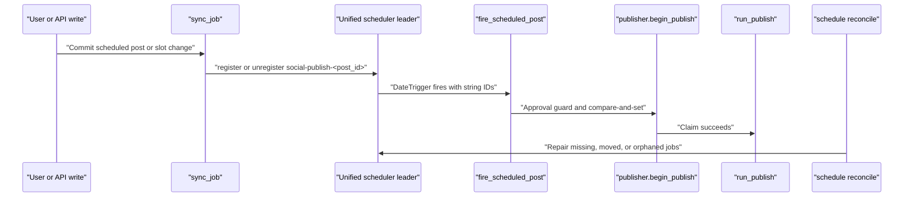
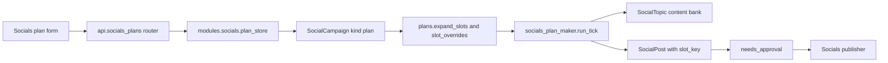

# Socials Publishing, Targets & Plans

Relevant source files

The following files were used as context for generating this wiki page:

- [frontend/components/deliverables/socials/__tests__/socials-plan-model.test.ts](frontend/components/deliverables/socials/__tests__/socials-plan-model.test.ts)
- [frontend/components/deliverables/socials/__tests__/socials-plan-with-auto.test.tsx](frontend/components/deliverables/socials/__tests__/socials-plan-with-auto.test.tsx)
- [frontend/components/deliverables/socials/__tests__/socials-plans.test.tsx](frontend/components/deliverables/socials/__tests__/socials-plans.test.tsx)
- [frontend/components/deliverables/socials/plans/plan-model.ts](frontend/components/deliverables/socials/plans/plan-model.ts)
- [frontend/components/deliverables/socials/plans/plan-page.tsx](frontend/components/deliverables/socials/plans/plan-page.tsx)
- [frontend/components/deliverables/socials/plans/plan-rhythm.ts](frontend/components/deliverables/socials/plans/plan-rhythm.ts)
- [frontend/components/deliverables/socials/plans/plan-step-bank.tsx](frontend/components/deliverables/socials/plans/plan-step-bank.tsx)
- [frontend/components/deliverables/socials/plans/plan-step-making.tsx](frontend/components/deliverables/socials/plans/plan-step-making.tsx)
- [frontend/components/deliverables/socials/plans/plan-step-research.tsx](frontend/components/deliverables/socials/plans/plan-step-research.tsx)
- [frontend/components/deliverables/socials/plans/socials-plans-view.tsx](frontend/components/deliverables/socials/plans/socials-plans-view.tsx)
- [frontend/hooks/use-socials-plans.ts](frontend/hooks/use-socials-plans.ts)
- [frontend/lib/socials-plan-types.ts](frontend/lib/socials-plan-types.ts)
- [orchestrator/api/socials_media_tools.py](orchestrator/api/socials_media_tools.py)
- [orchestrator/api/socials_plans.py](orchestrator/api/socials_plans.py)
- [orchestrator/api/socials_publish.py](orchestrator/api/socials_publish.py)
- [orchestrator/api/socials_topics.py](orchestrator/api/socials_topics.py)
- [orchestrator/core/boot/reaper.py](orchestrator/core/boot/reaper.py)
- [orchestrator/core/composio/tool_executor.py](orchestrator/core/composio/tool_executor.py)
- [orchestrator/core/composio/upload_spec.py](orchestrator/core/composio/upload_spec.py)
- [orchestrator/modules/socials/ai_options.py](orchestrator/modules/socials/ai_options.py)
- [orchestrator/modules/socials/batches.py](orchestrator/modules/socials/batches.py)
- [orchestrator/modules/socials/media_tools.py](orchestrator/modules/socials/media_tools.py)
- [orchestrator/modules/socials/notify.py](orchestrator/modules/socials/notify.py)
- [orchestrator/modules/socials/plan_notify.py](orchestrator/modules/socials/plan_notify.py)
- [orchestrator/modules/socials/plan_store.py](orchestrator/modules/socials/plan_store.py)
- [orchestrator/modules/socials/plan_visuals.py](orchestrator/modules/socials/plan_visuals.py)
- [orchestrator/modules/socials/plans.py](orchestrator/modules/socials/plans.py)
- [orchestrator/modules/socials/publish_lifecycle.py](orchestrator/modules/socials/publish_lifecycle.py)
- [orchestrator/modules/socials/publish_records.py](orchestrator/modules/socials/publish_records.py)
- [orchestrator/modules/socials/publisher.py](orchestrator/modules/socials/publisher.py)
- [orchestrator/modules/socials/publishing.py](orchestrator/modules/socials/publishing.py)
- [orchestrator/modules/socials/schedule_jobs.py](orchestrator/modules/socials/schedule_jobs.py)
- [orchestrator/services/socials_plan_maker.py](orchestrator/services/socials_plan_maker.py)
- [orchestrator/tests/test_a_restart_orphan_is_failed_not_done.py](orchestrator/tests/test_a_restart_orphan_is_failed_not_done.py)
- [orchestrator/tests/test_composio_upload_takes_the_canonical_tool_slug.py](orchestrator/tests/test_composio_upload_takes_the_canonical_tool_slug.py)
- [orchestrator/tests/test_playbook_restart_durability.py](orchestrator/tests/test_playbook_restart_durability.py)
- [orchestrator/tests/test_prd251_service.py](orchestrator/tests/test_prd251_service.py)
- [orchestrator/tests/test_prd251bw2_plans.py](orchestrator/tests/test_prd251bw2_plans.py)
- [orchestrator/tests/test_prd251bw3_brand_style.py](orchestrator/tests/test_prd251bw3_brand_style.py)
- [orchestrator/tests/test_prd251bw3_media_tools.py](orchestrator/tests/test_prd251bw3_media_tools.py)
- [orchestrator/tests/test_prd251cw2_batches.py](orchestrator/tests/test_prd251cw2_batches.py)
- [orchestrator/tests/test_prd251w2_approval_notify.py](orchestrator/tests/test_prd251w2_approval_notify.py)
- [orchestrator/tests/test_prd251w3_publisher.py](orchestrator/tests/test_prd251w3_publisher.py)
- [orchestrator/tests/test_prd251w3_recovery.py](orchestrator/tests/test_prd251w3_recovery.py)
- [orchestrator/tests/test_prd251w3_schedule.py](orchestrator/tests/test_prd251w3_schedule.py)
- [orchestrator/tests/test_prd251w3_send_once.py](orchestrator/tests/test_prd251w3_send_once.py)
- [orchestrator/tests/test_w1s6_boot_reaper.py](orchestrator/tests/test_w1s6_boot_reaper.py)
- [orchestrator/tests/test_w2s6_restart_recovery_realdb.py](orchestrator/tests/test_w2s6_restart_recovery_realdb.py)

## Purpose and Scope

This page documents the PRD-251 socials publishing and planning paths: channel capability data, target publish steps, Composio action checks, scheduled-post jobs and recovery, plan cadence and topic-bank settings, and the frontend plans and queue surfaces. The available implementation excerpts establish the plan API and scheduler behavior directly; publisher details below are limited to behavior described by the publisher tests. [orchestrator/api/socials_plans.py:5-40](), [orchestrator/modules/socials/schedule_jobs.py:1-31](), [orchestrator/tests/test_prd251w3_publisher.py:1-21]()

Sources: [orchestrator/api/socials_plans.py:5-40](), [orchestrator/modules/socials/schedule_jobs.py:1-31](), [orchestrator/tests/test_prd251w3_publisher.py:1-21]()

---

## 1. Channel Adapters & Capabilities

A publishing target identifies a Composio toolkit and post kind. The publisher test harness builds stored steps for a target from `SEEDED_CHANNELS[toolkit].kinds[kind]`, using `step_plan` to convert each step for storage. This ties channel-specific publishing sequences to seeded channel definitions rather than treating every platform as one generic action. [orchestrator/tests/test_prd251w3_publisher.py:60-64](), [orchestrator/tests/test_prd251w3_publisher.py:142-148]()

The same test module imports `parse_channel_adapters` and `SEEDED_CHANNELS` from `modules.socials.capabilities`; however, the provided excerpt does not show their implementation or enumerate the complete adapter and capability catalog. [orchestrator/tests/test_prd251w3_publisher.py:59-64]()

**Natural-language request to code entities**

Sources: [orchestrator/tests/test_prd251w3_publisher.py:59-64](), [orchestrator/tests/test_prd251w3_publisher.py:142-148]()

---

## 2. Publishing Pipeline: Steps, Sources, and Records

The publisher test contract covers an approved post with one or more targets. Approval is checked before any publish call: a stale approval publishes nothing, while a post claimed once publishes once, including under concurrent claims. The tests also cover transient retries up to `SOCIALS_MAX_TARGET_ATTEMPTS`, no retry for a 4xx response, and preservation of the platform’s error message. [orchestrator/tests/test_prd251w3_publisher.py:8-13]()

When one target succeeds and another fails, the post can end as `partially_published` and trigger a notice. A retry operates only on the failed target. These behaviors make the target, rather than the whole post, the unit of retry in the tested flow. [orchestrator/tests/test_prd251w3_publisher.py:11-13]()

The test harness imports `SocialPost`, `SocialPostTarget`, `Runtime`, `run_publish`, and the publisher modules. Its `FakeExecutor.execute_with_uploads` records each action, parameter set, upload-parameter list, execution path (`way_through`), application name, and workspace ID, enabling tests to inspect calls without invoking Composio. [orchestrator/tests/test_prd251w3_publisher.py:52-64](), [orchestrator/tests/test_prd251w3_publisher.py:92-112]()

### Composio file uploads

`tool_executor.py` declares `UPLOAD_ACTIONS` for selected Twitter and LinkedIn media/post actions. `resolve_file_uploads` returns parameters unchanged for actions outside that set; the shown code also skips already-resolved dictionaries containing `s3key`. [orchestrator/core/composio/tool_executor.py:38-51](), [orchestrator/core/composio/tool_executor.py:126-141](), [orchestrator/core/composio/tool_executor.py:156-162]()

For URL references, the resolver creates a Composio `FileUploadable` with the action’s tool slug and toolkit. For workspace paths, it downloads through `WorkspaceClient`, writes a temporary file, and creates a `FileUploadable` from that path. [orchestrator/core/composio/tool_executor.py:71-98](), [orchestrator/core/composio/tool_executor.py:100-123]()

Sources: [orchestrator/tests/test_prd251w3_publisher.py:8-18](), [orchestrator/tests/test_prd251w3_publisher.py:52-64](), [orchestrator/core/composio/tool_executor.py:38-51]()

### LinkedIn media scope

LinkedIn publishing is covered by a dedicated sequence test harness. The executor’s upload-action set includes LinkedIn post and image-upload actions. `resolve_file_uploads` is decorated with `leaves_its_images_to_the_direct_api`; the code comment identifies this as a LinkedIn direct-API workaround. The provided excerpt does not show that decorator’s implementation or the complete LinkedIn sequence. [orchestrator/tests/test_prd251w3_publisher.py:1-7](), [orchestrator/core/composio/tool_executor.py:33-33](), [orchestrator/core/composio/tool_executor.py:41-51](), [orchestrator/core/composio/tool_executor.py:126-136]()

Sources: [orchestrator/tests/test_prd251w3_publisher.py:1-7](), [orchestrator/core/composio/tool_executor.py:33-33](), [orchestrator/core/composio/tool_executor.py:41-51](), [orchestrator/core/composio/tool_executor.py:126-136]()

---

## 3. Composio Deny List & Action Security

`ComposioToolExecutor` imports `composio_action_denial_async` and `denied_result` from `core.composio.deny_list`, and imports `refused_result` from `post_gate`. The publisher tests specify the ordering contract: the deny list and post gate run before any upload. [orchestrator/core/composio/tool_executor.py:25-33](), [orchestrator/tests/test_prd251w3_publisher.py:14-16]()

The test contract also checks that only named parameters are converted for uploads and that actions outside `UPLOAD_ACTIONS` remain untouched. The available excerpts do not include the deny-list implementation, the settings interface for editing it, or the exact LinkedIn permission/scope configuration; those details should not be inferred from these files. [orchestrator/tests/test_prd251w3_publisher.py:14-16](), [orchestrator/core/composio/tool_executor.py:41-51]()

| Publish boundary | Code entity or contract | Documented behavior |
|---|---|---|
| Before upload | `composio_action_denial_async`, `post_gate` | Tests require both checks before upload processing. [orchestrator/core/composio/tool_executor.py:28-30](), [orchestrator/tests/test_prd251w3_publisher.py:14-16]() |
| File-action selection | `UPLOAD_ACTIONS` | Only the enumerated action slugs enter the upload resolver. [orchestrator/core/composio/tool_executor.py:41-51](), [orchestrator/core/composio/tool_executor.py:138-141]() |
| Upload resolution | `resolve_file_uploads` | Existing `s3key` dictionaries are skipped; URL and workspace-file references are handled by separate paths. [orchestrator/core/composio/tool_executor.py:89-123](), [orchestrator/core/composio/tool_executor.py:156-162]() |

Sources: [orchestrator/core/composio/tool_executor.py:25-33](), [orchestrator/core/composio/tool_executor.py:41-51](), [orchestrator/core/composio/tool_executor.py:89-123](), [orchestrator/tests/test_prd251w3_publisher.py:14-16]()

---

## 4. Scheduling Jobs, Execution, and Recovery

### Scheduled-post jobs

Each scheduled post has an APScheduler `DateTrigger` job named `social-publish-<post_id>`. The job invokes the module-level `fire_scheduled_post` function with string post and workspace IDs, which allows the Redis job store to serialize the job arguments. The unified scheduler is leader-controlled; a worker without the running scheduler does not register the job itself. [orchestrator/modules/socials/schedule_jobs.py:1-7](), [orchestrator/modules/socials/schedule_jobs.py:87-99](), [orchestrator/modules/socials/schedule_jobs.py:113-119]()

After a committed write, `sync_job` registers or replaces a job for a scheduled post with a slot, or removes the job when the post is no longer scheduled. If this worker is not the scheduler leader, the reconcile pass catches up: it adds missing jobs, moves jobs whose slots changed, and removes jobs for posts that are no longer scheduled. [orchestrator/modules/socials/schedule_jobs.py:9-15](), [orchestrator/modules/socials/schedule_jobs.py:132-145]()

A fired job claims the post through `publisher.begin_publish`, using the same approval guard and compare-and-set behavior as “publish now,” before running the publisher. This is intended to make duplicate fires and races with a user-triggered publish publish only once. [orchestrator/modules/socials/schedule_jobs.py:16-19]()

### Missed slots and lost publishes

A post is marked `missed` rather than silently published if the job fires beyond `SOCIALS_MISFIRE_GRACE_SECONDS`, Socials is off for the workspace, or its approval no longer matches. The documented missed cases also include a video whose AI-generated label disagrees with the post. A missed post can be rescheduled or published now while its approval still matches. [orchestrator/modules/socials/schedule_jobs.py:20-25](), [orchestrator/modules/socials/schedule_jobs.py:63-65]()

The schedule reconciliation pass can end a post that remains `publishing` beyond its run limit plus `LOST_MARGIN_SECONDS`; `end_lost` writes the end of the publish record. The scheduler module’s documentation also says the boot reaper handles posts it finds in this lost state. [orchestrator/modules/socials/schedule_jobs.py:26-30](), [orchestrator/modules/socials/schedule_jobs.py:61-62]()

### Boot-time recovery

The boot reaper handles a social post stuck in `rendering`: it marks the post `failed` and records the reason in its `review_log`, allowing it to be edited and rendered again. Separately, the scheduler’s lost-publish handling concerns posts stuck in `publishing`; these are different recovery cases. [orchestrator/core/boot/reaper.py:15-20](), [orchestrator/modules/socials/schedule_jobs.py:26-30]()

**Natural-language schedule lifecycle to code entities**

Sources: [orchestrator/modules/socials/schedule_jobs.py:1-19](), [orchestrator/modules/socials/schedule_jobs.py:87-99](), [orchestrator/modules/socials/schedule_jobs.py:132-145]()

---

## 5. Socials Plans, Campaigns, and Content Bank

A plan is a `SocialCampaign` with kind `plan`. Plans hold dates, timezone, cadence, research settings, make settings, and late-slot behavior. `plan_store` scopes plan reads to the workspace and leaves transaction commits to the caller. [orchestrator/api/socials_plans.py:5-19](), [orchestrator/modules/socials/plans.py:1-17](), [orchestrator/modules/socials/plan_store.py:1-10]()

### Plan API and validation

The plans router supports listing and creating plans, reading and updating a plan, pausing/resuming/ending, deletion, draft generation, research, slot reads and overrides, and batch approval. Reads and writes are workspace-scoped; the router documentation says another workspace’s plan is returned as 404. Plan routes are included through the Socials router rather than mounted directly, because the Socials router supplies the feature gate. [orchestrator/api/socials_plans.py:5-40]()

The API models define strict input shapes. A `CadenceRow` specifies channels, format, days, time, optional template and video length, optional post kind, and an optional row-level visual. `PlanSources` selects knowledge, deliverables, website, and GitHub sources, and carries notes and `never_say` entries. `PlanResearch` includes a repeat window constrained from 1 to `MAX_REPEAT_AFTER_DAYS`. [orchestrator/api/socials_plans.py:81-113](), [orchestrator/api/socials_plans.py:92-104](), [orchestrator/api/socials_plans.py:128-134]()

The plan model supports `daily`, `weekly`, and `monthly` rhythms. A new plan defaults to weekly at Sunday 17:00 unless it explicitly asks for daily; legacy plans with no rhythm are treated as daily. The plan store validates fields before applying them and refuses updates to ended plans. [orchestrator/modules/socials/plans.py:39-62](), [orchestrator/modules/socials/plan_store.py:84-102](), [orchestrator/modules/socials/plan_store.py:110-115](), [orchestrator/modules/socials/plan_store.py:127-134]()

### Slots, batches, and topic repetition

`expand_slots` expands cadence rows into local-time slots. Each slot key has the form `<row id>|<YYYY-MM-DD>|<HH:MM>` and is unique within the plan; slot overrides can move or skip a slot without changing the cadence. [orchestrator/modules/socials/plans.py:7-15]()

A weekly or monthly rhythm batches upcoming slots rather than generating every post on its individual day. The maker’s tick selects due slots, checks workspace Socials settings and channel/format capability, and skips a slot rather than making a partial post if a required channel or render capacity is unavailable. It selects an unused topic suitable for the format, preferring a topic pinned to the slot’s day. [orchestrator/services/socials_plan_maker.py:1-17](), [orchestrator/services/socials_plan_maker.py:121-131]()

For weekly or monthly plans, batch windows are generated through `modules.socials.batches`; the plan API returns batch state and warnings for the plan view. The client types model the batch state as `building`, `stalled`, `late`, `ready`, or `complete`. [orchestrator/services/socials_plan_maker.py:31-35](), [orchestrator/api/socials_plans.py:26-35](), [frontend/lib/socials-plan-types.ts:101-122]()

The research settings include `repeat_after_days`; the API describes it as excluding topics close to a post within the configured recent-day window, with the plan default defined as 60 days. [orchestrator/api/socials_plans.py:128-134](), [orchestrator/modules/socials/plans.py:56-59]()

When a plan slot is made, the maker creates a draft carrying the slot key and planned time, marks the selected topic used, composes copy with the topic’s facts as claim sources, and either renders a template or requests approval. If required input is missing, the post waits for the owner as a draft rather than silently failing. [orchestrator/services/socials_plan_maker.py:15-28]()

### Plan data flow

Sources: [orchestrator/api/socials_plans.py:5-40](), [orchestrator/api/socials_plans.py:92-134](), [orchestrator/modules/socials/plan_store.py:1-10](), [orchestrator/modules/socials/plans.py:7-17](), [orchestrator/services/socials_plan_maker.py:1-28]()

---

## 6. Queue, Plan UI, and Integration

The frontend plan tests document a plans list that displays each plan’s state, dates, cadence, and content-bank counts, and opens an individual plan page. A new plan is created from form input and then opened as its own plan page. [frontend/components/deliverables/socials/__tests__/socials-plans.test.tsx:1-11](), [frontend/components/deliverables/socials/__tests__/socials-plans.test.tsx:104-112]()

The plan page’s content-bank surface lists topics and adds topics through the bank. Its tests cover research availability notes, warnings for topics close to existing topics, and links to posts when a topic is close to a post. The editor also exposes row-level visual choices, AI media-tool selection, and monthly spend information. [frontend/components/deliverables/socials/__tests__/socials-plans.test.tsx:7-16]()

The UI displays batch progress and week-split warnings. Proposal changes are applied only after an explicit action, through the plan update path, rather than being applied automatically. [frontend/components/deliverables/socials/__tests__/socials-plans.test.tsx:14-19]()

`SocialPlan`, `SocialPlanCadenceRow`, `SocialPlanSources`, `SocialPlanMake`, `SocialPlanResearch`, and `SocialPlanCurrentBatch` define the client-side plan contract. `SocialPlan` includes plan state, cadence, sources, make/research settings, late policy, approval mode, slot overrides, bank counts, and optional batch information. [frontend/lib/socials-plan-types.ts:8-12](), [frontend/lib/socials-plan-types.ts:14-29](), [frontend/lib/socials-plan-types.ts:43-76](), [frontend/lib/socials-plan-types.ts:78-122]()

The available excerpts do not identify a specific queue component or enumerate the queue’s post-status filters. The publishing tests do establish target-level retry behavior, and the plan tests establish the plan-list and plan-detail behaviors described above. [orchestrator/tests/test_prd251w3_publisher.py:11-13](), [frontend/components/deliverables/socials/__tests__/socials-plans.test.tsx:1-19]()

Sources: [frontend/components/deliverables/socials/__tests__/socials-plans.test.tsx:1-19](), [frontend/components/deliverables/socials/__tests__/socials-plans.test.tsx:104-112](), [frontend/lib/socials-plan-types.ts:8-12](), [frontend/lib/socials-plan-types.ts:14-29](), [frontend/lib/socials-plan-types.ts:43-76](), [frontend/lib/socials-plan-types.ts:78-122](), [orchestrator/tests/test_prd251w3_publisher.py:11-13]()

---