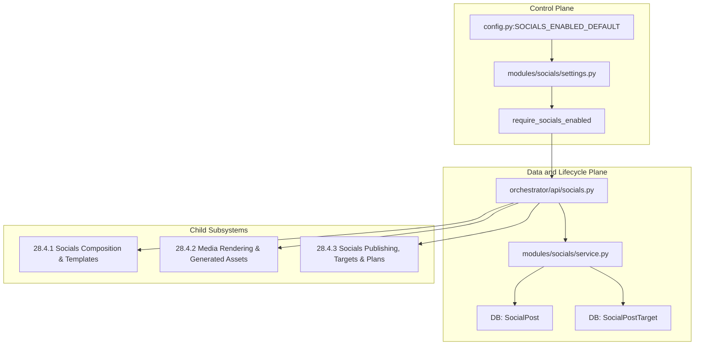
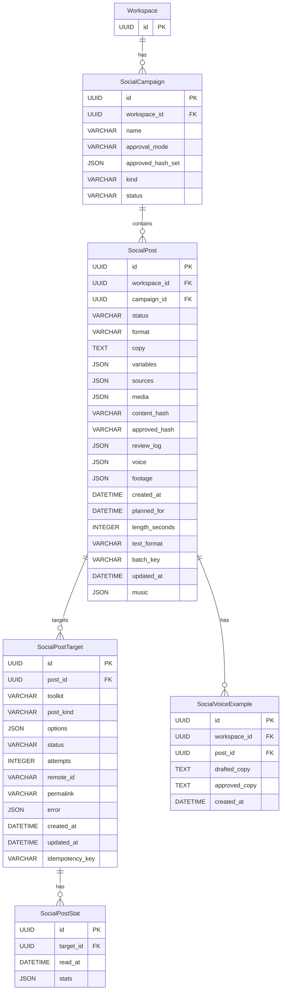
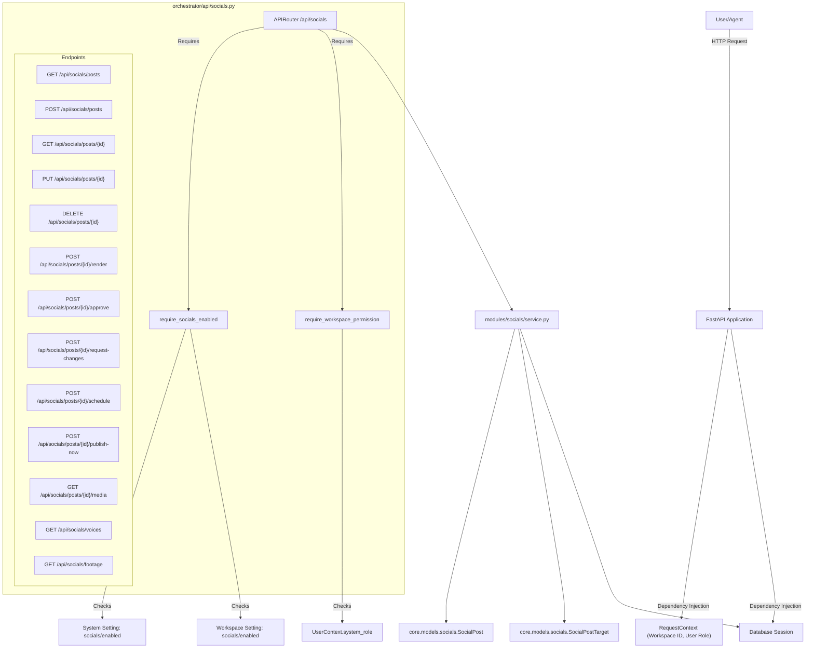

# Socials Subsystem (PRD-251)

Relevant source files

The following files were used as context for generating this wiki page:

- [docs/PRDS/PRD-251A-SOCIALS-REFERENCE-PIPELINE.md](docs/PRDS/PRD-251A-SOCIALS-REFERENCE-PIPELINE.md)
- [frontend/components/deliverables/socials/socials-claim-source.tsx](frontend/components/deliverables/socials/socials-claim-source.tsx)
- [frontend/components/settings/ComposioDenyListTab.tsx](frontend/components/settings/ComposioDenyListTab.tsx)
- [frontend/components/settings/__tests__/socials-composio-deny-list-tab.test.tsx](frontend/components/settings/__tests__/socials-composio-deny-list-tab.test.tsx)
- [frontend/lib/api-client.ts](frontend/lib/api-client.ts)
- [orchestrator/alembic/versions/prd251_socials.py](orchestrator/alembic/versions/prd251_socials.py)
- [orchestrator/alembic/versions/prd251_wave2.py](orchestrator/alembic/versions/prd251_wave2.py)
- [orchestrator/api/socials.py](orchestrator/api/socials.py)
- [orchestrator/config.py](orchestrator/config.py)
- [orchestrator/core/composio/post_gate.py](orchestrator/core/composio/post_gate.py)
- [orchestrator/core/models/socials.py](orchestrator/core/models/socials.py)
- [orchestrator/main.py](orchestrator/main.py)
- [orchestrator/modules/socials/__init__.py](orchestrator/modules/socials/__init__.py)
- [orchestrator/modules/socials/render.py](orchestrator/modules/socials/render.py)
- [orchestrator/modules/socials/service.py](orchestrator/modules/socials/service.py)
- [orchestrator/modules/socials/settings.py](orchestrator/modules/socials/settings.py)
- [orchestrator/reports/config-surface.json](orchestrator/reports/config-surface.json)
- [orchestrator/reports/route-manifest.json](orchestrator/reports/route-manifest.json)
- [orchestrator/tests/test_config_env_centralization.py](orchestrator/tests/test_config_env_centralization.py)
- [orchestrator/tests/test_prd251_api.py](orchestrator/tests/test_prd251_api.py)
- [orchestrator/tests/test_prd251_models.py](orchestrator/tests/test_prd251_models.py)
- [orchestrator/tests/test_prd251_settings.py](orchestrator/tests/test_prd251_settings.py)
- [orchestrator/tests/test_prd251bw1_migration.py](orchestrator/tests/test_prd251bw1_migration.py)
- [orchestrator/tests/test_prd251bw2_maker.py](orchestrator/tests/test_prd251bw2_maker.py)
- [orchestrator/tests/test_prd251bw2_migration.py](orchestrator/tests/test_prd251bw2_migration.py)
- [orchestrator/tests/test_prd251w1_post_gate.py](orchestrator/tests/test_prd251w1_post_gate.py)
- [orchestrator/tests/test_prd251w2_campaigns.py](orchestrator/tests/test_prd251w2_campaigns.py)
- [scripts/ralph/PROMPT_build_prd251.md](scripts/ralph/PROMPT_build_prd251.md)
- [scripts/ralph/PROMPT_review_prd251.md](scripts/ralph/PROMPT_review_prd251.md)
- [scripts/ralph/acceptance-prd251.sh](scripts/ralph/acceptance-prd251.sh)
- [scripts/ralph/prd-251.json](scripts/ralph/prd-251.json)

This page documents the technical architecture of the Socials Subsystem (PRD-251) within Automatos AI. The socials subsystem provides multi-channel social post management, approval workflows with content-hash immutability guarantees [orchestrator/modules/socials/service.py:1-44](), source tracking for claims [orchestrator/modules/socials/service.py:27-33](), database-backed settings and feature gating [scripts/ralph/prd-251.json:1-21](), media rendering bundles [orchestrator/modules/socials/render.py:75-76](), and a dedicated Deliverables Socials tab interface [frontend/lib/api-client.ts:1-4119]().

As a **PARENT** page, this document provides a high-level overview of the subsystem components and links directly to detailed child pages for composition, media rendering, and publishing execution.

Sources: [scripts/ralph/prd-251.json:1-21](), [orchestrator/modules/socials/service.py:1-44](), [orchestrator/api/socials.py:1-86]()

---

## 1. Subsystem Architecture & Core Components

The socials subsystem is structured around a strict lifecycle, separating drafting, rendering, review, and publishing. Everything is gated globally by a master switch (`SOCIALS_ENABLED_DEFAULT`) and locally per workspace via `modules/socials/settings.py` [scripts/ralph/prd-251.json:1-21](). The core models `SocialPost` and `SocialPostTarget` define the structure of social content and its publication targets [orchestrator/core/models/socials.py:76-81]().

Title: "Socials Subsystem High-Level Architecture"
Sources: [orchestrator/api/socials.py:1-86](), [orchestrator/modules/socials/settings.py:1-115](), [scripts/ralph/prd-251.json:1-21](), [orchestrator/core/models/socials.py:76-81]()

---

## 2. SocialPost/SocialPostTarget Models and Migrations

The `SocialPost` model represents a single social media post, tracking its content, status, and review history [orchestrator/core/models/socials.py:1-158](). The `SocialPostTarget` model defines specific publication targets for a post, including the channel, post kind, and status for that target [orchestrator/core/models/socials.py:1-158](). These models are created and managed through Alembic migrations, specifically `prd251_socials` [orchestrator/alembic/versions/prd251_socials.py:1-33](). The `test_prd251_models.py` suite ensures the integrity of these models and their relationships [orchestrator/tests/test_prd251_models.py:1-100]().

Title: "Socials Subsystem Data Model"
Sources: [orchestrator/core/models/socials.py:1-158](), [orchestrator/alembic/versions/prd251_socials.py:1-33](), [orchestrator/tests/test_prd251_models.py:1-100]()

---

## 3. Status Machine and Content Hash

The `SocialPost` lifecycle is governed by a status machine defined in `modules/socials/service.py` [orchestrator/modules/socials/service.py:1-132](). Posts transition through states like `draft`, `needs_approval`, `rendering`, `approved`, `scheduled`, and `published`. A critical component is the `content_hash`, an SHA256 hash of the post's canonical JSON content, including copy, variables, sources, media, and targets [orchestrator/modules/socials/service.py:10-22](). This hash ensures that approvals are bound to specific content versions, preventing unreviewed changes from being published. Any content edit, including changes to target channels, changes the hash, thus voiding existing approvals.

Sources: [orchestrator/modules/socials/service.py:1-132]()

---

## 4. Socials Service

The `modules/socials/service.py` module encapsulates the core business logic for managing social posts [orchestrator/modules/socials/service.py:1-70](). It handles post creation, updates, status transitions, content hash computation, and validation of claims against their sources. This service layer ensures data integrity and enforces the social post lifecycle rules, acting as the single source of truth for post state management.

Sources: [orchestrator/modules/socials/service.py:1-70]()

---

## 5. Master Switch and Settings

The Socials subsystem is controlled by a master switch (`SOCIALS_ENABLED_DEFAULT`) in `config.py` [orchestrator/config.py:1718-1742](). This global setting can be overridden at the workspace level. The `modules/socials/settings.py` module provides functions like `socials_master_enabled()` and `require_socials_enabled` to check these switches, ensuring that Socials features are only available when both the platform and the workspace have them enabled [scripts/ralph/prd-251.json:1-21](). This dual-level gating mechanism is crucial for feature rollout and access control.

Sources: [orchestrator/config.py:1718-1742](), [scripts/ralph/prd-251.json:1-21]()

---

## 6. `/api/socials` Endpoints

The backend API for the Socials subsystem is exposed through the `/api/socials` endpoints, defined in `orchestrator/api/socials.py` [orchestrator/api/socials.py:1-86](). These endpoints provide CRUD operations for social posts, campaigns, targets, and related entities. All routes are protected by the `require_socials_enabled` dependency, ensuring that the feature gates are respected [orchestrator/api/socials.py:5-7](). The API also handles error mapping from the service layer's exceptions to appropriate HTTP status codes [orchestrator/api/socials.py:13-18]().

Title: "/api/socials Endpoints and Dependencies"
Sources: [orchestrator/api/socials.py:1-86](), [orchestrator/reports/route-manifest.json:3000-3050](), [orchestrator/tests/test_prd251_api.py:1-26]()

---

## 7. Deliverables Socials Tab UI

The frontend provides a dedicated "Socials" tab within the Deliverables section for managing social posts. This UI allows users to compose, review, approve, schedule, and track the status of their social content. Components like `SocialPostedResponse` [frontend/lib/api-client.ts:35-36]() facilitate interaction with the backend API. The `api-client.ts` module [frontend/lib/api-client.ts:1-4119]() handles data fetching and mutations, providing a seamless user experience.

Sources: [frontend/lib/api-client.ts:35-36](), [frontend/lib/api-client.ts:1-4119]()

---

## 8. Socials Composition & Templates

Social posts are generated from structured templates stored in `document_templates` with formats `social_image` or `social_video` [orchestrator/core/models/socials.py:76](). Templates declare variable schemas, data bindings, audio plans, and visual slots. Agents and users compose posts by filling these variables, referencing factual sources, and selecting target channels.

For comprehensive details on composition logic, template gallery layouts, variables validation, and the socials editor form, see [Socials Composition & Templates](#28.4.1).

Sources: [orchestrator/core/models/socials.py:76]()

---

## 9. Media Rendering & Generated Assets

Once composed, posts requiring visual or audio assets are processed through the rendering pipeline implemented in `modules/socials/render.py` [orchestrator/modules/socials/render.py:1-62](). This layer builds media render bundles (`core/media_render_bundle.py`), checks workspace quotas (`core/media_render_quota.py`), manages AI-driven footage and voice slots via Composio toolkits, and registers output assets as Deliverables.

For detailed documentation on render/preview pipelines, quota accounting, the image store, and social kit tokens, see [Media Rendering & Generated Assets](#28.4.2).

Sources: [orchestrator/modules/socials/render.py:1-62](), [orchestrator/modules/socials/render.py:75-76](), [orchestrator/modules/socials/render.py:88-95]()

---

## 10. Socials Publishing, Targets & Plans

Approved posts are published to external channels through channel adapters and step-based execution records (`modules/socials/publishing.py`, `publish_steps.py`, and `publish_records.py`) [orchestrator/modules/socials/service.py:120-126](). The subsystem enforces the platform-wide Composio deny list, strict content-hash validation on publish, and automated schedule recovery via background workers.

For in-depth coverage of channel capabilities, publish flows, schedule recovery, and the queue/retake UI, see [Socials Publishing, Targets & Plans](#28.4.3).

Sources: [orchestrator/modules/socials/service.py:120-126]()

---