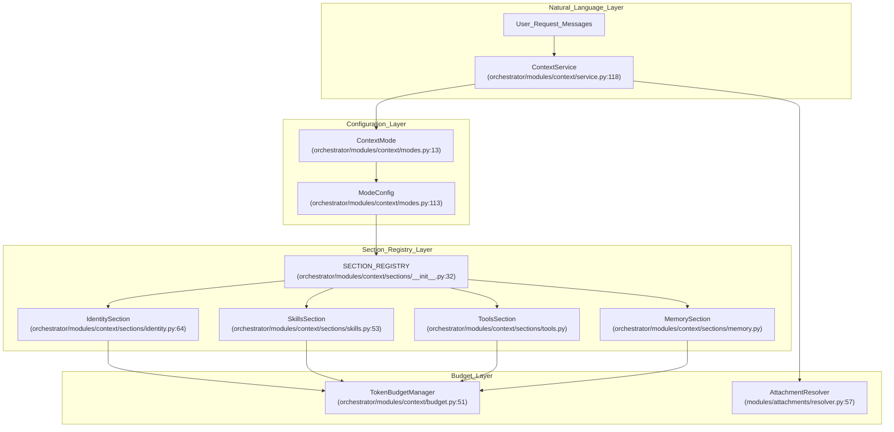
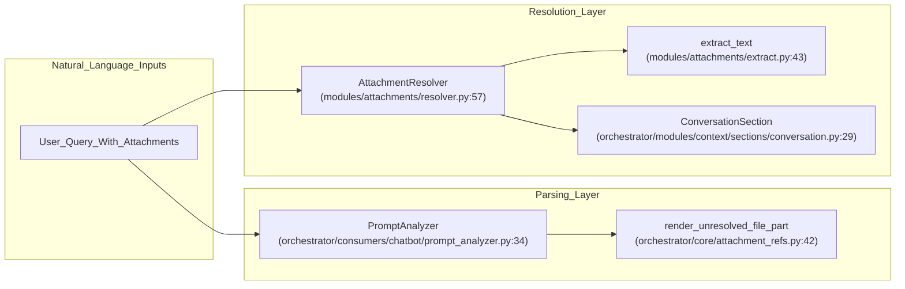

# Context Service

Relevant source files

The following files were used as context for generating this wiki page:

- [orchestrator/alembic/versions/prd201_s1_message_context_trace.py](orchestrator/alembic/versions/prd201_s1_message_context_trace.py)
- [orchestrator/core/attachment_refs.py](orchestrator/core/attachment_refs.py)
- [orchestrator/core/context_guard.py](orchestrator/core/context_guard.py)
- [orchestrator/core/llm/request_scope.py](orchestrator/core/llm/request_scope.py)
- [orchestrator/core/services/skill_l3_execution.py](orchestrator/core/services/skill_l3_execution.py)
- [orchestrator/modules/agents/services/skill_portability.py](orchestrator/modules/agents/services/skill_portability.py)
- [orchestrator/modules/attachments/extract.py](orchestrator/modules/attachments/extract.py)
- [orchestrator/modules/context/__init__.py](orchestrator/modules/context/__init__.py)
- [orchestrator/modules/context/budget.py](orchestrator/modules/context/budget.py)
- [orchestrator/modules/context/modes.py](orchestrator/modules/context/modes.py)
- [orchestrator/modules/context/planning.py](orchestrator/modules/context/planning.py)
- [orchestrator/modules/context/result.py](orchestrator/modules/context/result.py)
- [orchestrator/modules/context/sections/__init__.py](orchestrator/modules/context/sections/__init__.py)
- [orchestrator/modules/context/sections/agent_roster.py](orchestrator/modules/context/sections/agent_roster.py)
- [orchestrator/modules/context/sections/base.py](orchestrator/modules/context/sections/base.py)
- [orchestrator/modules/context/sections/conversation.py](orchestrator/modules/context/sections/conversation.py)
- [orchestrator/modules/context/sections/identity.py](orchestrator/modules/context/sections/identity.py)
- [orchestrator/modules/context/sections/planning_history.py](orchestrator/modules/context/sections/planning_history.py)
- [orchestrator/modules/context/sections/skills.py](orchestrator/modules/context/sections/skills.py)
- [orchestrator/modules/context/sections/task_context.py](orchestrator/modules/context/sections/task_context.py)
- [orchestrator/modules/context/service.py](orchestrator/modules/context/service.py)
- [orchestrator/modules/tools/discovery/actions_skills.py](orchestrator/modules/tools/discovery/actions_skills.py)
- [orchestrator/modules/tools/discovery/handlers_skill_runtime.py](orchestrator/modules/tools/discovery/handlers_skill_runtime.py)
- [orchestrator/scripts/eval/tool_routing/eval_seed.yaml](orchestrator/scripts/eval/tool_routing/eval_seed.yaml)
- [orchestrator/scripts/eval/tool_routing/eval_set.jsonl](orchestrator/scripts/eval/tool_routing/eval_set.jsonl)
- [orchestrator/scripts/eval/tool_routing/seed_eval_set.py](orchestrator/scripts/eval/tool_routing/seed_eval_set.py)
- [orchestrator/scripts/skill_signal_report.py](orchestrator/scripts/skill_signal_report.py)
- [orchestrator/tests/test_auto_prompt_prefix_is_turn_stable.py](orchestrator/tests/test_auto_prompt_prefix_is_turn_stable.py)
- [orchestrator/tests/test_context/__init__.py](orchestrator/tests/test_context/__init__.py)
- [orchestrator/tests/test_context/conftest.py](orchestrator/tests/test_context/conftest.py)
- [orchestrator/tests/test_context/test_budget_manager.py](orchestrator/tests/test_context/test_budget_manager.py)
- [orchestrator/tests/test_context/test_identity_section.py](orchestrator/tests/test_context/test_identity_section.py)
- [orchestrator/tests/test_context/test_memory_section.py](orchestrator/tests/test_context/test_memory_section.py)
- [orchestrator/tests/test_context/test_modes.py](orchestrator/tests/test_context/test_modes.py)
- [orchestrator/tests/test_context/test_prompt_caching.py](orchestrator/tests/test_context/test_prompt_caching.py)
- [orchestrator/tests/test_context/test_service.py](orchestrator/tests/test_context/test_service.py)
- [orchestrator/tests/test_context_guard.py](orchestrator/tests/test_context_guard.py)
- [orchestrator/tests/test_f155_a_widget_turn_is_told_where_it_is.py](orchestrator/tests/test_f155_a_widget_turn_is_told_where_it_is.py)
- [orchestrator/tests/test_f155_widget_born_work_remembers_as_a_widget_turn.py](orchestrator/tests/test_f155_widget_born_work_remembers_as_a_widget_turn.py)
- [orchestrator/tests/test_f181_b_a_skill_says_which_scripts_it_lacks.py](orchestrator/tests/test_f181_b_a_skill_says_which_scripts_it_lacks.py)
- [orchestrator/tests/test_f191_a_failed_command_is_not_a_success.py](orchestrator/tests/test_f191_a_failed_command_is_not_a_success.py)
- [orchestrator/tests/test_prd164_planning_pack.py](orchestrator/tests/test_prd164_planning_pack.py)
- [orchestrator/tests/test_prd202_s2_trigger_activation.py](orchestrator/tests/test_prd202_s2_trigger_activation.py)
- [orchestrator/tests/test_prd223_attachment_refs.py](orchestrator/tests/test_prd223_attachment_refs.py)
- [orchestrator/tests/test_prd263_skill_hash_in_context_trace.py](orchestrator/tests/test_prd263_skill_hash_in_context_trace.py)
- [orchestrator/tests/test_prd263_skill_signal_report.py](orchestrator/tests/test_prd263_skill_signal_report.py)

## Purpose and Scope

`ContextService` is the unified prompt-building layer for the Automatos AI platform [orchestrator/modules/context/service.py:1-19](). It provides a single entry point for assembling LLM contexts, consolidating fragmented prompt assembly paths into a modular system. It manages the assembly of system prompts, message history formatting, tool schema loading, and ephemeral attachment injection based on specific execution modes [orchestrator/modules/context/modes.py:13-24]().

This parent page provides a high-level overview of the context building layer, bridging natural language intent with core code entities. Detailed mechanics are delegated to the child pages covering modes, priority systems, budget management, section types, and migration paths.

### Context Service Assembly Pipeline (Code Entity Space)

**Diagram 1: Context Service Assembly Pipeline (Code Entity Space)**

Sources: [orchestrator/modules/context/service.py:118-186](), [orchestrator/modules/context/modes.py:13-120](), [orchestrator/modules/context/budget.py:51-148](), [modules/attachments/resolver.py:57-63]()

---

## 4.1. Context Modes

Execution modes (`ContextMode`) dictate the structural shape of prompts, personality injection, and tool loading strategies across the platform [orchestrator/modules/context/modes.py:13-24](). Each mode maps to a declarative `ModeConfig` defining its required sections, tool visibility rules, and token caps [orchestrator/modules/context/modes.py:113-120](). For example, `CHATBOT` mode enables personality and `filtered` tool loading, while `TASK_EXECUTION` disables personality and uses `full` tool loading [orchestrator/modules/context/modes.py:127-149](). Specific tools, like `platform_ask_orchestrator`, are restricted to `EXECUTION_TOOL_MODES` to prevent their appearance in inappropriate contexts [orchestrator/modules/context/modes.py:34-38]().

For details on configuration parameters, execution-only tools like `platform_ask_orchestrator`, and mode specific behaviors, see [Context Modes](#4.1).

Sources: [orchestrator/modules/context/modes.py:13-149](), [orchestrator/modules/context/service.py:119-126]()

---

## 4.2. Section Priority System

Context sections are rendered independently and assigned integer priorities where lower numbers represent higher importance [orchestrator/modules/context/sections/base.py](). Critical blocks such as agent identity and task constraints are assigned top priority to protect them from being dropped during budget compression [orchestrator/modules/context/budget.py:51-58](). For instance, sections with priority 1-2 (e.g., `identity`, `task_context`, `playbook_context`) are never dropped, even if the total context exceeds the allocated budget [orchestrator/modules/context/budget.py:123-124]().

The `IdentitySection` has priority 1, ensuring the agent's core identity, role, and persona are always included [orchestrator/modules/context/sections/identity.py:76-78](). The `TaskContextSection` has priority 2, ensuring the agent's current task description is preserved [orchestrator/modules/context/sections/task_context.py:26-28](). The `SkillsSection` has priority 4, and its rendering strategy focuses on providing L1 metadata (name + description) for most skills, with full L2 bodies only for a small set of "core always-on" skills like `platform-management` [orchestrator/modules/context/sections/skills.py:61-66](). This prevents irrelevant skills from consuming excessive tokens [orchestrator/modules/context/sections/skills.py:101-112]().

For details on priority tiers, preservation rules, and section ordering, see [Section Priority System](#4.2).

Sources: [orchestrator/modules/context/sections/base.py](), [orchestrator/modules/context/budget.py:51-124](), [orchestrator/modules/context/sections/identity.py:76-78](), [orchestrator/modules/context/sections/task_context.py:26-28](), [orchestrator/modules/context/sections/skills.py:61-112]()

---

## 4.3. Token Budget Management

The `TokenBudgetManager` evaluates rendered sections against a model-aware `TokenBudget` [orchestrator/modules/context/budget.py:24-38](). It applies sequential token caps, truncates oversized sections without breaking word or JSON structures, and drops lower-priority sections when token limits are exceeded [orchestrator/modules/context/budget.py:51-148](). Default budgets are defined per `ContextMode`, with specific allocations for total tokens, reserved for response, and reserved for messages [orchestrator/modules/context/budget.py:154-195]().

### Attachment and Message Resolution Flow (Code Entity Space)

**Diagram 2: Attachment and Message Resolution Flow (Code Entity Space)**

For information on budget calculations per model window and context guards, see [Token Budget Management](#4.3).

Sources: [orchestrator/consumers/chatbot/prompt_analyzer.py:34](), [orchestrator/core/attachment_refs.py:42](), [modules/attachments/resolver.py:57](), [modules/attachments/extract.py:43](), [orchestrator/modules/context/sections/conversation.py:29](), [orchestrator/modules/context/budget.py:24-195]()

---

## 4.4. Section Types

The `SECTION_REGISTRY` maps string keys to concrete subclasses of `BaseSection` [orchestrator/modules/context/sections/__init__.py:32-56](). Individual section classes manage specialized payloads including identity formatting (`IdentitySection`), skill definitions (`SkillsSection`), memory retrieval (`MemorySection`), graph contexts (`GraphSection`), documents inventory (`DocumentsInventorySection`), and conversation history (`ConversationSection`) [orchestrator/modules/context/sections/__init__.py:32-56](). Other notable sections include `AgentRosterSection` for coordinator prompts [orchestrator/modules/context/sections/agent_roster.py:9-10]() and `PlanningHistorySection` for mission planning [orchestrator/modules/context/sections/planning_history.py]().

The `SkillsSection` specifically handles the dynamic loading of skill content. It renders L1 metadata (name and description) for most skills, allowing the LLM to use the `platform_load_skill` tool to fetch the full L2 body when needed [orchestrator/modules/context/sections/skills.py:53-66](). This mechanism, known as trigger-based L2 activation, significantly reduces prompt costs by avoiding the unconditional injection of large skill bodies [orchestrator/modules/context/sections/skills.py:101-112](). The `platform_load_skill` tool is registered as a platform action to enable this functionality [orchestrator/modules/tools/discovery/actions_skills.py:29-57](). The `SkillLoader` service is responsible for managing skill repositories, parsing `SKILL.md` files, and caching skill content [orchestrator/modules/agents/services/skill_loader.py]()].

For detailed documentation on each section type and its rendering rules, see [Section Types](#4.4).

Sources: [orchestrator/modules/context/sections/__init__.py:32-56](), [orchestrator/modules/context/sections/agent_roster.py:9-10](), [orchestrator/modules/context/sections/planning_history.py](), [orchestrator/modules/context/sections/skills.py:53-112](), [orchestrator/modules/tools/discovery/actions_skills.py:29-57]()

---

## 4.5. Migration & Integration

`ContextService` replaces fragmented, ad-hoc prompt assembly paths across chat consumers, recipe runners, and background heartbeats with a unified entry point [orchestrator/modules/context/service.py:118-124](). It coordinates with `AttachmentResolver` for multimodal input injection and guarantees uniform compliance across all platform consumers [modules/attachments/resolver.py:57-63](). This consolidation ensures consistent context building and adherence to token budgets and priority rules across the entire platform.

The `ContextService` also plays a crucial role in observability by generating a detailed assembly trace for each LLM call. This trace, persisted in `ContextResult.to_assembly_trace()`, records the mode, driving model, budget, per-section token details, injected memory IDs, and the content hashes of skill bodies that served the turn [orchestrator/modules/context/result.py](). This allows for post-hoc analysis of "what Auto knew" during a turn, aiding in debugging and performance evaluation, particularly for skill activation signals [orchestrator/scripts/skill_signal_report.py]().

For details on integration patterns and historical prompt migration, see [Migration & Integration](#4.5).

Sources: [orchestrator/modules/context/service.py:118-124](), [modules/attachments/resolver.py:57-63](), [orchestrator/modules/context/result.py](), [orchestrator/scripts/skill_signal_report.py]()

---