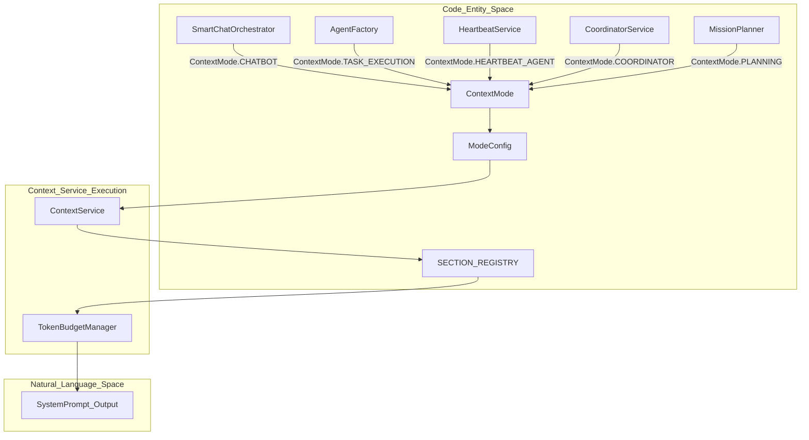
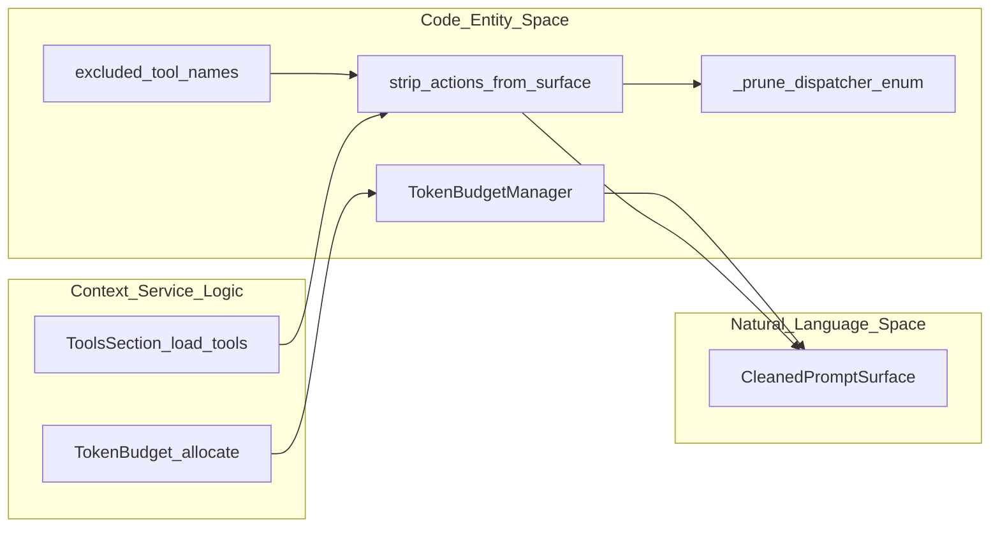

# Context Modes

<details>
<summary>Relevant source files</summary>

The following files were used as context for generating this wiki page:

- [orchestrator/alembic/versions/prd201_s1_message_context_trace.py](orchestrator/alembic/versions/prd201_s1_message_context_trace.py)
- [orchestrator/core/attachment_refs.py](orchestrator/core/attachment_refs.py)
- [orchestrator/core/context_guard.py](orchestrator/core/context_guard.py)
- [orchestrator/core/llm/request_scope.py](orchestrator/core/llm/request_scope.py)
- [orchestrator/core/services/skill_l3_execution.py](orchestrator/core/services/skill_l3_execution.py)
- [orchestrator/modules/agents/services/skill_portability.py](orchestrator/modules/agents/services/skill_portability.py)
- [orchestrator/modules/attachments/extract.py](orchestrator/modules/attachments/extract.py)
- [orchestrator/modules/context/__init__.py](orchestrator/modules/context/__init__.py)
- [orchestrator/modules/context/budget.py](orchestrator/modules/context/budget.py)
- [orchestrator/modules/context/modes.py](orchestrator/modules/context/modes.py)
- [orchestrator/modules/context/planning.py](orchestrator/modules/context/planning.py)
- [orchestrator/modules/context/sections/__init__.py](orchestrator/modules/context/sections/__init__.py)
- [orchestrator/modules/context/sections/agent_roster.py](orchestrator/modules/context/sections/agent_roster.py)
- [orchestrator/modules/context/sections/base.py](orchestrator/modules/context/sections/base.py)
- [orchestrator/modules/context/sections/conversation.py](orchestrator/modules/context/sections/conversation.py)
- [orchestrator/modules/context/sections/planning_history.py](orchestrator/modules/context/sections/planning_history.py)
- [orchestrator/modules/tools/discovery/handlers_skill_runtime.py](orchestrator/modules/tools/discovery/handlers_skill_runtime.py)
- [orchestrator/tests/test_context/test_modes.py](orchestrator/tests/test_context/test_modes.py)
- [orchestrator/tests/test_context/test_service.py](orchestrator/tests/test_context/test_service.py)
- [orchestrator/tests/test_context_guard.py](orchestrator/tests/test_context_guard.py)
- [orchestrator/tests/test_f181_b_a_skill_says_which_scripts_it_lacks.py](orchestrator/tests/test_f181_b_a_skill_says_which_scripts_it_lacks.py)
- [orchestrator/tests/test_f191_a_failed_command_is_not_a_success.py](orchestrator/tests/test_f191_a_failed_command_is_not_a_success.py)
- [orchestrator/tests/test_prd164_planning_pack.py](orchestrator/tests/test_prd164_planning_pack.py)
- [orchestrator/tests/test_prd223_attachment_refs.py](orchestrator/tests/test_prd223_attachment_refs.py)

</details>


Context modes define how `ContextService` (`[orchestrator/modules/context/service.py]()`) assembles system prompts, tools, and message payloads for different execution scenarios. Each mode is backed by a declarative `ModeConfig` dataclass (`[orchestrator/modules/context/modes.py:113-121]()`) that specifies required sections, tool loading strategies, personality injection flags, and token budget constraints.

---

## Purpose and Scope

Context modes serve as the configuration backbone for prompt assembly across the Automatos AI platform. They control:

1. **Section Composition**: Which prompt sections (Identity, Skills, Memory, Task Context, etc.) are included in the final system prompt `[orchestrator/modules/context/modes.py:117]()`.
2. **Tool Loading Strategy**: Whether tools are loaded fully (`full`), filtered (`filtered`), restricted to the platform dispatcher (`dispatcher_only`), read-only (`read_only`), or omitted (`none`) `[orchestrator/modules/context/modes.py:118]()`.
3. **Personality Injection**: Whether conversational tone and chatbot heuristics (`personality=True`) or neutral professional instructions (`personality=False`) are applied `[orchestrator/modules/context/modes.py:119]()`.
4. **Token Budgeting**: Specific token allocation limits (`max_tokens`) per mode `[orchestrator/modules/context/modes.py:120]()`.

Sources: `[orchestrator/modules/context/modes.py:1-121]()`

---

## Architecture Overview

### Context Mode Lifecycle and Data Flow

The following diagram bridges natural language routing and consumer execution contexts to concrete codebase symbols (`ContextMode`, `ModeConfig`, `ContextService`, `SECTION_REGISTRY`, and `TokenBudgetManager`).

Title: "Context Assembly and Mode Routing"


Sources: `[orchestrator/modules/context/modes.py:13-24]`, `[orchestrator/modules/context/modes.py:112-121]`, `[orchestrator/modules/context/sections/__init__.py:33-56]`, `[orchestrator/modules/context/budget.py:51-73]()`

---

## Available Context Modes

The platform defines specialized modes via the `ContextMode` string enum (`[orchestrator/modules/context/modes.py:13-24]()`). Each mode is configured in `MODE_CONFIGS` (`[orchestrator/modules/context/modes.py:123-169]()`).

### CHATBOT
* **Purpose**: User-facing conversational interaction.
* **Sections**: `identity`, `product_facts`, `onboarding`, `skills`, `composio`, `plugins`, `platform_actions`, `documents_inventory`, `memory`, `business_graph`, `datetime_context`, `conversation`, `standing_rules` `[orchestrator/modules/context/modes.py:128-134]()`.
* **Personality**: `True` (enables chatbot greetings, conversational tone, and user awareness) `[orchestrator/modules/context/modes.py:136]()`.
* **Tool Strategy**: `filtered` `[orchestrator/modules/context/modes.py:135]()`.
* **Budget**: 128,000 total tokens (60,000 reserved for messages) `[orchestrator/modules/context/budget.py:155-159]()`.

### TASK_EXECUTION
* **Purpose**: Professional, neutral agent execution for operational tasks.
* **Sections**: `identity`, `skills`, `composio`, `plugins`, `platform_actions`, `memory`, `business_graph`, `task_context`, `datetime_context`, `conversation` `[orchestrator/modules/context/modes.py:142-146]()`.
* **Personality**: `False` (neutral, professional prompt tone) `[orchestrator/modules/context/modes.py:149]()`.
* **Tool Strategy**: `full` `[orchestrator/modules/context/modes.py:148]()`.

### HEARTBEAT_ORCHESTRATOR & HEARTBEAT_AGENT
* **Purpose**: Autonomous scheduled platform checks and background agent execution.
* **HEARTBEAT_ORCHESTRATOR**: Uses `dispatcher_only` tool loading, `personality=False`, and an 8,000 token system budget `[orchestrator/modules/context/modes.py:154-161]()`.
* **HEARTBEAT_AGENT**: Executes scheduled agent tasks autonomously with `full` tool loading and `field_memory` digests for cross-run learning (PRD-179) `[orchestrator/modules/context/modes.py:163-169]()`.

### RECIPE
* **Purpose**: Multi-step playbook and workflow step execution, incorporating `playbook_context` and strict task scoping.

### ROUTER & ORCHESTRATOR_STAGE
* **Purpose**: Internal platform routing decisions and state management stages. `ROUTER` loads no tools (`none`), while orchestrator stages handle intermediary DAG transitions.

### NL2SQL
* **Purpose**: Database schema inspection and natural-language-to-SQL query generation, constrained by tight token limits (`2,000` reserved message budget) `[orchestrator/modules/context/budget.py:180-184]()`.

### COORDINATOR & PLANNING
* **Purpose**: Mission decomposition and task graph planning surfaces, utilizing specialized planning context packs and `AgentRosterSection` integrations `[orchestrator/modules/context/sections/agent_roster.py:20-30]`, `[orchestrator/tests/test_prd164_planning_pack.py:1-18]()`.

### CHECK_IN
* **Purpose**: Proactive check-ins by agents (PRD-268 US-C02c) `[orchestrator/modules/context/modes.py:24]()`.

Sources: `[orchestrator/modules/context/modes.py:13-25]`, `[orchestrator/modules/context/modes.py:123-169]`, `[orchestrator/modules/context/budget.py:154-195]`, `[orchestrator/modules/context/sections/agent_roster.py:20-30]()`

---

## Tool Stripping and PRD-229 Enforcement

To maintain strict vertical tool boundaries, `platform_ask_orchestrator` is permitted **only** in worker execution surfaces (`TASK_EXECUTION`). It is stripped across all other modes `[orchestrator/modules/context/modes.py:27-35]()`:

```python
EXECUTION_ONLY_TOOLS: frozenset[str] = frozenset({"platform_ask_orchestrator"})
EXECUTION_TOOL_MODES: frozenset["ContextMode"] = frozenset({ContextMode.TASK_EXECUTION})
```

The helper functions `excluded_tool_names()`, `strip_actions_from_surface()`, and `_prune_dispatcher_enum()` enforce this boundary at runtime `[orchestrator/modules/context/modes.py:42-110]()`. When rendering non-execution surfaces, `strip_actions_from_surface` either drops the first-class execution tool or removes `platform_ask_orchestrator` from the `platform_execute` dispatcher's action enum `[orchestrator/modules/context/modes.py:57-83]()`.

Sources: `[orchestrator/modules/context/modes.py:27-110]()`

---

## Token Budget Management

The `TokenBudgetManager` (`[orchestrator/modules/context/budget.py:51-62]()`) allocates token budgets across rendered sections and manages priority-based truncation:

1. **Per-Section Capping**: Applies `max_tokens` limits via token-boundary truncation (`truncate_to_token_budget`) `[orchestrator/modules/context/budget.py:77-106]()`.
2. **Priority-Based Dropping**: If total tokens exceed the available budget, sections are dropped starting from the highest priority number (lowest importance) `[orchestrator/modules/context/budget.py:113-134]()`.
3. **Protected Tiers**: Priority `1` and `2` sections (e.g., `identity`, `task_context`) are **never dropped** `[orchestrator/modules/context/budget.py:122-125]()`.

Sources: `[orchestrator/modules/context/budget.py:51-147]()`

---

## Code Entity to Natural Language Bridge

The following diagram bridges natural language tool filtering requirements to concrete codebase symbols (`excluded_tool_names`, `strip_actions_from_surface`, `_prune_dispatcher_enum`, and `TokenBudgetManager`).

Title: "Tool Filtering and Context Translation"


Sources: `[orchestrator/modules/context/modes.py:41-110]`, `[orchestrator/modules/context/budget.py:51-147]()`

---