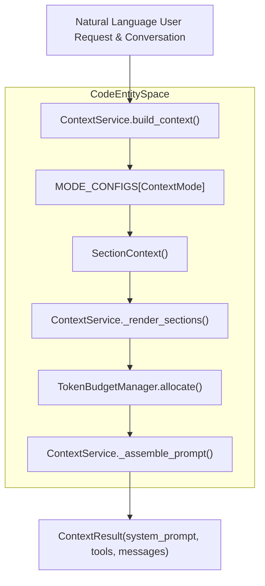
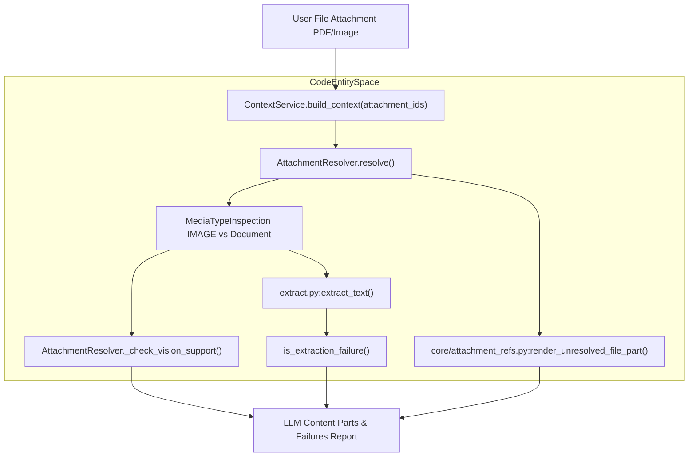
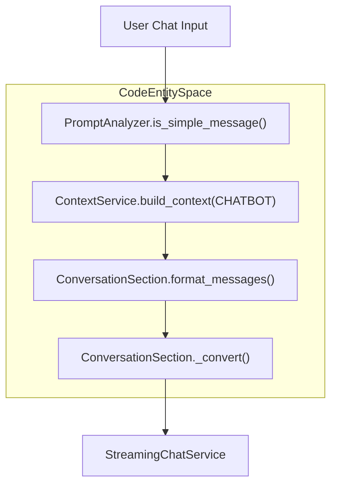

# Migration & Integration

Relevant source files

The following files were used as context for generating this wiki page:

- [orchestrator/modules/context/result.py](orchestrator/modules/context/result.py)
- [orchestrator/modules/context/sections/identity.py](orchestrator/modules/context/sections/identity.py)
- [orchestrator/modules/context/sections/skills.py](orchestrator/modules/context/sections/skills.py)
- [orchestrator/modules/context/sections/task_context.py](orchestrator/modules/context/sections/task_context.py)
- [orchestrator/modules/context/service.py](orchestrator/modules/context/service.py)
- [orchestrator/modules/tools/discovery/actions_skills.py](orchestrator/modules/tools/discovery/actions_skills.py)
- [orchestrator/scripts/eval/tool_routing/eval_seed.yaml](orchestrator/scripts/eval/tool_routing/eval_seed.yaml)
- [orchestrator/scripts/eval/tool_routing/eval_set.jsonl](orchestrator/scripts/eval/tool_routing/eval_set.jsonl)
- [orchestrator/scripts/eval/tool_routing/seed_eval_set.py](orchestrator/scripts/eval/tool_routing/seed_eval_set.py)
- [orchestrator/scripts/skill_signal_report.py](orchestrator/scripts/skill_signal_report.py)
- [orchestrator/tests/test_auto_prompt_prefix_is_turn_stable.py](orchestrator/tests/test_auto_prompt_prefix_is_turn_stable.py)
- [orchestrator/tests/test_context/__init__.py](orchestrator/tests/test_context/__init__.py)
- [orchestrator/tests/test_context/conftest.py](orchestrator/tests/test_context/conftest.py)
- [orchestrator/tests/test_context/test_budget_manager.py](orchestrator/tests/test_context/test_budget_manager.py)
- [orchestrator/tests/test_context/test_identity_section.py](orchestrator/tests/test_context/test_identity_section.py)
- [orchestrator/tests/test_context/test_memory_section.py](orchestrator/tests/test_context/test_memory_section.py)
- [orchestrator/tests/test_context/test_prompt_caching.py](orchestrator/tests/test_context/test_prompt_caching.py)
- [orchestrator/tests/test_f155_a_widget_turn_is_told_where_it_is.py](orchestrator/tests/test_f155_a_widget_turn_is_told_where_it_is.py)
- [orchestrator/tests/test_f155_widget_born_work_remembers_as_a_widget_turn.py](orchestrator/tests/test_f155_widget_born_work_remembers_as_a_widget_turn.py)
- [orchestrator/tests/test_prd202_s2_trigger_activation.py](orchestrator/tests/test_prd202_s2_trigger_activation.py)
- [orchestrator/tests/test_prd263_skill_hash_in_context_trace.py](orchestrator/tests/test_prd263_skill_hash_in_context_trace.py)
- [orchestrator/tests/test_prd263_skill_signal_report.py](orchestrator/tests/test_prd263_skill_signal_report.py)

This page describes how `ContextService` (`[orchestrator/modules/context/service.py:118-123]()`) replaced fragmented prompt-building code paths across the Automatos AI codebase. It covers the pre-migration state, unified mode configurations, attachment resolution, prompt caching (PRD-201 S4), and integration across various consumers like the Chatbot, Missions, Planning, and Heartbeat subsystems.

---

## Purpose and Scope

Prior to the implementation of the centralized context system, prompt construction logic was duplicated across multiple modules with inconsistent formatting, missing memory injection, and no unified token budget management. The `ContextService` migration unified all prompt building through a single, testable service with declarative mode-based section assembly (`[orchestrator/modules/context/service.py:118-142]()`, `[orchestrator/modules/context/modes.py:38-43]()`).

This migration achieved:
- **Centralized Assembly**: A single entry point for all LLM calls (`[orchestrator/modules/context/service.py:118-123]()`).
- **Token Budgeting**: Model-aware trimming that protects critical context (`[orchestrator/modules/context/budget.py:29-34]()`).
- **Cache Stability**: Sequential section ordering to maximize LLM prompt caching (`[orchestrator/modules/context/service.py:76-87]()`, `[orchestrator/tests/test_context/test_prompt_caching.py:30-45]()`).

Sources: `[orchestrator/modules/context/service.py:118-142]`, `[orchestrator/modules/context/budget.py:29-34]`, `[orchestrator/tests/test_context/test_prompt_caching.py:30-45]`

---

## Pre-Migration State: Fragmented Prompt-Building Paths

Before `ContextService`, prompt building was scattered across the codebase, each with its own logic for assembling identity, skills, memory, tools, and datetime context.

### Fragmented Prompt-Building Locations

| Location | Old Method / Logic | Issue Addressed |
|:---|:---|:---|
| `personality.py` | `AutomatosPersonality` base prompt | Replaced by `IdentitySection` with `personality=True` in `CHATBOT` mode (`[orchestrator/modules/context/service.py:170-171]()`, `[orchestrator/modules/context/sections/identity.py:84-85]()`) |
| `agent_factory.py` | `execute_with_prompt()` manual strings | Now delegates to `ContextService.build_context()` (`[orchestrator/modules/context/service.py:118-123]()`) |
| `chatbot/` | Inline memory + tool injection | Unified via `ContextMode.CHATBOT` section list (`[orchestrator/modules/context/modes.py:38-43]()`) |
| `heartbeat_service.py` | `_orchestrator_tick` / `_agent_tick` | Replaced by dedicated heartbeat modes in `ContextMode` (`[orchestrator/modules/context/modes.py:38-43]()`) |
| `recipe_executor.py` | Step-loop prompt assembly | Replaced by `ContextMode.RECIPE` context (`[orchestrator/modules/context/modes.py:38-43]()`) |
| `engine.py` | `UniversalRouter` classification | Replaced by `ContextMode.ROUTER` lean context (`[orchestrator/modules/context/modes.py:38-43]()`) |
| `task_context.py` | String concatenation in factory | Unified via `TaskContextSection` (Priority 2) (`[orchestrator/modules/context/sections/task_context.py:18-28]()`) |
| `memory.py` | Scattered retrieval calls | Unified via `MemorySection` (`[orchestrator/modules/context/sections/base.py:1-20]()`) |
| `skills.py` | Unconditional L2 skill body injection | Replaced by `SkillsSection` with L1 metadata and `platform_load_skill` tool for L2 (`[orchestrator/modules/context/sections/skills.py:53-65]()`, `[orchestrator/modules/tools/discovery/actions_skills.py:29-57]()`) |

Sources: `[orchestrator/modules/context/modes.py:38-43]`, `[orchestrator/modules/context/service.py:118-123]`, `[orchestrator/modules/context/sections/identity.py:84-85]`, `[orchestrator/modules/context/sections/task_context.py:18-28]`, `[orchestrator/modules/context/sections/skills.py:53-65]`, `[orchestrator/modules/tools/discovery/actions_skills.py:29-57]`

---

## ContextService Core Architecture & Execution Flow

`ContextService` is initialized with an optional database session and exposes `build_context()` as the single entry point (`[orchestrator/modules/context/service.py:118-142]()`). The execution pipeline coordinates mode config lookup, section instantiation, parallel rendering via section handlers, budget allocation via `TokenBudgetManager`, prompt assembly, and tool loading (`[orchestrator/modules/context/service.py:128-183]()`).

Title: "NaturalLanguageSpaceToCodeEntitySpaceContextPipeline"

Sources: `[orchestrator/modules/context/service.py:118-183]`, `[orchestrator/modules/context/modes.py:38-43]`

---

## Attachment Resolution Subsystem (PRD-127 & PRD-223)

The migration centralized attachment handling via `AttachmentResolver`. All consumers pass `attachment_ids` into `ContextService.build_context()`, which delegates to the resolver to produce image URLs or extract document text (`[orchestrator/modules/context/service.py:139-140]()`).

Key mechanisms include:
- **Vision Verification**: `_check_vision_support()` ensures target models support image processing before resolving images.
- **Text Extraction**: `extract_text()` parses binary formats into plaintext.
- **Stale Claim Prevention (PRD-223 S0.4)**: `render_unresolved_file_part()` in `core/attachment_refs.py` prevents pre-resolution text flatteners from outputting stale claims when an attachment successfully resolves.

Title: "NaturalLanguageSpaceToCodeEntitySpaceAttachmentResolution"

Sources: `[orchestrator/modules/context/service.py:139-140]`, `[orchestrator/modules/attachments/resolver.py:59-63]`, `[core/attachment_refs.py:42-67]`

---

## Consumer Integration Patterns

### Chatbot & Prompt Analysis Integration
The `CHATBOT` mode is the primary user-facing path. It integrates with `PromptAnalyzer` to detect simple messages and fresh start requests before invoking the context build (`[orchestrator/consumers/chatbot/prompt_analyzer.py:1-50]()`).

Title: "ChatbotRequestRoutingToContextPipeline"

Sources: `[orchestrator/consumers/chatbot/prompt_analyzer.py:1-50]`, `[orchestrator/modules/context/sections/conversation.py:1-50]`

### Planning Pack Integration (PRD-164)
The `PLANNING` mode introduced a specialized context bundle consumed by `MissionPlanner` and board tasks (`[orchestrator/modules/context/planning.py:45-50]()`). This pack includes planning knowledge (RAG), planning history, and field memory (`[orchestrator/modules/context/planning.py:100-130]()`).

The `PlanningContextPack` class (`[orchestrator/modules/context/planning.py:45-50]()`) builds this context, leveraging `ContextService` for the `PLANNING` mode and applying token budgets (`[orchestrator/modules/context/planning.py:110-130]()`).

Sources: `[orchestrator/modules/context/modes.py:38-43]`, `[orchestrator/modules/context/planning.py:45-130]`

### Skill Loading and Activation (PRD-202 S2)
The `SkillsSection` (`[orchestrator/modules/context/sections/skills.py:53-65]()`) renders only L1 metadata (name + description) for non-core skills, reducing prompt token costs. The full L2 body is injected when the LLM calls the `platform_load_skill` tool (`[orchestrator/modules/tools/discovery/actions_skills.py:29-57]()`). Core skills such as `platform-management` remain always-on L2 (`[orchestrator/modules/context/sections/skills.py:101-108]()`).

The `_served_skill_bodies` function (`[orchestrator/modules/context/service.py:106-115]()`) records the content hashes of served skill bodies in the turn's context trace for telemetry analysis (`[orchestrator/scripts/skill_signal_report.py:1-28]()`).

Sources: `[orchestrator/modules/context/sections/skills.py:53-108]`, `[orchestrator/modules/tools/discovery/actions_skills.py:29-57]`, `[orchestrator/modules/context/service.py:106-115]`, `[orchestrator/scripts/skill_signal_report.py:1-28]`

---

## Migration Validation

The migration was validated via extensive integration tests ensuring that:
1. **Immutability**: `ContextResult` is a frozen dataclass (`[orchestrator/modules/context/result.py:9-10]()`).
2. **Budget Compliance**: Low-priority sections are trimmed while P1-P2 (Identity, Task Context) remain (`[orchestrator/modules/context/budget.py:29-62]()`).
3. **Section Parallelism**: Sections are rendered concurrently using `asyncio` to reduce latency (`[orchestrator/modules/context/service.py:118-142]()`).

Sources: `[orchestrator/modules/context/result.py:9-10]`, `[orchestrator/modules/context/budget.py:29-62]`, `[orchestrator/modules/context/service.py:118-142]`

---