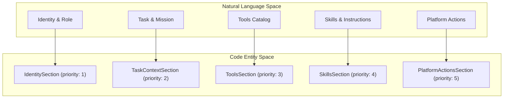
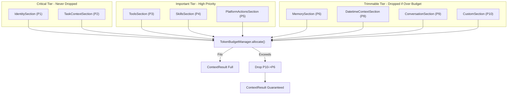
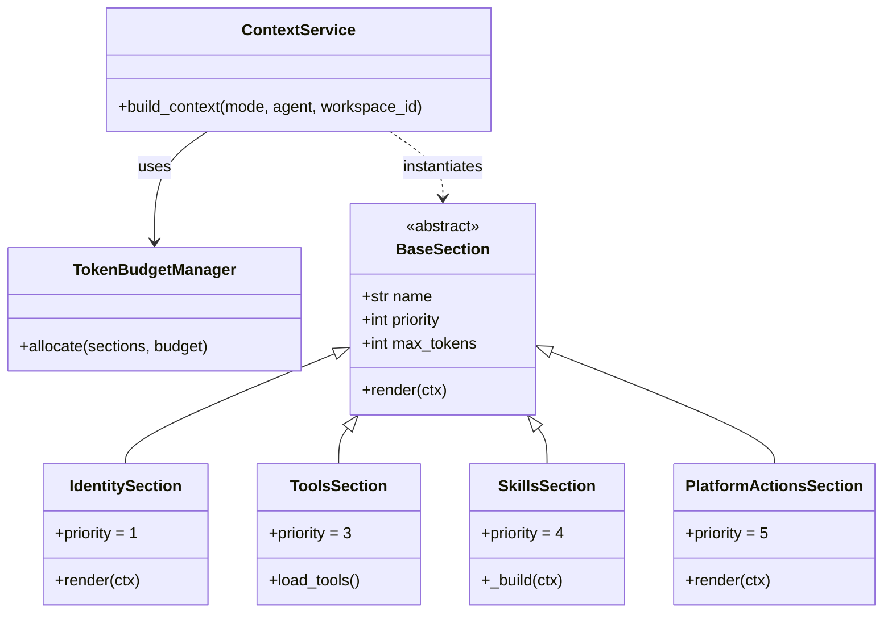

# Section Priority System

Relevant source files

The following files were used as context for generating this wiki page:

- [orchestrator/modules/context/result.py](orchestrator/modules/context/result.py)
- [orchestrator/modules/context/sections/identity.py](orchestrator/modules/context/sections/identity.py)
- [orchestrator/modules/context/sections/skills.py](orchestrator/modules/context/sections/skills.py)
- [orchestrator/modules/context/sections/task_context.py](orchestrator/modules/context/sections/task_context.py)
- [orchestrator/modules/context/service.py](orchestrator/modules/context/service.py)
- [orchestrator/modules/tools/discovery/actions_skills.py](orchestrator/modules/tools/discovery/actions_skills.py)
- [orchestrator/scripts/eval/tool_routing/eval_seed.yaml](orchestrator/scripts/eval/tool_routing/eval_seed.yaml)
- [orchestrator/scripts/eval/tool_routing/eval_set.jsonl](orchestrator/scripts/eval/tool_routing/eval_set.jsonl)
- [orchestrator/scripts/eval/tool_routing/seed_eval_set.py](orchestrator/scripts/eval/tool_routing/seed_eval_set.py)
- [orchestrator/scripts/skill_signal_report.py](orchestrator/scripts/skill_signal_report.py)
- [orchestrator/tests/test_auto_prompt_prefix_is_turn_stable.py](orchestrator/tests/test_auto_prompt_prefix_is_turn_stable.py)
- [orchestrator/tests/test_context/__init__.py](orchestrator/tests/test_context/__init__.py)
- [orchestrator/tests/test_context/conftest.py](orchestrator/tests/test_context/conftest.py)
- [orchestrator/tests/test_context/test_budget_manager.py](orchestrator/tests/test_context/test_budget_manager.py)
- [orchestrator/tests/test_context/test_identity_section.py](orchestrator/tests/test_context/test_identity_section.py)
- [orchestrator/tests/test_context/test_memory_section.py](orchestrator/tests/test_context/test_memory_section.py)
- [orchestrator/tests/test_context/test_prompt_caching.py](orchestrator/tests/test_context/test_prompt_caching.py)
- [orchestrator/tests/test_f155_a_widget_turn_is_told_where_it_is.py](orchestrator/tests/test_f155_a_widget_turn_is_told_where_it_is.py)
- [orchestrator/tests/test_f155_widget_born_work_remembers_as_a_widget_turn.py](orchestrator/tests/test_f155_widget_born_work_remembers_as_a_widget_turn.py)
- [orchestrator/tests/test_prd202_s2_trigger_activation.py](orchestrator/tests/test_prd202_s2_trigger_activation.py)
- [orchestrator/tests/test_prd263_skill_hash_in_context_trace.py](orchestrator/tests/test_prd263_skill_hash_in_context_trace.py)
- [orchestrator/tests/test_prd263_skill_signal_report.py](orchestrator/tests/test_prd263_skill_signal_report.py)

The **Section Priority System** is the `ContextService` mechanism designed to protect critical agent context (such as identity, active tasks, and foundational instructions) from being dropped when system prompts encounter tight token budget constraints. By assigning a strict priority rank (1 through 10) to each context section, the system delegates budget management to `TokenBudgetManager` [orchestrator/modules/context/budget.py:64-147](), which selectively trims lower-priority sections while guaranteeing that high-priority components always render in full.

Sources: [orchestrator/modules/context/service.py:29-34](), [orchestrator/modules/context/budget.py:64-147]()

---

## Overview

Every context section inherits from `BaseSection` [orchestrator/modules/context/sections/base.py:30-50]() and declares a numeric `priority` attribute. When prompt assembly runs across various execution modes (`CHATBOT`, `TASK_EXECUTION`, `HEARTBEAT`, etc.), sections are evaluated against the mode's available token budget. If truncation is required, sections are dropped in **reverse priority order** (where higher numerical values represent lower importance), ensuring critical guidance remains intact.

### Diagram: Natural Language Space to Code Entity Space Bridge

Sources: [orchestrator/modules/context/budget.py:1-64](), [orchestrator/modules/context/sections/base.py:10-30](), [orchestrator/modules/context/sections/skills.py:62-62](), [orchestrator/modules/context/sections/tools.py:41-45](), [orchestrator/modules/context/sections/platform_actions.py:60-72]()

---

## Priority Tier Breakdown

The system organizes context into three functional tiers according to operational necessity:

1.  **Critical Tier (Priorities 1–2):** Fundamental context like agent identity (`IdentitySection`) [orchestrator/modules/context/sections/identity.py:76-78]() and task/recipe instructions (`TaskContextSection` [orchestrator/modules/context/sections/task_context.py:27-28](), `PlaybookContextSection`) that are **never dropped** under budget pressure.
2.  **Important Tier (Priorities 3–5):** Capabilities, tools (`ToolsSection`), core skills (`SkillsSection`) [orchestrator/modules/context/sections/skills.py:62-62](), and platform actions (`PlatformActionsSection`). Retained whenever possible but subject to progressive disclosure or token trimming.
3.  **Trimmable Tier (Priorities 6–10):** Supplementary context like memories (`MemorySection`), temporal info (`DatetimeContextSection`), conversation history (`ConversationSection`), and custom metadata (`CustomSection`) that are safely pruned when budgets are exceeded.

### Diagram: Priority Tier Fallback Hierarchy

Sources: [orchestrator/modules/context/budget.py:53-145](), [orchestrator/modules/context/sections/base.py:1-30](), [orchestrator/modules/context/sections/tools.py:41-45](), [orchestrator/modules/context/sections/platform_actions.py:60-72]()

---

## Section Priority Registry

The registry maps section identifiers to their concrete implementations and default token limits:

| Priority | Section Name | Class | Max Tokens (Default) | Purpose |
| :--- | :--- | :--- | :--- | :--- |
| **1** | `identity` | `IdentitySection` | None | Agent name, role, persona, and response formatting |
| **2** | `task_context` | `TaskContextSection` | 1500 | Current task description and board metadata |
| **2** | `playbook_context` | `PlaybookContextSection` | - | Current recipe step and execution context |
| **2** | `mission_context` | `MissionContextSection` | - | Goal decomposition and DAG task graph context |
| **2** | `onboarding` | `OnboardingSection` | - | Mission Zero onboarding flow for new workspaces |
| **2** | `planning_history` | `PlanningHistorySection` | - | Seeded failures for compounding learning |
| **3** | `tools` | `ToolsSection` | None | Manages tool schemas and tool loading |
| **4** | `skills` | `SkillsSection` | None | Trigger-based skill activation: L1 metadata always, L2 on demand |
| **5** | `platform_actions` | `PlatformActionsSection` | Configurable | Descriptions of internal platform execution capabilities |
| **6** | `memory` | `MemorySection` | Configurable | User memories, session context, and daily logs |
| **8** | `datetime_context`| `DatetimeContextSection` | - | Current system date and time |
| **9** | `conversation` | `ConversationSection` | - | Formatting hints for message history |
| **10** | `custom` | `CustomSection` | - | Arbitrary key-value metadata |

Sources: [orchestrator/modules/context/sections/__init__.py:33-55](), [orchestrator/modules/context/budget.py:1-64](), [orchestrator/modules/context/sections/tools.py:41-52](), [orchestrator/modules/context/sections/platform_actions.py:60-72]()

---

## Token Budget Allocation Algorithm

`TokenBudgetManager.allocate()` executes prompt budgeting via a three-phase pipeline [orchestrator/modules/context/budget.py:64-147]():

1.  **Per-Section Capping:** Each rendered section string is truncated against its defined `max_tokens` limit [orchestrator/modules/context/budget.py:86-94]() to prevent resource monopolization.
2.  **Priority-Based Dropping:** Sections are evaluated in descending order of priority number. If the aggregate token count exceeds the allocated target, lower-priority sections are dropped iteratively [orchestrator/modules/context/budget.py:98-115](). Priorities 1 and 2 are explicitly guarded and exempt from removal [orchestrator/modules/context/budget.py:117-145]().
3.  **Order Preservation:** Surviving sections are re-sorted to preserve their original relative declaration order before final prompt aggregation [orchestrator/modules/context/budget.py:146-164]().

Sources: [orchestrator/modules/context/budget.py:64-147]()

---

## Code Entity Mapping

### Diagram: Context Assembly Class Architecture

Sources: [orchestrator/modules/context/sections/base.py:1-30](), [orchestrator/modules/context/sections/tools.py:41-52](), [orchestrator/modules/context/sections/platform_actions.py:60-72]()

---

## Mode-Specific Budget Configurations

Budgets are allocated per `ContextMode` configuration parameters [orchestrator/modules/context/budget.py:154-203]() by subtracting reserved token counts for message history and response generation from the total model context window.

| Mode | Total Budget | Reserved (Response) | Reserved (Messages) |
| :--- | :--- | :--- | :--- |
| `CHATBOT` | 128,000 | 4,096 | 60,000 |
| `TASK_EXECUTION` | 128,000 | 4,096 | 20,000 |
| `HEARTBEAT_AGENT`| 128,000 | 4,096 | 0 |
| `COORDINATOR` | 131,072 | 4,096 | 0 |

Sources: [orchestrator/modules/context/budget.py:154-203](), [orchestrator/modules/context/modes.py:112-170]()

---

## Implementation Details

### Identity Protection
`IdentitySection` [orchestrator/modules/context/sections/identity.py:76-78]() handles core agent metadata and `CHATBOT` persona configurations. When `personality=True` is requested, it delegates to personality prompt generators to bundle platform skills, tool interaction rules, and self-learning directives. Given its Priority 1 assignment, these attributes are immune to pruning. The `_build_chatbot_identity` method [orchestrator/modules/context/sections/identity.py:131-164]() is responsible for constructing the full chatbot personality prompt.

Sources: [orchestrator/modules/context/sections/base.py:1-30](), [orchestrator/modules/context/modes.py:112-170](), [orchestrator/modules/context/sections/identity.py:76-78](), [orchestrator/modules/context/sections/identity.py:131-164]()

### Trigger-Based Skill Activation
`SkillsSection` [orchestrator/modules/context/sections/skills.py:53-67]() (Priority 4) implements progressive disclosure. Only core operational skills inject their full L2 body every turn, while all other attached skills contribute solely their L1 metadata (name and description), requiring the agent to explicitly call `platform_load_skill` [orchestrator/modules/tools/discovery/actions_skills.py:29-57]() when matched against a task. The `_build` method [orchestrator/modules/context/sections/skills.py:86-139]() manages the rendering of core skill bodies and L1 metadata. The `SKILL_BODIES_KEY` [orchestrator/modules/context/sections/skills.py:39-40]() is used to record the content hash of served skill bodies for context tracing.

Sources: [orchestrator/modules/context/sections/skills.py:53-67](), [orchestrator/modules/context/sections/skills.py:86-139](), [orchestrator/modules/tools/discovery/actions_skills.py:29-57](), [orchestrator/modules/context/sections/skills.py:39-40]()

### Platform Actions Catalog
`PlatformActionsSection` [orchestrator/modules/context/sections/platform_actions.py:60-72]() (Priority 5) renders catalog markdown for `platform_execute` actions. When semantic tool routing is active (`config.SEMANTIC_TOOL_ROUTING`), it queries `ActionSemanticIndex` [orchestrator/modules/tools/discovery/action_semantic_index.py:113-137]() to filter and render only top-K relevant actions based on the current context query, falling back gracefully to the full catalog if indexing fails. The `_routed` method [orchestrator/modules/context/sections/platform_actions.py:138-153]() handles the logic for graph routing and semantic filtering. The `ActionRegistry` [orchestrator/modules/tools/discovery/action_registry.py:119-129]() is used to manage and retrieve `ActionDefinition` objects.

Sources: [orchestrator/modules/context/sections/platform_actions.py:60-132](), [orchestrator/modules/tools/discovery/action_semantic_index.py:113-137](), [orchestrator/modules/context/sections/platform_actions.py:138-153](), [orchestrator/modules/tools/discovery/action_registry.py:119-129]()

---