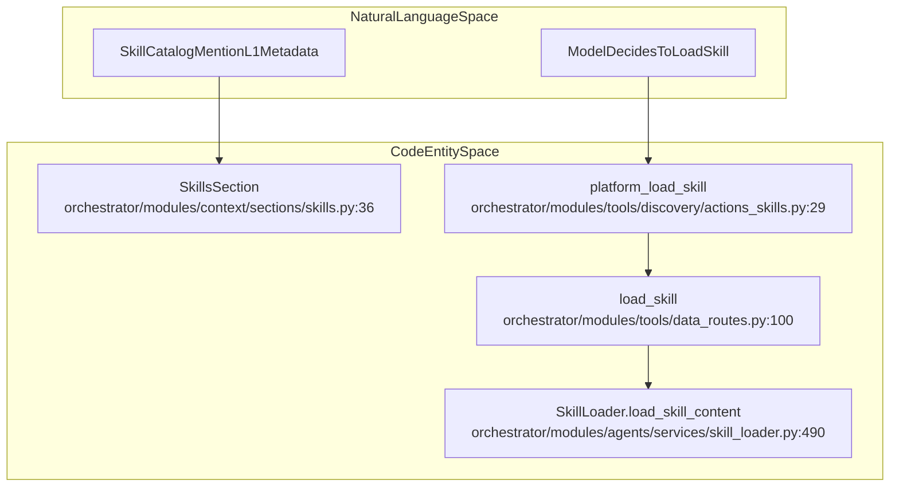

# Section Types

Relevant source files

The following files were used as context for generating this wiki page:

- [orchestrator/consumers/chatbot/knowledge_prefetch.py](orchestrator/consumers/chatbot/knowledge_prefetch.py)
- [orchestrator/core/seeds/utterances/graph.yaml](orchestrator/core/seeds/utterances/graph.yaml)
- [orchestrator/modules/context/result.py](orchestrator/modules/context/result.py)
- [orchestrator/modules/context/sections/documents_inventory.py](orchestrator/modules/context/sections/documents_inventory.py)
- [orchestrator/modules/context/sections/graph_context.py](orchestrator/modules/context/sections/graph_context.py)
- [orchestrator/modules/context/sections/identity.py](orchestrator/modules/context/sections/identity.py)
- [orchestrator/modules/context/sections/skills.py](orchestrator/modules/context/sections/skills.py)
- [orchestrator/modules/context/sections/task_context.py](orchestrator/modules/context/sections/task_context.py)
- [orchestrator/modules/context/service.py](orchestrator/modules/context/service.py)
- [orchestrator/modules/tools/data_routes.py](orchestrator/modules/tools/data_routes.py)
- [orchestrator/modules/tools/discovery/actions_analytics.py](orchestrator/modules/tools/discovery/actions_analytics.py)
- [orchestrator/modules/tools/discovery/actions_data_routes.py](orchestrator/modules/tools/discovery/actions_data_routes.py)
- [orchestrator/modules/tools/discovery/actions_field.py](orchestrator/modules/tools/discovery/actions_field.py)
- [orchestrator/modules/tools/discovery/actions_graph.py](orchestrator/modules/tools/discovery/actions_graph.py)
- [orchestrator/modules/tools/discovery/actions_skills.py](orchestrator/modules/tools/discovery/actions_skills.py)
- [orchestrator/scripts/eval/tool_routing/eval_seed.yaml](orchestrator/scripts/eval/tool_routing/eval_seed.yaml)
- [orchestrator/scripts/eval/tool_routing/eval_set.jsonl](orchestrator/scripts/eval/tool_routing/eval_set.jsonl)
- [orchestrator/scripts/eval/tool_routing/seed_eval_set.py](orchestrator/scripts/eval/tool_routing/seed_eval_set.py)
- [orchestrator/scripts/skill_signal_report.py](orchestrator/scripts/skill_signal_report.py)
- [orchestrator/tests/test_auto_prompt_prefix_is_turn_stable.py](orchestrator/tests/test_auto_prompt_prefix_is_turn_stable.py)
- [orchestrator/tests/test_context/__init__.py](orchestrator/tests/test_context/__init__.py)
- [orchestrator/tests/test_context/conftest.py](orchestrator/tests/test_context/conftest.py)
- [orchestrator/tests/test_context/test_budget_manager.py](orchestrator/tests/test_context/test_budget_manager.py)
- [orchestrator/tests/test_context/test_identity_section.py](orchestrator/tests/test_context/test_identity_section.py)
- [orchestrator/tests/test_context/test_memory_section.py](orchestrator/tests/test_context/test_memory_section.py)
- [orchestrator/tests/test_context/test_prompt_caching.py](orchestrator/tests/test_context/test_prompt_caching.py)
- [orchestrator/tests/test_f077c_a_number_question_goes_to_the_database.py](orchestrator/tests/test_f077c_a_number_question_goes_to_the_database.py)
- [orchestrator/tests/test_f078_the_prompt_names_the_connected_database.py](orchestrator/tests/test_f078_the_prompt_names_the_connected_database.py)
- [orchestrator/tests/test_f155_a_widget_turn_is_told_where_it_is.py](orchestrator/tests/test_f155_a_widget_turn_is_told_where_it_is.py)
- [orchestrator/tests/test_f155_a_widget_turns_prompt_carries_only_what_its_key_may_read.py](orchestrator/tests/test_f155_a_widget_turns_prompt_carries_only_what_its_key_may_read.py)
- [orchestrator/tests/test_f155_widget_born_work_remembers_as_a_widget_turn.py](orchestrator/tests/test_f155_widget_born_work_remembers_as_a_widget_turn.py)
- [orchestrator/tests/test_f227_each_question_is_searched_on_its_own.py](orchestrator/tests/test_f227_each_question_is_searched_on_its_own.py)
- [orchestrator/tests/test_f302_b_a_shop_question_always_reaches_the_database.py](orchestrator/tests/test_f302_b_a_shop_question_always_reaches_the_database.py)
- [orchestrator/tests/test_f312_a_auto_reaches_for_the_knowledge_graph.py](orchestrator/tests/test_f312_a_auto_reaches_for_the_knowledge_graph.py)
- [orchestrator/tests/test_f312_b_the_graph_tools_name_the_graphs_own_relations.py](orchestrator/tests/test_f312_b_the_graph_tools_name_the_graphs_own_relations.py)
- [orchestrator/tests/test_f330_b_a_question_turn_holds_no_connection_while_the_documents_are_searched.py](orchestrator/tests/test_f330_b_a_question_turn_holds_no_connection_while_the_documents_are_searched.py)
- [orchestrator/tests/test_prd202_s2_trigger_activation.py](orchestrator/tests/test_prd202_s2_trigger_activation.py)
- [orchestrator/tests/test_prd263_skill_hash_in_context_trace.py](orchestrator/tests/test_prd263_skill_hash_in_context_trace.py)
- [orchestrator/tests/test_prd263_skill_signal_report.py](orchestrator/tests/test_prd263_skill_signal_report.py)

This page provides comprehensive technical documentation for the individual section types implemented within the `ContextService` prompt-building pipeline `[orchestrator/modules/context/sections/__init__.py:1-76]`. Each section encapsulates a distinct component of the LLM prompt, complete with priority levels, token budgets, and rendering logic.

---

## Purpose and Scope

The section architecture decouples prompt generation into modular, reusable components (`BaseSection` implementations). These sections are dynamically assembled based on the active `ContextMode` `[orchestrator/modules/context/modes.py:1-120]` and filtered through the token budget management system `[orchestrator/modules/context/budget.py:1-147]`.

Sources: `[orchestrator/modules/context/sections/__init__.py:1-76]`, `[orchestrator/modules/context/modes.py:1-120]`, `[orchestrator/modules/context/budget.py:1-147]`

---

## BaseSection and SectionContext Interface

All section implementations inherit from `BaseSection`, defining a uniform interface for prompt construction `[orchestrator/modules/context/sections/base.py:1-50]`.

| Method / Attribute | Type / Signature | Description |
|---|---|---|
| `name` | `str` | Section identifier registered in `SECTION_REGISTRY` |
| `priority` | `int` | Priority tier (1–10); lower numbers denote higher priority and protection against budget trimming |
| `max_tokens` | `Optional[int]` | Optional hard limit for truncation |
| `render(ctx: SectionContext)` | `async def render(ctx: SectionContext) -> str` | Generates the markdown string for the section |
| `truncate(text: str, max_tokens: int)` | `staticmethod` | Truncates text on token boundaries via context guard |

`SectionContext` holds request-scoped data passed across sections, including `agent`, `workspace_id`, `messages`, `task_description`, and `db_session`.

Sources: `[orchestrator/modules/context/sections/base.py:1-50]`, `[orchestrator/modules/context/service.py:173-186]`

---

## Section Registry and Mapping

The `SECTION_REGISTRY` maps string keys declared in `ModeConfig.sections` `[orchestrator/modules/context/modes.py:113-120]` to their concrete `BaseSection` classes `[orchestrator/modules/context/sections/__init__.py:31-51]`.

### Diagram: Natural Language Space to Code Entity Space — Section Architecture

```mermaid
graph TB
    subgraph "NaturalLanguageSpace"
        NL_Identity["AgentIdentityAndPersona"]
        NL_Skills["SkillsAndCapabilitiesCatalog"]
        NL_Task["ActiveTaskAndDependencies"]
        NL_Memory["UserMemoriesAndFieldHistory"]
        NL_Graph["KnowledgeGraphContext"]
        NL_Documents["DocumentsAndDatabasesInventory"]
    end

    subgraph "CodeEntitySpace"
        IdentitySec["IdentitySection<br/>orchestrator/modules/context/sections/identity.py:64"]
        SkillsSec["SkillsSection<br/>orchestrator/modules/context/sections/skills.py:36"]
        TaskSec["TaskContextSection<br/>orchestrator/modules/context/sections/task_context.py:18"]
        MemorySec["MemorySection<br/>orchestrator/modules/context/sections/memory.py"]
        GraphSec["GraphSection<br/>orchestrator/modules/context/sections/graph_context.py:47"]
        DocumentsInvSec["DocumentsInventorySection<br/>orchestrator/modules/context/sections/documents_inventory.py:38"]
        Registry["SECTION_REGISTRY<br/>orchestrator/modules/context/sections/__init__.py:31"]
    end

    NL_Identity --> IdentitySec
    NL_Skills --> SkillsSec
    NL_Task --> TaskSec
    NL_Memory --> MemorySec
    NL_Graph --> GraphSec
    NL_Documents --> DocumentsInvSec

    IdentitySec --> Registry
    SkillsSec --> Registry
    TaskSec --> Registry
    MemorySec --> Registry
    GraphSec --> Registry
    DocumentsInvSec --> Registry
```

Sources: `[orchestrator/modules/context/sections/__init__.py:31-51]`, `[orchestrator/modules/context/sections/identity.py:64]`, `[orchestrator/modules/context/sections/skills.py:36]`, `[orchestrator/modules/context/sections/task_context.py:18]`, `[orchestrator/modules/context/sections/graph_context.py:47]`, `[orchestrator/modules/context/sections/documents_inventory.py:38]`

---

## Core Section Types Reference

| Priority | Section Name | Class Name | Purpose | Max Tokens | Drop Eligible? |
|----------|-------------|------------|---------|------------|---------------|
| 1 | `identity` | `IdentitySection` | Agent name, role, workspace, persona, personality presets | None (Optional) | No (Priority 1) |
| 2 | `task_context` | `TaskContextSection` | Current task description, status, board info, dependency context | 1500 | No (Priority 2) |
| 2 | `onboarding` | `OnboardingSection` | Mission Zero onboarding flow guidance | 800 | No (Priority 2) |
| 3 | `conversation` | `ConversationSection` | Message history formatting and unresolved attachments | N/A | No |
| 3 | `tools` | `ToolsSection` | Tool schemas loader (`FULL`, `FILTERED`, `DISPATCHER_ONLY`) | N/A | No |
| 4 | `skills` | `SkillsSection` | Trigger-based L1 metadata catalog + core L2 body | None | Yes |
| 5 | `platform_actions` | `PlatformActionsSection` | Summary of `platform_*` management tools | 2000 | Yes |
| 6 | `memory` | `MemorySection` | User memories, daily logs, and context bundle | 1500 | Yes |
| 6 | `field_memory` | `FieldMemorySection` | Cross-run durable field memory for heartbeat agents | N/A | Yes |
| 7 | `documents_inventory` | `DocumentsInventorySection` | Names documents and connected databases in the workspace | N/A | Yes |
| 45 | `business_graph` | `GraphSection` | Business knowledge graph insights and routing | 800 | Yes |

Sources: `[orchestrator/modules/context/sections/__init__.py:31-51]`, `[orchestrator/modules/context/sections/identity.py:68-78]`, `[orchestrator/modules/context/sections/task_context.py:18-28]`, `[orchestrator/modules/context/sections/skills.py:44-48]`, `[orchestrator/modules/context/budget.py:121-123]`, `[orchestrator/modules/context/sections/documents_inventory.py:1-23]`, `[orchestrator/modules/context/sections/graph_context.py:47-56]`

---

## Detailed Section Implementations

### IdentitySection (Priority 1)
Implemented in `[orchestrator/modules/context/sections/identity.py:64-164]`. It establishes agent identity. When `personality=True` (configured in `CHATBOT` mode `[orchestrator/modules/context/modes.py:127-136]`), it delegates to `AutomatosPersonality` (`[orchestrator/consumers/chatbot/personality.py:112-172]`) to construct conversational guidelines, greetings, and action styles, drawing on workspace orchestrator settings with TTL caching `[orchestrator/consumers/chatbot/personality.py:37-69]`. For non-chatbot modes (`TASK_EXECUTION`, `HEARTBEAT_AGENT`), it builds a concise, neutral identity prompt incorporating the agent's role, description, persona, and response formatting rules `[orchestrator/modules/context/sections/identity.py:96-125]`.

A special `WIDGET_CHAT_NOTE` is appended for public widget turns, informing the agent about the restricted environment and that owner's assets cannot be changed `[orchestrator/modules/context/sections/identity.py:17-21]`, `[orchestrator/modules/context/sections/identity.py:164]`. This is part of the F155 security surface `[orchestrator/core/security/surface.py:1-20]`.

Sources: `[orchestrator/modules/context/sections/identity.py:64-164]`, `[orchestrator/consumers/chatbot/personality.py:37-172]`, `[orchestrator/modules/context/modes.py:127-136]`, `[orchestrator/core/security/surface.py:1-20]`

### TaskContextSection (Priority 2)
Implemented in `[orchestrator/modules/context/sections/task_context.py:18-88]`. It injects the active task description (`ctx.task_description`), status, priority, board name, and dependency instructions into `TASK_EXECUTION` mode prompts. Because it holds priority 2, it is protected against budget trimming `[orchestrator/modules/context/budget.py:123-125]`.

Sources: `[orchestrator/modules/context/sections/task_context.py:18-88]`, `[orchestrator/modules/context/budget.py:123-125]`

### SkillsSection (Priority 4)
Implemented in `[orchestrator/modules/context/sections/skills.py:36-131]`. It implements trigger-based skill activation to minimize prompt overhead:
- **L1 Metadata**: Every attached non-core skill injects only its name and description (~50-100 tokens), acting as an on-demand catalog `[orchestrator/modules/context/sections/skills.py:110]`.
- **L2 Full Body**: The complete `SKILL.md` body is rendered exclusively for core always-on skills (defined in `_DEFAULT_CORE_ALWAYS_ON` `[orchestrator/modules/context/sections/skills.py:34]`, e.g., `platform-management`) `[orchestrator/modules/context/sections/skills.py:103-109]`.
- **On-Demand Loading**: When the model requires a skill's full instructions, it executes the `platform_load_skill` action `[orchestrator/modules/tools/discovery/actions_skills.py:29-57]`.
- **Widget Turn Handling**: Skills are not included on a widget turn (`widget_turn()`) because `platform_load_skill` is not a widget tool, and the core always-on skill is an owner-facing manual `[orchestrator/modules/context/sections/skills.py:69-75]`.
- **Skill Body Hashing**: The `_body_hash` function `[orchestrator/modules/context/sections/skills.py:49-52]` generates a SHA256 hash of the rendered skill body, which is recorded in `ctx.kwargs[SKILL_BODIES_KEY]` `[orchestrator/modules/context/sections/skills.py:129]` and subsequently included in the `ContextResult.skill_bodies` for tracing `[orchestrator/modules/context/service.py:106-115]`.

### Diagram: Natural Language Space to Code Entity Space — Skills and Tool Execution

Sources: `[orchestrator/modules/context/sections/skills.py:36-131]`, `[orchestrator/modules/tools/discovery/actions_skills.py:29-57]`, `[orchestrator/modules/context/sections/skills.py:69-75]`, `[orchestrator/modules/context/sections/skills.py:49-52]`, `[orchestrator/modules/context/sections/skills.py:129]`, `[orchestrator/modules/context/service.py:106-115]`, `[orchestrator/modules/context/sections/skills.py:34]`, `[orchestrator/modules/context/sections/skills.py:103-109]`, `[orchestrator/modules/tools/data_routes.py:100]`, `[orchestrator/modules/agents/services/skill_loader.py:490]`

---

### PlatformActionsSection (Priority 5)
Implemented in `[orchestrator/modules/context/sections/platform_actions.py:30-108]`. It renders a markdown catalog of available `platform_execute` actions `[orchestrator/modules/tools/discovery/action_registry.py:28-56]`. Working alongside `SmartToolRouter` `[orchestrator/consumers/chatbot/smart_tool_router.py:65-78]` and intent classifiers (`[orchestrator/consumers/chatbot/intent_classifier.py:48-56]`), it maps user intent to registry categories `[orchestrator/consumers/chatbot/smart_tool_router.py:40-52]`. When semantic tool routing (`config.SEMANTIC_TOOL_ROUTING`) is enabled and a user query is present, it uses `ActionSemanticIndex` `[orchestrator/modules/tools/discovery/action_semantic_index.py:113-116]` or `GraphRouter` to rank actions by cosine similarity or edge chains and filter the catalog to the top-$K$ candidates `[orchestrator/modules/context/sections/platform_actions.py:72-91]`.

Sources: `[orchestrator/modules/context/sections/platform_actions.py:30-108]`, `[orchestrator/modules/tools/discovery/action_registry.py:28-56]`, `[orchestrator/consumers/chatbot/smart_tool_router.py:40-78]`, `[orchestrator/modules/tools/discovery/action_semantic_index.py:113-116]`

---

### MemorySection and FieldMemorySection (Priority 6)
- **`MemorySection`**: Injects user memories, historical context bundles from `UnifiedMemoryService`, and daily summaries into chatbot sessions `[orchestrator/modules/context/sections/memory.py]`.
- **`FieldMemorySection`**: Injected in `HEARTBEAT_AGENT` mode `[orchestrator/modules/context/modes.py:166-170]`, it provides the workspace-scoped durable field memory digest, enabling recurring autonomous agents to build upon cross-run learnings `[orchestrator/modules/context/sections/field_memory.py]`. The `platform_field_query` and `platform_field_inject` actions `[orchestrator/modules/tools/discovery/actions_field.py:9-82]` allow agents to interact with this shared field.

Sources: `[orchestrator/modules/context/sections/__init__.py:37-48]`, `[orchestrator/modules/context/modes.py:166-170]`, `[orchestrator/modules/tools/discovery/actions_field.py:9-82]`

---

### DocumentsInventorySection (Priority 7)
Implemented in `[orchestrator/modules/context/sections/documents_inventory.py:1-125]`. This section informs the agent about the documents and connected databases available in the workspace. It dynamically generates a summary of:
- The number and titles of the owner's documents and reports saved by agents `[orchestrator/modules/context/sections/documents_inventory.py:110-123]`.
- The names of active connected databases `[orchestrator/modules/context/sections/documents_inventory.py:64-74]`.
- Guidance on how to use `search_knowledge` for documents and `platform_query_data` for numerical or database record questions `[orchestrator/modules/context/sections/documents_inventory.py:50-57]`.
- Specific instructions for handling spreadsheets, noting they should be processed with code rather than searched `[orchestrator/modules/context/sections/documents_inventory.py:58-61]`.

For widget turns, this section respects the key's scopes, only naming documents and databases that the widget key is permitted to read (`documents:read`, `data:query`) `[orchestrator/modules/context/sections/documents_inventory.py:104-109]`. Working alongside `knowledge_prefetch.py` (`[orchestrator/consumers/chatbot/knowledge_prefetch.py:1-130]`), questions concerning workspace documents can be automatically prefetched prior to the initial model call.

Sources: `[orchestrator/modules/context/sections/documents_inventory.py:1-125]`, `[orchestrator/consumers/chatbot/knowledge_prefetch.py:1-130]`, `[orchestrator/tests/test_f078_the_prompt_names_the_connected_database.py:1-136]`

---

### GraphSection / GraphContext (Priority 45)
Implemented in `[orchestrator/modules/context/sections/graph_context.py:47-162]`. It loads the workspace knowledge graph via `GraphService`, scores nodes against user message terms, and extracts a BFS neighborhood excerpt when relevance clears `_RELEVANCE_THRESHOLD` (0.3) `[orchestrator/modules/context/sections/graph_context.py:32-34]`, `[orchestrator/modules/context/sections/graph_context.py:102-103]`. It also injects `GRAPH_ROUTE_LINE` on chatbot turns, instructing the agent to utilize `platform_query_graph` for relational and multi-document queries `[orchestrator/modules/context/sections/graph_context.py:38-44]`, `[orchestrator/modules/context/sections/graph_context.py:108-116]`. The `platform_graph_path`, `platform_graph_communities`, and `platform_graph_stats` actions `[orchestrator/modules/tools/discovery/actions_graph.py:15-111]` provide agents with capabilities to traverse and analyze the graph.

Sources: `[orchestrator/modules/context/sections/graph_context.py:47-162]`, `[orchestrator/modules/tools/discovery/actions_graph.py:15-111]`

---

## Token Budget Allocation and Trimming

When rendered sections exceed the available budget (`TokenBudget.available_for_sections`), `TokenBudgetManager` `[orchestrator/modules/context/budget.py:51-147]` evaluates sections in descending order of priority number (lowest importance first). Sections with priority 1 and 2 (`identity`, `task_context`, `onboarding`) are explicitly protected and never dropped `[orchestrator/modules/context/budget.py:123-125]`.

Sources: `[orchestrator/modules/context/budget.py:51-147]`

---