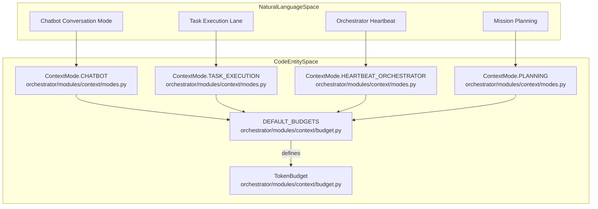
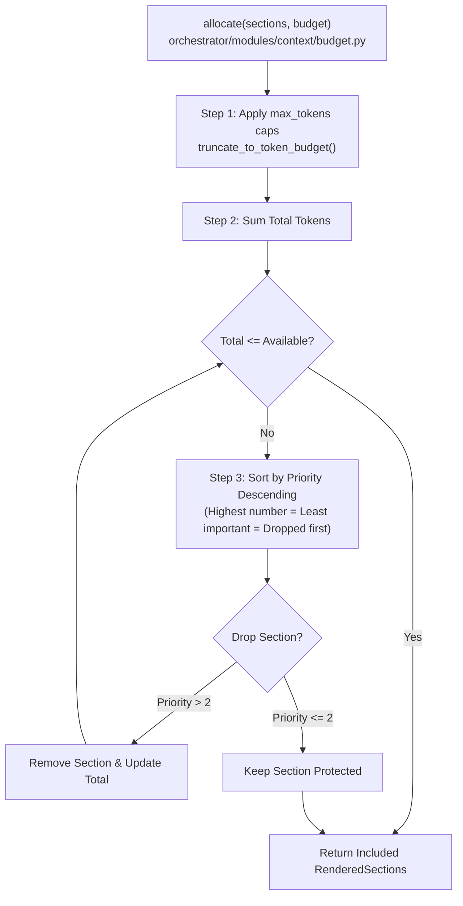
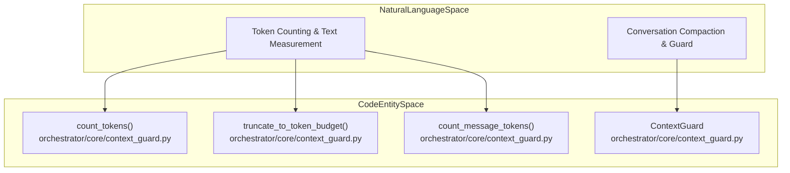

# Token Budget Management

Relevant source files

The following files were used as context for generating this wiki page:

- [orchestrator/alembic/versions/prd201_s1_message_context_trace.py](orchestrator/alembic/versions/prd201_s1_message_context_trace.py)
- [orchestrator/core/attachment_refs.py](orchestrator/core/attachment_refs.py)
- [orchestrator/core/context_guard.py](orchestrator/core/context_guard.py)
- [orchestrator/core/llm/request_scope.py](orchestrator/core/llm/request_scope.py)
- [orchestrator/core/services/skill_l3_execution.py](orchestrator/core/services/skill_l3_execution.py)
- [orchestrator/modules/agents/services/skill_portability.py](orchestrator/modules/agents/services/skill_portability.py)
- [orchestrator/modules/attachments/extract.py](orchestrator/modules/attachments/extract.py)
- [orchestrator/modules/context/__init__.py](orchestrator/modules/context/__init__.py)
- [orchestrator/modules/context/budget.py](orchestrator/modules/context/budget.py)
- [orchestrator/modules/context/modes.py](orchestrator/modules/context/modes.py)
- [orchestrator/modules/context/planning.py](orchestrator/modules/context/planning.py)
- [orchestrator/modules/context/sections/__init__.py](orchestrator/modules/context/sections/__init__.py)
- [orchestrator/modules/context/sections/agent_roster.py](orchestrator/modules/context/sections/agent_roster.py)
- [orchestrator/modules/context/sections/base.py](orchestrator/modules/context/sections/base.py)
- [orchestrator/modules/context/sections/conversation.py](orchestrator/modules/context/sections/conversation.py)
- [orchestrator/modules/context/sections/planning_history.py](orchestrator/modules/context/sections/planning_history.py)
- [orchestrator/modules/tools/discovery/handlers_skill_runtime.py](orchestrator/modules/tools/discovery/handlers_skill_runtime.py)
- [orchestrator/tests/test_context/test_modes.py](orchestrator/tests/test_context/test_modes.py)
- [orchestrator/tests/test_context/test_service.py](orchestrator/tests/test_context/test_service.py)
- [orchestrator/tests/test_context_guard.py](orchestrator/tests/test_context_guard.py)
- [orchestrator/tests/test_f181_b_a_skill_says_which_scripts_it_lacks.py](orchestrator/tests/test_f181_b_a_skill_says_which_scripts_it_lacks.py)
- [orchestrator/tests/test_f191_a_failed_command_is_not_a_success.py](orchestrator/tests/test_f191_a_failed_command_is_not_a_success.py)
- [orchestrator/tests/test_prd164_planning_pack.py](orchestrator/tests/test_prd164_planning_pack.py)
- [orchestrator/tests/test_prd223_attachment_refs.py](orchestrator/tests/test_prd223_attachment_refs.py)

**Purpose and Scope**: This page documents the token budget management system implemented in `ContextService` `[orchestrator/modules/context/service.py:1-25]()` and `TokenBudgetManager` `[orchestrator/modules/context/budget.py:51-147]()`. It controls context allocation across various execution modes, governs sequential section rendering, applies priority-based trimming, and enforces token boundaries via `ContextGuard` `[orchestrator/core/context_guard.py:1-35]()` to prevent context overflow.

---

## 1. Overview and Budget Allocation per Mode

The token budget manager allocates a fixed token budget across rendered sections during prompt assembly. Each context mode defined in `ContextMode` `[orchestrator/modules/context/modes.py:13-25]()` holds a corresponding `ModeConfig` `[orchestrator/modules/context/modes.py:113-121]()` dictating section composition, tool loading behavior, and maximum token bounds `[orchestrator/modules/context/modes.py:113-121]`. 

The system maps natural language execution requirements into concrete budgeting objects, ensuring that responses and messages are correctly provisioned.

### Natural Language Space to Code Entity Space: Budget Mapping

Sources:
- `[orchestrator/modules/context/modes.py:13-25]()`
- `[orchestrator/modules/context/modes.py:113-121]()`
- `[orchestrator/modules/context/budget.py:24-39]()`
- `[orchestrator/modules/context/budget.py:154-195]()`

### Default Budgets by Mode

Token budgets are configured per mode in `DEFAULT_BUDGETS` `[orchestrator/modules/context/budget.py:154-195]()`. A `TokenBudget` `[orchestrator/modules/context/budget.py:24-39]()` calculates available space using total window size, reserved response tokens, and reserved message history tokens `[orchestrator/modules/context/budget.py:31-38]()`.

| ContextMode | Total Budget | Reserved (Response) | Reserved (Messages) | Available for Sections |
| :--- | :--- | :--- | :--- | :--- |
| `CHATBOT` | 128,000 | 4,096 | 60,000 | 63,904 |
| `TASK_EXECUTION` | 128,000 | 4,096 | 20,000 | 103,904 |
| `HEARTBEAT_ORCHESTRATOR`| 128,000 | 2,048 | 0 | 125,952 |
| `HEARTBEAT_AGENT` | 128,000 | 4,096 | 0 | 123,904 |
| `RECIPE` | 128,000 | 4,096 | 10,000 | 113,904 |
| `NL2SQL` | 128,000 | 2,048 | 2,000 | 123,952 |
| `ROUTER` | 128,000 | 4,096 | 0 | 123,904 |
| `ORCHESTRATOR_STAGE` | 128,000 | 4,096 | 0 | 123,904 |
| `COORDINATOR` | 128,000 | 4,096 | 0 | 123,904 |
| `PLANNING` | 128,000 | 4,096 | 0 | 123,904 |
| `CHECK_IN` | 128,000 | 4,096 | 0 | 123,904 |

Sources:
- `[orchestrator/modules/context/budget.py:24-39]()`
- `[orchestrator/modules/context/budget.py:154-195]()`
- `[orchestrator/modules/context/modes.py:113-169]()`

---

## 2. Sequential Section Allocation and TokenBudgetManager

The `TokenBudgetManager` `[orchestrator/modules/context/budget.py:51-147]()` processes `RenderedSection` `[orchestrator/modules/context/budget.py:41-49]()` objects sequentially. It applies per-section constraints and executes priority-based trimming if the accumulated token count exceeds available limits.

### Token Budget Allocation Data Flow

Sources:
- `[orchestrator/modules/context/budget.py:64-147]()`
- `[orchestrator/modules/context/budget.py:41-49]()`

**Allocation Workflow**:
1. **Per-Section Capping**: Individual sections specify `max_tokens` limits. If exceeded, `truncate_to_token_budget` `[orchestrator/core/context_guard.py:83-110]()` truncates content cleanly on token boundaries without splitting words or JSON payloads `[orchestrator/modules/context/budget.py:80-103]()`.
2. **Descending Priority Sorting**: Sections are evaluated in reverse priority order (highest integer value first) `[orchestrator/modules/context/budget.py:115-117]()`.
3. **Budget Enforcement**: Dropping occurs iteratively until total token consumption fits within `available_for_sections` `[orchestrator/modules/context/budget.py:120-135]()`.

Sources:
- `[orchestrator/modules/context/budget.py:64-147]()`
- `[orchestrator/core/context_guard.py:83-110]()`

---

## 3. Priority-Based Trimming and Protected Tiers

The framework categorizes context sections using a 1-10 priority hierarchy (defined in `SECTION_REGISTRY` mapping) `[orchestrator/modules/context/sections/__init__.py:33-56]()`. Lower numbers indicate higher structural importance.

### Section Priority Registry

| Priority | Section Name | Role | Class Implementation |
| :--- | :--- | :--- | :--- |
| **1** | `identity` | Agent name, role, persona, response style | `IdentitySection` |
| **2** | `task_context` | Current task description and metadata | `TaskContextSection` |
| **2** | `onboarding` | Mission Zero workspace setup prompts | `OnboardingSection` |
| **2** | `mission_context` | Mission goal, plan, and task statuses | `MissionContextSection` |
| **2** | `playbook_context`| Recipe execution step data | `PlaybookContextSection` |
| **2** | `planning_history`| Past failures for learning loop | `PlanningHistorySection` |
| **2** | `planning_knowledge`| Knowledge for planning (e.g., RAG) | `PlanningKnowledgeSection` |
| **3** | `agent_roster` | Available agents with capabilities for the coordinator | `AgentRosterSection` |
| **3** | `tools` | Tool choice and loading | `ToolsSection` |
| **4** | `skills` | Skill instructions and tool usage guides | `SkillsSection` |
| **5** | `platform_actions`| Summaries of available system tools | `PlatformActionsSection` |
| **5** | `plugins` | Non-materialized plugin capabilities | `PluginsSection` |
| **5** | `composio` | External app descriptions | `ComposioSection` |
| **6** | `memory` | User facts, session context, and logs | `MemorySection` |
| **6** | `field_memory` | Workspace-scoped field memory for recurring agents | `FieldMemorySection` |
| **8** | `datetime_context`| Current timestamp for temporal grounding | `DatetimeContextSection` |
| **9** | `conversation` | Formatted chat history | `ConversationSection` |
| **10** | `custom` | Dynamic overrides or one-off prompts | `CustomSection` |

**Protected Tiers**: Sections with `priority <= 2` are explicitly exempted from dropping by `TokenBudgetManager` `[orchestrator/modules/context/budget.py:124-125]()`. This guarantees that core instructions (identity and task context) remain intact even under severe token pressure.

Sources:
- `[orchestrator/modules/context/sections/__init__.py:33-56]()`
- `[orchestrator/modules/context/budget.py:124-125]()`
- `[orchestrator/modules/context/sections/agent_roster.py:27-30]()`

---

## 4. Context Guard and Token Estimation

The system uses `tiktoken` for accurate token quantification. When `tiktoken` is unavailable, it falls back to a character estimation heuristic (~4 characters per token).

### Natural Language Space to Code Entity Space: Guard Operations

Sources:
- `[orchestrator/core/context_guard.py:1-35]()`
- `[orchestrator/core/context_guard.py:41-135]()`

- **`count_tokens`**: Measures individual string payloads using tokenizers `[orchestrator/core/context_guard.py:72-81]()`.
- **`truncate_to_token_budget`**: Enforces strict token-boundary truncation with optional suffixes `[orchestrator/core/context_guard.py:83-110]()`.
- **`count_message_tokens`**: Computes total payload sizes across role headers, content structures, and tool call objects `[orchestrator/core/context_guard.py:112-135]()`.
- **`ContextGuard`**: Intercepts requests before upstream LLM calls, tracking window utilization and executing conversational compaction when limits are approached `[orchestrator/core/context_guard.py:1-35]()`.

Sources:
- `[orchestrator/core/context_guard.py:1-35]()`
- `[orchestrator/core/context_guard.py:41-135]()`

---