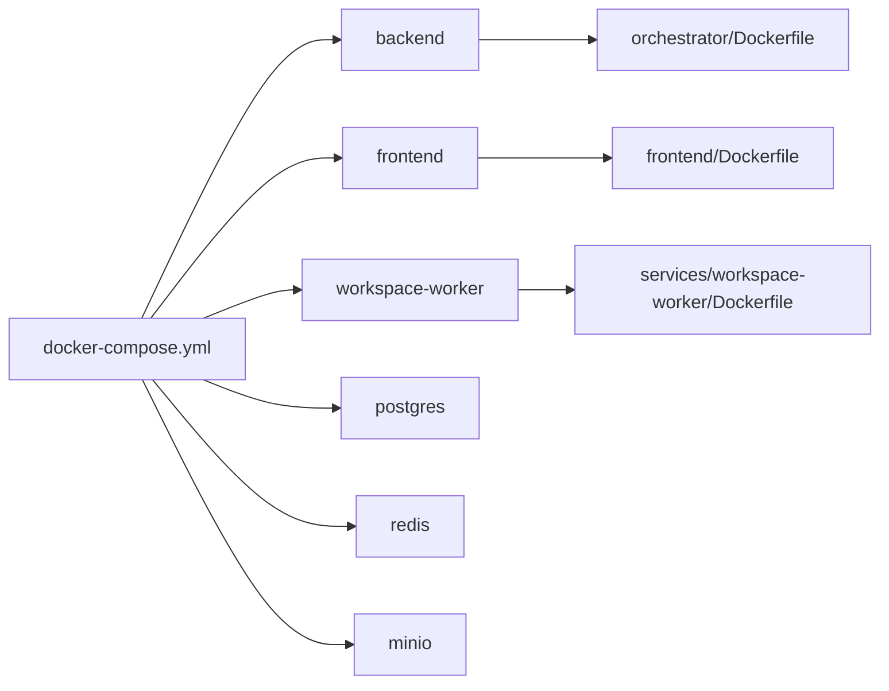
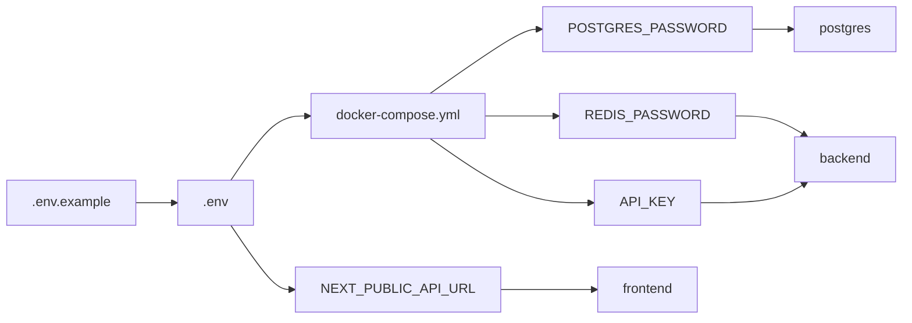

# Deployment & Infrastructure

Relevant source files

The following files were used as context for generating this wiki page:

- [.env.example](.env.example)
- [.grype.yaml](.grype.yaml)
- [docker-compose.yml](docker-compose.yml)
- [frontend/Dockerfile](frontend/Dockerfile)
- [orchestrator/Dockerfile](orchestrator/Dockerfile)
- [orchestrator/requirements-dev.lock](orchestrator/requirements-dev.lock)
- [orchestrator/requirements-dev.txt](orchestrator/requirements-dev.txt)
- [orchestrator/requirements.lock](orchestrator/requirements.lock)
- [orchestrator/tests/test_prd262_agent_opt_worker_image.py](orchestrator/tests/test_prd262_agent_opt_worker_image.py)
- [orchestrator/tests/test_prd262_media_render_esbuild.py](orchestrator/tests/test_prd262_media_render_esbuild.py)
- [orchestrator/tests/test_prd262_media_render_stages.py](orchestrator/tests/test_prd262_media_render_stages.py)
- [services/agent-opt-worker/Dockerfile](services/agent-opt-worker/Dockerfile)
- [services/agent-opt-worker/overrides.txt](services/agent-opt-worker/overrides.txt)
- [services/agent-opt-worker/requirements.in](services/agent-opt-worker/requirements.in)
- [services/agent-opt-worker/requirements.lock](services/agent-opt-worker/requirements.lock)
- [services/media-render/Dockerfile](services/media-render/Dockerfile)
- [services/media-render/requirements.lock](services/media-render/requirements.lock)
- [services/media-render/tests/test_image_esbuild.py](services/media-render/tests/test_image_esbuild.py)
- [services/workspace-worker/requirements.lock](services/workspace-worker/requirements.lock)

## Purpose and Scope

This page maps Automatos AI’s deployment surface at a high level: container images, local Compose environments, configuration, data services, CI/CD, production deployment, and Kubernetes. The Compose configuration distinguishes production images from the development setup, which uses separate development stages and source mounts [docker-compose.yml:25-28]().

For implementation and operational details, follow the child pages below.

**Related Child Pages**
- For application Dockerfiles, entrypoints, and production-parity testing, see [Docker Containerization](#20.1).
- For Compose services, profiles, health checks, and local environment defaults, see [Docker Compose & Environments](#20.2).
- For secrets and service configuration, see [Environment Variables](#20.3).
- For PostgreSQL, migrations, and Redis, see [Database & Redis Setup](#20.4).
- For GitHub Actions and deployment automation, see [CI/CD & Automation Scripts](#20.5).
- For Railway topology and production operations, see [Production Deployment](#20.6).
- For Helm and Kind-based deployment, see [Kubernetes & Helm Chart](#20.7).

Sources: [docker-compose.yml:25-28]()

## System Architecture & Production Topology

The local Compose configuration names backend, frontend, and workspace-worker as application services, alongside data services such as PostgreSQL, Redis, and MinIO. Optional Compose profiles extend the stack with memory, search, media, voice, or database administration components [docker-compose.yml:30-36](), [docker-compose.yml:52-78](). The diagrams connect those deployment terms to file and service names used in the repository.

### Diagram: Compose Services and Container Definitions

Sources: [docker-compose.yml:30-36](), [docker-compose.yml:52-78](), [orchestrator/Dockerfile:1-12](), [frontend/Dockerfile:1-10]()

### Diagram: Environment Configuration to Compose Services

Sources: [.env.example:4-9](), [.env.example:15-42](), [docker-compose.yml:46-50]()

## 20.1 Docker Containerization

The backend Dockerfile describes separate build stages for dependency installation, development, compilation, and production [orchestrator/Dockerfile:5-12](). The frontend Dockerfile describes development, production-build, and runtime-oriented stages [frontend/Dockerfile:5-10](). Other service images and entrypoint behavior are covered in the child page.

For details, see [Docker Containerization](#20.1).

Sources: [orchestrator/Dockerfile:5-12](), [frontend/Dockerfile:5-10]()

## 20.2 Docker Compose & Environments

`docker-compose.yml` is the unified Compose configuration. It documents default and optional profiles, including `all`, `memory`, `search`, `media`, and `voice`, as well as a core override that can omit the workspace worker [docker-compose.yml:52-78](). Published ports default to loopback through `BIND_ADDRESS`; the configuration also describes separate publish-address settings for the API and web app [docker-compose.yml:10-19]().

For details, see [Docker Compose & Environments](#20.2).

Sources: [docker-compose.yml:10-19](), [docker-compose.yml:52-78]()

## 20.3 Environment Variables

`.env.example` groups settings for PostgreSQL, Redis, API access, frontend URLs, LLM providers, integrations, authentication, and object storage [\.env.example:12-42](), [\.env.example:44-70](), [\.env.example:92-124](). The Compose configuration requires non-placeholder values for `POSTGRES_PASSWORD`, `REDIS_PASSWORD`, and `API_KEY` [docker-compose.yml:46-50]().

For details, see [Environment Variables](#20.3).

Sources: [.env.example:12-42](), [.env.example:44-70](), [.env.example:92-124](), [docker-compose.yml:46-50]()

## 20.4 Database & Redis Setup

The Compose configuration uses a PostgreSQL 16 image with `pgvector` and mounts the database data directory to the `postgres_data` volume [docker-compose.yml:86-100](). Redis is named among the default Compose services [docker-compose.yml:52-55](). Migrations, seed data, and Redis behavior are covered in the child page.

For details, see [Database & Redis Setup](#20.4).

Sources: [docker-compose.yml:52-55](), [docker-compose.yml:86-100]()

## 20.5 CI/CD & Automation Scripts

CI/CD and automation scripts are a separate part of the deployment landscape. The supplied container configuration describes production images as the images used by the local Compose application services, and notes that CI publishes their image names [docker-compose.yml:25-36](). Workflow and automation details belong in the child page.

For details, see [CI/CD & Automation Scripts](#20.5).

Sources: [docker-compose.yml:25-36]()

## 20.6 Production Deployment

Production deployment concerns include how application images and supporting services are run outside the local Compose environment. The backend Dockerfile states that its final production stage is also used by Railway builds [orchestrator/Dockerfile:23-29](). For deployment topology, scaling, monitoring, and operational guidance, see the child page.

For details, see [Production Deployment](#20.6).

Sources: [orchestrator/Dockerfile:23-29]()

## 20.7 Kubernetes & Helm Chart

Kubernetes and Helm deployment are covered by the child page. This parent page provides the deployment map; consult that page for the chart, local cluster manifests, and Kubernetes verification details.

For details, see [Kubernetes & Helm Chart](#20.7).

Sources: [docker-compose.yml:25-36]()

---