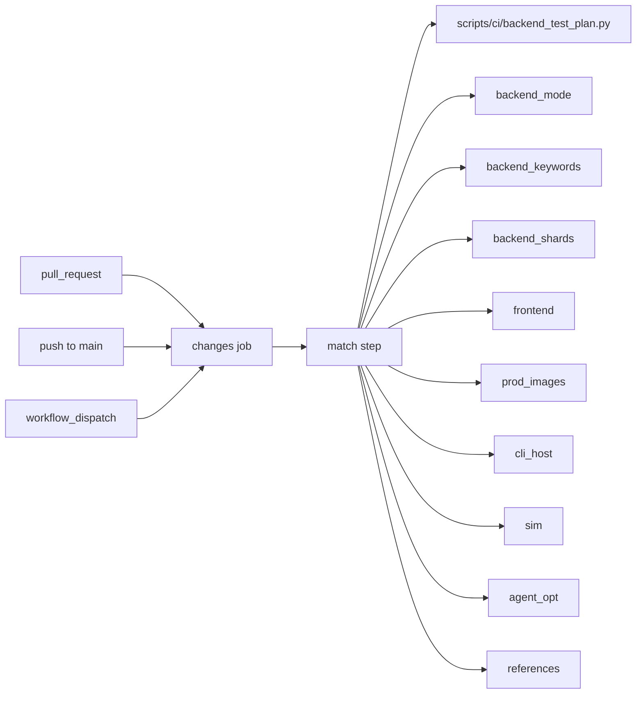
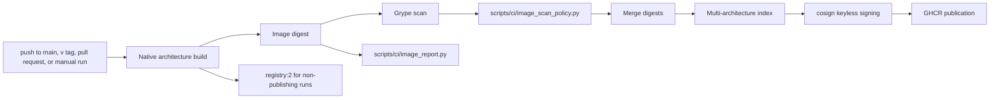
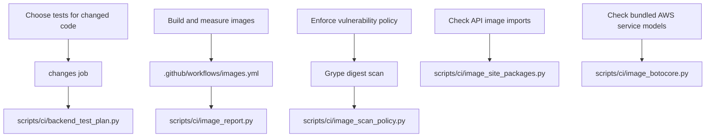
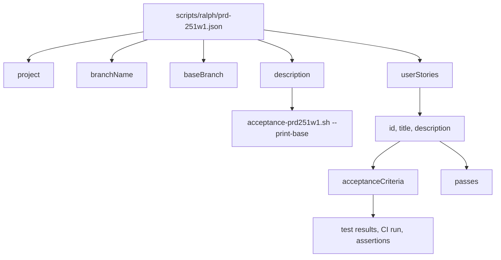
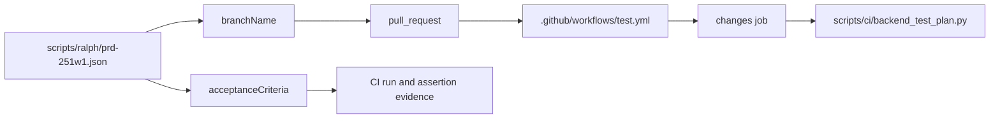
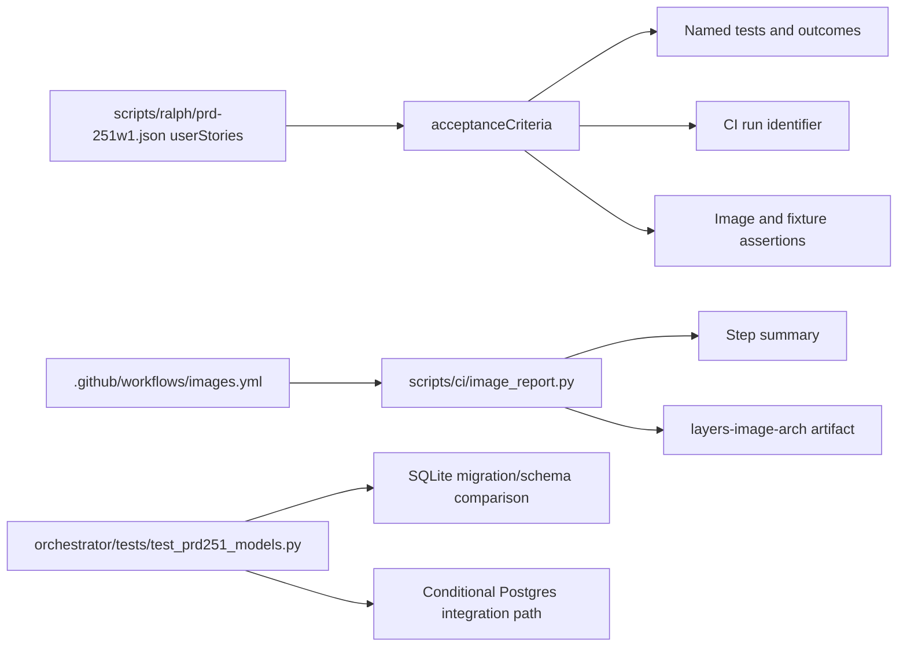

# CI/CD & Automation Scripts

Relevant source files

The following files were used as context for generating this wiki page:

- [.github/workflows/images.yml](.github/workflows/images.yml)
- [.github/workflows/test.yml](.github/workflows/test.yml)
- [QUICKSTART.md](QUICKSTART.md)
- [SETUP.md](SETUP.md)
- [charts/automatos/README.md](charts/automatos/README.md)
- [charts/automatos/templates/worker.yaml](charts/automatos/templates/worker.yaml)
- [docs/PRDS/PRD-251A-SOCIALS-REFERENCE-PIPELINE.md](docs/PRDS/PRD-251A-SOCIALS-REFERENCE-PIPELINE.md)
- [docs/agents/llm-provider-management.md](docs/agents/llm-provider-management.md)
- [docs/getting-started/self-hosting.md](docs/getting-started/self-hosting.md)
- [frontend/components/deliverables/socials/socials-claim-source.tsx](frontend/components/deliverables/socials/socials-claim-source.tsx)
- [frontend/components/marketplace/__tests__/github-import-modal.test.tsx](frontend/components/marketplace/__tests__/github-import-modal.test.tsx)
- [frontend/components/marketplace/__tests__/marketplace-admin-gate.test.ts](frontend/components/marketplace/__tests__/marketplace-admin-gate.test.ts)
- [frontend/components/settings/ComposioDenyListTab.tsx](frontend/components/settings/ComposioDenyListTab.tsx)
- [frontend/components/settings/__tests__/socials-composio-deny-list-tab.test.tsx](frontend/components/settings/__tests__/socials-composio-deny-list-tab.test.tsx)
- [frontend/lib/baseline-skills.ts](frontend/lib/baseline-skills.ts)
- [frontend/lib/tooltips.json](frontend/lib/tooltips.json)
- [orchestrator/alembic/versions/prd251_socials.py](orchestrator/alembic/versions/prd251_socials.py)
- [orchestrator/alembic/versions/prd251_wave2.py](orchestrator/alembic/versions/prd251_wave2.py)
- [orchestrator/core/composio/post_gate.py](orchestrator/core/composio/post_gate.py)
- [orchestrator/core/models/socials.py](orchestrator/core/models/socials.py)
- [orchestrator/modules/socials/settings.py](orchestrator/modules/socials/settings.py)
- [orchestrator/tests/test_818_every_make_target_has_its_commands_in_the_guide.py](orchestrator/tests/test_818_every_make_target_has_its_commands_in_the_guide.py)
- [orchestrator/tests/test_compose_published_images.py](orchestrator/tests/test_compose_published_images.py)
- [orchestrator/tests/test_config_env_centralization.py](orchestrator/tests/test_config_env_centralization.py)
- [orchestrator/tests/test_f452_worker_cannot_regain_privileges.py](orchestrator/tests/test_f452_worker_cannot_regain_privileges.py)
- [orchestrator/tests/test_prd251_models.py](orchestrator/tests/test_prd251_models.py)
- [orchestrator/tests/test_prd251_settings.py](orchestrator/tests/test_prd251_settings.py)
- [orchestrator/tests/test_prd251bw1_migration.py](orchestrator/tests/test_prd251bw1_migration.py)
- [orchestrator/tests/test_prd251bw2_maker.py](orchestrator/tests/test_prd251bw2_maker.py)
- [orchestrator/tests/test_prd251bw2_migration.py](orchestrator/tests/test_prd251bw2_migration.py)
- [orchestrator/tests/test_prd251w1_post_gate.py](orchestrator/tests/test_prd251w1_post_gate.py)
- [orchestrator/tests/test_prd251w2_campaigns.py](orchestrator/tests/test_prd251w2_campaigns.py)
- [orchestrator/tests/test_prd262_core_stack.py](orchestrator/tests/test_prd262_core_stack.py)
- [orchestrator/tests/test_prd262_dependabot.py](orchestrator/tests/test_prd262_dependabot.py)
- [orchestrator/tests/test_prd262_worker_boot.py](orchestrator/tests/test_prd262_worker_boot.py)
- [orchestrator/tests/test_prd262_worker_diet.py](orchestrator/tests/test_prd262_worker_diet.py)
- [orchestrator/tests/test_setup_runbook.py](orchestrator/tests/test_setup_runbook.py)
- [scripts/ci/image_worker_toolchain.py](scripts/ci/image_worker_toolchain.py)
- [scripts/ci/smoke-core-stack.sh](scripts/ci/smoke-core-stack.sh)
- [scripts/ralph/PROMPT_build_prd251.md](scripts/ralph/PROMPT_build_prd251.md)
- [scripts/ralph/PROMPT_review_prd251.md](scripts/ralph/PROMPT_review_prd251.md)
- [scripts/ralph/acceptance-prd251.sh](scripts/ralph/acceptance-prd251.sh)
- [scripts/ralph/prd-251.json](scripts/ralph/prd-251.json)
- [scripts/ralph/prd-251w1.json](scripts/ralph/prd-251w1.json)
- [services/workspace-worker/Dockerfile](services/workspace-worker/Dockerfile)
- [services/workspace-worker/entrypoint.sh](services/workspace-worker/entrypoint.sh)

## Purpose and scope

This page documents the CI workflows and automation mechanisms evidenced in the supplied repository files: the test workflow’s lane-planning entry point, the container-image workflow’s build and publication policy, and the `scripts/ralph` PRD manifests’ story and acceptance-evidence structure. The supplied excerpts do not show the implementations of `scripts/ci` or `scripts/dr`, nor the acceptance scripts themselves, so their internal behavior is not specified here. [.github/workflows/test.yml:1-23](), [.github/workflows/images.yml:1-31](), [scripts/ralph/prd-251.json:1-21](), [scripts/ralph/prd-251w1.json:1-20]()

Sources: [.github/workflows/test.yml:1-23](), [.github/workflows/images.yml:1-31](), [scripts/ralph/prd-251.json:1-21](), [scripts/ralph/prd-251w1.json:1-20]()

---

## 1. GitHub Actions Workflows & Test Infrastructure

### 1.1 Test workflow triggers and lane planning

The `test` workflow runs on pull requests, pushes to `main`, and manual `workflow_dispatch`. It uses a concurrency group keyed by workflow and Git ref, cancelling a superseded run on the same ref. The workflow comments explain that running on every branch caused duplicate work for PR commits; branches receive the test net by opening a PR. [.github/workflows/test.yml:12-18](), [.github/workflows/test.yml:31-41]()

The `changes` job determines which path-gated lanes a run needs. It has a five-minute timeout, read permissions for contents and pull requests, and exposes outputs for the image, frontend, CLI host, simulation, agent optimization, references, and backend test planning lanes. Its checkout is sparse: it includes `orchestrator/tests` and `scripts/ci`. [.github/workflows/test.yml:43-80]()

The planner step receives the GitHub event, repository, PR number, and a backend shard count of four. The workflow comments identify `scripts/ci/backend_test_plan.py` as the backend planner: broad backend-impacting changes run all tests in parallel shards; narrower changes select tests based on touched files; changes with no test readers can select no backend tests. The available excerpt does not show the planner implementation or the commands used by downstream jobs, so those details are not inferred here. [.github/workflows/test.yml:49-72](), [.github/workflows/test.yml:82-88]()

| Workflow input or output | Role evidenced in the workflow |
|---|---|
| `EVENT`, `REPO`, `PR` | Identify the event and PR context passed to the planner step. |
| `BACKEND_SHARDS` | Sets the backend shard count to `4`. |
| `backend_mode`, `backend_keywords` | Outputs for backend test selection. |
| `backend_shards`, `backend_shard_count` | Outputs for backend shard planning. |
| `prod_images`, `frontend`, `cli_host`, `sim`, `agent_opt`, `references` | Outputs controlling path-gated lanes. |

[.github/workflows/test.yml:62-72](), [.github/workflows/test.yml:82-88]()

#### Diagram: Test workflow inputs mapped to planner entities

Sources: [.github/workflows/test.yml:31-37](), [.github/workflows/test.yml:43-72](), [.github/workflows/test.yml:82-88]()

The workflow’s comments define a fail-safe for path planning: on main and manual runs, all lanes run; if PR file information cannot be read or is truncated, all lanes run rather than risk omitting a required lane. The `changes` job uses read-only repository and pull-request permissions. [.github/workflows/test.yml:43-47](), [.github/workflows/test.yml:59-61]()

Sources: [.github/workflows/test.yml:43-61]()

### 1.2 Container image workflow

The `images` workflow builds platform images for `linux/amd64` and `linux/arm64`. Its documented publication policy distinguishes publishing runs from measurement runs: `main` and `v*` tags publish to GHCR, while pull requests and manual runs on other branches build and push by digest to a temporary `registry:2` service inside the job. Builds read the cache; only publishing runs write the general build cache. [.github/workflows/images.yml:1-10]()

For publishing, a `main` push receives a `sha-<short>` tag, while a version tag receives both `X.Y.Z` and `X.Y`. The workflow also documents content-tree tags (`tree-<12>`) for image build contexts. The workflow does not move `edge`; a separate smoke workflow is described as booting main publishes before promoting `edge`. [.github/workflows/images.yml:11-21]()

Builds run on native architecture-specific runners, avoiding QEMU. Each architecture’s pushed digest is scanned with Grype. The stated image scan policy blocks fixable Critical findings and any severity matching CISA’s Known Exploited Vulnerabilities list unless `.grype.yaml` provides an allowlist entry with a reason and expiry. The merge job waits for all build jobs before combining digests into a multi-architecture index and signing it using keyless cosign through GitHub OIDC. [.github/workflows/images.yml:22-31]()

The workflow also describes image-specific handling: `agent-opt-worker` is built for amd64 and is not published to GHCR; `media-render` and `voice-tts` are built for both architectures but are likewise kept out of GHCR publication. The media-render image’s scan is report-only until its initial findings are fixed or allowlisted. [.github/workflows/images.yml:32-48]()

#### Diagram: Image build, scan, and publication entities

Sources: [.github/workflows/images.yml:3-10](), [.github/workflows/images.yml:22-31](), [.github/workflows/images.yml:49-56]()

The image workflow documents additional reporting and verification work. Build reports include image size, layer details, and update deltas, and are checked against `.github/image-budgets.json` using `scripts/ci/image_report.py`. API image checks include site-package native-library loading and `import main` via `scripts/ci/image_site_packages.py`, as well as botocore service-model checks via `scripts/ci/image_botocore.py`. [.github/workflows/images.yml:49-61]()

The workflow also describes reproducible API builds, weekly operating-system package rebuilds, and a manually triggered media-assets publication path. These are workflow policies; implementation details beyond the cited description are not expanded here. [.github/workflows/images.yml:62-81]()

Sources: [.github/workflows/images.yml:49-81]()

### 1.3 Workflow policy and code-entity map

The names used by the CI configuration connect human-facing responsibilities to searchable workflow and script entities: `changes` selects lanes, `backend_test_plan.py` plans backend tests, `image_report.py` reports image characteristics, and `image_scan_policy.py` enforces scan policy. [.github/workflows/test.yml:43-72](), [.github/workflows/images.yml:22-29](), [.github/workflows/images.yml:49-61]()

#### Diagram: CI responsibilities mapped to code entities

Sources: [.github/workflows/test.yml:49-72](), [.github/workflows/images.yml:22-29](), [.github/workflows/images.yml:49-61]()

---

## 2. Scripts and automation scope

The supplied workflow excerpts identify several `scripts/ci` utilities and show that the test workflow checks out `scripts/ci` for lane planning. The available material does not include the contents of those scripts or any `scripts/dr` files, so their command-line interfaces, functions, data formats, and execution behavior cannot be documented reliably from this source set. [.github/workflows/test.yml:73-80](), [.github/workflows/test.yml:49-54](), [.github/workflows/images.yml:22-29](), [.github/workflows/images.yml:49-61]()

| Script or path | Role stated by supplied files |
|---|---|
| `scripts/ci/backend_test_plan.py` | Plans backend test scope from PR file changes. |
| `scripts/ci/image_scan_policy.py` | Applies the documented image vulnerability scan policy. |
| `scripts/ci/image_report.py` | Reports image size, layers, and update deltas and checks image budgets. |
| `scripts/ci/image_site_packages.py` | Checks native-library loading and `import main` in API images. |
| `scripts/ci/image_botocore.py` | Checks botocore service models and client construction. |
| `scripts/dr` | No implementation details are present in the supplied excerpts. |

[.github/workflows/test.yml:49-54](), [.github/workflows/images.yml:22-29](), [.github/workflows/images.yml:49-61]()

Sources: [.github/workflows/test.yml:49-54](), [.github/workflows/test.yml:73-80](), [.github/workflows/images.yml:22-29](), [.github/workflows/images.yml:49-61]()

---

## 3. The Ralph PRD Automation Loop

The supplied `scripts/ralph` manifests represent PRD work as named implementation waves. Each manifest records project metadata, a branch and base branch, a description of scope, and a `userStories` collection. Story records include identifiers, titles, descriptions, acceptance criteria, priority, and a `passes` state. [.github/workflows/test.yml:17-17](), [scripts/ralph/prd-251.json:1-21](), [scripts/ralph/prd-251w1.json:1-20]()

`prd-251.json` describes Wave 0 on `feat/prd-251-socials` based on `main`; its description distinguishes the initial configuration, tables, service/API, prerequisite fixes, and Socials tab from later rendering, scheduling, and publishing work. `prd-251w1.json` describes a subsequent wave with its own branch and base branch, story scope, and a stated diff-base command: `bash scripts/ralph/acceptance-prd251w1.sh --print-base`. [.github/workflows/test.yml:17-17](), [scripts/ralph/prd-251.json:1-5](), [scripts/ralph/prd-251w1.json:1-5]()

The manifests preserve completion evidence inside acceptance criteria. The Wave 0 manifest records test names and a CI run identifier for settings, workspace gating, and permissions. The Wave 1 manifest records a CI run identifier and evidence for image construction, fixture output assertions, boot checks, Kokoro synthesis, and required CI jobs. These are manifest entries describing recorded results, not independent verification of current CI status. [scripts/ralph/prd-251.json:11-18](), [scripts/ralph/prd-251w1.json:11-17]()

### 3.1 Ralph manifest data flow

#### Diagram: PRD manifest entities and recorded completion evidence

Sources: [scripts/ralph/prd-251w1.json:1-20]()

### 3.2 Wave boundaries and workflow linkage

The Wave 0 manifest states that its work does not include media rendering, scheduling, or channel publishing, and describes those as later waves. The Wave 1 manifest identifies its own scope and enumerates the CI jobs it records as required for that wave’s gate. The test workflow comments explain that the Ralph runner opens a PR after seeding a wave, allowing the PR-triggered test net to run. [.github/workflows/test.yml:12-18](), [scripts/ralph/prd-251.json:1-5](), [scripts/ralph/prd-251w1.json:1-17]()

#### Diagram: Ralph wave manifest connected to PR-based CI

Sources: [.github/workflows/test.yml:12-18](), [.github/workflows/test.yml:31-37](), [.github/workflows/test.yml:43-72](), [scripts/ralph/prd-251w1.json:1-17]()

Sources: [.github/workflows/test.yml:12-18](), [scripts/ralph/prd-251.json:1-21](), [scripts/ralph/prd-251w1.json:1-20]()

---

## 4. Acceptance checks, reports, and dossiers

Acceptance evidence appears in two supplied forms. First, Ralph manifests embed acceptance criteria with completion notes, test names, and CI run identifiers. Second, the CI workflow descriptions identify image reports and image artifacts: `image_report.py` produces size, layer, and update-delta information, including step summaries and `layers-<image>-<arch>` artifacts. [scripts/ralph/prd-251.json:11-18](), [scripts/ralph/prd-251w1.json:11-17](), [.github/workflows/images.yml:49-56]()

The Wave 1 manifest records the diff-base invocation `bash scripts/ralph/acceptance-prd251w1.sh --print-base`. The acceptance script contents are not included in the supplied files, so its implementation, checks, exit behavior, and report format are not described here. [scripts/ralph/prd-251w1.json:5]()

The separate model test `test_prd251_models.py` describes how the Socials model and migration schema are compared. It runs Alembic migration operations on SQLite and compares reflected schema properties, including columns, primary keys, uniqueness, checks, foreign keys, and indexes. Its module documentation also describes a Postgres integration path that skips cleanly when Postgres is unavailable. [orchestrator/tests/test_prd251_models.py:1-25](), [orchestrator/tests/test_prd251_models.py:76-120](), [orchestrator/tests/test_prd251_models.py:138-161]()

### 4.1 Acceptance evidence flow

#### Diagram: Acceptance records and CI-generated reports

Sources: [scripts/ralph/prd-251w1.json:11-17](), [.github/workflows/images.yml:49-56](), [orchestrator/tests/test_prd251_models.py:1-25](), [orchestrator/tests/test_prd251_models.py:76-120]()

Sources: [.github/workflows/images.yml:49-61](), [scripts/ralph/prd-251.json:11-18](), [scripts/ralph/prd-251w1.json:5](), [scripts/ralph/prd-251w1.json:11-17](), [orchestrator/tests/test_prd251_models.py:1-25]()

---