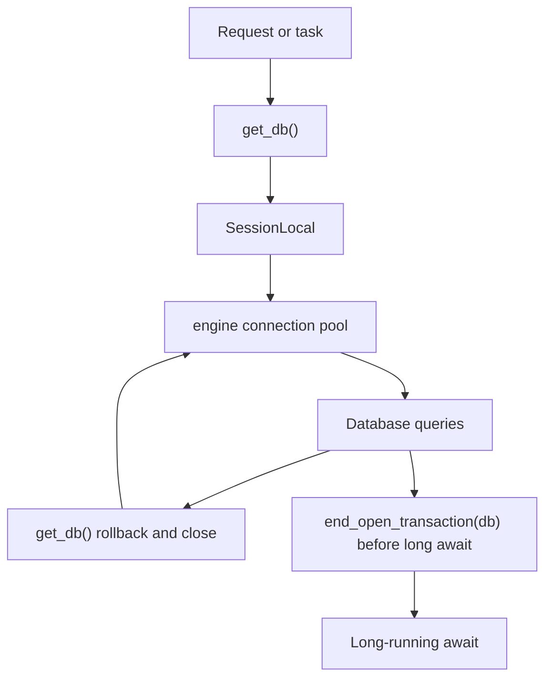
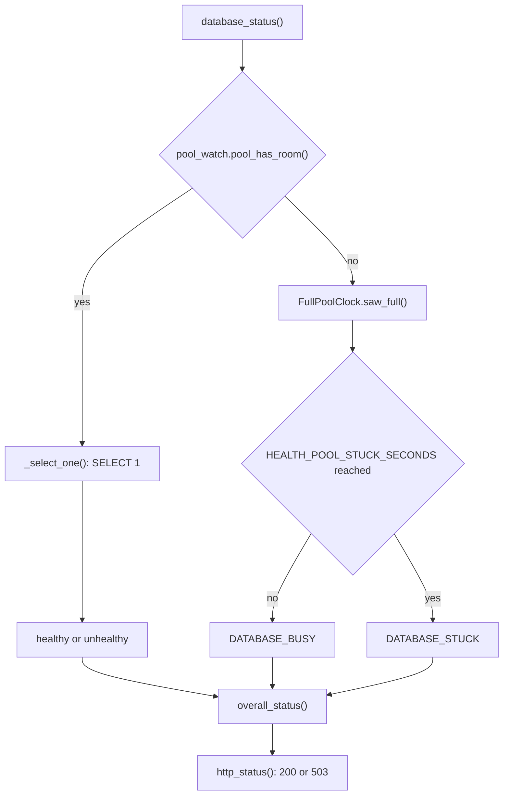

# Database & Redis Setup

Relevant source files

The following files were used as context for generating this wiki page:

- [orchestrator/core/best_effort.py](orchestrator/core/best_effort.py)
- [orchestrator/core/database/database.py](orchestrator/core/database/database.py)
- [orchestrator/core/database/pool_watch.py](orchestrator/core/database/pool_watch.py)
- [orchestrator/core/health_probe.py](orchestrator/core/health_probe.py)
- [orchestrator/tests/test_f229_health_off_the_loop.py](orchestrator/tests/test_f229_health_off_the_loop.py)
- [orchestrator/tests/test_f458_full_pool_names_its_holders.py](orchestrator/tests/test_f458_full_pool_names_its_holders.py)
- [orchestrator/tests/test_f458_health_never_waits_on_a_full_pool.py](orchestrator/tests/test_f458_health_never_waits_on_a_full_pool.py)
- [orchestrator/tests/test_prd251w1_render_quota.py](orchestrator/tests/test_prd251w1_render_quota.py)
- [orchestrator/tests/test_prd251w1_voice.py](orchestrator/tests/test_prd251w1_voice.py)

## Purpose and Scope

This page describes the database connection and session lifecycle visible in the supplied code, including credential resolution, SQLAlchemy pooling, transaction cleanup, pool monitoring, and database health checks. The supplied files do not include the PostgreSQL extension or migration configuration, seed-data implementation, Redis client, Redis pub/sub channels, or cache namespace definitions; those details therefore cannot be documented here. [orchestrator/core/database/database.py:22-171](), [orchestrator/core/database/pool_watch.py:1-22](), [orchestrator/core/health_probe.py:1-21]()

Sources: [orchestrator/core/database/database.py:22-171](), [orchestrator/core/database/pool_watch.py:1-22](), [orchestrator/core/health_probe.py:1-21]()

---

## PostgreSQL Connection Management & Session Lifecycle

`core/database/database.py` configures the SQLAlchemy engine and session factory used by the application. `get_database_url()` first asks the credential resolver for PostgreSQL connection parameters. If that attempt fails, it falls back to `DATABASE_URL` and then to the individual `POSTGRES_*` configuration values; if required values are missing, it raises a `ValueError`. [orchestrator/core/database/database.py:22-69]()

### Connection URL Resolution & SSL

In production, the module adds `sslmode=require` to the database URL if the URL does not already specify an `sslmode` parameter. In other environments, that production-specific modification is not applied. [orchestrator/core/database/database.py:71-80]()

### Engine Configuration & Pooling

The module creates a global SQLAlchemy `engine` with a pool size of 10, up to 20 overflow connections, connection pre-ping, a 3600-second recycle interval, and a 30-second checkout timeout. SQL statement logging is controlled by `config.SQL_DEBUG`. `SessionLocal` is a session factory bound to this engine, with autocommit and autoflush disabled. [orchestrator/core/database/database.py:82-95]()

The engine is registered with `pool_watch.watch(engine)`. The pool watcher tracks checked-out connections and can report their holders when the pool becomes full. [orchestrator/core/database/database.py:96-104](), [orchestrator/core/database/pool_watch.py:148-167]()

### Session Dependency & Transaction Safety

`get_db()` creates a `SessionLocal` session for a dependency-managed operation and, in its `finally` block, rolls back any open transaction before closing the session. This ensures an uncommitted transaction is not left open when the session is returned. [orchestrator/core/database/database.py:115-127]()

`get_db_session()` is a context manager that commits after a successful body, rolls back and re-raises on an exception, and always closes the session. `end_open_transaction(db)` commits immediately; its documented use is before a long `await` that would otherwise leave a connection idle in a transaction. That commit ends the transaction but also makes any pending writes durable at that boundary. [orchestrator/core/database/database.py:128-158]()

`create_tables()` calls `Base.metadata.create_all(bind=engine)`, while `init_database()` invokes `create_tables()` and then opens a database session whose default-data initialization block is currently empty. These functions show a table-creation path, not the Alembic migration workflow or an implemented seed-data catalog. [orchestrator/core/database/database.py:106-113](), [orchestrator/core/database/database.py:159-171]()

### Database Session and Connection Flow

Sources: [orchestrator/core/database/database.py:82-95](), [orchestrator/core/database/database.py:115-158]()

---

## Pool Monitoring & Health Checks

`pool_watch.pool_has_room()` checks whether the pool has an idle connection or can open another connection without exceeding its overflow limit. It returns `True` if pool counters cannot be read, so an unreadable or foreign pool does not block a caller from proceeding. `pool_numbers()` reports checked-out connections and the pool limit when those values are available. [orchestrator/core/database/pool_watch.py:48-70]()

`PoolWatch` records connection holders at checkout. When a checkout leaves the pool full, it can emit a rate-limited warning identifying holders and their execution locations. The report uses task await chains or thread stacks and is designed not to raise into the checkout path if its bookkeeping fails. [orchestrator/core/database/pool_watch.py:148-167](), [orchestrator/core/database/pool_watch.py:18-22]()

`health_probe.database_status()` checks pool availability before attempting a database query. If the pool is full, it reports `busy` or, after the configured stuck duration, `stuck`, without requesting another connection. If a connection is available, it runs `SELECT 1` through `_select_one()`. `overall_status()` maps these states into healthy, degraded, or unhealthy status; `http_status()` returns 503 for a stuck pool and 200 for other database states. [orchestrator/core/health_probe.py:35-44](), [orchestrator/core/health_probe.py:69-109]()

### Pool Saturation and Health Probe Flow

Sources: [orchestrator/core/health_probe.py:35-44](), [orchestrator/core/health_probe.py:47-76](), [orchestrator/core/health_probe.py:79-109](), [orchestrator/core/database/pool_watch.py:54-70]()

---

## Best-Effort Database Writes

`core/best_effort.py` provides wrappers for writes that should not block an event loop. `off_loop()` runs a synchronous writer inline when no event loop is running; when called on an event loop, it submits the write to a thread pool and returns immediately. `awaitable_off_loop()` submits the synchronous writer body to the same best-effort execution mechanism and awaits its result. [orchestrator/core/best_effort.py:81-106]()

Before a handed-off writer executes, `_within_pool_bound()` checks pool availability. If no connection becomes available within `BEST_EFFORT_POOL_WAIT_S`, the write is dropped with a warning rather than waiting behind requests for the pool’s checkout timeout. `drain()` is available to wait for handed-off writes, including their completion callbacks. [orchestrator/core/best_effort.py:49-57](), [orchestrator/core/best_effort.py:109-120]()

Sources: [orchestrator/core/best_effort.py:1-21](), [orchestrator/core/best_effort.py:49-120]()

---

## PostgreSQL Extensions, Migrations, Seed Data & Redis

The supplied files establish a PostgreSQL connection URL and create a SQLAlchemy engine, but they do not show PostgreSQL extension setup such as `pgvector`, Alembic environment or revision files, a single-head migration check, or seed-data definitions. `init_database()` calls `create_tables()` and contains an empty placeholder for default-data initialization; it is not evidence of a migration or seed-data process. [orchestrator/core/database/database.py:22-95](), [orchestrator/core/database/database.py:106-113](), [orchestrator/core/database/database.py:159-171]()

The supplied files also do not show a Redis client, Redis connection settings, pub/sub channel names, or cache namespace conventions. No Redis setup or behavior can be inferred from the PostgreSQL engine and session code presented here. [orchestrator/core/database/database.py:12-20]()

Sources: [orchestrator/core/database/database.py:12-20](), [orchestrator/core/database/database.py:22-95](), [orchestrator/core/database/database.py:106-113](), [orchestrator/core/database/database.py:159-171]()

---

## Key Database Entities & Functions

| Entity / symbol | Role |
|---|---|
| `get_database_url()` | Resolves PostgreSQL connection parameters from the credential resolver or configured environment values. [orchestrator/core/database/database.py:22-69]() |
| `engine` | SQLAlchemy engine with configured connection pooling and pre-ping. [orchestrator/core/database/database.py:82-91]() |
| `SessionLocal` | Session factory bound to `engine`. [orchestrator/core/database/database.py:93-95]() |
| `get_db()` | Yields a dependency-managed session and rolls back any open transaction before closing it. [orchestrator/core/database/database.py:115-127]() |
| `get_db_session()` | Context-managed session that commits on success and rolls back on exceptions. [orchestrator/core/database/database.py:128-141]() |
| `end_open_transaction(db)` | Commits the current session transaction, intended for use before a long await. [orchestrator/core/database/database.py:142-158]() |
| `create_tables()` | Calls SQLAlchemy metadata `create_all()` against the configured engine. [orchestrator/core/database/database.py:106-113]() |
| `init_database()` | Calls `create_tables()` and enters a session-backed placeholder for default-data initialization. [orchestrator/core/database/database.py:159-171]() |
| `pool_watch.pool_has_room()` | Determines whether the pool has an idle connection or overflow capacity. [orchestrator/core/database/pool_watch.py:54-62]() |
| `pool_watch.watch(engine)` / `PoolWatch` | Attaches pool monitoring to an engine and tracks connection holders. [orchestrator/core/database/database.py:100-104](), [orchestrator/core/database/pool_watch.py:148-167]() |
| `health_probe.database_status()` | Checks pool availability and, when possible, executes a database health query. [orchestrator/core/health_probe.py:69-93]() |
| `off_loop()` / `awaitable_off_loop()` | Runs best-effort database writers outside an event loop’s synchronous execution path. [orchestrator/core/best_effort.py:89-106]() |

Sources: [orchestrator/core/database/database.py:22-171](), [orchestrator/core/database/pool_watch.py:48-70](), [orchestrator/core/database/pool_watch.py:148-167](), [orchestrator/core/health_probe.py:69-109](), [orchestrator/core/best_effort.py:89-106]()

---