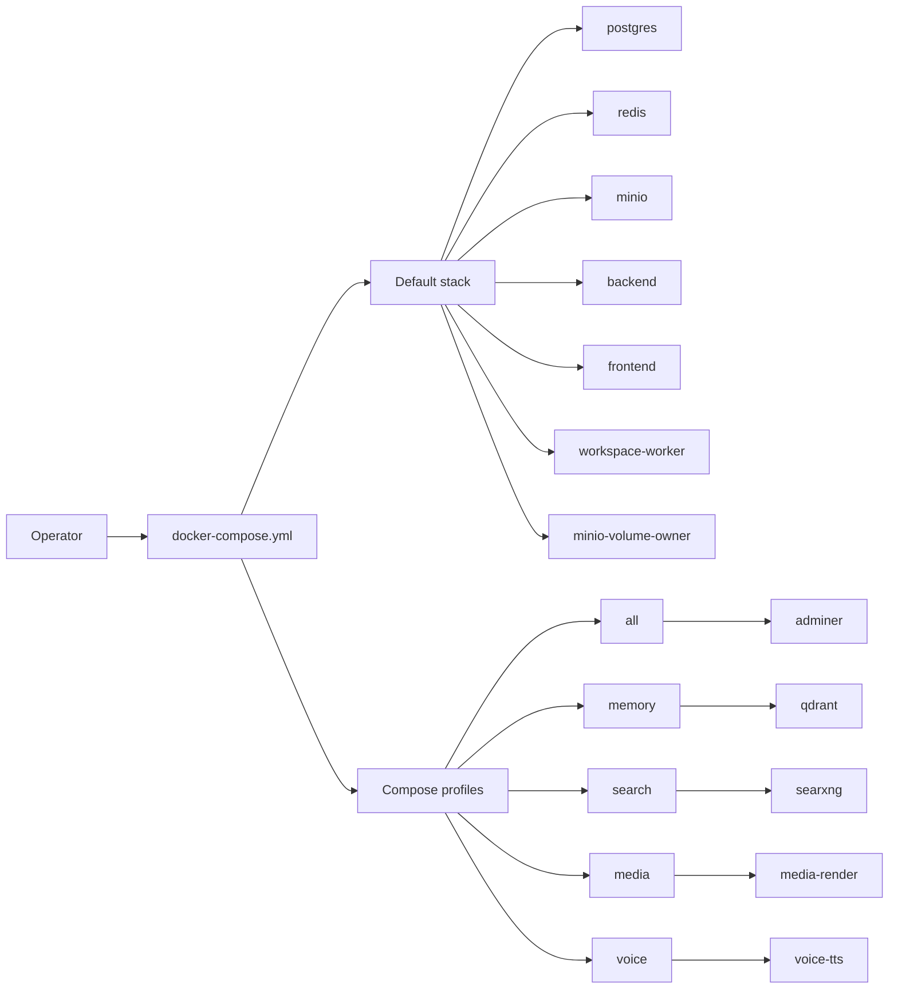
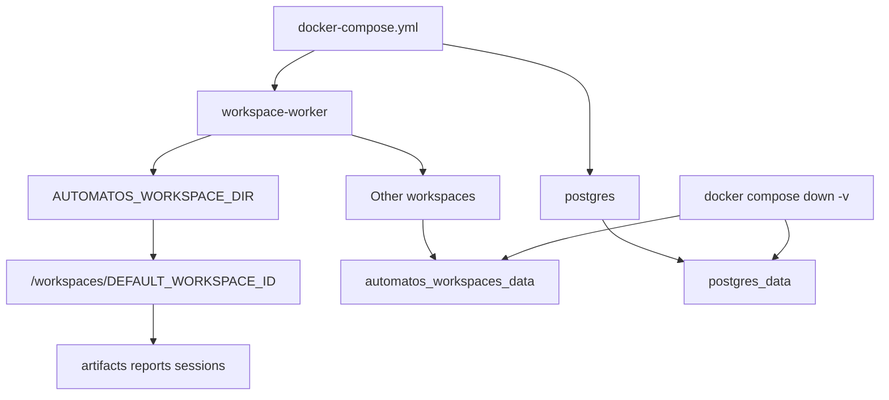

# Docker Compose & Environments

Relevant source files

The following files were used as context for generating this wiki page:

- [.env.example](.env.example)
- [.grype.yaml](.grype.yaml)
- [docker-compose.yml](docker-compose.yml)
- [frontend/Dockerfile](frontend/Dockerfile)
- [orchestrator/Dockerfile](orchestrator/Dockerfile)
- [orchestrator/requirements-dev.lock](orchestrator/requirements-dev.lock)
- [orchestrator/requirements-dev.txt](orchestrator/requirements-dev.txt)
- [orchestrator/requirements.lock](orchestrator/requirements.lock)
- [orchestrator/tests/test_prd262_agent_opt_worker_image.py](orchestrator/tests/test_prd262_agent_opt_worker_image.py)
- [orchestrator/tests/test_prd262_media_render_esbuild.py](orchestrator/tests/test_prd262_media_render_esbuild.py)
- [orchestrator/tests/test_prd262_media_render_stages.py](orchestrator/tests/test_prd262_media_render_stages.py)
- [services/agent-opt-worker/Dockerfile](services/agent-opt-worker/Dockerfile)
- [services/agent-opt-worker/overrides.txt](services/agent-opt-worker/overrides.txt)
- [services/agent-opt-worker/requirements.in](services/agent-opt-worker/requirements.in)
- [services/agent-opt-worker/requirements.lock](services/agent-opt-worker/requirements.lock)
- [services/media-render/Dockerfile](services/media-render/Dockerfile)
- [services/media-render/requirements.lock](services/media-render/requirements.lock)
- [services/media-render/tests/test_image_esbuild.py](services/media-render/tests/test_image_esbuild.py)
- [services/workspace-worker/requirements.lock](services/workspace-worker/requirements.lock)

## Purpose and scope

This page describes the available Docker Compose configuration and environment settings for the local stack. It covers the Compose operating model and documented profiles, image selection, host-port binding, required secrets, workspace-path behavior, and the available SearXNG settings. The provided file excerpts show only the beginning of `docker-compose.yml`; service details not present in those excerpts are intentionally not inferred. [docker-compose.yml:1-104](), [.env.example:1-141]()

Sources: [docker-compose.yml:1-104](), [.env.example:1-141]()

---

## 1. Compose Stack and Service Roles

`docker-compose.yml` is the unified Compose entry point. It is documented as running production images rather than mounting source for live reload; development uses the separate `docker-compose.dev.yml` path instead. The three application images named in the Compose comments are `backend`, `frontend`, and `workspace-worker`; CI-published image names use `ghcr.io/automatosai/automatos-<service>:${AUTOMATOS_IMAGE_TAG:-edge}`. [docker-compose.yml:25-44]()

The default stack is documented as including `postgres`, `redis`, `minio`, `backend`, `frontend`, and `workspace-worker`, plus a one-shot `minio-volume-owner`. Optional services are enabled through Compose profiles. [docker-compose.yml:52-71]()

| Compose service or group | Documented role and behavior | Sources |
|---|---|---|
| `postgres` | PostgreSQL with `pgvector`; uses the `postgres_data` named volume. Its database name and user have defaults, while `POSTGRES_PASSWORD` is required. | [docker-compose.yml:86-100]() |
| `backend` | Backend application image. The Compose comments identify it as one of the three CI-published app images and describe pairing-code generation through `docker compose exec backend`. | [docker-compose.yml:13-19](), [docker-compose.yml:30-44]() |
| `frontend` | Frontend application image. Its published address has a separate `WEB_PUBLISH_ADDRESS` setting, defaulting to `BIND_ADDRESS`. | [docker-compose.yml:13-19](), [docker-compose.yml:30-44]() |
| `workspace-worker` | Workspace runtime included in the default stack. Its files are mounted from `AUTOMATOS_WORKSPACE_DIR` for the local workspace; other workspaces use the `automatos_workspaces_data` named volume. | [docker-compose.yml:52-66]() |
| `minio` | Local object-storage service in the default stack. `minio-volume-owner` is documented as a one-shot prerequisite that runs before it. | [docker-compose.yml:52-56]() |
| `minio-volume-owner` | One-shot volume-owner service; runs before MinIO and exits. | [docker-compose.yml:52-56]() |
| `redis` | Included in the default stack. Its detailed service configuration is outside the provided Compose excerpt. | [docker-compose.yml:52-55]() |
| `adminer` | Database GUI enabled through the `all` profile. | [docker-compose.yml:67-68]() |
| `qdrant` | Durable-memory service enabled through the `memory` profile; the comments also call out `QDRANT_URL`. | [docker-compose.yml:68-69]() |
| `searxng` | Web-search service enabled through the `search` profile; the comments also call out `SEARXNG_URL`. | [docker-compose.yml:69-70]() |
| `media-render` | Socials media renderer enabled through the `media` profile. Without that profile, rendering a post reports that the media profile is needed. | [docker-compose.yml:70-71]() |
| `voice-tts` | Server voice service enabled through the `voice` profile; the documented URL is `http://voice-tts:8100`. | [docker-compose.yml:72-72]() |

Sources: [docker-compose.yml:13-19](), [docker-compose.yml:25-44](), [docker-compose.yml:46-80](), [docker-compose.yml:86-100]()

### Natural-language to Compose/code entity map

This diagram connects the operator-facing stack and profile names to the service identifiers documented in `docker-compose.yml`. [docker-compose.yml:52-80]()

**Diagram 1: Compose stack and profile names**

Sources: [docker-compose.yml:52-80]()

---

## 2. Profiles, Startup Requirements, and Health Checks

### Profiles and core override

The default configuration includes `workspace-worker`; the comments explicitly state that no environment key disables it. A five-container core option is available through `make up CORE=1` or by combining `docker-compose.yml` with `docker-compose.core.yml`. That override places `workspace-worker` behind a `workspace` profile, leaving `postgres`, `redis`, `minio`, `backend`, and `frontend` as the core services. [docker-compose.yml:73-79]()

The optional profiles documented in the Compose comments are `all`, `memory`, `search`, `media`, and `voice`. These add `adminer`, `qdrant`, `searxng`, `media-render`, and `voice-tts`, respectively. [docker-compose.yml:67-72]()

### Health checks and engine requirements

The Compose quick-start comments require Docker Engine 25 or later and Compose 2.24.4 or later because the health checks use `start_interval`. The comments state that `make up` checks these versions before starting. [docker-compose.yml:4-8]()

The provided PostgreSQL excerpt says its health check probes over TCP at `127.0.0.1` so a fresh database volume’s temporary initialization server, which listens only on the Unix socket, does not incorrectly satisfy the check. The excerpt cuts off before the complete health-check definition, so its command and remaining settings are not described here. [docker-compose.yml:101-104]()

Separately, the frontend development stage defines a health check against `http://localhost:3000`, with a 60-second start period and one-second startup interval. This is a Dockerfile-level development-stage check, not evidence of the complete Compose health-check configuration. [frontend/Dockerfile:36-52]()

Sources: [docker-compose.yml:4-8](), [docker-compose.yml:67-79](), [docker-compose.yml:101-104](), [frontend/Dockerfile:36-52]()

---

## 3. Ports, Bind Addresses, and Local Exposure

Published ports default to `BIND_ADDRESS`, whose default is `127.0.0.1`. Setting `BIND_ADDRESS=0.0.0.0` deliberately exposes those published services beyond loopback. The comments distinguish the backend and frontend: `API_PUBLISH_ADDRESS` and `WEB_PUBLISH_ADDRESS` control those two services and default to `BIND_ADDRESS`; PostgreSQL, Redis, MinIO, Qdrant, Adminer, and SearXNG remain bound to `BIND_ADDRESS`. [docker-compose.yml:10-19]()

`LOCAL_REMOTE_ACCESS` documents three modes: `off`, `paired`, and `open`. `off` is the default and prevents backend startup when either published application address reaches beyond loopback. `paired` requires devices to pair using a one-time code minted by `docker compose exec backend python -m scripts.mint_pairing_code`. `open` retains anonymous-owner access and warns at boot. [docker-compose.yml:15-19]()

The shown PostgreSQL port mapping uses `BIND_ADDRESS` and `POSTGRES_PORT`, with defaults `127.0.0.1` and `5432`. [docker-compose.yml:97-100]()

Sources: [docker-compose.yml:10-19](), [docker-compose.yml:97-100]()

---

## 4. Persistent Storage and Workspace Files

The provided Compose excerpt shows PostgreSQL state persisted in the named volume `postgres_data`. The comments also describe the workspace-worker storage model: `AUTOMATOS_WORKSPACE_DIR` defaults to `./workspaces` beside the Compose file, is created on first boot, and is mounted as the root of the local workspace at `/workspaces/<DEFAULT_WORKSPACE_ID>`. [docker-compose.yml:52-66](), [docker-compose.yml:97-100]()

Other workspaces on the stack use the named volume `automatos_workspaces_data`; the comments say it survives `docker compose up --build` and is removed by `docker compose down -v`. [docker-compose.yml:63-66]()

The Compose comments suggest setting `AUTOMATOS_WORKSPACE_DIR` to a directory near project files when the local workspace should share a location with local deliverables and Code Canvas sessions. The example uses `LOCAL_PROJECTS_DIR=~/Development` and `AUTOMATOS_WORKSPACE_DIR=~/Development/deliverables`. [docker-compose.yml:56-63]()

**Diagram 2: Workspace storage concepts mapped to Compose identifiers**

Sources: [docker-compose.yml:52-66](), [docker-compose.yml:97-100]()

---

## 5. Environment Inputs, Defaults, and Required Secrets

A `.env` file is required for the Compose stack. At minimum, it must contain non-placeholder values for `POSTGRES_PASSWORD`, `REDIS_PASSWORD`, and `API_KEY`; the Compose comments state that the backend refuses to start with a `CHANGE_ME` placeholder, referring to `orchestrator/docker-secrets-guard.sh`. [.env.example:1-9](), [docker-compose.yml:46-50]()

The `.env.example` quick-start comments describe `make env` as copying `.env.example` to `.env` when needed and replacing those three placeholder secrets with random values generated using `openssl rand -hex 24`. The example file itself contains placeholder values, not usable credentials. [.env.example:4-9]()

The shown environment defaults include PostgreSQL database/user and port (`orchestrator_db`, `postgres`, `5432`), Redis port (`6379`), API port (`8000`), and frontend port (`3000`). The example sets frontend API and WebSocket origins to `http://localhost:8000` and `ws://localhost:8000/ws`. [.env.example:13-42]()

The Compose comments mention `envs/api.defaults` as the location of `PLATFORM_KEY_WORKSPACE_ID`; the contents of that defaults file were not provided, so its other settings and loading behavior are not specified here. The `.env.example` comments say LLM keys can be configured in the application’s API Keys settings or through environment variables, and identify OpenAI and Anthropic keys as optional example values. [docker-compose.yml:46-50](), [.env.example:44-59]()

Sources: [docker-compose.yml:46-50](), [.env.example:1-9](), [.env.example:13-59]()

---

## 6. Search Configuration and SearXNG

The optional `search` profile starts `searxng`. The Compose comments identify `SEARXNG_URL` as the related setting; `.env.example` gives `http://searxng:8080` as the example URL after starting that profile. [docker-compose.yml:67-70](), [.env.example:74-83]()

The environment example documents `WEB_ACCESS`, `WEB_ACCESS_DENY`, and `WEB_SEARCH_PROVIDER`. It describes provider selection as `auto`, `openrouter`, `composio`, `searxng`, or `off`; in automatic mode, web search uses the first available engine among an OpenRouter key, Composio, and a SearXNG container. It also states that page fetching via `platform_web_fetch` needs no key and that private, loopback, and link-local addresses are refused. [.env.example:74-83]()

The available excerpt documents the SearXNG URL and profile but does not include the `searxng` service definition or a SearXNG settings file. Consequently, container-level settings, networks, and health checks for SearXNG cannot be detailed from the supplied content. [docker-compose.yml:67-70](), [.env.example:74-83]()

Sources: [docker-compose.yml:67-70](), [.env.example:74-83]()

---

## 7. Image Selection and Build Stages

The Compose comments describe the default stack as using production images—the images CI builds and scans—with no source reload. The app services `backend`, `frontend`, and `workspace-worker` declare CI image names alongside their build configuration. Compose pulls the named image first and builds only when that image is unavailable. [docker-compose.yml:25-44]()

`make up` is documented as selecting an image tag for the checkout (`sha-<7>`, `edge`, or a local tag), pulling it, starting with `--no-build`, and writing the selected tag to `.env`. `make build` builds the three app images from source using a `local-<sha7>` tag. A direct local source build can use an `AUTOMATOS_IMAGE_TAG=local-<ref>` tag with `docker compose up -d --build`; the comments warn that a plain untagged `docker compose up --build` uses `edge`, which a later `make up` may replace by pulling. [docker-compose.yml:30-44]()

The provided backend Dockerfile uses multiple stages: a pinned `uv` installer stage, a dependency-build stage, and later common, development, compile, and production stages. The excerpt documents hash-locked dependencies and keeping compiler tools in the build stage rather than the shipped runtime image. [orchestrator/Dockerfile:1-29](), [orchestrator/Dockerfile:44-78]()

The frontend Dockerfile documents a Node 24 Alpine base, a development stage with `npm run dev`, and a production builder that embeds `NEXT_PUBLIC_*` values into the client bundle. The comments warn that these public build-time variables must not contain secrets. [frontend/Dockerfile:1-10](), [frontend/Dockerfile:36-52](), [frontend/Dockerfile:69-110]()

The additional service Dockerfiles establish that `agent-opt-worker` is a separate container for FutureAGI SDKs and that `media-render` assembles rendered media. The supplied Compose excerpt does not show their service definitions, so their Compose profile or dependency wiring is not asserted here. [services/agent-opt-worker/Dockerfile:1-10](), [services/media-render/Dockerfile:1-11]()

Sources: [docker-compose.yml:25-44](), [orchestrator/Dockerfile:1-29](), [orchestrator/Dockerfile:44-78](), [frontend/Dockerfile:1-10](), [frontend/Dockerfile:36-52](), [frontend/Dockerfile:69-110](), [services/agent-opt-worker/Dockerfile:1-10](), [services/media-render/Dockerfile:1-11]()

---