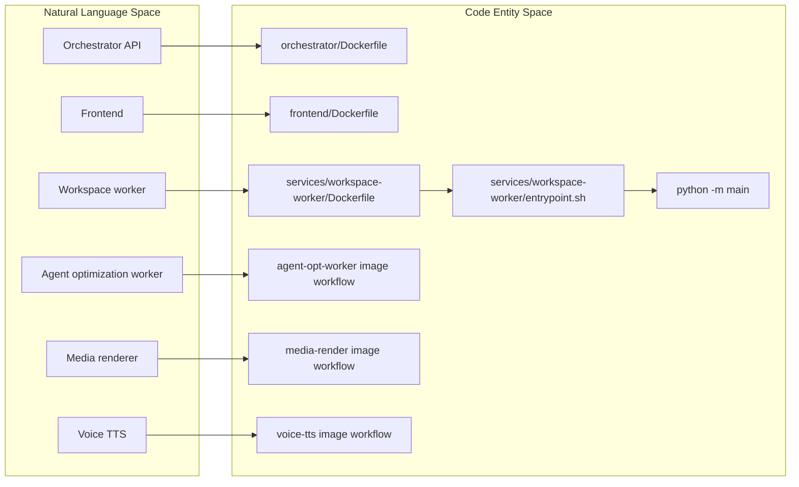
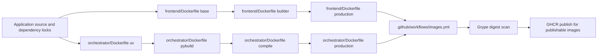
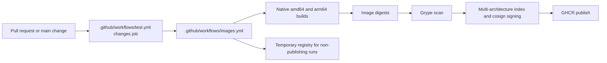

# Docker Containerization

Relevant source files

The following files were used as context for generating this wiki page:

- [.env.example](.env.example)
- [.github/workflows/images.yml](.github/workflows/images.yml)
- [.github/workflows/test.yml](.github/workflows/test.yml)
- [.grype.yaml](.grype.yaml)
- [QUICKSTART.md](QUICKSTART.md)
- [SETUP.md](SETUP.md)
- [charts/automatos/README.md](charts/automatos/README.md)
- [charts/automatos/templates/worker.yaml](charts/automatos/templates/worker.yaml)
- [docker-compose.yml](docker-compose.yml)
- [docs/agents/llm-provider-management.md](docs/agents/llm-provider-management.md)
- [docs/getting-started/self-hosting.md](docs/getting-started/self-hosting.md)
- [frontend/Dockerfile](frontend/Dockerfile)
- [frontend/components/marketplace/__tests__/github-import-modal.test.tsx](frontend/components/marketplace/__tests__/github-import-modal.test.tsx)
- [frontend/components/marketplace/__tests__/marketplace-admin-gate.test.ts](frontend/components/marketplace/__tests__/marketplace-admin-gate.test.ts)
- [frontend/lib/baseline-skills.ts](frontend/lib/baseline-skills.ts)
- [frontend/lib/tooltips.json](frontend/lib/tooltips.json)
- [orchestrator/Dockerfile](orchestrator/Dockerfile)
- [orchestrator/requirements-dev.lock](orchestrator/requirements-dev.lock)
- [orchestrator/requirements-dev.txt](orchestrator/requirements-dev.txt)
- [orchestrator/requirements.lock](orchestrator/requirements.lock)
- [orchestrator/tests/test_818_every_make_target_has_its_commands_in_the_guide.py](orchestrator/tests/test_818_every_make_target_has_its_commands_in_the_guide.py)
- [orchestrator/tests/test_compose_published_images.py](orchestrator/tests/test_compose_published_images.py)
- [orchestrator/tests/test_f452_worker_cannot_regain_privileges.py](orchestrator/tests/test_f452_worker_cannot_regain_privileges.py)
- [orchestrator/tests/test_prd262_agent_opt_worker_image.py](orchestrator/tests/test_prd262_agent_opt_worker_image.py)
- [orchestrator/tests/test_prd262_core_stack.py](orchestrator/tests/test_prd262_core_stack.py)
- [orchestrator/tests/test_prd262_dependabot.py](orchestrator/tests/test_prd262_dependabot.py)
- [orchestrator/tests/test_prd262_media_render_esbuild.py](orchestrator/tests/test_prd262_media_render_esbuild.py)
- [orchestrator/tests/test_prd262_media_render_stages.py](orchestrator/tests/test_prd262_media_render_stages.py)
- [orchestrator/tests/test_prd262_worker_boot.py](orchestrator/tests/test_prd262_worker_boot.py)
- [orchestrator/tests/test_prd262_worker_diet.py](orchestrator/tests/test_prd262_worker_diet.py)
- [orchestrator/tests/test_setup_runbook.py](orchestrator/tests/test_setup_runbook.py)
- [scripts/ci/image_worker_toolchain.py](scripts/ci/image_worker_toolchain.py)
- [scripts/ci/smoke-core-stack.sh](scripts/ci/smoke-core-stack.sh)
- [services/agent-opt-worker/Dockerfile](services/agent-opt-worker/Dockerfile)
- [services/agent-opt-worker/overrides.txt](services/agent-opt-worker/overrides.txt)
- [services/agent-opt-worker/requirements.in](services/agent-opt-worker/requirements.in)
- [services/agent-opt-worker/requirements.lock](services/agent-opt-worker/requirements.lock)
- [services/media-render/Dockerfile](services/media-render/Dockerfile)
- [services/media-render/requirements.lock](services/media-render/requirements.lock)
- [services/media-render/tests/test_image_esbuild.py](services/media-render/tests/test_image_esbuild.py)
- [services/workspace-worker/Dockerfile](services/workspace-worker/Dockerfile)
- [services/workspace-worker/entrypoint.sh](services/workspace-worker/entrypoint.sh)
- [services/workspace-worker/requirements.lock](services/workspace-worker/requirements.lock)

## Purpose and Scope

This page describes the production-oriented Docker images and build workflows for the orchestrator, frontend, workspace worker, agent optimization worker, media renderer, and voice TTS service. It covers the visible multi-stage build strategies, workspace-worker startup and privilege handling, image publishing and scanning, and the CI paths used to select image-related and production-parity tests. [.github/workflows/images.yml:1-48](), [.github/workflows/test.yml:20-23](), [orchestrator/Dockerfile:1-13](), [frontend/Dockerfile:1-11](), [services/workspace-worker/Dockerfile:1-8](), [services/workspace-worker/entrypoint.sh:1-4]()

Sources: [.github/workflows/images.yml:1-48](), [.github/workflows/test.yml:20-23](), [orchestrator/Dockerfile:1-13](), [frontend/Dockerfile:1-11](), [services/workspace-worker/Dockerfile:1-8](), [services/workspace-worker/entrypoint.sh:1-4]()

---

## 1. Container Architecture and Multi-Stage Design

The image set separates the application into independently built services. The image workflow identifies the API, frontend, workspace worker, agent-opt worker, media-render, and voice-tts images; it publishes the main application images to GHCR under `automatos-<image>` names, while agent-opt-worker, media-render, and voice-tts are built and scanned in the workflow but are not published there. [.github/workflows/images.yml:1-4](), [.github/workflows/images.yml:32-48]()

The Dockerfiles use different build approaches. The orchestrator Dockerfile defines `uv`, `pybuild`, `base`, `development`, `compile`, and `production` stages. The frontend Dockerfile defines `base`, `development`, `builder`, `node-strip`, and `production` stages. The workspace-worker Dockerfile defines Node-related stages and a Python production stage. [orchestrator/Dockerfile:1-13](), [frontend/Dockerfile:1-11](), [services/workspace-worker/Dockerfile:1-8]()

| Service image | Documented build approach | Runtime or workflow detail |
|---|---|---|
| Orchestrator / API | Multi-stage Python 3.11 build; `uv` supplies the installer, and `pybuild` installs locked dependencies. The Dockerfile describes `compile` as a non-shipping stage and `production` as the optimized runtime stage. [orchestrator/Dockerfile:5-13](), [orchestrator/Dockerfile:20-31]() | The Compose documentation identifies the production images as the images CI builds and scans; the shown Dockerfile excerpt does not include the final runtime command. [docker-compose.yml:25-28]() |
| Frontend | Node 24 on Alpine 3.24; locked npm dependencies are installed in `base`, and the production build is created in `builder`. [frontend/Dockerfile:5-10](), [frontend/Dockerfile:16-34](), [frontend/Dockerfile:54-67]() | The build accepts public configuration as build arguments and bakes those values into the Next.js bundle. [frontend/Dockerfile:69-110]() |
| Workspace worker | Python 3.12 production image with a stripped Node.js 24 binary copied from a dedicated stage. [services/workspace-worker/Dockerfile:5-8](), [services/workspace-worker/Dockerfile:76-85]() | `entrypoint.sh` adjusts workspace ownership when needed and starts `python -m main` as the `worker` account using `setpriv`. [services/workspace-worker/entrypoint.sh:54-64](), [services/workspace-worker/entrypoint.sh:82-93]() |
| Agent optimization worker | The image workflow builds this service for amd64 when its paths are in scope, and identifies it as an image that Railway builds itself rather than one GHCR publishes. [.github/workflows/images.yml:32-34]() | The supplied content does not include this service’s Dockerfile or application entrypoint, so their stage layout and runtime command are not specified here. [.github/workflows/images.yml:32-34]() |
| Media renderer | The image workflow builds this service for amd64 and arm64 when its paths are in scope and keeps its image out of GHCR publication. [.github/workflows/images.yml:35-44]() | The workflow notes its GPL-licensed `espeak-ng`, phonemizer, and x264 components and uses a private GHCR build-cache reference. [.github/workflows/images.yml:35-44]() |
| Voice TTS | The image workflow builds this service for amd64 and arm64 when its paths are in scope and does not publish it to GHCR. [.github/workflows/images.yml:45-48]() | The workflow identifies Kokoro and LAME as components and states Railway builds the image itself. [.github/workflows/images.yml:45-48]() |

Sources: [.github/workflows/images.yml:1-4](), [.github/workflows/images.yml:32-48](), [docker-compose.yml:25-28](), [orchestrator/Dockerfile:1-31](), [frontend/Dockerfile:1-11](), [frontend/Dockerfile:16-34](), [frontend/Dockerfile:54-110](), [services/workspace-worker/Dockerfile:5-8](), [services/workspace-worker/Dockerfile:76-85](), [services/workspace-worker/entrypoint.sh:54-64](), [services/workspace-worker/entrypoint.sh:82-93]()

### 1.1 Natural Language to Code Entity Mapping

This diagram connects service names used in deployment and image workflows to Dockerfiles and the workspace worker’s concrete startup entities. The media-render, agent-opt-worker, and voice-tts mappings point to workflow image identifiers; their Dockerfile internals are not included in the supplied excerpts. [.github/workflows/images.yml:32-48](), [orchestrator/Dockerfile:1-13](), [frontend/Dockerfile:1-11](), [services/workspace-worker/Dockerfile:1-8](), [services/workspace-worker/entrypoint.sh:82-93]()

**Diagram: Service names mapped to Docker and runtime entities**

Sources: [.github/workflows/images.yml:32-48](), [orchestrator/Dockerfile:1-13](), [frontend/Dockerfile:1-11](), [services/workspace-worker/Dockerfile:1-8](), [services/workspace-worker/entrypoint.sh:82-93]()

### 1.2 Build-to-Runtime Data Flow

The Dockerfiles express a build-time progression from pinned base images and dependency inputs toward production artifacts. For the frontend, `package.json`, `package-lock.json`, and `.npmrc` are installed in `base`; the `builder` stage copies application source, accepts public configuration arguments, and runs the production build. For the orchestrator, the shown stages establish a pinned `uv` installer and a dependency-build stage based on `requirements.lock` and `scripts/split_lock.py`. [frontend/Dockerfile:16-34](), [frontend/Dockerfile:54-110](), [orchestrator/Dockerfile:20-48]()

**Diagram: Build inputs and production image workflow**

Sources: [frontend/Dockerfile:16-34](), [frontend/Dockerfile:54-110](), [orchestrator/Dockerfile:1-13](), [orchestrator/Dockerfile:20-48](), [.github/workflows/images.yml:22-31]()

---

## 2. Service Dockerfiles and Build Strategies

### 2.1 Orchestrator Container

The orchestrator Dockerfile begins with a pinned `uv` image. Its `pybuild` stage uses Python 3.11 slim, installs compiler and header packages for building dependencies, copies the pinned installer, and reads `requirements.lock` together with `scripts/split_lock.py`. The Dockerfile documents the stages as `uv`, `pybuild`, `base`, `development`, `compile`, and `production`; the development stage is described as mounting source for hot reload, while `pybuild` and `compile` do not ship as the final image. [orchestrator/Dockerfile:5-13](), [orchestrator/Dockerfile:20-48]()

The dependency installation splits the lock into stable, rest, and development sets. It installs with hash checking and without dependency resolution; it restricts installs to wheels, with a documented `pysher` source-build exception. It then strips unneeded symbols from shared libraries, removes package test directories and selected source/header files, and prunes SciPy content according to the application’s stated import requirements. [orchestrator/Dockerfile:50-78](), [orchestrator/Dockerfile:80-110]()

Sources: [orchestrator/Dockerfile:5-13](), [orchestrator/Dockerfile:20-48](), [orchestrator/Dockerfile:50-78](), [orchestrator/Dockerfile:80-110]()

### 2.2 Frontend Container

The frontend’s `base` stage uses a pinned Node 24 Alpine 3.24 image, disables Next.js telemetry, and installs dependencies with `npm ci` from `package.json`, `package-lock.json`, and `.npmrc`. The `development` stage copies the source and runs `npm run dev`; the `builder` stage builds the production application. [frontend/Dockerfile:5-10](), [frontend/Dockerfile:16-34](), [frontend/Dockerfile:36-52](), [frontend/Dockerfile:54-67]()

The builder accepts public API, WebSocket, authentication-edition, Clerk, and media-origin arguments. Those values are set as build environment variables before `npm run build`, so `NEXT_PUBLIC_*` configuration is embedded at build time. The build removes `.next/cache`, moves the standalone `node_modules` output to a separate path, and deletes trace files. The `node-strip` stage strips the Node binary and checks that symbol-table and debug sections are absent. [frontend/Dockerfile:69-110](), [frontend/Dockerfile:112-124]()

Sources: [frontend/Dockerfile:5-10](), [frontend/Dockerfile:16-34](), [frontend/Dockerfile:36-52](), [frontend/Dockerfile:54-67](), [frontend/Dockerfile:69-124]()

### 2.3 Workspace Worker and Entrypoint

The workspace-worker Dockerfile uses Node 24 in a dedicated stage and creates a stripped Node binary in `node-stripped`. It also defines an `npm` stage that removes npm documentation and a pinned `uv` stage. A lock-processing stage splits `requirements.lock` into stable, SDK, and `psycopg2` parts and checks that the expected packages are isolated. The `psycopg2` build stage compiles from source with pinned build dependencies; the final Python 3.12 `production` stage copies in the stripped Node tree. [services/workspace-worker/Dockerfile:5-29](), [services/workspace-worker/Dockerfile:31-74](), [services/workspace-worker/Dockerfile:76-85]()

At startup, `entrypoint.sh` checks whether the worker account can write to `LOCAL_WORKSPACE_ROOT`. If it cannot, it reads the folder’s owner UID and GID together, then either adjusts the worker IDs when safe or logs why it cannot do so. It does not adopt root’s UID, and it avoids IDs already assigned to accounts in the image. [services/workspace-worker/entrypoint.sh:4-19](), [services/workspace-worker/entrypoint.sh:21-52](), [services/workspace-worker/entrypoint.sh:54-64]()

The entrypoint also repairs ownership under `WORKSPACE_VOLUME_PATH` when required. Its `find` traversal skips `projects` and `LOCAL_WORKSPACE_ROOT`, uses `chown -h` so a symlink itself is handled rather than its target, and logs a failed ownership walk without preventing startup. Finally, it uses `setpriv` to run `python -m main` as `worker`, with `--no-new-privs` and `HOME=/home/worker`. [services/workspace-worker/entrypoint.sh:66-80](), [services/workspace-worker/entrypoint.sh:82-93]()

Sources: [services/workspace-worker/Dockerfile:5-29](), [services/workspace-worker/Dockerfile:31-74](), [services/workspace-worker/Dockerfile:76-85](), [services/workspace-worker/entrypoint.sh:4-19](), [services/workspace-worker/entrypoint.sh:21-52](), [services/workspace-worker/entrypoint.sh:54-80](), [services/workspace-worker/entrypoint.sh:82-93]()

### 2.4 Agent Optimization Worker, Media Renderer, and Voice TTS

The image workflow defines CI behavior for these three images, but the supplied excerpts do not include their Dockerfiles or entrypoints. The workflow builds `agent-opt-worker` for amd64 and builds `media-render` and `voice-tts` for amd64 and arm64. These image jobs are path-gated on pull requests and run on main; the workflow states that Railway builds these images itself rather than publishing them to GHCR. [.github/workflows/images.yml:32-48]()

For media-render, the workflow calls out GPL-licensed `espeak-ng`, phonemizer, and x264 components, and uses a private GHCR build-cache reference. For voice-tts, it identifies Kokoro and LAME and retains the GitHub Actions cache. These workflow statements establish build and distribution policy, not the internal Dockerfile stage structure. [.github/workflows/images.yml:35-48]()

Sources: [.github/workflows/images.yml:32-48]()

---

## 3. CI/CD Image Workflows and Production-Parity Tests

The image workflow builds Linux images on native amd64 and arm64 runners, pushes build outputs by digest, and scans those digests with Grype. Its stated scan policy blocks fixable Critical findings and any-severity matches on CISA’s Known Exploited Vulnerabilities list unless `.grype.yaml` permits them with a reason and expiry. On publishing runs, the workflow joins architecture digests into a multi-architecture index and signs it using GitHub OIDC-backed cosign. [.github/workflows/images.yml:1-31]()

The workflow publishes only on main and `v*` tags. Pull requests and non-publishing runs use a temporary registry for build-and-scan work rather than publishing to GHCR. Its image set has exceptions: agent-opt-worker, media-render, and voice-tts are built for CI but are not published to GHCR by this workflow. [.github/workflows/images.yml:6-10](), [.github/workflows/images.yml:32-48]()

**Diagram: Image build, scan, and publication path**

Sources: [.github/workflows/images.yml:1-31](), [.github/workflows/test.yml:43-73]()

The test workflow is the enforcement gate for the orchestrator pytest suite. It runs on pull requests, pushes to main, and manual dispatch; it uses concurrency cancellation for superseded runs and describes the orchestrator suite as running against a real PostgreSQL service with per-test timeouts. The workflow’s path-planning job exposes outputs for image, frontend, CLI-host, simulation, agent-opt-worker, reference, and backend lanes. [.github/workflows/test.yml:3-18](), [.github/workflows/test.yml:31-42](), [.github/workflows/test.yml:43-73]()

For image-related path selection, `PROD_IMAGE_PATHS` includes the frontend and orchestrator Dockerfiles and dependency inputs, the workspace-worker directory, and a set of image-inspection scripts and related fixtures. The workflow comments describe the production-parity lane as building three Railway-equivalent images on amd64 for pull requests that touch those paths. [.github/workflows/test.yml:89-102](), [.github/workflows/images.yml:92-96]()

The supplied workflow excerpt also identifies image checks for API native-library loading and `import main`, botocore service coverage, reproducible API builds, and dependency-layer reuse. The workspace-worker boot test documents coverage of the entrypoint’s ownership behavior and states that production-parity tests run the real entrypoint block as root in throwaway containers for a symlink case, a read-only volume, and a deliverables folder that UID 1000 cannot write. [.github/workflows/images.yml:55-65](), [orchestrator/tests/test_prd262_worker_boot.py:1-13]()

Sources: [.github/workflows/test.yml:3-18](), [.github/workflows/test.yml:31-42](), [.github/workflows/test.yml:43-73](), [.github/workflows/test.yml:89-102](), [.github/workflows/images.yml:55-65](), [.github/workflows/images.yml:92-96](), [orchestrator/tests/test_prd262_worker_boot.py:1-13]()

---