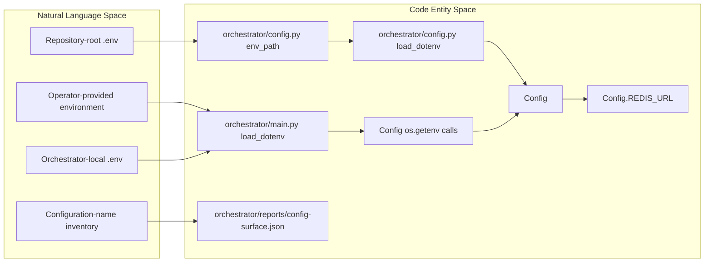
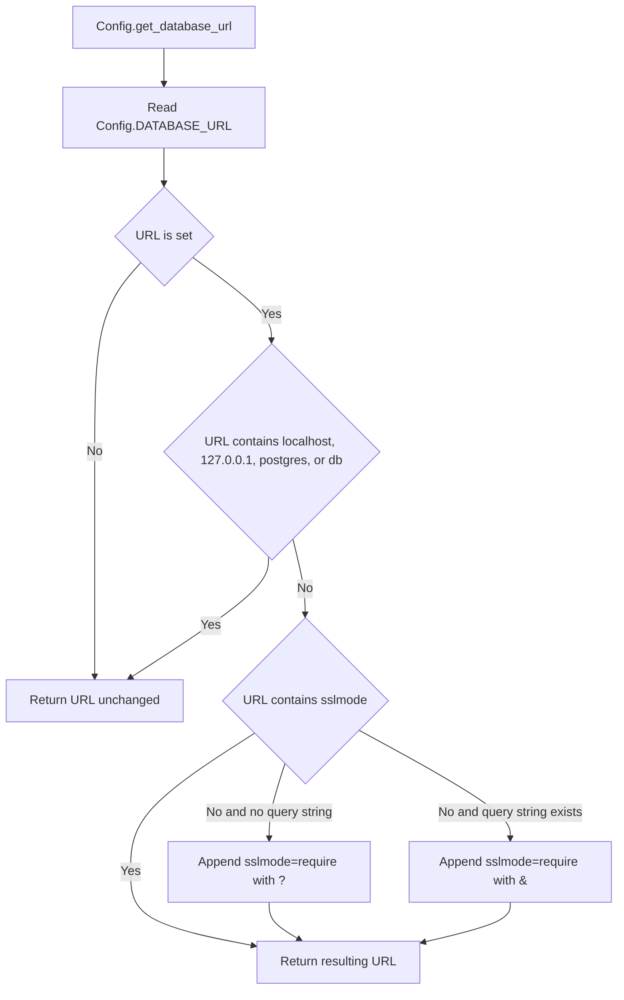
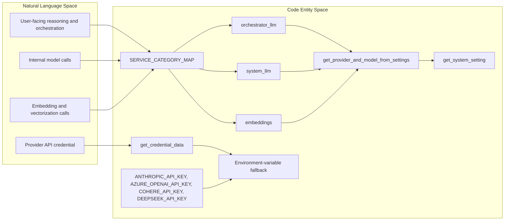

# Environment Variables

Relevant source files

The following files were used as context for generating this wiki page:

- [.gitignore](.gitignore)
- [docs/PRDS/126-BUSINESS-KNOWLEDGE-GRAPH.md](docs/PRDS/126-BUSINESS-KNOWLEDGE-GRAPH.md)
- [docs/testing/CUSTOMER-NIGHTS-PLAN.md](docs/testing/CUSTOMER-NIGHTS-PLAN.md)
- [frontend/components/settings/DynamicCredentialForm.tsx](frontend/components/settings/DynamicCredentialForm.tsx)
- [frontend/components/settings/SystemSettingsTab.tsx](frontend/components/settings/SystemSettingsTab.tsx)
- [frontend/lib/api-client.ts](frontend/lib/api-client.ts)
- [frontend/lib/api/credentials.ts](frontend/lib/api/credentials.ts)
- [graphify-out/snapshots/bucket-1-pre-drop.sql](graphify-out/snapshots/bucket-1-pre-drop.sql)
- [orchestrator/.env.example](orchestrator/.env.example)
- [orchestrator/alembic/versions/prd135_drop_bucket_1.py](orchestrator/alembic/versions/prd135_drop_bucket_1.py)
- [orchestrator/api/credentials.py](orchestrator/api/credentials.py)
- [orchestrator/api/socials.py](orchestrator/api/socials.py)
- [orchestrator/api/system_settings.py](orchestrator/api/system_settings.py)
- [orchestrator/config.py](orchestrator/config.py)
- [orchestrator/core/composio/models.py](orchestrator/core/composio/models.py)
- [orchestrator/core/credentials/integration_bridges/__init__.py](orchestrator/core/credentials/integration_bridges/__init__.py)
- [orchestrator/core/credentials/integration_bridges/base.py](orchestrator/core/credentials/integration_bridges/base.py)
- [orchestrator/core/credentials/integration_bridges/shopify.py](orchestrator/core/credentials/integration_bridges/shopify.py)
- [orchestrator/core/credentials/service.py](orchestrator/core/credentials/service.py)
- [orchestrator/core/llm/manager.py](orchestrator/core/llm/manager.py)
- [orchestrator/core/models/credentials.py](orchestrator/core/models/credentials.py)
- [orchestrator/core/models/system_settings.py](orchestrator/core/models/system_settings.py)
- [orchestrator/core/monitoring/automatos_alerts.py](orchestrator/core/monitoring/automatos_alerts.py)
- [orchestrator/core/monitoring/automatos_logs_api.py](orchestrator/core/monitoring/automatos_logs_api.py)
- [orchestrator/core/seeds/seed_system_settings.py](orchestrator/core/seeds/seed_system_settings.py)
- [orchestrator/core/services/audit_service.py](orchestrator/core/services/audit_service.py)
- [orchestrator/core/services/plugin_cache.py](orchestrator/core/services/plugin_cache.py)
- [orchestrator/main.py](orchestrator/main.py)
- [orchestrator/modules/socials/__init__.py](orchestrator/modules/socials/__init__.py)
- [orchestrator/modules/socials/render.py](orchestrator/modules/socials/render.py)
- [orchestrator/modules/socials/service.py](orchestrator/modules/socials/service.py)
- [orchestrator/reports/config-surface.json](orchestrator/reports/config-surface.json)
- [orchestrator/reports/route-manifest.json](orchestrator/reports/route-manifest.json)
- [orchestrator/tests/test_1057_credential_stats_and_health_reach_their_handlers.py](orchestrator/tests/test_1057_credential_stats_and_health_reach_their_handlers.py)
- [orchestrator/tests/test_p2w2_credentials_null_workspace.py](orchestrator/tests/test_p2w2_credentials_null_workspace.py)
- [orchestrator/tests/test_prd251_api.py](orchestrator/tests/test_prd251_api.py)

## Purpose and Scope

This page explains how environment variables enter the backend, how `Config` exposes selected values, how LLM provider configuration is split between environment keys and system settings, and what the supplied ignore rules protect. The available excerpts do not include the contents of `.env.example` or a gitleaks configuration, so this page does not infer their exact contents or any gitleaks allowlist policy. [orchestrator/config.py:1-7](), [.gitignore:117-129](), [orchestrator/reports/config-surface.json:1-3]()

Sources: [orchestrator/config.py:1-7](), [.gitignore:117-129](), [orchestrator/reports/config-surface.json:1-3]()

---

## 1. Configuration Architecture & Pipeline

`orchestrator/config.py` documents itself as the only place where `os.getenv()` is called for configuration; other backend modules are expected to import configuration from it. It resolves a `.env` file relative to the orchestrator package’s parent directory and calls `load_dotenv` before defining `Config`. [orchestrator/config.py:1-7](), [orchestrator/config.py:38-46]()

`orchestrator/main.py` also loads an orchestrator-local `.env` early in application startup, before importing the centralized configuration. The source excerpt establishes both load sites, but does not establish precedence or override semantics between them; those details should be verified against the installed `python-dotenv` behavior and deployment setup rather than assumed. [orchestrator/main.py:31-37](), [orchestrator/config.py:38-40]()

The `Config` class exposes environment-derived values as class attributes and properties. Some values are parsed when the module is imported—for example, `SQL_DEBUG` becomes a boolean and memory budgets become integers—while `REDIS_URL` is computed by a property. [orchestrator/config.py:42-57](), [orchestrator/config.py:77-93]()

**Diagram: Environment Inputs and Configuration Entities**

Sources: [orchestrator/main.py:31-37](), [orchestrator/config.py:1-7](), [orchestrator/config.py:38-46](), [orchestrator/config.py:77-93](), [orchestrator/reports/config-surface.json:1-3]()

### Configuration sources and their roles

| Source or mechanism | Role |
|---|---|
| `orchestrator/main.py` `.env` load | Loads the orchestrator-local `.env` before importing centralized configuration. [orchestrator/main.py:31-37]() |
| `orchestrator/config.py` `.env` load | Resolves a `.env` path from the config module’s parent directory and calls `load_dotenv`. [orchestrator/config.py:38-40]() |
| `Config` | Centralized environment-derived settings interface; the module docstring says configuration `os.getenv()` calls belong here. [orchestrator/config.py:1-7](), [orchestrator/config.py:42-46]() |
| `config-surface.json` | Names-only inventory and configuration-deletion guard; its comment says it stores names, never values. [orchestrator/reports/config-surface.json:1-3]() |
| `.gitignore` | Excludes local environment overrides, environment files, and credential-key files from version control. [.gitignore:4-5](), [.gitignore:119-129]() |

Sources: [orchestrator/main.py:31-37](), [orchestrator/config.py:1-7](), [orchestrator/config.py:38-46](), [orchestrator/reports/config-surface.json:1-3](), [.gitignore:4-5](), [.gitignore:119-129]()

---

## 2. Required Environment Variables & Core Secrets

`Config` labels PostgreSQL as required and reads the individual connection parameters `POSTGRES_DB`, `POSTGRES_USER`, `POSTGRES_PASSWORD`, `POSTGRES_HOST`, and `POSTGRES_PORT`. It also reads `DATABASE_URL`, described in the code as an override for the individual parameters. The excerpt does not show startup validation for missing values, so “required” here reflects the configuration comment, not a claim about a specific validation error or boot outcome. [orchestrator/config.py:48-57]()

The configuration-surface inventory includes sensitive or service-related names such as `CREDENTIAL_ENCRYPTION_KEY`, `CLERK_SECRET_KEY`, and LLM provider keys. The inventory is explicitly names-only; it does not establish which keys are mandatory for every deployment or how each is consumed. [orchestrator/reports/config-surface.json:1-3](), [orchestrator/reports/config-surface.json:74-80](), [orchestrator/reports/config-surface.json:140-146]()

| Variable | What the provided code establishes |
|---|---|
| `POSTGRES_DB` | Read as a PostgreSQL configuration attribute. [orchestrator/config.py:48-56]() |
| `POSTGRES_USER` | Read as a PostgreSQL configuration attribute. [orchestrator/config.py:48-56]() |
| `POSTGRES_PASSWORD` | Read as a PostgreSQL configuration attribute. [orchestrator/config.py:48-56]() |
| `POSTGRES_HOST` | Read as a PostgreSQL configuration attribute. [orchestrator/config.py:48-56]() |
| `POSTGRES_PORT` | Read as a PostgreSQL configuration attribute. [orchestrator/config.py:48-56]() |
| `DATABASE_URL` | Read as a direct connection URL; the code comment says it overrides individual PostgreSQL parameters. [orchestrator/config.py:48-57]() |
| `REDIS_PASSWORD` | Optional password used when constructing a Redis URL from host and port. [orchestrator/config.py:75-93]() |
| `CREDENTIAL_ENCRYPTION_KEY` | Present in the names-only configuration inventory. [.gitignore:127-129](), [orchestrator/reports/config-surface.json:138-142]() |
| `CLERK_SECRET_KEY` | Present in the names-only configuration inventory. [orchestrator/reports/config-surface.json:74-80]() |

Sources: [orchestrator/config.py:48-57](), [orchestrator/config.py:75-93](), [.gitignore:127-129](), [orchestrator/reports/config-surface.json:1-3](), [orchestrator/reports/config-surface.json:74-80](), [orchestrator/reports/config-surface.json:138-146]()

---

## 3. Database, Cache, and Object Storage Configuration

### PostgreSQL

`Config.get_database_url()` returns the configured `DATABASE_URL`. When that URL is absent, the method returns the absent value; the shown implementation does not construct a URL from the individual `POSTGRES_*` attributes. For a configured URL, it leaves URLs containing one of the listed local-host strings unchanged. For other hosts, it appends `sslmode=require` unless the URL already contains `sslmode`. [orchestrator/config.py:59-72]()

| Variable or function | Role |
|---|---|
| `POSTGRES_DB`, `POSTGRES_USER`, `POSTGRES_PASSWORD`, `POSTGRES_HOST`, `POSTGRES_PORT` | Individual PostgreSQL configuration attributes. [orchestrator/config.py:48-56]() |
| `DATABASE_URL` | Direct database URL read by `Config`; documented as overriding individual parameters. [orchestrator/config.py:48-57]() |
| `Config.get_database_url()` | Returns the direct URL and applies the non-local `sslmode=require` rule. [orchestrator/config.py:59-72]() |

Sources: [orchestrator/config.py:48-72]()

**Diagram: `Config.get_database_url()` Decision Flow**

Sources: [orchestrator/config.py:59-72]()

### Redis

Redis host, port, password, and database are represented as `Config` attributes. `REDIS_DB` defaults to `"0"`. The `REDIS_URL` property first checks the process environment for an explicit URL; otherwise, when both host and port are present, it constructs a URL and includes password authentication only when a password is set. The constructed URL uses database path `/0`; the shown code does not use the `REDIS_DB` attribute in that construction. [orchestrator/config.py:75-93]()

| Variable | Default or behavior |
|---|---|
| `REDIS_HOST` | Host component used when constructing a URL. [orchestrator/config.py:75-93]() |
| `REDIS_PORT` | Port component used when constructing a URL. [orchestrator/config.py:75-93]() |
| `REDIS_PASSWORD` | Optional authentication component in a constructed URL. [orchestrator/config.py:75-93]() |
| `REDIS_DB` | Defaults to `"0"`. [orchestrator/config.py:77-80]() |
| `REDIS_URL` | Explicit environment URL takes precedence over host/port construction. [orchestrator/config.py:82-93]() |

Sources: [orchestrator/config.py:75-93]()

### Object storage and service-specific settings

The supplied excerpts do not show an object-storage environment-variable implementation or a complete service-by-service environment example. Treat the names-only configuration inventory as an index of setting names, not as a specification of defaults, required status, or service wiring. [orchestrator/reports/config-surface.json:1-3]()

Sources: [orchestrator/reports/config-surface.json:1-3]()

---

## 4. LLM Provider Configuration & API Keys

LLM configuration has two distinct concerns in the supplied code: service-to-tier and provider/model selection comes from database-backed system settings, while provider API keys can be resolved through the credential system and, as a final fallback in the documented resolution sequence, environment variables. [orchestrator/core/llm/manager.py:40-67](), [orchestrator/core/llm/manager.py:123-153](), [orchestrator/core/llm/manager.py:159-180]()

`SERVICE_CATEGORY_MAP` maps services such as `orchestrator` and `heartbeat` to `orchestrator_llm`, internal services such as `chatbot`, `rag`, and `planner` to `system_llm`, and `embeddings` to the `embeddings` tier. `get_provider_and_model_from_settings()` reads provider and model settings for the selected category and raises `ValueError` if either is not configured; the code explicitly specifies no hardcoded provider/model fallback in this function. [orchestrator/core/llm/manager.py:40-67](), [orchestrator/core/llm/manager.py:123-153]()

The `get_credential_data()` docstring describes a credential lookup sequence: an explicit system-settings credential-name mapping; standard naming patterns; provider-name variants; lookup by credential type; and finally environment variables. The function body excerpt ends before the implementation of those steps, so the sequence is documented by the function’s docstring rather than verified here against its complete implementation. [orchestrator/core/llm/manager.py:156-180]()

**Diagram: LLM Service Selection and Credential Resolution**

Sources: [orchestrator/core/llm/manager.py:40-67](), [orchestrator/core/llm/manager.py:70-120](), [orchestrator/core/llm/manager.py:123-180](), [orchestrator/reports/config-surface.json:11-13](), [orchestrator/reports/config-surface.json:33-35](), [orchestrator/reports/config-surface.json:87-89](), [orchestrator/reports/config-surface.json:149-150]()

| Configuration name | Evidence in the supplied files |
|---|---|
| `ANTHROPIC_API_KEY` | Listed in the configuration-surface inventory. [orchestrator/reports/config-surface.json:11-13]() |
| `AZURE_OPENAI_API_KEY` | Listed in the configuration-surface inventory. [orchestrator/reports/config-surface.json:33-35]() |
| `COHERE_API_KEY` | Listed in the configuration-surface inventory. [orchestrator/reports/config-surface.json:87-89]() |
| `DEEPSEEK_API_KEY` | Listed in the configuration-surface inventory. [orchestrator/reports/config-surface.json:147-150]() |
| `OPENAI_API_KEY` | Not established by the shown inventory excerpt; consult the complete inventory and provider implementation before relying on it. [orchestrator/reports/config-surface.json:1-3]() |

Sources: [orchestrator/reports/config-surface.json:1-3](), [orchestrator/reports/config-surface.json:11-13](), [orchestrator/reports/config-surface.json:33-35](), [orchestrator/reports/config-surface.json:87-89](), [orchestrator/reports/config-surface.json:147-150]()

---

## 5. Memory and Context Configuration

`Config` defines memory TTLs, context-token fallback budgets, awareness-cache TTL, decay settings, and promotion thresholds. The numeric values are parsed during module import. The comments describe context budgets as fallback budgets used when the model context window is unknown; when the window is known, the `ContextRouter._compute_budgets` path derives budgets proportionally. [orchestrator/config.py:95-137]()

| Variable | Default | Purpose described in configuration |
|---|---:|---|
| `MEMORY_SESSION_TTL_SECONDS` | `86400` | TTL for active sessions. [orchestrator/config.py:96-101]() |
| `MEMORY_SESSION_CONSOLIDATION_TTL_SECONDS` | `3600` | TTL after `end_session()` for the consolidation window. [orchestrator/config.py:99-103]() |
| `MEMORY_CACHE_TTL_SECONDS` | `300` | TTL for durable-store search-result caching in Redis. [orchestrator/config.py:102-104]() |
| `CONTEXT_BUDGET_SESSION` | `500` | Session-source fallback budget in tokens. [orchestrator/config.py:104-109]() |
| `CONTEXT_BUDGET_LONG_TERM` | `800` | Long-term-source fallback budget in tokens. [orchestrator/config.py:104-110]() |
| `CONTEXT_BUDGET_TEMPORAL` | `600` | Temporal-source fallback budget in tokens. [orchestrator/config.py:104-111]() |
| `CONTEXT_BUDGET_DAILY` | `400` | Daily-source fallback budget in tokens. [orchestrator/config.py:104-112]() |
| `CONTEXT_BUDGET_AWARENESS` | `200` | Awareness-source fallback budget in tokens. [orchestrator/config.py:104-113]() |
| `CONTEXT_BUDGET_TOOLS` | `1000` | Tools-source fallback budget in tokens. [orchestrator/config.py:104-114]() |
| `CONTEXT_BUDGET_SYSTEM_PROMPT` | `600` | System-prompt fallback budget in tokens. [orchestrator/config.py:104-115]() |
| `MEMORY_AWARENESS_CACHE_TTL_SECONDS` | `600` | TTL for the per-workspace capability map cached in Redis. [orchestrator/config.py:115-116]() |
| `MEMORY_DECAY_RATE` | `0.004` | L2 decay rate per hour. [orchestrator/config.py:117-122]() |
| `MEMORY_DECAY_ARCHIVE_THRESHOLD` | `0.3` | Threshold below which items are archived. [orchestrator/config.py:121-124]() |
| `MEMORY_PROMOTION_MIN_IMPORTANCE` | `0.7` | Default importance threshold for L2-to-L3 promotion. [orchestrator/config.py:125-137]() |
| `MEMORY_PROMOTION_HIGH_SIGNAL_TYPES` | `user_fact,preference,procedure` | Types with a separate high-signal promotion threshold. [orchestrator/config.py:131-138]() |
| `MEMORY_PROMOTION_HIGH_SIGNAL_MIN_IMPORTANCE` | `0.5` | Importance threshold for the listed high-signal types. [orchestrator/config.py:133-138]() |

Sources: [orchestrator/config.py:95-138]()

---

## 6. Configuration Inventory and Change Protection

`orchestrator/reports/config-surface.json` is labeled as a config deletion guard used by `tests/test_config_surface_guard.py`. Its comment states that it stores names only, never values, and gives `python3 scripts/regen_config_surface.py` as the regeneration command. The supplied excerpt shows the beginning of its settings list, not the complete inventory. [orchestrator/reports/config-surface.json:1-3]()

The configuration-surface report should therefore be treated as a protected-name inventory, not a secret store or complete operator guide: it does not provide values, and the excerpt does not establish defaults or requiredness for every listed setting. [orchestrator/reports/config-surface.json:1-3]()

Sources: [orchestrator/reports/config-surface.json:1-3]()

---

## 7. Secret Files and Ignore Policy

The repository `.gitignore` excludes personal environment overrides and files that may contain secrets. It ignores `envs/*.local`, common root and nested `.env` files, the frontend local environment file, and credential encryption key files. [ .gitignore:4-5](), [.gitignore:119-129]()

| Ignore pattern | Policy evidenced by `.gitignore` |
|---|---|
| `envs/*.local` | Personal local environment overrides; the comment notes these may hold secrets. [.gitignore:4-5]() |
| `.env`, `.env.local`, `.env.*.local`, `**/.env` | Environment files containing secrets, including nested `.env` files. [.gitignore:119-125]() |
| `frontend/.env.local` | Frontend local environment file. [.gitignore:119-125]() |
| `.credential_key`, `*.credential_key`, `**/.credential_key` | Auto-generated credential encryption keys. [.gitignore:127-129]() |

Sources: [.gitignore:4-5](), [.gitignore:119-129]()

### `.env.example` and gitleaks scope

The supplied file contents identify `orchestrator/.env.example` as an additional file in the cluster but do not include its contents. Consequently, this page cannot authoritatively enumerate its variables, defaults, or required markers. Inspect that file in the repository when creating or updating a local environment file; do not substitute real secrets into a tracked example. [.gitignore:119-125]()

No gitleaks configuration or ignore file is included in the supplied contents. Therefore, no gitleaks-specific exclusions, allowlist entries, or scanning behavior can be documented from this evidence. The repository’s `.gitignore` rules are evidenced separately and should not be treated as proof of gitleaks policy. [.gitignore:117-129]()

Sources: [.gitignore:117-129]()

---