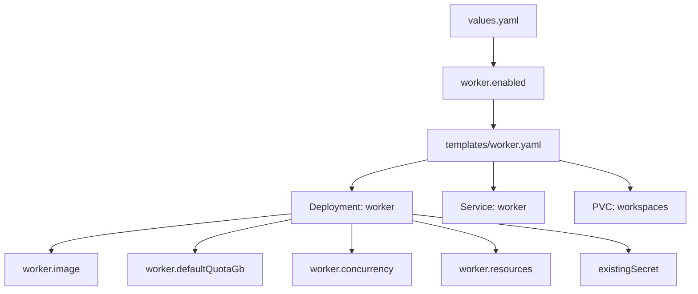
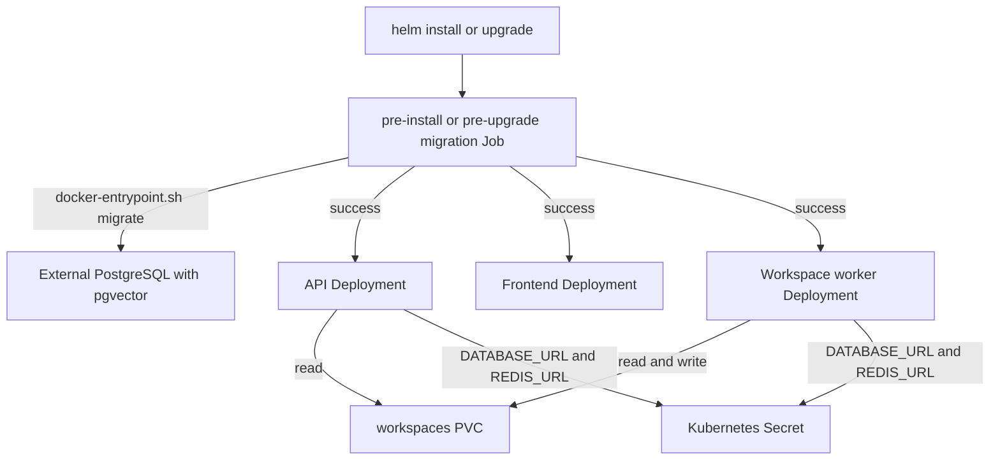
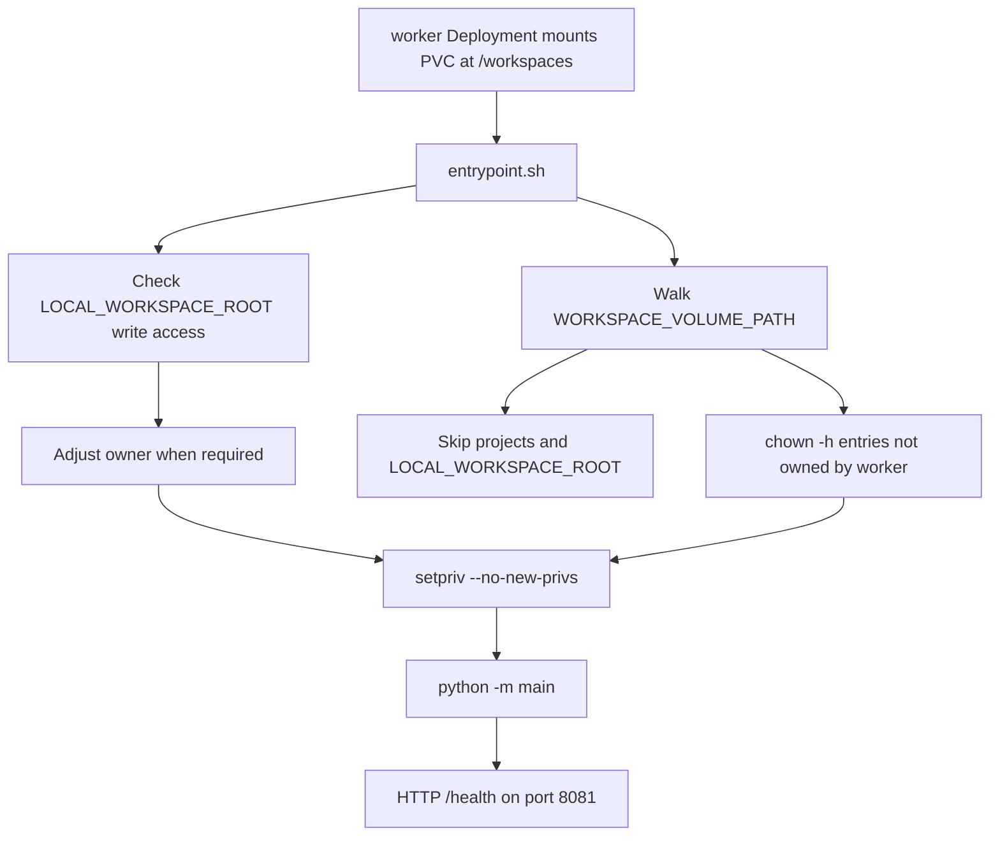
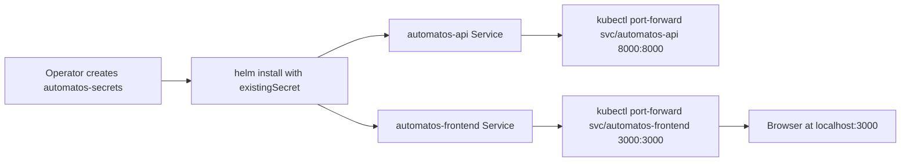
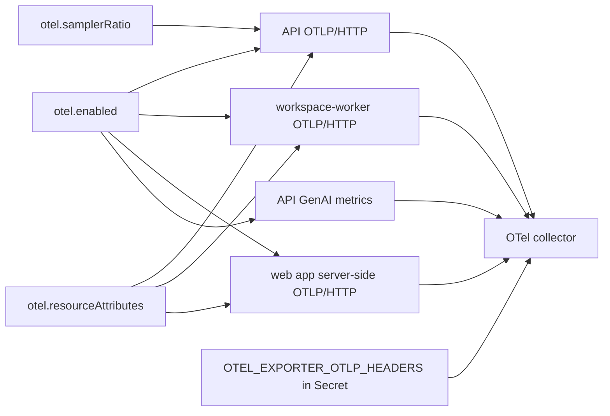
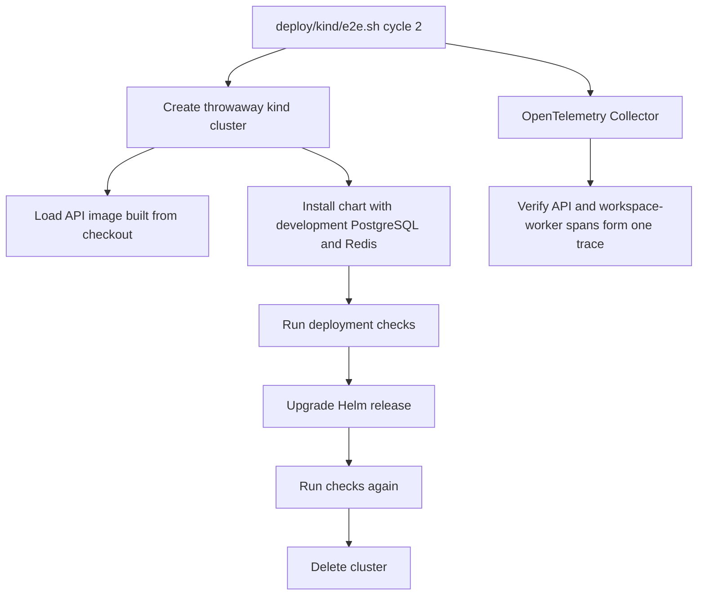

# Kubernetes & Helm Chart

Relevant source files

The following files were used as context for generating this wiki page:

- [.github/workflows/images.yml](.github/workflows/images.yml)
- [.github/workflows/test.yml](.github/workflows/test.yml)
- [QUICKSTART.md](QUICKSTART.md)
- [SETUP.md](SETUP.md)
- [charts/automatos/README.md](charts/automatos/README.md)
- [charts/automatos/templates/worker.yaml](charts/automatos/templates/worker.yaml)
- [docs/agents/llm-provider-management.md](docs/agents/llm-provider-management.md)
- [docs/getting-started/self-hosting.md](docs/getting-started/self-hosting.md)
- [frontend/components/marketplace/__tests__/github-import-modal.test.tsx](frontend/components/marketplace/__tests__/github-import-modal.test.tsx)
- [frontend/components/marketplace/__tests__/marketplace-admin-gate.test.ts](frontend/components/marketplace/__tests__/marketplace-admin-gate.test.ts)
- [frontend/lib/baseline-skills.ts](frontend/lib/baseline-skills.ts)
- [frontend/lib/tooltips.json](frontend/lib/tooltips.json)
- [orchestrator/tests/test_818_every_make_target_has_its_commands_in_the_guide.py](orchestrator/tests/test_818_every_make_target_has_its_commands_in_the_guide.py)
- [orchestrator/tests/test_compose_published_images.py](orchestrator/tests/test_compose_published_images.py)
- [orchestrator/tests/test_f452_worker_cannot_regain_privileges.py](orchestrator/tests/test_f452_worker_cannot_regain_privileges.py)
- [orchestrator/tests/test_prd262_core_stack.py](orchestrator/tests/test_prd262_core_stack.py)
- [orchestrator/tests/test_prd262_dependabot.py](orchestrator/tests/test_prd262_dependabot.py)
- [orchestrator/tests/test_prd262_worker_boot.py](orchestrator/tests/test_prd262_worker_boot.py)
- [orchestrator/tests/test_prd262_worker_diet.py](orchestrator/tests/test_prd262_worker_diet.py)
- [orchestrator/tests/test_setup_runbook.py](orchestrator/tests/test_setup_runbook.py)
- [scripts/ci/image_worker_toolchain.py](scripts/ci/image_worker_toolchain.py)
- [scripts/ci/smoke-core-stack.sh](scripts/ci/smoke-core-stack.sh)
- [services/workspace-worker/Dockerfile](services/workspace-worker/Dockerfile)
- [services/workspace-worker/entrypoint.sh](services/workspace-worker/entrypoint.sh)

## Purpose and scope

This page documents the `charts/automatos` Helm chart and the `deploy/kind` workflow for Kubernetes deployment and local end-to-end verification. The chart installs the API, a database migration Job, the web app, and the workspace worker; PostgreSQL with `pgvector` and Redis are external dependencies. The chart is documented as local-edition-only: the published web-app image has one workspace and no login, so operators should put it behind a VPN or an authenticating ingress. Its API address is fixed at build time, which is why the documented access path uses `kubectl port-forward`. [charts/automatos/README.md:1-12]()

Sources: `charts/automatos/README.md:1-12`

## Helm Chart Structure and Purpose

The chart packages Kubernetes resources for the application and documents chart tests. Its install-time dependencies include an existing Kubernetes Secret, PostgreSQL with `pgvector`, and Redis. [charts/automatos/README.md:3-5]()

| Chart element | Role |
|---|---|
| `templates/worker.yaml` | Renders the workspace worker Deployment and its HTTP Service when `.Values.worker.enabled` is true. [charts/automatos/templates/worker.yaml:1-8](), [charts/automatos/templates/worker.yaml:112-126]() |
| Migration Job | Runs before install or upgrade, waits for PostgreSQL, migrates and seeds the database, and creates the local-edition workspace and operator. A failure fails the release operation. [charts/automatos/README.md:14-20]() |
| API Deployment | Runs the API with `AUTOMATOS_SKIP_MIGRATIONS=true`; the migration Job is the only chart resource documented as changing the schema. The API is kept to one replica because its in-process schedulers use a per-container lock. [charts/automatos/README.md:18-20]() |
| Frontend Deployment | Runs the web app. [charts/automatos/README.md:18-20]() |
| Workspace PVC | Stores agent files; the worker reads and writes them, and the API reads them. The PVC is retained on Helm uninstall. Multi-node pods require `ReadWriteMany` storage. [charts/automatos/README.md:21-22]() |
| Optional Ingress | When enabled, sends `/api` and `/ws` to the API and other paths to the web app. [charts/automatos/README.md:23-23]() |

Sources: `charts/automatos/README.md:3-5`, `charts/automatos/README.md:14-24`, `charts/automatos/templates/worker.yaml:1-8`, `charts/automatos/templates/worker.yaml:112-126`

### Configuration and component mapping

The chart’s documented settings include `existingSecret`, edition configuration, component image tags and digests, workspace storage, ingress, OpenTelemetry, and optional session mode. The README points operators to `values.yaml` for the chart’s settings. The worker template consumes worker-specific image, quota, concurrency, resource, and shared-secret values. [charts/automatos/README.md:66-81](), [charts/automatos/templates/worker.yaml:1-2](), [charts/automatos/templates/worker.yaml:29-60](), [charts/automatos/templates/worker.yaml:105-110]()

**Diagram: Helm configuration names mapped to rendered worker resources**

This maps chart configuration and template identifiers to the worker’s rendered Kubernetes resources. [charts/automatos/templates/worker.yaml:1-2](), [charts/automatos/templates/worker.yaml:29-60](), [charts/automatos/templates/worker.yaml:77-110](), [charts/automatos/templates/worker.yaml:112-126]()

Sources: `charts/automatos/README.md:66-81`, `charts/automatos/templates/worker.yaml:1-2`, `charts/automatos/templates/worker.yaml:29-60`, `charts/automatos/templates/worker.yaml:77-126`

## Kubernetes Deployments and Migration Lifecycle

The chart expects operators to create a Kubernetes Secret; it does not generate or store secrets. The README’s install example includes `DATABASE_URL`, `REDIS_URL`, `API_KEY`, `CREDENTIAL_ENCRYPTION_KEY`, and `WORKER_INTERNAL_TOKEN`. It also identifies `ANTHROPIC_API_KEY` and `CLAUDE_CODE_OAUTH_TOKEN` as optional worker credentials. Keep `CREDENTIAL_ENCRYPTION_KEY` backed up and shared by every pod because credentials saved in the app are encrypted with it. [charts/automatos/README.md:25-46]()

The documented release lifecycle uses a `pre-install`/`pre-upgrade` migration Job that invokes `docker-entrypoint.sh migrate`. It waits for PostgreSQL, migrates and seeds, and creates the local-edition workspace and operator. The API Deployment starts with `AUTOMATOS_SKIP_MIGRATIONS=true`; the chart documents one API replica because a second replica would run scheduled jobs twice. [charts/automatos/README.md:14-20]()

The worker is gated by `.Values.worker.enabled`. Its Deployment uses `Recreate` and one replica, mounts the workspace PVC at `/workspaces`, and exposes port `8081` through a Service. It reads required `DATABASE_URL` and `REDIS_URL` values from the chart’s Secret reference; the worker-internal token and Code Canvas credentials are optional Secret references. [charts/automatos/templates/worker.yaml:1-17](), [charts/automatos/templates/worker.yaml:22-60](), [charts/automatos/templates/worker.yaml:62-79](), [charts/automatos/templates/worker.yaml:107-126]()

**Diagram: Release lifecycle and workspace data flow**

The migration Job, application Deployments, external services, and workspace data flow shown here are documented by the chart README and worker template. [charts/automatos/README.md:14-24](), [charts/automatos/templates/worker.yaml:46-60](), [charts/automatos/templates/worker.yaml:77-110]()

Sources: `charts/automatos/README.md:14-24`, `charts/automatos/templates/worker.yaml:46-60`, `charts/automatos/templates/worker.yaml:77-110`

### Workspace worker startup and security

The worker mounts the workspace PVC at `/workspaces` and defines `/health` readiness and liveness probes on its HTTP port. [charts/automatos/templates/worker.yaml:62-79]()

The worker template disables service-account token automounting and sets `allowPrivilegeEscalation: false`. It drops all capabilities, then adds `CHOWN`, `DAC_OVERRIDE`, `SETUID`, and `SETGID`; it also selects the runtime-default seccomp profile. These permissions support the image entrypoint’s volume-ownership setup and subsequent privilege drop. [charts/automatos/templates/worker.yaml:22-28](), [charts/automatos/templates/worker.yaml:80-104]()

The worker image entrypoint checks whether the worker can write to `LOCAL_WORKSPACE_ROOT`; where needed, it attempts to run as the folder owner, while avoiding root and IDs already assigned to image accounts. It adjusts workspace-volume ownership while skipping mounted projects and the local workspace root, then executes the application as the `worker` user with `--no-new-privs`. [services/workspace-worker/entrypoint.sh:4-19](), [services/workspace-worker/entrypoint.sh:21-64](), [services/workspace-worker/entrypoint.sh:66-93]()

**Diagram: Worker startup from PVC mount to application process**

This diagram associates the chart’s worker Deployment and probes with the image entrypoint’s ownership checks and privilege drop. [charts/automatos/templates/worker.yaml:29-43](), [charts/automatos/templates/worker.yaml:62-79](), [services/workspace-worker/entrypoint.sh:54-64](), [services/workspace-worker/entrypoint.sh:66-93]()

Sources: `charts/automatos/templates/worker.yaml:29-43`, `charts/automatos/templates/worker.yaml:62-79`, `services/workspace-worker/entrypoint.sh:54-64`, `services/workspace-worker/entrypoint.sh:66-93`

## Image Selection and Access

The chart defaults component image tags to the chart’s `appVersion` when component tags and digests are unset. Operators can pin an immutable `sha-…` or version tag, or specify an image digest. The chart selects `Always` for moving tags such as `edge` and major/minor release lines, and `IfNotPresent` for digests or fixed tags, unless the operator supplies a pull policy. [charts/automatos/README.md:66-77]()

The documented install flow creates the namespace and Secret, then runs `helm install` with `existingSecret`, `--wait`, and a 20-minute timeout. The documented access flow uses separate port-forwards for the API and frontend because the web-app image’s API address is fixed at build time. [charts/automatos/README.md:25-37](), [charts/automatos/README.md:48-61]()

The published web-app image is the local edition: one workspace, one operator, and no login. The chart documentation therefore cautions against exposing it without a VPN or authenticating ingress. [charts/automatos/README.md:7-12]()

**Diagram: Operator inputs and local access path**

This connects the documented Secret and Helm install steps to the API and frontend port-forward commands. [charts/automatos/README.md:25-37](), [charts/automatos/README.md:48-61]()

Sources: `charts/automatos/README.md:25-37`, `charts/automatos/README.md:48-61`

## OpenTelemetry and Observability Integration (PRD-256)

OpenTelemetry is configurable through the chart’s `otel` values and is off by default. The documented configuration supports traces from the API, worker, and web app’s server side, plus API GenAI metrics, exported over OTLP/HTTP to a collector. Endpoint headers are supplied through the Secret as `OTEL_EXPORTER_OTLP_HEADERS`; `otel.samplerRatio` controls the share of new traces sampled, and `otel.resourceAttributes` adds resource attributes. [charts/automatos/README.md:66-81]()

**Diagram: Chart OpenTelemetry settings and collector destination**

The chart README documents the telemetry sources, OTLP/HTTP destination, endpoint headers, sampling ratio, and resource attributes. [charts/automatos/README.md:66-81]()

Sources: `charts/automatos/README.md:66-81`

### Trace configuration

The chart exposes the deployment-level `otel.enabled`, `otel.endpoint`, `otel.samplerRatio`, and `otel.resourceAttributes` settings, with endpoint headers stored in the Kubernetes Secret. The chart README points to `deploy/otel/` as the reference collector configuration. [charts/automatos/README.md:66-81]()

Sources: `charts/automatos/README.md:66-81`

## Local Kubernetes Cluster and End-to-End Verification (`deploy/kind`)

The documented Kind end-to-end command is `deploy/kind/e2e.sh cycle 2`. It creates a throwaway cluster, loads images—including the API built from the checkout—installs the chart with development PostgreSQL and Redis, runs checks, upgrades the release, repeats checks, and deletes the cluster; the cycle is run twice. The workflow also runs an OpenTelemetry Collector using the reference configuration and checks that spans from one API and worker request arrive as one trace. [charts/automatos/README.md:99-110]()

The Kind workflow requires Docker, `kind`, `kubectl`, and Helm. The chart’s documented chart-level checks are `helm unittest charts/automatos`, `helm lint`, and a kubeconform schema check in `.github/workflows/chart.yml`. [charts/automatos/README.md:99-110]()

**Diagram: Kind end-to-end verification mapped to deployment entities**

This maps the documented end-to-end cycle to its cluster, image, chart, dependency, upgrade, and trace-verification steps. [charts/automatos/README.md:99-110]()

Sources: `charts/automatos/README.md:99-110`

### Chart tests and local verification boundary

Chart unit tests run without a cluster through `helm unittest charts/automatos`; CI also runs Helm lint and a kubeconform schema check. The Kind end-to-end command provides cluster-level install, upgrade, and telemetry verification. [charts/automatos/README.md:99-110]()

Sources: `charts/automatos/README.md:99-110`

---