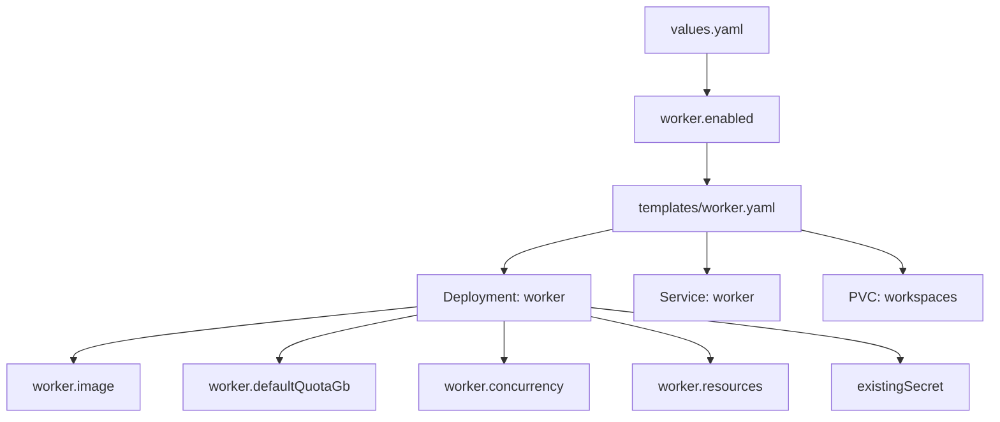
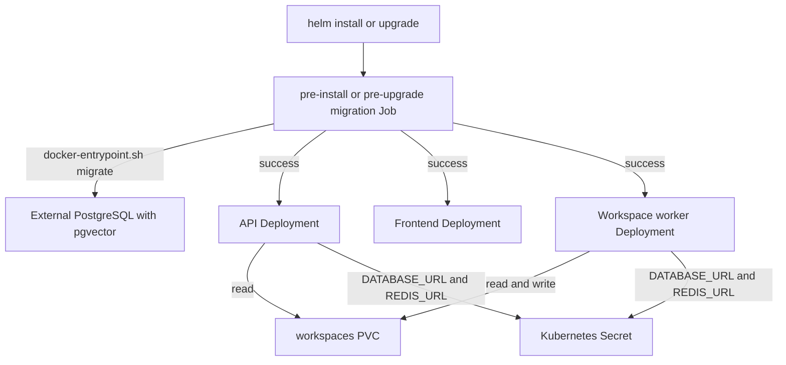
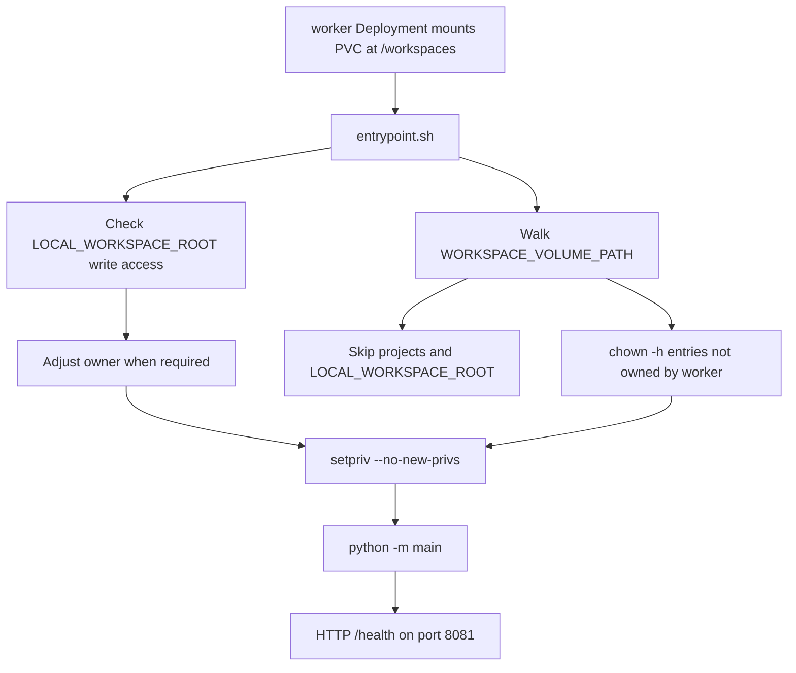
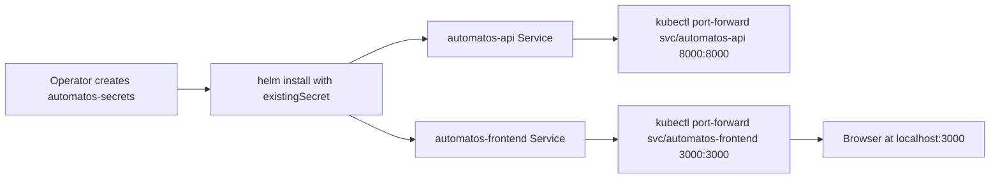
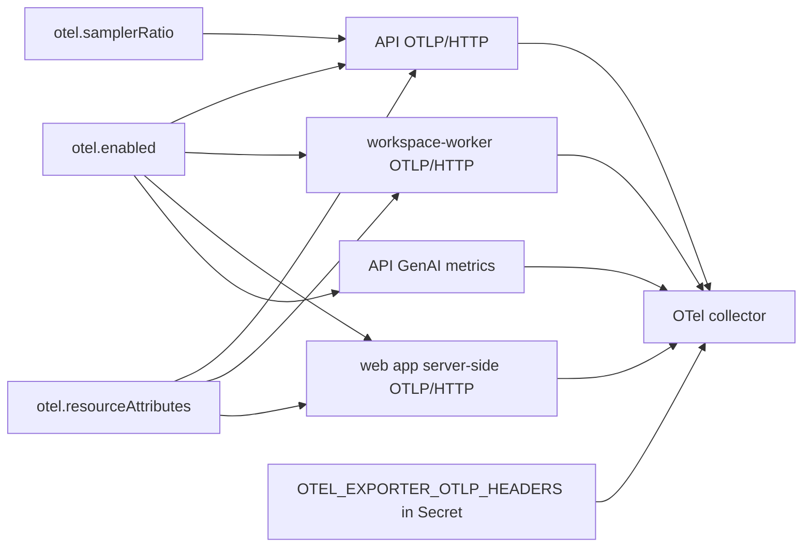
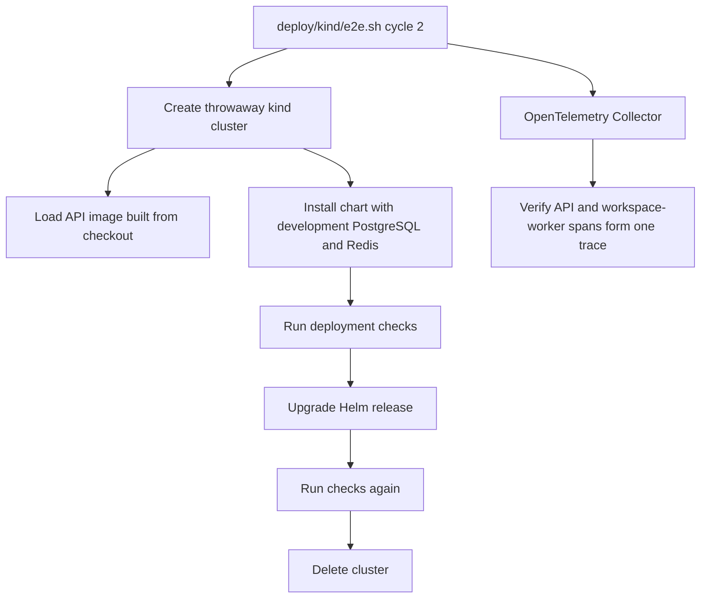

# Kubernetes & Helm Chart

Relevant source files

The following files were used as context for generating this wiki page:

- [.github/workflows/images.yml](.github/workflows/images.yml)
- [.github/workflows/test.yml](.github/workflows/test.yml)
- [QUICKSTART.md](QUICKSTART.md)
- [SETUP.md](SETUP.md)
- [charts/automatos/README.md](charts/automatos/README.md)
- [charts/automatos/templates/worker.yaml](charts/automatos/templates/worker.yaml)
- [docs/agents/llm-provider-management.md](docs/agents/llm-provider-management.md)
- [docs/getting-started/self-hosting.md](docs/getting-started/self-hosting.md)
- [frontend/components/marketplace/__tests__/github-import-modal.test.tsx](frontend/components/marketplace/__tests__/github-import-modal.test.tsx)
- [frontend/components/marketplace/__tests__/marketplace-admin-gate.test.ts](frontend/components/marketplace/__tests__/marketplace-admin-gate.test.ts)
- [frontend/lib/baseline-skills.ts](frontend/lib/baseline-skills.ts)
- [frontend/lib/tooltips.json](frontend/lib/tooltips.json)
- [orchestrator/tests/test_818_every_make_target_has_its_commands_in_the_guide.py](orchestrator/tests/test_818_every_make_target_has_its_commands_in_the_guide.py)
- [orchestrator/tests/test_compose_published_images.py](orchestrator/tests/test_compose_published_images.py)
- [orchestrator/tests/test_f452_worker_cannot_regain_privileges.py](orchestrator/tests/test_f452_worker_cannot_regain_privileges.py)
- [orchestrator/tests/test_prd262_core_stack.py](orchestrator/tests/test_prd262_core_stack.py)
- [orchestrator/tests/test_prd262_dependabot.py](orchestrator/tests/test_prd262_dependabot.py)
- [orchestrator/tests/test_prd262_worker_boot.py](orchestrator/tests/test_prd262_worker_boot.py)
- [orchestrator/tests/test_prd262_worker_diet.py](orchestrator/tests/test_prd262_worker_diet.py)
- [orchestrator/tests/test_setup_runbook.py](orchestrator/tests/test_setup_runbook.py)
- [scripts/ci/image_worker_toolchain.py](scripts/ci/image_worker_toolchain.py)
- [scripts/ci/smoke-core-stack.sh](scripts/ci/smoke-core-stack.sh)
- [services/workspace-worker/Dockerfile](services/workspace-worker/Dockerfile)
- [services/workspace-worker/entrypoint.sh](services/workspace-worker/entrypoint.sh)

## Purpose and scope

This page documents the `charts/automatos` Helm chart and the `deploy/kind` workflow for Kubernetes deployment and local end-to-end verification. The chart installs the API, a database migration Job, the web app, and the workspace worker; PostgreSQL with `pgvector` and Redis are external dependencies. The chart is documented as local-edition-only: the published web-app image has one workspace and no login, so operators should put it behind a VPN or an authenticating ingress. Its API address is fixed at build time, which is why the documented access path uses `kubectl port-forward`. [charts/automatos/README.md:1-12]()

Sources: `charts/automatos/README.md:1-12`

## Helm Chart Structure and Purpose

The chart packages Kubernetes resources for the application and documents chart tests. Its install-time dependencies include an existing Kubernetes Secret, PostgreSQL with `pgvector`, and Redis. [charts/automatos/README.md:3-5]()

| Chart element | Role |
|---|---|
| `templates/worker.yaml` | Renders the workspace worker Deployment and its HTTP Service when `.Values.worker.enabled` is true. [charts/automatos/templates/worker.yaml:1-8](), [charts/automatos/templates/worker.yaml:112-126]() |
| Migration Job | Runs before install or upgrade, waits for PostgreSQL, migrates and seeds the database, and creates the local-edition workspace and operator. A failure fails the release operation. [charts/automatos/README.md:14-20]() |
| API Deployment | Runs the API with `AUTOMATOS_SKIP_MIGRATIONS=true`; the migration Job is the only chart resource documented as changing the schema. The API is kept to one replica because its in-process schedulers use a per-container lock. [charts/automatos/README.md:18-20]() |
| Frontend Deployment | Runs the web app. [charts/automatos/README.md:18-20]() |
| Workspace PVC | Stores agent files; the worker reads and writes them, and the API reads them. The PVC is retained on Helm uninstall. Multi-node pods require `ReadWriteMany` storage. [charts/automatos/README.md:21-22]() |
| Optional Ingress | When enabled, sends `/api` and `/ws` to the API and other paths to the web app. [charts/automatos/README.md:23-23]() |

Sources: `charts/automatos/README.md:3-5`, `charts/automatos/README.md:14-24`, `charts/automatos/templates/worker.yaml:1-8`, `charts/automatos/templates/worker.yaml:112-126`

### Configuration and component mapping

The chart’s documented settings include `existingSecret`, edition configuration, component image tags and digests, workspace storage, ingress, OpenTelemetry, and optional session mode. The README points operators to `values.yaml` for the chart’s settings. The worker template consumes worker-specific image, quota, concurrency, resource, and shared-secret values. Since chart 0.10.0 (PRD-280 US-202) the worker can run in a namespace of its own (`worker.namespace`), reading a Secret of its own (`worker.existingSecret`), with each side of the agent-files volume on a claim the operator made (`workspaces.api.existingClaim`, `workspaces.worker.existingClaim`); the chart refuses a separate namespace without that Secret and both claims, and never creates the namespace. [charts/automatos/README.md]() [charts/automatos/README.md:66-81](), [charts/automatos/templates/worker.yaml:1-2](), [charts/automatos/templates/worker.yaml:29-60](), [charts/automatos/templates/worker.yaml:105-110]()

**Diagram: Helm configuration names mapped to rendered worker resources**

This maps chart configuration and template identifiers to the worker’s rendered Kubernetes resources. [charts/automatos/templates/worker.yaml:1-2](), [charts/automatos/templates/worker.yaml:29-60](), [charts/automatos/templates/worker.yaml:77-110](), [charts/automatos/templates/worker.yaml:112-126]()

Sources: `charts/automatos/README.md:66-81`, `charts/automatos/templates/worker.yaml:1-2`, `charts/automatos/templates/worker.yaml:29-60`, `charts/automatos/templates/worker.yaml:77-126`

## Kubernetes Deployments and Migration Lifecycle

The chart expects operators to create a Kubernetes Secret; it does not generate or store secrets. The README’s install example includes `DATABASE_URL`, `REDIS_URL`, `API_KEY`, `CREDENTIAL_ENCRYPTION_KEY`, and `WORKER_INTERNAL_TOKEN`. It also identifies `ANTHROPIC_API_KEY` and `CLAUDE_CODE_OAUTH_TOKEN` as optional worker credentials. Keep `CREDENTIAL_ENCRYPTION_KEY` backed up and shared by every pod because credentials saved in the app are encrypted with it. [charts/automatos/README.md:25-46]()

The documented release lifecycle uses a `pre-install`/`pre-upgrade` migration Job that invokes `docker-entrypoint.sh migrate`. It waits for PostgreSQL, migrates and seeds, and creates the local-edition workspace and operator. The API Deployment starts with `AUTOMATOS_SKIP_MIGRATIONS=true`; the chart documents one API replica because a second replica would run scheduled jobs twice. [charts/automatos/README.md:14-20]()

The worker is gated by `.Values.worker.enabled`. Its Deployment uses `Recreate` and one replica, mounts the workspace PVC at `/workspaces`, and exposes port `8081` through a Service. It reads required `DATABASE_URL` and `REDIS_URL` values from the chart’s Secret reference; the worker-internal token and Code Canvas credentials are optional Secret references. [charts/automatos/templates/worker.yaml:1-17](), [charts/automatos/templates/worker.yaml:22-60](), [charts/automatos/templates/worker.yaml:62-79](), [charts/automatos/templates/worker.yaml:107-126]()

**Diagram: Release lifecycle and workspace data flow**

The migration Job, application Deployments, external services, and workspace data flow shown here are documented by the chart README and worker template. [charts/automatos/README.md:14-24](), [charts/automatos/templates/worker.yaml:46-60](), [charts/automatos/templates/worker.yaml:77-110]()

Sources: `charts/automatos/README.md:14-24`, `charts/automatos/templates/worker.yaml:46-60`, `charts/automatos/templates/worker.yaml:77-110`

### Workspace worker startup and security

The worker mounts the workspace PVC at `/workspaces` and defines `/health` readiness and liveness probes on its HTTP port. [charts/automatos/templates/worker.yaml:62-79]()

The worker template disables service-account token automounting and sets `allowPrivilegeEscalation: false`. Since chart 0.10.0 (PRD-280 US-201) its pod runs as uid 1000 (`runAsNonRoot`, `runAsUser` and `runAsGroup` 1000, `fsGroup` 1000), and its container drops all capabilities and adds none; it also selects the runtime-default seccomp profile, so it passes the "restricted" pod security level. The storage must hand the workspace volume over writable by the pod's group. [charts/automatos/templates/worker.yaml]() Since chart 0.9.0 its root file system is read-only, with `emptyDir` volumes at `/tmp` and `/home/worker` (`worker.readOnlyRootFilesystem`), as every other container's is; the chart README's "Pod security" section lists each component's., [charts/automatos/templates/worker.yaml:80-104]()

The worker image starts as uid 1000. Started as any user but root, as the chart starts it, the entrypoint repairs nothing: it checks that it can write the workspace volume (and `LOCAL_WORKSPACE_ROOT` when set), stops with a message that says what the storage must provide when it cannot, and otherwise starts the application with `--no-new-privs`. Compose starts the image as root on purpose (`user: "0:0"`), and so must a platform that mounts its volumes as root; started as root, the entrypoint checks whether the worker can write to `LOCAL_WORKSPACE_ROOT`; where needed, it attempts to run as the folder owner, while avoiding root and IDs already assigned to image accounts. It adjusts workspace-volume ownership while skipping mounted projects and the local workspace root, then executes the application as the `worker` user with `--no-new-privs`. [services/workspace-worker/entrypoint.sh:4-19](), [services/workspace-worker/entrypoint.sh:21-64](), [services/workspace-worker/entrypoint.sh:66-93]()

**Diagram: Worker startup from PVC mount to application process**

This diagram associates the chart’s worker Deployment and probes with the image entrypoint’s ownership checks and privilege drop. [charts/automatos/templates/worker.yaml:29-43](), [charts/automatos/templates/worker.yaml:62-79](), [services/workspace-worker/entrypoint.sh:54-64](), [services/workspace-worker/entrypoint.sh:66-93]()

Sources: `charts/automatos/templates/worker.yaml:29-43`, `charts/automatos/templates/worker.yaml:62-79`, `services/workspace-worker/entrypoint.sh:54-64`, `services/workspace-worker/entrypoint.sh:66-93`

## Image Selection and Access

The chart defaults component image tags to the chart’s `appVersion` when component tags and digests are unset. Operators can pin an immutable `sha-…` or version tag, or specify an image digest. The chart selects `Always` for moving tags such as `edge` and major/minor release lines, and `IfNotPresent` for digests or fixed tags, unless the operator supplies a pull policy. [charts/automatos/README.md:66-77]()

The documented install flow creates the namespace and Secret, then runs `helm install` with `existingSecret`, `--wait`, and a 20-minute timeout. The documented access flow uses separate port-forwards for the API and frontend because the web-app image’s API address is fixed at build time. [charts/automatos/README.md:25-37](), [charts/automatos/README.md:48-61]()

The published web-app image is the local edition: one workspace, one operator, and no login. The chart documentation therefore cautions against exposing it without a VPN or authenticating ingress. [charts/automatos/README.md:7-12]()

**Diagram: Operator inputs and local access path**

This connects the documented Secret and Helm install steps to the API and frontend port-forward commands. [charts/automatos/README.md:25-37](), [charts/automatos/README.md:48-61]()

Sources: `charts/automatos/README.md:25-37`, `charts/automatos/README.md:48-61`

## OpenTelemetry and Observability Integration (PRD-256)

OpenTelemetry is configurable through the chart’s `otel` values and is off by default. The documented configuration supports traces from the API, worker, and web app’s server side, plus API GenAI metrics, exported over OTLP/HTTP to a collector. Endpoint headers are supplied through the Secret as `OTEL_EXPORTER_OTLP_HEADERS`; `otel.samplerRatio` controls the share of new traces sampled, and `otel.resourceAttributes` adds resource attributes. [charts/automatos/README.md:66-81]()

**Diagram: Chart OpenTelemetry settings and collector destination**

The chart README documents the telemetry sources, OTLP/HTTP destination, endpoint headers, sampling ratio, and resource attributes. [charts/automatos/README.md:66-81]()

Sources: `charts/automatos/README.md:66-81`

### Trace configuration

The chart exposes the deployment-level `otel.enabled`, `otel.endpoint`, `otel.samplerRatio`, and `otel.resourceAttributes` settings, with endpoint headers stored in the Kubernetes Secret. The chart README points to `deploy/otel/` as the reference collector configuration. [charts/automatos/README.md:66-81]()

Sources: `charts/automatos/README.md:66-81`

## Local Kubernetes Cluster and End-to-End Verification (`deploy/kind`)

The documented Kind end-to-end command is `deploy/kind/e2e.sh cycle 2`. It creates a throwaway cluster, loads images—including the API built from the checkout—installs the chart with development PostgreSQL and Redis, runs checks, upgrades the release, repeats checks, and deletes the cluster; the cycle is run twice. The workflow also runs an OpenTelemetry Collector using the reference configuration and checks that spans from one API and worker request arrive as one trace. [charts/automatos/README.md:99-110]()

The Kind workflow requires Docker, `kind`, `kubectl`, and Helm. The chart’s documented chart-level checks are `helm unittest charts/automatos`, `helm lint`, and a kubeconform schema check in `.github/workflows/chart.yml`. [charts/automatos/README.md:99-110]()

**Diagram: Kind end-to-end verification mapped to deployment entities**

This maps the documented end-to-end cycle to its cluster, image, chart, dependency, upgrade, and trace-verification steps. [charts/automatos/README.md:99-110]()

Sources: `charts/automatos/README.md:99-110`

### Chart tests and local verification boundary

Chart unit tests run without a cluster through `helm unittest charts/automatos`; CI also runs Helm lint and a kubeconform schema check. The Kind end-to-end command provides cluster-level install, upgrade, and telemetry verification. [charts/automatos/README.md:99-110]()

Sources: `charts/automatos/README.md:99-110`

## Automatos's hosted services in the enterprise edition

An enterprise install (PRD-277 US-704, D-12) calls none of Automatos's hosted services until its operator switches one on. Each service is one chart value under `edition.enterprise.hostedServices`, rendered to one API setting; each is `false` unless set `true`, and the chart and the API both refuse any other value. One never switches on another. The local edition calls each service as it always has, and the hosted edition is the host, so it calls none; neither reads these settings.

| Value | API setting | Host it calls | What it sends | What it brings back | When |
|---|---|---|---|---|---|
| `themeRevocations` | `ENTERPRISE_CALLS_THEME_REVOCATIONS` | `THEME_REVOCATIONS_URL` (default `https://api.automatos.app/api/themes/revocations`) | One `GET` with `Accept: application/json`, `Accept-Encoding: identity` and `User-Agent: Automatos-ThemeRevocations/1`. No credential, cookie, install id or workspace data. | Automatos's theme revocation list: the revoked Marketplace theme versions (a digest, or a theme id and version range, with a level and a reason) and the revoked signing key ids. The install stores them and refuses or warns on a theme they cover. | Every `THEME_REVOCATIONS_PULL_MINUTES` (60), first a minute after start, and when an install admin presses Check now. |
| `cloudSync` | `ENTERPRISE_CALLS_CLOUD_SYNC` | `AUTOMATOS_CLOUD_URL` (default `https://api.automatos.app`) | `GET /api/marketplace/catalog`, and `GET /api/marketplace/catalog/files/<digest>/package.autotheme` for a Cloud theme being installed or updated, each with `Accept`, `Accept-Encoding: identity` and the `User-Agent` `Automatos/<version> (local)`, which carries the product's version. No credential, cookie, install id or workspace data. The web app's browsers load a Cloud theme's screenshots from `/api/marketplace/catalog/files/<digest>/<path>` on that host. | The catalogue (the Marketplace themes and items it lists, with their versions and digests) and each theme package, which the install checks against its digest and signature before storing it. | When an install admin presses Sync with Automatos Cloud (after a fresh sign-in), and when a Cloud theme is installed or updated. |
| `cloudItems` | `ENTERPRISE_CALLS_CLOUD_ITEMS` | `AUTOMATOS_CLOUD_URL` | During a Sync, `GET` of each changed item's bundle and each listed plugin's package, at addresses the install derives from the setting and the catalogue's revision or slug and version, with the same headers. | The agents, Playbooks, packages and plugins the catalogue lists. Each is shown for review in the web app before a person adds it. | Only inside a Sync, so only with `cloudSync` on. |

Every request is made from the API, so the host sees the address the install calls from, as it would for any request; the screenshot loads come from each person's browser, so the host sees that browser's address.

Screenshots load in the browser from Automatos Cloud only while `cloudSync` is on. The chart gives the web container the same value (`ENTERPRISE_CALLS_CLOUD_SYNC`), and the web app's content security policy allows Automatos Cloud's files path (`https://api.automatos.app/api/marketplace/catalog/files/`) only then. Otherwise the enterprise policy names no Automatos host and no host of the hosted edition's sign-in provider. The web server refuses to start on a value other than the API's switch forms.

What each service needs, which the chart checks when it renders and the API checks at start:

- **`cloudSync` needs `themeRevocations`.** A theme brought from Automatos Cloud is withdrawn only through Automatos's revocation list, so an install that syncs themes must pull it.
- **`cloudItems` needs `cloudSync`.** Items arrive only in a Sync.

A setting that is off stops requests. It never stops the install reading what it already holds:

- **`themeRevocations` off:** no pull is scheduled or made, and the revocation sync's status and Check now answer 404 with a sentence saying the operator hasn't switched it on. The install does not hear when Automatos revokes a theme version or a signing key. The revocations and revoked keys it already pulled still apply, and so do revocations an admin sets on the install itself.
- **`cloudSync` off:** no catalogue or package is requested, the Sync and its status answer 404 with that sentence, and the Marketplace shows no Sync button and no Cloud screenshots. The install does not see new or updated themes from Automatos Cloud. Themes it already holds stay installed.
- **`cloudItems` off:** a Sync brings themes only, and no item bundle or plugin package is requested. Items already brought stay, are still listed, and are still shown for review in the web app before a person adds one.

The web app reads which services are on from `GET /api/hosted-services`. To consider before switching one on: what the table says it sends, that the host learns the install's address and product version, and, for `cloudItems`, that each item still needs a person to add it.

Sources: `orchestrator/core/editions.py`, `orchestrator/core/edition_start_up.py`, `charts/automatos/templates/_enterprise_api.tpl`, `charts/automatos/templates/_enterprise.tpl`, `frontend/csp-policy.mjs`, `charts/automatos/README.md`

## Phones in the enterprise edition

People pair their phones with Automatos Go while `edition.enterprise.devicePairing` is on (`ENTERPRISE_DEVICE_PAIRING`, PRD-277 US-601). It is on by default; the chart and the API refuse any value but `true` or `false`, and the chart refuses the setting in `config`.

- **Who pairs.** A person signed in to the web app makes a one-time code in Settings, Phones & devices, for themselves, in a workspace they are a member of. The code lasts ten minutes and pairs one phone once; a new code replaces the person's earlier one. A person makes at most ten codes in ten minutes, and none while they hold ten active devices in the workspace. `POST /api/v1/mobile/pair` keeps its limit of attempts per address. No device, key or console makes a code in this edition. The pairing link and the discovery document name the install's public address (`edition.enterprise.publicUrl`), never the address a request came in on.
- **Signing in on the phone.** A person can also sign in on Automatos Go itself, at the install's own sign-in address, through the same identity provider and the same access rules as the web app, with pairing on or off (PRD-277 US-603). The phone gets a one-time code on the app's own link, never a web session; the code lasts one minute, works once, and only with the app's own proof. `POST /api/v1/mobile/sign-in/exchange` turns it into the phone's token and shares `POST /api/v1/mobile/pair`'s limit of attempts per address. The person must be a member of exactly one workspace. Nothing from the identity provider reaches the phone.
- **What a phone is.** The person who paired it or signed in on it, never an operator and never an install admin: at each request it is that person, with their current role in the phone's workspace. A phone cannot confirm a fresh sign-in, so it can take no action that needs one.
- **When a phone stops working.** At its next request after its person is deactivated, after they leave the phone's workspace, after an admin ends all of that person's sessions, and after the phone is removed in Settings.
- **Push notifications.** Notifications leave through Expo's push service only after an install admin agrees, after a fresh sign-in; each answer is in the audit log.
- **Changing edition, or switching pairing off.** The first time the API starts as an edition other than the one it last started as, or with `devicePairing` off after it was on, it revokes every paired phone before it serves, so a phone paired under the local edition does not carry over. Switching pairing back on brings none back. A phone signed in on the phone is revoked by a change of edition, not by the pairing setting. Each phone revoked is in the audit log. Change the edition or this setting with the pods of the earlier configuration stopped.
- **Discovery.** `/.well-known/automatos.json` lists `auth.modes` `["oidc", "device"]` (`["oidc"]` with pairing off) and `auth.oidc`: `start_url` and `exchange_url` (the install's own sign-in start and code-exchange addresses), `app_link` (`go`) and `code_challenge_method` (`S256`); nothing about the identity provider.

Sources: `orchestrator/core/editions.py`, `orchestrator/api/mobile_devices.py`, `orchestrator/api/mobile_push.py`, `orchestrator/services/mobile/edition_change.py`, `orchestrator/services/mobile/discovery.py`, `charts/automatos/templates/_enterprise_api.tpl`

---