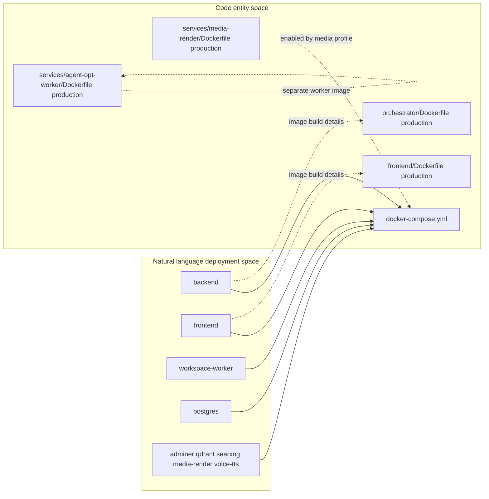
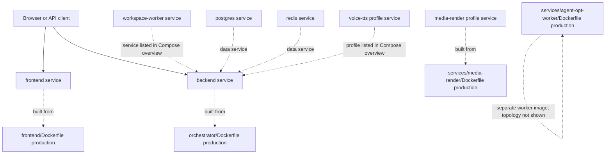

# Production Deployment

Relevant source files

The following files were used as context for generating this wiki page:

- [.env.example](.env.example)
- [.grype.yaml](.grype.yaml)
- [docker-compose.yml](docker-compose.yml)
- [frontend/Dockerfile](frontend/Dockerfile)
- [orchestrator/Dockerfile](orchestrator/Dockerfile)
- [orchestrator/requirements-dev.lock](orchestrator/requirements-dev.lock)
- [orchestrator/requirements-dev.txt](orchestrator/requirements-dev.txt)
- [orchestrator/requirements.lock](orchestrator/requirements.lock)
- [orchestrator/tests/test_prd262_agent_opt_worker_image.py](orchestrator/tests/test_prd262_agent_opt_worker_image.py)
- [orchestrator/tests/test_prd262_media_render_esbuild.py](orchestrator/tests/test_prd262_media_render_esbuild.py)
- [orchestrator/tests/test_prd262_media_render_stages.py](orchestrator/tests/test_prd262_media_render_stages.py)
- [services/agent-opt-worker/Dockerfile](services/agent-opt-worker/Dockerfile)
- [services/agent-opt-worker/overrides.txt](services/agent-opt-worker/overrides.txt)
- [services/agent-opt-worker/requirements.in](services/agent-opt-worker/requirements.in)
- [services/agent-opt-worker/requirements.lock](services/agent-opt-worker/requirements.lock)
- [services/media-render/Dockerfile](services/media-render/Dockerfile)
- [services/media-render/requirements.lock](services/media-render/requirements.lock)
- [services/media-render/tests/test_image_esbuild.py](services/media-render/tests/test_image_esbuild.py)
- [services/workspace-worker/requirements.lock](services/workspace-worker/requirements.lock)

## Purpose and scope

This page documents the production deployment details supported by the provided repository excerpts: the Docker Compose service profiles, production image build conventions, environment configuration, and deployment implications for scaling, monitoring, and backups. The supplied files do not include the Railway manifest, the workspace-worker Dockerfile or entrypoint, or monitoring and backup configuration. Accordingly, Railway service names and settings, worker runtime specifics, and implemented monitoring or backup strategies cannot be verified here. [docker-compose.yml:1-82](), [orchestrator/Dockerfile:1-13](), [frontend/Dockerfile:1-10]()

Sources: [docker-compose.yml:1-82](), [orchestrator/Dockerfile:1-13](), [frontend/Dockerfile:1-10]()

---

## Deployment Architecture & Topology

The visible Compose configuration defines a default deployment centered on PostgreSQL, Redis, MinIO, the backend, the frontend, and the workspace worker. Additional profiles enable Adminer, Qdrant, SearXNG, media rendering, and voice. A core override can omit the workspace worker. PostgreSQL and Redis are core dependencies in the shown Compose overview; the supplied excerpts do not show all service definitions or their health checks. [docker-compose.yml:52-80](), [docker-compose.yml:84-104]()

### Production Service Map & Code Entities

This diagram maps service names and deployment concepts to code entities identifiable in the provided files. Railway-specific service identifiers are not available in the supplied excerpts and are therefore not inferred.

**Diagram: Compose services mapped to code entities**

Sources: [docker-compose.yml:52-80](), [orchestrator/Dockerfile:1-13](), [frontend/Dockerfile:1-10](), [services/media-render/Dockerfile:1-30](), [services/agent-opt-worker/Dockerfile:1-10]()

### Worker profiles and supporting services

The Compose default includes `workspace-worker`; the `core` override places it behind a `workspace` profile, allowing the backend and frontend to run without it. In that configuration, workspace tools, the Deliverables file browser, and Code Canvas require the worker and report that it is unavailable when the worker is not running. The `memory`, `search`, `media`, and `voice` profiles enable Qdrant, SearXNG, media rendering, and voice TTS respectively. [docker-compose.yml:52-80]()

The FutureAGI agent optimization worker is a separate container image. Its Dockerfile creates a `worker` user, exposes port `8080`, starts `uvicorn main:app`, and documents that startup requires `AGENT_OPT_WORKER_TOKEN`. The file describes the worker as an isolated service called by the API with `X-Internal-Token`; it does not establish that this worker is part of the shown Compose profiles or a Railway topology. [services/agent-opt-worker/Dockerfile:1-36]()

Sources: [docker-compose.yml:52-80](), [services/agent-opt-worker/Dockerfile:1-36]()

### Production request and worker topology

The Compose overview identifies the default app and data services, while the Dockerfiles document the backend, frontend, media-render, and agent-opt-worker image build targets. The supplied excerpts do not show enough service wiring to assert request paths, ports, or network links between those containers. [docker-compose.yml:52-80](), [orchestrator/Dockerfile:1-13](), [frontend/Dockerfile:1-10](), [services/media-render/Dockerfile:1-30](), [services/agent-opt-worker/Dockerfile:1-36]()

**Diagram: Deployment roles and image artifacts**

Sources: [docker-compose.yml:52-80](), [orchestrator/Dockerfile:1-13](), [frontend/Dockerfile:1-10](), [services/media-render/Dockerfile:1-30](), [services/agent-opt-worker/Dockerfile:1-36]()

---

## Containerization Strategy & Production Parity

The Compose file states that it runs production images: the application code is inside the images, with no source reload. The backend and frontend Dockerfiles use multi-stage builds. The backend uses a pinned `uv` installer and a hash-checked dependency lock; the frontend installs from `package-lock.json` using `npm ci` and builds a Next.js standalone bundle. [docker-compose.yml:25-28](), [orchestrator/Dockerfile:1-13](), [orchestrator/Dockerfile:20-78](), [frontend/Dockerfile:1-10](), [frontend/Dockerfile:29-35]()

The Compose overview says CI publishes images under `ghcr.io/automatosai/automatos-<service>:${AUTOMATOS_IMAGE_TAG:-edge}`. It describes `make up` as selecting a tag, pulling it, starting without a build, and recording the tag in `.env`; `make build` builds local images. The `AUTOMATOS_REVISION` value labels local builds when provided. [docker-compose.yml:30-44]()

### Build and runtime mapping

| Component or image | Build and runtime details |
| --- | --- |
| Backend | `orchestrator/Dockerfile` uses a multi-stage build; the shown dependency installation uses `requirements.lock`, split into stable and remaining dependency sets, with hash checking. [orchestrator/Dockerfile:1-13](), [orchestrator/Dockerfile:44-78]() |
| Frontend | `frontend/Dockerfile` uses Node 24 Alpine, installs dependencies with `npm ci`, and passes `NEXT_PUBLIC_*` values as build-time configuration. [frontend/Dockerfile:16-34](), [frontend/Dockerfile:69-110]() |
| Media renderer | `services/media-render/Dockerfile` identifies `production` as the last stage and describes a multi-stage build for assets and runtime dependencies. [services/media-render/Dockerfile:13-30]() |
| Agent optimization worker | `services/agent-opt-worker/Dockerfile` defines the production stage after a runtime stage and runs the app as the non-root `worker` user. [services/agent-opt-worker/Dockerfile:10-17](), [services/agent-opt-worker/Dockerfile:30-44]() |
| Workspace worker | The Compose overview lists `workspace-worker` as a default service. Its Dockerfile and entrypoint are not among the supplied file contents, so their build and runtime details cannot be established here. [docker-compose.yml:52-66]() |

Sources: [docker-compose.yml:25-44](), [docker-compose.yml:52-80](), [orchestrator/Dockerfile:1-13](), [orchestrator/Dockerfile:44-78](), [frontend/Dockerfile:16-35](), [frontend/Dockerfile:69-110](), [services/media-render/Dockerfile:13-30](), [services/agent-opt-worker/Dockerfile:10-17](), [services/agent-opt-worker/Dockerfile:30-44]()

---

## Scaling Strategies & Worker Profiles

The available configuration establishes service profiles, but it does not specify autoscaling rules, replica counts, load-balancer behavior, or worker concurrency limits. Treat scaling decisions as deployment-platform configuration rather than as behavior evidenced by these excerpts.

The Compose profile choices provide an operational grouping:

| Profile or mode | Services and operational implication |
| --- | --- |
| Default | Includes PostgreSQL, Redis, MinIO, backend, frontend, and workspace worker according to the Compose overview. [docker-compose.yml:52-66]() |
| `core` | Runs the five-container core stack without the workspace worker; workspace tools and file-oriented features then report the worker unavailable. [docker-compose.yml:73-79]() |
| `memory` | Enables Qdrant for durable memory and requires `QDRANT_URL` configuration as indicated in the Compose comments. [docker-compose.yml:67-68]() |
| `search` | Enables SearXNG for agent web search and uses `SEARXNG_URL` as indicated in the Compose comments. [docker-compose.yml:69-70]() |
| `media` | Enables `media-render` for Socials media rendering. [docker-compose.yml:70-71]() |
| `voice` | Enables `voice-tts`; the Compose comments specify `VOICE_TTS_URL=http://voice-tts:8100`. [docker-compose.yml:72]() |
| `all` | Adds Adminer, described as a database GUI. [docker-compose.yml:67]() |

For production capacity planning, scale stateless application and worker services only after verifying their actual process model, shared-state assumptions, queue semantics, and storage requirements in the corresponding runtime configuration. In particular, the provided excerpts do not establish whether multiple workspace-worker instances safely share a workspace filesystem. [docker-compose.yml:52-80]()

Sources: [docker-compose.yml:52-80]()

---

## Environment Configuration & Secrets

The Compose overview requires a `.env` file containing `POSTGRES_PASSWORD`, `REDIS_PASSWORD`, and `API_KEY`; it warns that placeholder values are rejected by `orchestrator/docker-secrets-guard.sh`. The supplied excerpt names that guard but does not include its implementation. [docker-compose.yml:46-50]()

The example environment file includes database, Redis, API, frontend, authentication, object storage, and optional integration settings. It documents `OPENAI_API_KEY` and `ANTHROPIC_API_KEY` as optional environment-provided LLM keys, while other providers can be configured in application settings. It also documents `COMPOSIO_KEY` and `FIRECRAWL_API_KEY` as optional integration keys. [`.env.example:13-30](), [`.env.example:44-72]()

`NEXT_PUBLIC_*` values are embedded in the frontend bundle at build time and must not contain secrets. The frontend Dockerfile makes the API URL, WebSocket URL, auth edition, Clerk publishable key, and media origins build-time arguments; secret API keys should remain server-side. [frontend/Dockerfile:69-101]()

For object storage, the example describes MinIO as the local Compose default and indicates that leaving `S3_ENDPOINT_URL` unset targets real AWS S3 when AWS credentials and region are configured. This file does not specify a production backup policy or retention schedule. [`.env.example:113-133`]()

Sources: [docker-compose.yml:46-50](), [`.env.example:13-30`](), [`.env.example:44-72`](), [frontend/Dockerfile:69-101](), [`.env.example:113-133`]()

---

## Monitoring, Backup & Observability

The supplied files document Compose startup and health-check considerations at a high level: the Compose file requires Docker Engine 25 or later for its `start_interval` health-check behavior and says this enables rapid readiness probing during startup. The shown Compose excerpt does not include the individual health-check definitions, so their endpoints and thresholds cannot be documented here. [docker-compose.yml:4-8](), [docker-compose.yml:101-104]()

The frontend Dockerfile defines a container health check that probes `http://localhost:3000` with `wget`; it uses a 60-second start period, a 30-second interval, a 10-second timeout, and three retries. [frontend/Dockerfile:44-49]()

The supplied deployment materials do not show Prometheus, Grafana, Loki, Alertmanager, exporter, or Railway monitoring configuration. They also do not define PostgreSQL, Redis, MinIO, or S3 backup jobs, retention periods, or restoration procedures. Production operators must provide and validate monitoring and backup mechanisms outside the configuration evidenced here; verify recoverability with restore tests rather than treating persistent storage alone as a backup. [docker-compose.yml:84-104](), [`.env.example:113-133`]()

Sources: [docker-compose.yml:4-8](), [docker-compose.yml:101-104](), [frontend/Dockerfile:44-49](), [`.env.example:113-133`]()

---