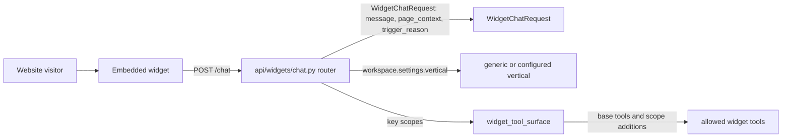
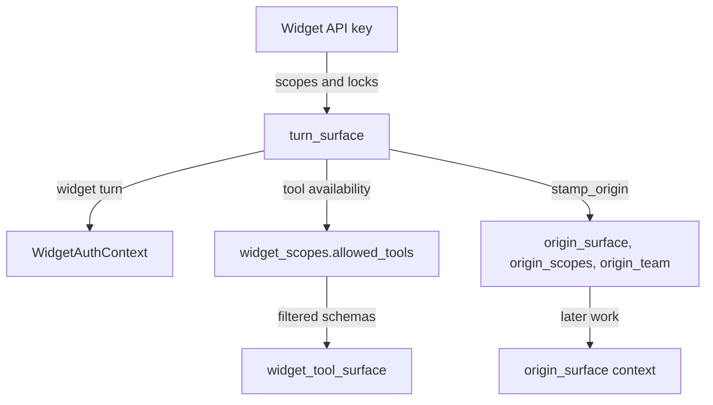

# Embedded Widgets, Sites & Verticals

Relevant source files

The following files were used as context for generating this wiki page:

- [orchestrator/api/widgets/chat.py](orchestrator/api/widgets/chat.py)
- [orchestrator/core/security/surface.py](orchestrator/core/security/surface.py)
- [orchestrator/core/security/widget_scopes.py](orchestrator/core/security/widget_scopes.py)
- [orchestrator/modules/context/sections/composio.py](orchestrator/modules/context/sections/composio.py)
- [orchestrator/modules/context/sections/plugins.py](orchestrator/modules/context/sections/plugins.py)
- [orchestrator/modules/tools/discovery/actions_mission_resume.py](orchestrator/modules/tools/discovery/actions_mission_resume.py)
- [orchestrator/modules/tools/discovery/actions_missions.py](orchestrator/modules/tools/discovery/actions_missions.py)
- [orchestrator/modules/tools/discovery/handlers_missions.py](orchestrator/modules/tools/discovery/handlers_missions.py)
- [orchestrator/modules/tools/discovery/plan_edits.py](orchestrator/modules/tools/discovery/plan_edits.py)
- [orchestrator/modules/tools/discovery/step_brief_edits.py](orchestrator/modules/tools/discovery/step_brief_edits.py)
- [orchestrator/tests/test_f155_a_widget_turn_gets_no_skills_and_only_its_locked_agents_plugins.py](orchestrator/tests/test_f155_a_widget_turn_gets_no_skills_and_only_its_locked_agents_plugins.py)
- [orchestrator/tests/test_f155_the_public_widget_surface.py](orchestrator/tests/test_f155_the_public_widget_surface.py)
- [orchestrator/tests/test_f155_widget_born_work_carries_its_origin.py](orchestrator/tests/test_f155_widget_born_work_carries_its_origin.py)
- [orchestrator/tests/test_f155_widget_scopes.py](orchestrator/tests/test_f155_widget_scopes.py)
- [orchestrator/tests/test_f282_c_plan_edits_land_on_the_missions_steps.py](orchestrator/tests/test_f282_c_plan_edits_land_on_the_missions_steps.py)
- [orchestrator/tests/test_f308_c_a_brief_edit_reaches_the_steps_card.py](orchestrator/tests/test_f308_c_a_brief_edit_reaches_the_steps_card.py)
- [orchestrator/tests/test_f308_d_a_reply_never_says_steps_pause_when_they_dont.py](orchestrator/tests/test_f308_d_a_reply_never_says_steps_pause_when_they_dont.py)
- [orchestrator/tests/test_widget_proactive_prd007.py](orchestrator/tests/test_widget_proactive_prd007.py)

## Purpose and Scope

This page gives a high-level overview of how embedded website chat relates to workspace configuration, site callbacks, and vertical integrations such as Shopify. It focuses on the boundaries between the public widget surface and the platform; detailed API, site-management, and integration behavior belongs on the child pages. The widget chat API is documented as reusing the platform’s chat services, while vertical selection is read from `workspace.settings.vertical` and defaults to `generic` [orchestrator/api/widgets/chat.py:1-15](), [orchestrator/api/widgets/chat.py:137-151]().

- For widget endpoints, SDK keys, domain checks, rate limiting, and scopes, see [Widget API & SDK](#27.1).
- For Sites, callbacks, destinations, and proactive triggers, see [Sites, Callbacks & Destinations](#27.2).
- For Shopify and other vertical integrations, see [Shopify & Vertical Integrations](#27.3).

Sources: [orchestrator/api/widgets/chat.py:1-15](), [orchestrator/api/widgets/chat.py:137-151]()

## Architectural Overview: Natural Language to Code Entity Space

The diagram connects visitor-facing concepts to code entities visible in the supplied files. It shows the widget chat request boundary, the workspace vertical lookup, and the scope-based tool surface; it does not prescribe unshown site or callback implementation details [orchestrator/api/widgets/chat.py:48-66](), [orchestrator/api/widgets/chat.py:137-151](), [orchestrator/core/security/widget_scopes.py:34-45](), [orchestrator/core/security/widget_scopes.py:79-108]().

**Diagram: Visitor request to widget chat and scoped tools**

Sources: [orchestrator/api/widgets/chat.py:48-66](), [orchestrator/api/widgets/chat.py:137-151](), [orchestrator/core/security/widget_scopes.py:34-45](), [orchestrator/core/security/widget_scopes.py:79-108]()

## 27.1 Widget API & SDK

The widget API provides a chat endpoint whose request can include a message, conversation ID, agent ID, model ID, page context, and trigger reason. The chat module documents that widget turns reuse the existing chat services, and that the SSE stream is handled separately by `api/widgets/chat_stream.py` [orchestrator/api/widgets/chat.py:1-15](), [orchestrator/api/widgets/chat.py:48-66]().

The public widget surface is constrained by the API key’s scopes: `allowed_tools` combines base tools with tools granted by recognized scopes, and `widget_tool_surface` filters the offered tool schemas accordingly [orchestrator/core/security/widget_scopes.py:34-76](), [orchestrator/core/security/widget_scopes.py:79-108](). For authentication, SDK configuration, rate limiting, internationalization, and the frontend settings tab, see [Widget API & SDK](#27.1).

Sources: [orchestrator/api/widgets/chat.py:1-15](), [orchestrator/api/widgets/chat.py:48-66](), [orchestrator/core/security/widget_scopes.py:34-76](), [orchestrator/core/security/widget_scopes.py:79-108]()

## 27.2 Sites, Callbacks & Destinations

Site configuration and callback destinations connect a deployed widget to workspace behavior. The widget’s base scope includes `widget_open_callback_form`, while the chat request supports optional page context and trigger reasons; the widget chat module recognizes `proactive_opener` and `cart_idle` as proactive trigger reasons [orchestrator/core/security/widget_scopes.py:34-45](), [orchestrator/api/widgets/chat.py:55-73]().

The workspace vertical is resolved from `workspace.settings.vertical`, with `generic` as the fallback when a vertical is not configured [orchestrator/api/widgets/chat.py:137-151](). For the Sites service and API, callback panel, destination dispatch, and frontend sites library, see [Sites, Callbacks & Destinations](#27.2).

Sources: [orchestrator/core/security/widget_scopes.py:34-45](), [orchestrator/api/widgets/chat.py:55-73](), [orchestrator/api/widgets/chat.py:137-151]()

## 27.3 Shopify & Vertical Integrations

Vertical integrations tailor widget behavior to a workspace’s configured vertical. In the chat API, vertical selection is read from workspace settings and defaults to `generic`; Shopify-specific tests document a default proactive-widget configuration that is disabled unless enabled, and a public configuration projection that excludes internal Shopify credentials and domain settings [orchestrator/api/widgets/chat.py:137-151](), [orchestrator/tests/test_widget_proactive_prd007.py:31-61](), [orchestrator/tests/test_widget_proactive_prd007.py:90-108]().

The Shopify proactive-widget tests also cover product and collection page context used to form opener messages, including product details and cart context [orchestrator/tests/test_widget_proactive_prd007.py:118-176](). For the integration registry, provisioning contract, Shopify events, token handling, and catalog or order-pattern synchronization, see [Shopify & Vertical Integrations](#27.3).

Sources: [orchestrator/api/widgets/chat.py:137-151](), [orchestrator/tests/test_widget_proactive_prd007.py:31-61](), [orchestrator/tests/test_widget_proactive_prd007.py:90-108](), [orchestrator/tests/test_widget_proactive_prd007.py:118-176]()

## Widget Turn Boundaries

A widget turn carries the public surface identity, scopes, team lock, and optional agent lock through a context variable. The scope map defines the base tools and scope-specific additions; tool filtering exposes only the corresponding tool schemas to the model [orchestrator/core/security/surface.py:27-47](), [orchestrator/core/security/surface.py:50-80](), [orchestrator/core/security/widget_scopes.py:34-76](), [orchestrator/core/security/widget_scopes.py:93-108]().

Work that continues after the turn can preserve its origin through `stamp_origin` and `origin_surface`. This makes widget restrictions relevant beyond the initial request, rather than treating the public widget as an owner session [orchestrator/core/security/surface.py:92-127](). For the detailed scope and origin rules, see [Widget API & SDK](#27.1).

**Diagram: Widget surface and inherited origin**

Sources: [orchestrator/core/security/surface.py:27-47](), [orchestrator/core/security/surface.py:50-80](), [orchestrator/core/security/surface.py:92-127](), [orchestrator/core/security/widget_scopes.py:79-108]()

---