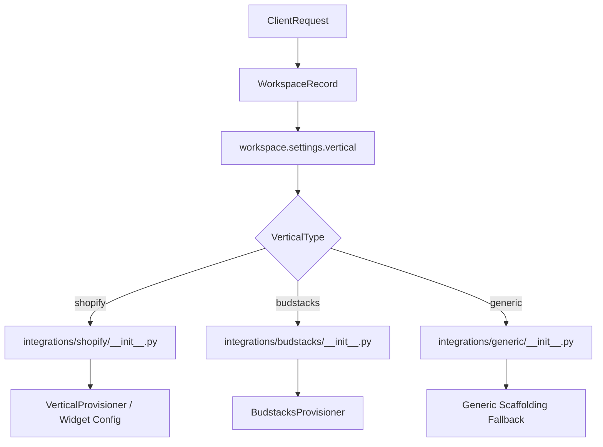
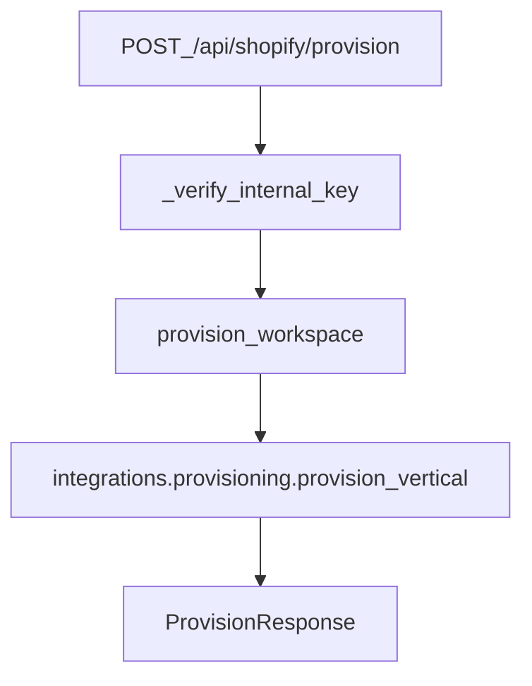
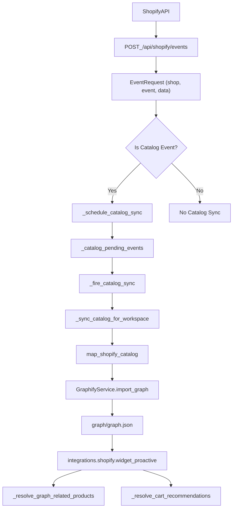

# Shopify & Vertical Integrations

Relevant source files

The following files were used as context for generating this wiki page:

- [.gitignore](.gitignore)
- [docs/PRDS/126-BUSINESS-KNOWLEDGE-GRAPH.md](docs/PRDS/126-BUSINESS-KNOWLEDGE-GRAPH.md)
- [docs/testing/CUSTOMER-NIGHTS-PLAN.md](docs/testing/CUSTOMER-NIGHTS-PLAN.md)
- [frontend/components/settings/DynamicCredentialForm.tsx](frontend/components/settings/DynamicCredentialForm.tsx)
- [frontend/components/settings/SystemSettingsTab.tsx](frontend/components/settings/SystemSettingsTab.tsx)
- [frontend/lib/api/credentials.ts](frontend/lib/api/credentials.ts)
- [graphify-out/snapshots/bucket-1-pre-drop.sql](graphify-out/snapshots/bucket-1-pre-drop.sql)
- [orchestrator/.env.example](orchestrator/.env.example)
- [orchestrator/alembic/versions/prd135_drop_bucket_1.py](orchestrator/alembic/versions/prd135_drop_bucket_1.py)
- [orchestrator/api/credentials.py](orchestrator/api/credentials.py)
- [orchestrator/api/shopify.py](orchestrator/api/shopify.py)
- [orchestrator/api/system_settings.py](orchestrator/api/system_settings.py)
- [orchestrator/core/composio/models.py](orchestrator/core/composio/models.py)
- [orchestrator/core/credentials/integration_bridges/__init__.py](orchestrator/core/credentials/integration_bridges/__init__.py)
- [orchestrator/core/credentials/integration_bridges/base.py](orchestrator/core/credentials/integration_bridges/base.py)
- [orchestrator/core/credentials/integration_bridges/shopify.py](orchestrator/core/credentials/integration_bridges/shopify.py)
- [orchestrator/core/credentials/service.py](orchestrator/core/credentials/service.py)
- [orchestrator/core/llm/manager.py](orchestrator/core/llm/manager.py)
- [orchestrator/core/models/credentials.py](orchestrator/core/models/credentials.py)
- [orchestrator/core/models/system_settings.py](orchestrator/core/models/system_settings.py)
- [orchestrator/core/monitoring/automatos_alerts.py](orchestrator/core/monitoring/automatos_alerts.py)
- [orchestrator/core/monitoring/automatos_logs_api.py](orchestrator/core/monitoring/automatos_logs_api.py)
- [orchestrator/core/seeds/seed_system_settings.py](orchestrator/core/seeds/seed_system_settings.py)
- [orchestrator/core/services/audit_service.py](orchestrator/core/services/audit_service.py)
- [orchestrator/core/services/plugin_cache.py](orchestrator/core/services/plugin_cache.py)
- [orchestrator/modules/knowledge/graph_edge_rules.py](orchestrator/modules/knowledge/graph_edge_rules.py)
- [orchestrator/modules/knowledge/graph_extraction.py](orchestrator/modules/knowledge/graph_extraction.py)
- [orchestrator/modules/knowledge/graph_relations.py](orchestrator/modules/knowledge/graph_relations.py)
- [orchestrator/modules/knowledge/graph_service.py](orchestrator/modules/knowledge/graph_service.py)
- [orchestrator/modules/tools/discovery/handlers_graph.py](orchestrator/modules/tools/discovery/handlers_graph.py)
- [orchestrator/tests/helpers_graph_extraction.py](orchestrator/tests/helpers_graph_extraction.py)
- [orchestrator/tests/test_1057_credential_stats_and_health_reach_their_handlers.py](orchestrator/tests/test_1057_credential_stats_and_health_reach_their_handlers.py)
- [orchestrator/tests/test_api_key_domain_check.py](orchestrator/tests/test_api_key_domain_check.py)
- [orchestrator/tests/test_f206_a_graph_extraction_fits_its_cap.py](orchestrator/tests/test_f206_a_graph_extraction_fits_its_cap.py)
- [orchestrator/tests/test_f312_a_a_person_is_never_produced.py](orchestrator/tests/test_f312_a_a_person_is_never_produced.py)
- [orchestrator/tests/test_f312_b_a_claim_of_effect_needs_the_documents_words.py](orchestrator/tests/test_f312_b_a_claim_of_effect_needs_the_documents_words.py)
- [orchestrator/tests/test_f312_c_blend_components_are_part_of_the_blend.py](orchestrator/tests/test_f312_c_blend_components_are_part_of_the_blend.py)
- [orchestrator/tests/test_f312_d_a_supplier_edge_points_from_the_supplier.py](orchestrator/tests/test_f312_d_a_supplier_edge_points_from_the_supplier.py)
- [orchestrator/tests/test_f312_f_a_nodes_role_decides_what_its_edges_may_say.py](orchestrator/tests/test_f312_f_a_nodes_role_decides_what_its_edges_may_say.py)
- [orchestrator/tests/test_graph_relation_vocab.py](orchestrator/tests/test_graph_relation_vocab.py)
- [orchestrator/tests/test_issue_1073_graph_event_loop.py](orchestrator/tests/test_issue_1073_graph_event_loop.py)
- [orchestrator/tests/test_p2w2_credentials_null_workspace.py](orchestrator/tests/test_p2w2_credentials_null_workspace.py)
- [orchestrator/tests/test_prd183_s1_catalog_webhook.py](orchestrator/tests/test_prd183_s1_catalog_webhook.py)
- [orchestrator/tests/test_prd183_s5_vertical_provision.py](orchestrator/tests/test_prd183_s5_vertical_provision.py)
- [orchestrator/tests/test_prd189_s3_webhook_debounce.py](orchestrator/tests/test_prd189_s3_webhook_debounce.py)

This page documents the vertical integration subsystem within Automatos AI, covering Shopify-specific merchant onboarding, provisioning, credential bridging, catalog/order synchronization, encrypted token handling, and generic vertical scaffolding.

---

## 1. Integrations Registry Contract & Scaffolding

Automatos AI organizes domain-specific platform extensions under the `integrations/` directory. Verticals like Shopify, budstacks, and the fallback `generic` vertical implement a uniform contract that dictates how workspaces are provisioned, how widget features (such as proactive triggers) are configured, and how plug-and-play event hooks are dispatched.

The workspace vertical is stored as a setting string in `workspace.settings.vertical`. When a request or chat session initializes, the runtime resolves the vertical via `_resolve_workspace_vertical` to dispatch appropriate plugins or UI behaviours [orchestrator/api/widgets/chat.py:138-151](). If a workspace lacks a specific vertical configuration, it defaults to `"generic"`.

*Figure 1: Natural Language Space to Code Entity Space mapping for vertical resolution.*

Sources: [orchestrator/integrations/__init__.py](), [orchestrator/api/widgets/chat.py:138-151](), [orchestrator/integrations/shopify/__init__.py]()

---

## 2. Shopify Provisioning, Connect & Webhook Events

The Shopify integration API layer (`orchestrator/api/shopify.py`) handles merchant lifecycle events stemming from app installations, token connections, and webhook forwards.

### Key Endpoints & Functions
*   **`POST /api/shopify/provision`**: Implemented by `provision_workspace`, which seeds agents, establishes workspace settings, and issues a public widget API key [orchestrator/api/shopify.py:151-179](). It delegates to the `VerticalProvisioner` interface under `integrations.provisioning` [orchestrator/api/shopify.py:166-174]().
*   **Internal Authentication**: Guarded by `_verify_internal_key`, which performs a constant-time comparison via `hmac.compare_digest` against `config.SHOPIFY_INTERNAL_API_KEY` [orchestrator/api/shopify.py:87-105]().
*   **Workspace Resolution**: Guarded by `_resolve_sync_workspace`, ensuring tenant isolation and rejecting unauthorized cross-workspace operations [orchestrator/api/shopify.py:63-84]().

*Figure 2: Natural Language Space to Code Entity Space mapping for the Shopify provisioning pipeline.*

Sources: [orchestrator/api/shopify.py:63-179]()

---

## 3. Encrypted Tokens & Integration Bridges

Shopify credentials, including full-write Admin access tokens (`shpat_*`), require secure storage at rest.

### Encryption Flow
Secrets are encrypted using the platform's canonical Fernet service (`core.credentials.encryption`) via `_encrypt_secret` before writing to `workspace.settings.shopify_access_token`, and decrypted dynamically via `_decrypt_secret` when executing API calls [orchestrator/api/shopify.py:47-59]().

### Integration Bridge Implementation
The Shopify credential bridge (`core.credentials.integration_bridges.shopify`) translates saved n8n-style credentials into working Composio connected accounts [orchestrator/core/credentials/integration_bridges/shopify.py:2-17](). It handles core authentication types:
1.  **`shopifyAccessTokenApi`**: Admin API custom app tokens (`shpat_*`), which map directly to Composio `API_KEY` auth for instant activation [orchestrator/core/credentials/integration_bridges/shopify.py:6-7, 116-175]().
2.  **OAuth2 Flow**: Partner App client credentials (`client_id` and `client_secret`), which generate an OAuth redirect URL for frontend popups [orchestrator/core/credentials/integration_bridges/shopify.py:8-10, 148-162]().

Sources: [orchestrator/api/shopify.py:47-59](), [orchestrator/core/credentials/integration_bridges/shopify.py:2-175]()

---

## 4. Catalog and Order-Pattern Synchronization

To ground conversational AI agents in real catalog data, product listings and order patterns are indexed into the workspace knowledge graph.

### Synchronization Components
*   **Webhook Events**: The `POST /api/shopify/events` endpoint receives Shopify webhook events [orchestrator/api/shopify.py:131-135](). For catalog-related events, it triggers a catalog re-sync for the resolved workspace [orchestrator/tests/test_prd183_s1_catalog_webhook.py:125-154]().
*   **Knowledge Graph Ingestion**: Synchronized data is structured into graph nodes and edges via graph services (`modules.knowledge/graph_service.py`), maintaining node types such as products, variants, collections, and vendors [orchestrator/modules/knowledge/graph_service.py:1-24](). The `GraphifyService` handles the build, cache, and export of the knowledge graph [orchestrator/modules/knowledge/graph_service.py:1-24](). The `partition_pending_sources` function ensures that only relevant document and agent output types are processed for incremental graph builds [orchestrator/modules/knowledge/graph_service.py:99-143]().
*   **Proactive Widget Logic**: The `integrations.shopify.widget_proactive` module contains logic for resolving related products and cart recommendations from the knowledge graph [orchestrator/integrations/shopify/widget_proactive.py:50-135](), [orchestrator/integrations/shopify/widget_proactive.py:138-209]().

*Figure 3: Shopify Data Synchronization and Knowledge Graph Integration flow.*

Sources: [orchestrator/api/shopify.py:131-135](), [orchestrator/tests/test_prd183_s1_catalog_webhook.py:18-22](), [orchestrator/modules/knowledge/graph_service.py:1-143](), [orchestrator/integrations/shopify/widget_proactive.py:50-209]()

---

## 5. Generic Vertical Scaffolding & Budstacks

The `integrations/` directory provides generic vertical scaffolding and alternate domain verticals like `budstacks`, serving as blueprints for workspace provisioning.

The `integrations.provisioning.VerticalProvisioner` protocol defines the structural interface for any vertical [orchestrator/integrations/provisioning.py:48-84](). Verticals self-register into `PROVISIONER_REGISTRY` at import time [orchestrator/integrations/provisioning.py:86-87](). The `provision_vertical` function handles workspace creation and agent roster seeding [orchestrator/integrations/provisioning.py:6-18]().

Sources: [orchestrator/integrations/provisioning.py:6-87](), [orchestrator/tests/test_prd183_s5_vertical_provision.py:35-38]()

---