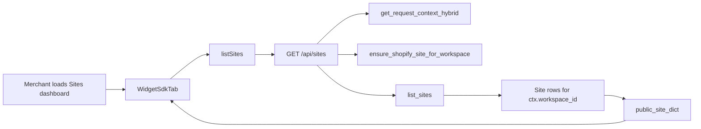
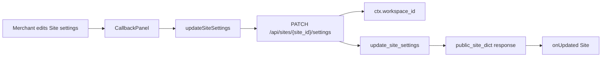
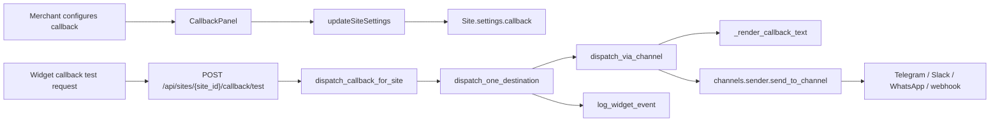
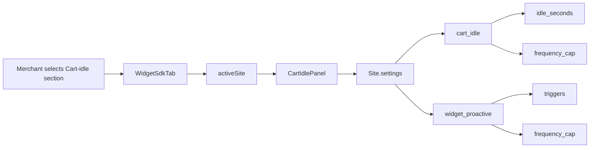

# Sites, Callbacks & Destinations

Relevant source files

The following files were used as context for generating this wiki page:

- [frontend/components/settings/WidgetSdkTab.tsx](frontend/components/settings/WidgetSdkTab.tsx)
- [frontend/components/sites/CallbackPanel.tsx](frontend/components/sites/CallbackPanel.tsx)
- [frontend/components/sites/CartIdlePanel.tsx](frontend/components/sites/CartIdlePanel.tsx)
- [frontend/components/sites/ShopifyTab.tsx](frontend/components/sites/ShopifyTab.tsx)
- [frontend/components/sites/SyncPanel.tsx](frontend/components/sites/SyncPanel.tsx)
- [frontend/lib/sites/api.ts](frontend/lib/sites/api.ts)
- [frontend/lib/sites/types.ts](frontend/lib/sites/types.ts)
- [orchestrator/api/sites.py](orchestrator/api/sites.py)
- [orchestrator/services/destinations/base.py](orchestrator/services/destinations/base.py)
- [orchestrator/services/destinations/dispatcher.py](orchestrator/services/destinations/dispatcher.py)
- [orchestrator/tests/api/test_deliverables_api.py](orchestrator/tests/api/test_deliverables_api.py)
- [orchestrator/tests/modules/tools/execution/test_exec_workspace_deliverable.py](orchestrator/tests/modules/tools/execution/test_exec_workspace_deliverable.py)
- [orchestrator/tests/test_eval_graph_mode.py](orchestrator/tests/test_eval_graph_mode.py)
- [orchestrator/tests/test_prd008a_callback_test_endpoint.py](orchestrator/tests/test_prd008a_callback_test_endpoint.py)
- [orchestrator/tests/test_prd008a_destinations.py](orchestrator/tests/test_prd008a_destinations.py)

## Purpose and Scope

Section 27.2 documents the workspace-scoped Sites resource and its dashboard-facing API, callback handoff configuration, destination dispatch, widget trigger settings, and frontend sites library. It also describes the catalog-sync panels where they are part of the Sites dashboard surface. Details that require source files not included here—such as the callback submission endpoint implementation and the cart-idle panel’s trigger behavior—are identified as outside the available implementation evidence rather than inferred.

Sources: [orchestrator/api/sites.py:1-23](), [frontend/components/settings/WidgetSdkTab.tsx:29-65](), [frontend/lib/sites/types.ts:18-73]()

---

## 1. Sites Service & API Layer

A Site is a workspace-scoped resource for an external property such as a Shopify store, Wix site, WooCommerce site, or custom embed. The API derives the workspace from `get_request_context_hybrid`; its documentation states that a Site owned by another workspace is returned as not found, avoiding an existence leak. [orchestrator/api/sites.py:21-23]()

### API routes and service responsibilities

The router is mounted with the `/api/sites` prefix. Its documented operations are listing and creating Sites, fetching and updating a Site, and shallow-merging top-level keys into `settings`. [orchestrator/api/sites.py:7-14]()

| Route | Behavior and access details |
|---|---|
| `GET /api/sites` | Runs `ensure_shopify_site_for_workspace` as an idempotent self-healing step when the workspace exists, then calls `list_sites` and serializes each result with `public_site_dict`. A failure during the healing step is logged and does not fail the list request. [orchestrator/api/sites.py:99-117]() |
| `POST /api/sites` | Requires `workspace:manage`. Accepts `type`, `display_name`, optional `external_id`, and optional `settings`; validates supplied settings for AI disclosure before calling `create_site`. A `ValueError` becomes HTTP 400. [orchestrator/api/sites.py:67-72](), [orchestrator/api/sites.py:120-139]() |
| `GET /api/sites/{site_id}` | Calls `get_site` with the authenticated workspace ID and returns HTTP 404 if no workspace-owned Site is found. [orchestrator/api/sites.py:142-152]() |
| `PATCH /api/sites/{site_id}` | Requires `workspace:manage`; accepts `display_name` and/or `status`, rejects a request with no fields, and maps service validation errors to HTTP 400. [orchestrator/api/sites.py:74-80](), [orchestrator/api/sites.py:154-175]() |
| `PATCH /api/sites/{site_id}/settings` | The router documentation describes shallow merging of supplied top-level settings keys. The request model requires a `settings` object; the service function `update_site_settings` is imported by the router. [orchestrator/api/sites.py:7-14](), [orchestrator/api/sites.py:82-84](), [orchestrator/api/sites.py:47-56]() |

The API uses `public_site_dict` for Site responses. The router’s request/response documentation explicitly says not to expose `secrets`; the Site’s public TypeScript representation includes settings and capabilities but no secrets field. [orchestrator/api/sites.py:63-65](), [frontend/lib/sites/types.ts:75-86]()

The Sites service functions imported by the router are `create_site`, `ensure_shopify_site_for_workspace`, `get_site`, `list_sites`, `public_site_dict`, `update_site_meta`, and `update_site_settings`. Their implementation details are not shown in the provided source. [orchestrator/api/sites.py:47-56]()

### AI disclosure validation

The API calls `validate_settings` through `_refuse_a_silent_ai_notice`. An `AIDisclosureRejected` exception becomes HTTP 422. Site creation applies this validation when settings are supplied. The route module’s documentation describes the rule as refusing a save when the AI-disclosure line, in the Site’s locale, would not say that the interaction is with an AI. [orchestrator/api/sites.py:15-16](), [orchestrator/api/sites.py:86-93](), [orchestrator/api/sites.py:120-139]()

### Natural-language concepts mapped to code entities

**Diagram: Sites dashboard request mapped to router and service symbols**

Sources: [frontend/components/settings/WidgetSdkTab.tsx:31-52](), [frontend/lib/sites/api.ts:5-8](), [orchestrator/api/sites.py:99-117](), [orchestrator/api/sites.py:47-56]()

**Diagram: Site settings update mapped to UI, client, route, and service names**

Sources: [frontend/components/sites/CallbackPanel.tsx:63-80](), [frontend/components/sites/CallbackPanel.tsx:153-164](), [frontend/lib/sites/api.ts:38-45](), [orchestrator/api/sites.py:7-14](), [orchestrator/api/sites.py:47-56]()

---

## 2. Destination Dispatcher & Callbacks

Callback settings are stored under the Site’s `settings.callback` object. The frontend types define `enabled` and a list of destinations; each destination names a platform and may carry a platform-specific target. Supported callback platforms are `telegram`, `slack`, `whatsapp`, and `webhook`. [frontend/lib/sites/types.ts:18-41](), [orchestrator/services/destinations/base.py:29-40]()

The dispatcher’s documented role is to route a callback to configured destinations using the same channel notification plumbing used elsewhere, rather than maintaining a separate delivery system. Its module documentation describes parallel destination dispatch, retry with exponential backoff, and delivery-state event logging. In v1, dispatch is started with `asyncio.create_task` from the callback endpoint; the module notes that a later Redis-backed worker can replace that scheduling call without changing the orchestrator function. [orchestrator/services/destinations/dispatcher.py:1-17](), [orchestrator/services/destinations/base.py:1-20]()

### Destination shapes and target resolution

`CallbackDestination` allows an optional `channel_id`, `chat_id`, or `webhook_url` depending on platform. The type documentation says Telegram and WhatsApp targets can be auto-resolved from workspace-connected channels; Slack may use a channel override; and webhook delivery requires a URL. [frontend/lib/sites/types.ts:18-35]()

The dispatcher’s `dispatch_via_channel` resolves the platform, rejects a missing or unsupported platform as a non-retryable failure, renders a text message, determines any explicit target, and delegates to `channels.sender.send_to_channel`. Slack uses `channel_id`, Telegram uses `chat_id`, and webhook uses `webhook_url`; a webhook destination without a URL returns a non-retryable failure before sending. [orchestrator/services/destinations/dispatcher.py:72-111](), [orchestrator/services/destinations/dispatcher.py:112-151]()

`_render_callback_text` formats the Site name, customer name and phone, plus optional product context, urgency, preferred time, and request ID. The `CallbackPayload` data class defines those fields; its documentation states that the phone number is forwarded to the merchant destination and is not persisted in Automatos beyond the conversation transcript. [orchestrator/services/destinations/dispatcher.py:53-70](), [orchestrator/services/destinations/base.py:60-74]()

The dispatcher configures up to three attempts, with delays of 0, 5, and 15 seconds before attempts one, two, and three. `dispatch_one_destination` retries only when the preceding result is marked retryable; it logs a `callback_delivered` widget event on success. [orchestrator/services/destinations/dispatcher.py:39-40](), [orchestrator/services/destinations/dispatcher.py:154-198]()

`DispatchResult` represents one destination attempt: it includes success, destination type, latency, optional error, retryability, and free-form context. The test suite verifies missing and unknown platforms, the required webhook URL, sender delegation, explicit Slack and webhook targets, and propagation of retryability. [orchestrator/services/destinations/base.py:42-58](), [orchestrator/tests/test_prd008a_destinations.py:53-91](), [orchestrator/tests/test_prd008a_destinations.py:98-201]()

### Callback test endpoint

The dashboard’s “Send test” action calls `POST /api/sites/{site_id}/callback/test`. The test endpoint contract verifies a 404 for a Site outside the requesting workspace, a 400 when no destinations are configured, and a successful response containing per-destination results when dispatch succeeds. The response includes a `cb_` request ID in the tested happy path. [frontend/lib/sites/api.ts:66-77](), [orchestrator/tests/test_prd008a_callback_test_endpoint.py:1-12](), [orchestrator/tests/test_prd008a_callback_test_endpoint.py:92-126]()

**Diagram: Callback configuration and dispatch mapped to code symbols**

Sources: [frontend/components/sites/CallbackPanel.tsx:153-177](), [frontend/lib/sites/api.ts:38-45](), [frontend/lib/sites/api.ts:66-77](), [orchestrator/api/sites.py:43-45](), [orchestrator/services/destinations/dispatcher.py:53-70](), [orchestrator/services/destinations/dispatcher.py:72-78](), [orchestrator/services/destinations/dispatcher.py:154-198](), [orchestrator/tests/test_prd008a_callback_test_endpoint.py:48-89]()

---

## 3. Widget Triggers, Settings & Rate Limiting

### Site trigger settings

The frontend type model defines two widget-trigger configuration blocks:

- `CartIdleSettings` contains `enabled`, `idle_seconds`, a greeting, and a frequency cap with a scope of `session`, `day`, or `product_session` and a `max_pops` limit. [frontend/lib/sites/types.ts:43-51]()
- `ProactiveSettings` contains `enabled`, page types, typed triggers with optional seconds or percentage thresholds, a frequency cap, greeting-source and fallback fields, an agent timeout, popup style, consent behavior, and dismissal persistence. [frontend/lib/sites/types.ts:53-67]()

Both are optional entries in `SiteSettings`, alongside callback settings. This establishes the persisted configuration shape; the trigger execution logic is not included in the supplied files. [frontend/lib/sites/types.ts:69-73]()

`WidgetSdkTab` exposes a `cart-idle` section and renders `CartIdlePanel` for the active Site. The panel receives the Site and an update callback; its internal behavior is not shown in the provided source. [frontend/components/settings/WidgetSdkTab.tsx:29-35](), [frontend/components/settings/WidgetSdkTab.tsx:157-161]()

The supplied files do not establish the implementation of proactive widget trigger evaluation or widget API rate limiting. In particular, they do not provide source for a rate-limit middleware, Redis storage behavior, IP ceilings, or the cart-idle event runtime; those details are therefore not specified here.

**Diagram: Widget trigger settings mapped to frontend entities**

Sources: [frontend/components/settings/WidgetSdkTab.tsx:29-35](), [frontend/components/settings/WidgetSdkTab.tsx:157-161](), [frontend/lib/sites/types.ts:43-73]()

---

## 4. Frontend Sites Library, Catalog Sync & Dashboard UI

### Frontend sites API client

`frontend/lib/sites/api.ts` wraps `apiClient` and supplies typed operations for Sites, callback channels, callback tests, and Shopify synchronization. [frontend/lib/sites/api.ts:1-3]()

| Helper | Responsibility |
|---|---|
| `listSites()` | Reads `/api/sites` and returns `resp.sites`, defaulting to an empty array when absent. [frontend/lib/sites/api.ts:5-8]() |
| `listCallbackChannels()` | Reads `/api/channels`, retains platforms in `CALLBACK_PLATFORMS`, and sorts by descending `last_activity_at`. [frontend/lib/sites/api.ts:10-25]() |
| `getSite()` | Fetches `/api/sites/{siteId}`. [frontend/lib/sites/api.ts:27-29]() |
| `updateSiteMeta()` | Patches Site metadata at `/api/sites/{siteId}`. [frontend/lib/sites/api.ts:31-36]() |
| `updateSiteSettings()` | Sends a settings patch inside the API request’s `settings` field to `/api/sites/{siteId}/settings`. [frontend/lib/sites/api.ts:38-45]() |
| `sendCallbackTest()` | Posts an empty request body to `/api/sites/{siteId}/callback/test`. [frontend/lib/sites/api.ts:66-77]() |
| `getShopifySyncStatus()` / `startShopifySync()` | Fetches product-sync status or starts product synchronization using a workspace ID query parameter. [frontend/lib/sites/api.ts:79-114]() |
| `getShopifyOrdersSyncStatus()` / `startShopifyOrdersSync()` | Fetches order-sync status or starts order synchronization; start options can include `days` and `min_support`. [frontend/lib/sites/api.ts:116-151]() |

The product sync status type includes lifecycle states (`never_synced`, `running`, `complete`, `error`) and optional counts and timestamps. The orders status type includes order-analysis and frequently-bought-together edge fields. [frontend/lib/sites/api.ts:83-96](), [frontend/lib/sites/api.ts:117-132]()

### Dashboard panels

`WidgetSdkTab` loads Sites with `listSites`, chooses the first Site as active when one exists, and supports switching among multiple Sites. Its sections include API keys, cart-idle, callback, sync, and a Shopify-specific section shown only when the active Site has type `shopify`. [frontend/components/settings/WidgetSdkTab.tsx:31-65](), [frontend/components/settings/WidgetSdkTab.tsx:108-153]()

When a panel updates a Site, `patchSite` replaces the matching entry in local state. The callback and cart-idle sections pass this update function to their panels. If a Sites-dependent section is selected before a Site exists, the tab renders a “no sites” state; it also has separate loading and error states. [frontend/components/settings/WidgetSdkTab.tsx:67-106](), [frontend/components/settings/WidgetSdkTab.tsx:104-106](), [frontend/components/settings/WidgetSdkTab.tsx:155-178]()

`CallbackPanel` initializes its draft from `site.settings.callback`, defaulting to disabled with no destinations. It reduces a legacy or multi-destination array to the first recognized platform for the single-destination UI. It loads callback channels, checks webhook URLs for an HTTP or HTTPS prefix, and requires a connected channel for non-webhook choices. Saving calls `updateSiteSettings`; testing calls `sendCallbackTest` and is enabled only when the current configuration is unchanged, enabled, and has a destination. [frontend/components/sites/CallbackPanel.tsx:31-61](), [frontend/components/sites/CallbackPanel.tsx:63-107](), [frontend/components/sites/CallbackPanel.tsx:135-177]()

The UI intentionally exposes one destination at a time, even though the stored type is an array and the dispatcher is documented to fan out across configured destinations. If an existing array contains multiple entries, `pickPrimaryDestination` selects the first valid entry. [frontend/components/sites/CallbackPanel.tsx:38-61](), [frontend/services/destinations/dispatcher.py:1-17]()

`SyncPanel` describes catalog synchronization as bringing product data into the workspace knowledge graph. It always renders Shopify product and order sync cards, even when `site.type` is not `shopify`, because connectivity is workspace-level rather than derived from Site type. The product card loads status on mount or workspace change, polls every five seconds while running, and permits a manual sync attempt without a frontend connectivity gate; errors from the backend are displayed in the panel. [frontend/components/sites/SyncPanel.tsx:26-55](), [frontend/components/sites/SyncPanel.tsx:63-101](), [frontend/components/sites/SyncPanel.tsx:112-124]()

> **Source-path note:** The `CallbackPanel` section above is supported by `frontend/components/sites/CallbackPanel.tsx`; destination fan-out behavior is supported by `orchestrator/services/destinations/dispatcher.py`.

Sources: [frontend/lib/sites/api.ts:1-151](), [frontend/components/settings/WidgetSdkTab.tsx:31-180](), [frontend/components/sites/CallbackPanel.tsx:31-61](), [frontend/components/sites/CallbackPanel.tsx:63-177](), [frontend/components/sites/SyncPanel.tsx:26-55](), [frontend/components/sites/SyncPanel.tsx:63-124](), [orchestrator/services/destinations/dispatcher.py:1-17]()

---