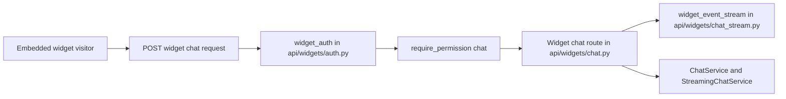
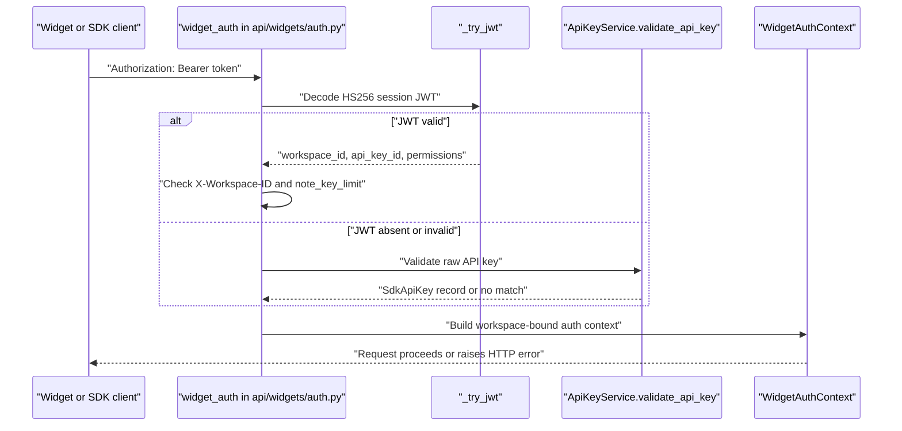
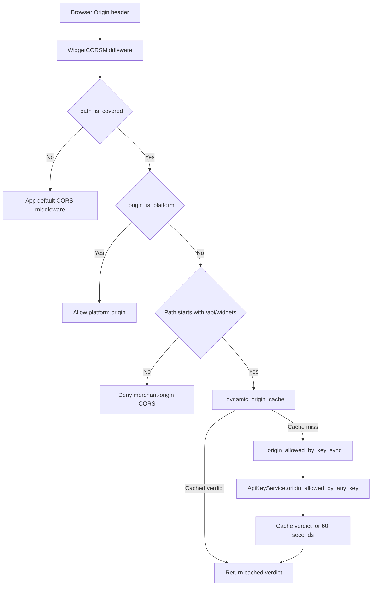
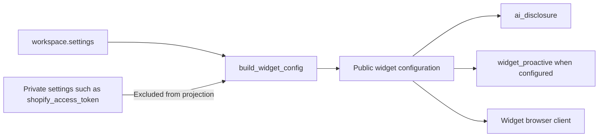
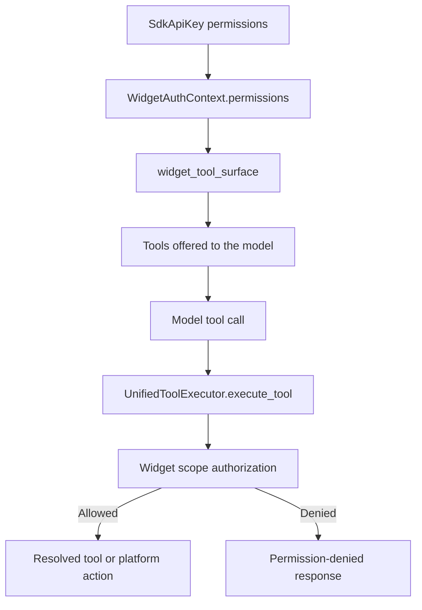

# Widget API & SDK

Relevant source files

The following files were used as context for generating this wiki page:

- [docs/workspace-execution/security-sandboxing.md](docs/workspace-execution/security-sandboxing.md)
- [orchestrator/api/api_keys.py](orchestrator/api/api_keys.py)
- [orchestrator/api/widgets/auth.py](orchestrator/api/widgets/auth.py)
- [orchestrator/api/widgets/chat.py](orchestrator/api/widgets/chat.py)
- [orchestrator/api/widgets/config.py](orchestrator/api/widgets/config.py)
- [orchestrator/api/widgets/cors.py](orchestrator/api/widgets/cors.py)
- [orchestrator/api/widgets/session.py](orchestrator/api/widgets/session.py)
- [orchestrator/core/database/migrations/043_team_based_document_scoping.sql](orchestrator/core/database/migrations/043_team_based_document_scoping.sql)
- [orchestrator/core/models/sdk_api_keys.py](orchestrator/core/models/sdk_api_keys.py)
- [orchestrator/core/security/surface.py](orchestrator/core/security/surface.py)
- [orchestrator/core/security/widget_scopes.py](orchestrator/core/security/widget_scopes.py)
- [orchestrator/core/services/api_key_service.py](orchestrator/core/services/api_key_service.py)
- [orchestrator/modules/context/sections/composio.py](orchestrator/modules/context/sections/composio.py)
- [orchestrator/modules/context/sections/plugins.py](orchestrator/modules/context/sections/plugins.py)
- [orchestrator/modules/tools/discovery/actions_mission_resume.py](orchestrator/modules/tools/discovery/actions_mission_resume.py)
- [orchestrator/modules/tools/discovery/actions_missions.py](orchestrator/modules/tools/discovery/actions_missions.py)
- [orchestrator/modules/tools/discovery/handlers_missions.py](orchestrator/modules/tools/discovery/handlers_missions.py)
- [orchestrator/modules/tools/discovery/plan_edits.py](orchestrator/modules/tools/discovery/plan_edits.py)
- [orchestrator/modules/tools/discovery/step_brief_edits.py](orchestrator/modules/tools/discovery/step_brief_edits.py)
- [orchestrator/tests/security/test_prd172_tenant_isolation.py](orchestrator/tests/security/test_prd172_tenant_isolation.py)
- [orchestrator/tests/test_f155_a_widget_turn_gets_no_skills_and_only_its_locked_agents_plugins.py](orchestrator/tests/test_f155_a_widget_turn_gets_no_skills_and_only_its_locked_agents_plugins.py)
- [orchestrator/tests/test_f155_the_public_widget_surface.py](orchestrator/tests/test_f155_the_public_widget_surface.py)
- [orchestrator/tests/test_f155_widget_born_work_carries_its_origin.py](orchestrator/tests/test_f155_widget_born_work_carries_its_origin.py)
- [orchestrator/tests/test_f155_widget_key_limits.py](orchestrator/tests/test_f155_widget_key_limits.py)
- [orchestrator/tests/test_f155_widget_scopes.py](orchestrator/tests/test_f155_widget_scopes.py)
- [orchestrator/tests/test_f282_c_plan_edits_land_on_the_missions_steps.py](orchestrator/tests/test_f282_c_plan_edits_land_on_the_missions_steps.py)
- [orchestrator/tests/test_f308_c_a_brief_edit_reaches_the_steps_card.py](orchestrator/tests/test_f308_c_a_brief_edit_reaches_the_steps_card.py)
- [orchestrator/tests/test_f308_d_a_reply_never_says_steps_pause_when_they_dont.py](orchestrator/tests/test_f308_d_a_reply_never_says_steps_pause_when_they_dont.py)
- [orchestrator/tests/test_p2w2_cors_boot_guard.py](orchestrator/tests/test_p2w2_cors_boot_guard.py)
- [orchestrator/tests/test_p2w2_widget_fail_closed.py](orchestrator/tests/test_p2w2_widget_fail_closed.py)
- [orchestrator/tests/test_prd008a_cors_coverage.py](orchestrator/tests/test_prd008a_cors_coverage.py)
- [orchestrator/tests/test_prd008a_widget_config_resolver.py](orchestrator/tests/test_prd008a_widget_config_resolver.py)
- [orchestrator/tests/test_prd186_s3_hardening.py](orchestrator/tests/test_prd186_s3_hardening.py)
- [orchestrator/tests/test_widget_proactive_prd007.py](orchestrator/tests/test_widget_proactive_prd007.py)

## Purpose and scope

The Widget API exposes authenticated endpoints for embedded chat and related SDK operations. Its security model combines workspace-bound SDK keys or session JWTs, origin checks, per-key permissions, rate-limit integration, and a restricted tool surface for widget turns. This page covers the provided implementation details for authentication, chat, CORS, key management, configuration projection, and widget scopes; it also identifies the other widget router and dashboard areas in the subsystem where implementation details are not included in the supplied source excerpts. [orchestrator/api/widgets/chat.py:1-15](), [orchestrator/api/widgets/auth.py:1-14](), [orchestrator/api/widgets/cors.py:1-20](), [orchestrator/tests/test_f155_widget_scopes.py:1-9]()

Sources: `orchestrator/api/widgets/chat.py`, `orchestrator/api/widgets/auth.py`, `orchestrator/api/widgets/cors.py`, `orchestrator/tests/test_f155_widget_scopes.py`

---

## 1. Widget API Router Architecture

The widget API is divided into router modules for chat, authentication/session exchange, configuration, documentation, and callbacks. The provided excerpts show `chat.py` importing `widget_auth`, `require_permission`, the SSE stream implementation, and AI-disclosure resolution. The individual route definitions and behavior for `session.py`, `config.py`, `docs.py`, and `callback.py` are not included in the supplied excerpts, so their detailed route contracts cannot be established here. [orchestrator/api/widgets/chat.py:26-35]()

The chat module defines `WidgetChatRequest` with a required `message` and optional `conversation_id`, `agent_id`, `model_id`, `page_context`, and `trigger_reason`. It also defines `WidgetMessageOut` with message identity, role, content, and creation time. [orchestrator/api/widgets/chat.py:55-80]()

The chat module documents that widget turns reuse the existing `ChatService` and `StreamingChatService` capabilities and that the SSE stream is implemented in `chat_stream.py`. Its module docstring specifies `widget_auth` and `require_permission("chat")` as the chat authorization mechanism. [orchestrator/api/widgets/chat.py:5-15]()

**Widget API request flow: Natural Language Space to Code Entity Space**

Sources: `orchestrator/api/widgets/chat.py:5-15`, `orchestrator/api/widgets/chat.py:26-35`

### Router responsibilities

| Area | Responsibility visible in the supplied source | Sources |
|---|---|---|
| Chat | Defines request/response schemas, auth imports, team resolution, conversation ownership checks, vertical lookup, and SSE-related setup. | [orchestrator/api/widgets/chat.py:26-35](), [orchestrator/api/widgets/chat.py:55-80](), [orchestrator/api/widgets/chat.py:87-150]() |
| Auth | Provides `widget_auth`, returning a `WidgetAuthContext` for authenticated requests. | [orchestrator/api/widgets/auth.py:46-56](), [orchestrator/api/widgets/auth.py:100-117]() |
| Session | The auth module describes JWTs as tokens exchanged from API keys; the session router implementation is not included in the supplied excerpts. | [orchestrator/api/widgets/auth.py:5-14]() |
| Config | Chat imports `resolve_ai_disclosure`; the configuration route and full config projection implementation are not included in the supplied excerpts. | [orchestrator/api/widgets/chat.py:32-35]() |
| Docs and callback | Their route implementations are not included in the supplied excerpts. | [orchestrator/api/widgets/chat.py:26-35]() |

Sources: `orchestrator/api/widgets/chat.py`, `orchestrator/api/widgets/auth.py`

---

## 2. Authentication & Session Exchange

`widget_auth()` is a FastAPI dependency that resolves widget credentials in this order: extract a Bearer token; try decoding it as a JWT session token; if that fails, validate it as a raw API key; then populate request state and return a `WidgetAuthContext`. Missing credentials result in 401, while an origin not allowed by the key results in 403 according to the dependency’s documented contract. [orchestrator/api/widgets/auth.py:100-117]()

`WidgetAuthContext` carries `workspace_id`, `api_key_id`, `permissions`, an optional `default_agent_id`, and an optional team lock. The JWT path decodes using the configured `WIDGET_TOKEN_SECRET` and the `HS256` algorithm. If the token includes a workspace and the request includes `X-Workspace-ID`, the two workspace IDs must agree. The JWT path also reads the stored key rate limit and calls `note_key_limit()` before returning the context. [orchestrator/api/widgets/auth.py:38-56](), [orchestrator/api/widgets/auth.py:73-93](), [orchestrator/api/widgets/auth.py:137-171]()

If JWT decoding does not yield a payload, `widget_auth()` falls back to `ApiKeyService.validate_api_key()`. That service hashes the presented raw key, looks up the hash, rejects inactive or expired records, and updates `last_used_at` on success. [orchestrator/api/widgets/auth.py:173-184](), [orchestrator/core/services/api_key_service.py:110-138]()

The supplied excerpts do not include the session router’s endpoint schema or token-minting implementation. The auth module establishes the intended relationship—session tokens are exchanged from API keys—but exact endpoint behavior should be verified against `orchestrator/api/widgets/session.py`. [orchestrator/api/widgets/auth.py:5-14]()

**Credential resolution: Natural Language Space to Code Entity Space**

Sources: `orchestrator/api/widgets/auth.py:73-93`, `orchestrator/api/widgets/auth.py:100-117`, `orchestrator/api/widgets/auth.py:137-184`, `orchestrator/core/services/api_key_service.py:110-138`

---

## 3. API Keys, Domain Checks & ASGI CORS

### API key creation and storage

The API key management router is mounted at `/api/api-keys`. Its create endpoint requires workspace-management permission and step-up authentication. Public keys must include a non-empty `allowed_domains` list; a supplied `default_agent_id` must belong to the caller’s workspace. The request schema validates key type as `public` or `server` and rejects permission strings outside `VALID_PERMISSIONS`. [orchestrator/api/api_keys.py:28-35](), [orchestrator/api/api_keys.py:63-88](), [orchestrator/api/api_keys.py:132-160]()

`ApiKeyService.create_api_key()` generates a random secret, prefixes it with `ak_pub_` or `ak_srv_`, stores the SHA-256 hash rather than the plaintext, and returns the complete key in its creation response. The service documentation states that the plaintext is shown only once. Validation hashes a presented key and checks that the matching record is active and unexpired. [orchestrator/core/services/api_key_service.py:23-25](), [orchestrator/core/services/api_key_service.py:48-105](), [orchestrator/core/services/api_key_service.py:110-138]()

### Domain matching and CORS

`WidgetCORSMiddleware` covers `/api/widgets/*` and `/api/sites/*`. It is a pure ASGI middleware, chosen so streaming responses and SSE connections are not buffered. Platform origins come from `config.CORS_ALLOW_ORIGINS`; merchant storefront origins are authorized for widget paths through the allowed-domain lists of active public keys. `/api/sites` does not consult merchant keys because it is a first-party dashboard surface. [orchestrator/api/widgets/cors.py:5-8](), [orchestrator/api/widgets/cors.py:9-37](), [orchestrator/api/widgets/cors.py:49-67](), [orchestrator/api/widgets/cors.py:105-116]()

Preflight requests do not carry the eventual request’s authorization header, so `_origin_allowed_dynamic()` checks whether the origin is named on any active public key. Verdicts are cached per origin for 60 seconds, with a maximum cache size of 512 entries. Lookup failures fail closed and are not cached. The synchronous key lookup delegates to `ApiKeyService.origin_allowed_by_any_key()`. [orchestrator/api/widgets/cors.py:75-103](), [orchestrator/api/widgets/cors.py:105-132]()

`ApiKeyService._host_only()` normalizes allow-list entries by removing a scheme and trailing slash before comparison. The supplied service excerpt shows the normalization helper, but not the remainder of the domain-matching implementation. [orchestrator/core/services/api_key_service.py:28-40]()

**Origin authorization: Natural Language Space to Code Entity Space**

Sources: `orchestrator/api/widgets/cors.py:49-58`, `orchestrator/api/widgets/cors.py:70-85`, `orchestrator/api/widgets/cors.py:87-132`

---

## 4. Widget Chat & Proactive Engagement

`WidgetChatRequest` accepts optional page context and trigger metadata in addition to the message and conversation identifiers. The recognized proactive reasons are `proactive_opener` and `cart_idle`; the chat module describes these as selecting opener-generation mode rather than treating the message as a normal user utterance. [orchestrator/api/widgets/chat.py:55-75]()

The request handler’s supporting helpers include:

- `_retrieval_team()`, which resolves the effective document-retrieval team using the key’s team lock and the answering agent’s team. The code comments state that the key’s team lock takes precedence. [orchestrator/api/widgets/chat.py:87-101]()
- `_get_widget_user_id()`, which looks for user ID `1` as the owner of widget-initiated chats, then falls back to the first available user row; it raises a server error if no users exist. [orchestrator/api/widgets/chat.py:104-119]()
- `_key_started()`, which checks whether a conversation UUID belongs to the same workspace and widget API key. This enforces the documented rule that a key can read or resume only conversations it started. [orchestrator/api/widgets/chat.py:122-135]()
- `_resolve_workspace_vertical()`, which reads `workspace.settings.vertical` for plugin dispatch and defaults to `"generic"` if the value is absent. [orchestrator/api/widgets/chat.py:137-150]()

The chat module imports the widget SSE stream and specifies that the stream’s first event is an AI notice and assistant message events carry `ai_generated: true`. The actual event-generation code is in `chat_stream.py`, which is referenced but not included in the supplied excerpts. [orchestrator/api/widgets/chat.py:13-15](), [orchestrator/api/widgets/chat.py:32-35]()

Sources: `orchestrator/api/widgets/chat.py:13-15`, `orchestrator/api/widgets/chat.py:32-35`, `orchestrator/api/widgets/chat.py:55-75`, `orchestrator/api/widgets/chat.py:87-150`

---

## 5. Configuration, Sites, i18n & WidgetSdkTab

The chat router imports `resolve_ai_disclosure` from `api.widgets.config`, showing that widget chat has a configuration-backed AI disclosure path. Separately, the provided tests for `build_widget_config()` specify that public configuration includes an AI disclosure even when workspace settings are missing or empty, and that private settings such as Shopify access tokens and domains must not be projected to the browser. [orchestrator/api/widgets/chat.py:32-35](), [orchestrator/tests/test_widget_proactive_prd007.py:69-115]()

The supplied configuration tests also establish that `widget_proactive` is a public projection when present in workspace settings. They do not expose the full implementation of `build_widget_config()`, so additional projection rules are not described here. [orchestrator/tests/test_widget_proactive_prd007.py:90-115]()

The `WidgetSdkTab` dashboard panel and widget i18n implementation are named in the page scope, but their source files were not included in the supplied excerpts. Their component structure, localization catalog, and settings interactions therefore cannot be documented at implementation level from the available material. [orchestrator/api/widgets/chat.py:32-35]()

**Configuration projection: Natural Language Space to Code Entity Space**

Sources: `orchestrator/tests/test_widget_proactive_prd007.py:69-115`, `orchestrator/api/widgets/chat.py:32-35`

---

## 6. Widget Scopes, Permissions & Security Hardening (F155)

### Key permission vocabulary

`VALID_PERMISSIONS` defines the scopes accepted when creating SDK keys. It includes `chat`, `blog`, `documents:read`, `documents:write`, `data:query`, `data:execute`, `agents:read`, `agents:execute`, `missions:read`, `missions:execute`, `playbooks:read`, `playbooks:execute`, and the `TASKS_READ` constant. [orchestrator/api/api_keys.py:37-57]()

The key-creation endpoint validates requested permissions against this list. `widget_auth()` returns the effective permissions in `WidgetAuthContext`; the chat module’s documentation specifies `require_permission("chat")` for widget chat. [orchestrator/api/api_keys.py:82-88](), [orchestrator/api/widgets/auth.py:46-56](), [orchestrator/api/widgets/chat.py:11-12]()

### Tool surface and enforcement

The widget scope tests describe two enforcement layers: `widget_tool_surface()` filters tools offered to the model, and `UnifiedToolExecutor` refuses unauthorized calls when they are executed. A `chat`-only key can use permitted knowledge search and blog-list functionality in the tested cases, but cannot perform owner writes, read private owner data, execute connected-app tools, or use workspace files and shell. [orchestrator/tests/test_f155_widget_scopes.py:1-9](), [orchestrator/tests/test_f155_widget_scopes.py:24-75](), [orchestrator/tests/test_f155_widget_scopes.py:83-99](), [orchestrator/tests/test_f155_widget_scopes.py:122-129]()

The tests also verify that granting mission or playbook scopes does not allow a widget turn to start work that continues outside the turn. They verify that an unrecognized scope does not expand the offered tool set. [orchestrator/tests/test_f155_widget_scopes.py:66-99](), [orchestrator/tests/test_f155_widget_scopes.py:101-110]()

### Widget-turn isolation

The public-widget security tests document restrictions beyond the scope-filtering layer: widget turns are not treated as an admin, super-admin, or autonomous actor; a public widget call does not count as owner approval; and a widget key can resume only conversations it started. The chat implementation includes `_key_started()` for the conversation-ownership check. [orchestrator/tests/test_f155_the_public_widget_surface.py:9-18](), [orchestrator/api/widgets/chat.py:122-135]()

Team locks constrain document retrieval. `_retrieval_team()` combines the key’s team and the answering agent’s team through `effective_team()`. The security tests exercise team-locked document and graph tools, document listing and uploads, knowledge searches, and multimodal searches under the widget turn’s team context. [orchestrator/api/widgets/chat.py:87-101](), [orchestrator/tests/test_f155_the_public_widget_surface.py:3-8](), [orchestrator/tests/test_f155_the_public_widget_surface.py:69-75](), [orchestrator/tests/test_f155_the_public_widget_surface.py:87-114](), [orchestrator/tests/test_f155_the_public_widget_surface.py:117-145]()

**Permission enforcement: Natural Language Space to Code Entity Space**

Sources: `orchestrator/api/api_keys.py:37-57`, `orchestrator/api/widgets/auth.py:46-56`, `orchestrator/tests/test_f155_widget_scopes.py:24-75`, `orchestrator/tests/test_f155_widget_scopes.py:83-99`

### Scope reference

| Scope family | Key scope(s) | Boundary visible in the supplied tests |
|---|---|---|
| Chat | `chat` | Allows the widget chat surface and tested base lookup tools; does not grant owner writes or private reads. [orchestrator/api/api_keys.py:41-42](), [orchestrator/tests/test_f155_widget_scopes.py:43-64]() |
| Documents | `documents:read`, `documents:write` | Separates document search from uploads in the tested dispatcher calls. [orchestrator/api/api_keys.py:43-46](), [orchestrator/tests/test_f155_widget_scopes.py:66-75]() |
| Data | `data:query`, `data:execute` | Accepted key permission values; the supplied tests do not detail their route behavior. [orchestrator/api/api_keys.py:46-47]() |
| Agents | `agents:read`, `agents:execute` | Accepted key permission values; the widget scope tests specifically reject several agent-management or heartbeat reads. [orchestrator/api/api_keys.py:48-49](), [orchestrator/tests/test_f155_widget_scopes.py:114-119]() |
| Missions | `missions:read`, `missions:execute` | Accepted key permission values, but do not authorize starting mission work that continues after the widget turn. [orchestrator/api/api_keys.py:50-51](), [orchestrator/tests/test_f155_widget_scopes.py:101-110]() |
| Playbooks | `playbooks:read`, `playbooks:execute` | Accepted key permission values, but do not authorize starting playbook work that continues after the widget turn. [orchestrator/api/api_keys.py:52-53](), [orchestrator/tests/test_f155_widget_scopes.py:101-110]() |
| Tasks | `TASKS_READ` | Included in the key permission vocabulary; its concrete value and widget route behavior are not shown in the supplied excerpts. [orchestrator/api/api_keys.py:54-57]() |

Sources: `orchestrator/api/api_keys.py:37-57`, `orchestrator/tests/test_f155_widget_scopes.py:43-119`

---