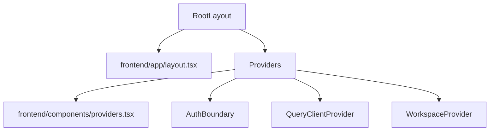
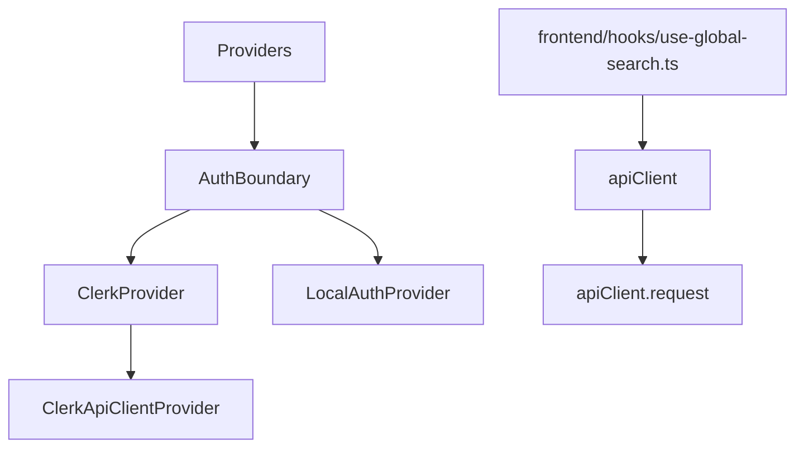
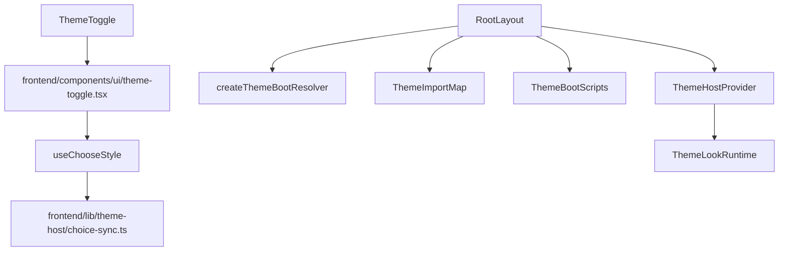

# Frontend Architecture

Relevant source files

The following files were used as context for generating this wiki page:

- [frontend/app/layout.tsx](frontend/app/layout.tsx)
- [frontend/components/__tests__/theme-choice-opt-in.test.tsx](frontend/components/__tests__/theme-choice-opt-in.test.tsx)
- [frontend/components/marketplace/themes/install-use.tsx](frontend/components/marketplace/themes/install-use.tsx)
- [frontend/components/providers.tsx](frontend/components/providers.tsx)
- [frontend/components/settings/themes/__tests__/appearance-tab.test.tsx](frontend/components/settings/themes/__tests__/appearance-tab.test.tsx)
- [frontend/components/settings/themes/__tests__/install-signature.test.tsx](frontend/components/settings/themes/__tests__/install-signature.test.tsx)
- [frontend/components/settings/themes/__tests__/scan-report.test.ts](frontend/components/settings/themes/__tests__/scan-report.test.ts)
- [frontend/components/settings/themes/__tests__/theme-fixtures.tsx](frontend/components/settings/themes/__tests__/theme-fixtures.tsx)
- [frontend/components/settings/themes/choose-install.tsx](frontend/components/settings/themes/choose-install.tsx)
- [frontend/components/settings/themes/installed-list.tsx](frontend/components/settings/themes/installed-list.tsx)
- [frontend/components/settings/themes/installed-row.tsx](frontend/components/settings/themes/installed-row.tsx)
- [frontend/components/settings/themes/scan-report.tsx](frontend/components/settings/themes/scan-report.tsx)
- [frontend/components/settings/themes/theme-labels.ts](frontend/components/settings/themes/theme-labels.ts)
- [frontend/components/ui/theme-toggle.tsx](frontend/components/ui/theme-toggle.tsx)
- [frontend/hooks/use-global-search.ts](frontend/hooks/use-global-search.ts)
- [frontend/hooks/use-installed-themes.ts](frontend/hooks/use-installed-themes.ts)
- [frontend/lib/theme-host/__tests__/choice-sync.test.tsx](frontend/lib/theme-host/__tests__/choice-sync.test.tsx)
- [frontend/lib/theme-host/choice-sync.ts](frontend/lib/theme-host/choice-sync.ts)
- [frontend/scripts/__tests__/frontend-ci-lane-paths.test.ts](frontend/scripts/__tests__/frontend-ci-lane-paths.test.ts)
- [frontend/tailwind.config.ts](frontend/tailwind.config.ts)
- [orchestrator/services/themes/review_stage.py](orchestrator/services/themes/review_stage.py)

## Purpose and Scope

The frontend is the Next.js application layer for Automatos AI. Its root layout resolves appearance settings before rendering and wraps application content in shared client-side providers, including authentication, workspace, theme, and React Query providers [frontend/app/layout.tsx:33-70]()[frontend/components/providers.tsx:92-140](). This parent page maps the main frontend concerns and points to child pages for implementation details.

Sources: [frontend/app/layout.tsx:33-70](), [frontend/components/providers.tsx:92-140]()

---

## 19.1. Application Structure

The application’s root entry point is `RootLayout`, which reads cookies and resolves the initial UI style and theme boot before rendering the document [frontend/app/layout.tsx:33-52](). It then mounts `Providers` around the page content [frontend/app/layout.tsx:53-70](). `Providers` composes the shared authentication, role, appearance, query, workspace, and theme-host boundaries [frontend/components/providers.tsx:92-140]().

For details on App Router pages, layout hierarchy, middleware, `next.config`, providers, and package tooling, see [Application Structure](#19.1).

**Diagram: From the Application Shell to Its Code Entities**

Sources: [frontend/app/layout.tsx:33-70](), [frontend/components/providers.tsx:34-40](), [frontend/components/providers.tsx:92-140]()

---

## 19.2. State Management & Hooks

The shared provider tree creates a React Query `QueryClient` with a one-minute default query `staleTime` and one retry, then provides it to the application [frontend/components/providers.tsx:99-107](). Workspace and UI-style state are also exposed through providers in that tree [frontend/components/providers.tsx:121-137](). Theme choice synchronization uses React Query-related hooks and workspace context, connecting server-held choices to the active UI style [frontend/lib/theme-host/choice-sync.ts:13-20]()[frontend/lib/theme-host/choice-sync.ts:56-64]().

For the React Query hooks catalog, query key conventions, `wsScope`, stores, cache invalidation, and optimistic updates, see [State Management & Hooks](#19.2).

Sources: [frontend/components/providers.tsx:99-107](), [frontend/components/providers.tsx:121-137](), [frontend/lib/theme-host/choice-sync.ts:13-20](), [frontend/lib/theme-host/choice-sync.ts:56-64]()

---

## 19.3. API Client

The provider tree selects an authentication boundary based on the configured edition: SaaS uses `ClerkProvider` and `ClerkApiClientProvider`, while local mode uses `LocalAuthProvider` [frontend/components/providers.tsx:29-40]()[frontend/components/providers.tsx:76-79](). Frontend components also call `apiClient`; for example, global search requests task and agent results through it [frontend/hooks/use-global-search.ts:106-110]()[frontend/hooks/use-global-search.ts:124-133]().

For `apiClient` implementation details, authentication injection, workspace headers, and error handling, see [API Client](#19.3).

**Diagram: Authentication Boundary and API Call Sites**

Sources: [frontend/components/providers.tsx:29-40](), [frontend/components/providers.tsx:76-79](), [frontend/hooks/use-global-search.ts:106-110](), [frontend/hooks/use-global-search.ts:124-133]()

---

## 19.4. Design System & UI Components

Tailwind configuration defines the frontend’s content paths, class-based dark mode, font families, and semantic color tokens [frontend/tailwind.config.ts:3-33]()[frontend/tailwind.config.ts:46-105](). Appearance selection distinguishes the Style axis (Classic, Studio, and installed themes) from the Tone axis (Light, Dark, System) in `ThemeToggle` [frontend/components/ui/theme-toggle.tsx:94-119]()[frontend/components/ui/theme-toggle.tsx:135-163]().

For shared components, Tailwind theme, Shadcn/ui, premium icons and icon registry, glossary tooltips, and Studio versus Classic themes, see [Design System & UI Components](#19.4).

Sources: [frontend/tailwind.config.ts:3-33](), [frontend/tailwind.config.ts:46-105](), [frontend/components/ui/theme-toggle.tsx:94-119](), [frontend/components/ui/theme-toggle.tsx:135-163]()

---

## 19.5. Navigation & Layout

The shared provider tree mounts `GlobalSearch` alongside the page content [frontend/components/providers.tsx:127-140](). The global search hook defines core navigation results, including routes for Agents, Chat, Analytics, Marketplace, Settings, and Command Center [frontend/hooks/use-global-search.ts:36-55](). It can also add pages from the active theme’s navigation registry [frontend/hooks/use-global-search.ts:60-66]().

For sidebars, headers, mobile navigation, profile menus, role-based filtering, and Studio menu configuration, see [Navigation & Layout](#19.5).

Sources: [frontend/components/providers.tsx:127-140](), [frontend/hooks/use-global-search.ts:36-55](), [frontend/hooks/use-global-search.ts:60-66]()

---

## 19.6. Settings Panels

The supplied frontend files show theme management as one settings area: `InstalledList` loads installed themes and the active choice, then renders `InstalledRow` entries [frontend/components/settings/themes/installed-list.tsx:35-67](). Rows display theme status and expose management actions such as setting a default, reviewing an update, rolling back, and uninstalling [frontend/components/settings/themes/installed-row.tsx:46-74]()[frontend/components/settings/themes/installed-row.tsx:99-133]().

For the `SettingsPanel` and its system settings, LLM models, API keys, webhooks, channels, notifications, widget SDK, session mode, and Composio deny-list tabs, see [Settings Panels](#19.6).

Sources: [frontend/components/settings/themes/installed-list.tsx:35-67](), [frontend/components/settings/themes/installed-row.tsx:46-74](), [frontend/components/settings/themes/installed-row.tsx:99-133]()

---

## 19.7. Looks, Theme Host & Play Shell

`RootLayout` resolves the initial theme boot and passes the resulting style, tone, and installed theme into `Providers` [frontend/app/layout.tsx:45-51]()[frontend/app/layout.tsx:67-69](). The layout renders `ThemeImportMap` and `ThemeBootScripts` in the document head [frontend/app/layout.tsx:59-65](). Within the provider tree, `ThemeHostProvider` and `ThemeLookRuntime` wrap application content [frontend/components/providers.tsx:131-138](). Theme selection is handled through `useChooseStyle`, which stores choices through the theme-choice synchronization flow [frontend/lib/theme-host/choice-sync.ts:5-12]().

For the PRD-261 looks token store and presets, look editor, theme-host loader, import maps, `theme-sdk` `defineTheme`, safe mode, and Play shell, see [Looks, Theme Host & Play Shell](#19.7).

**Diagram: Theme Choice from User Interface to Theme Runtime**

Sources: [frontend/components/ui/theme-toggle.tsx:99-119](), [frontend/lib/theme-host/choice-sync.ts:5-12](), [frontend/app/layout.tsx:45-65](), [frontend/components/providers.tsx:131-138]()

---