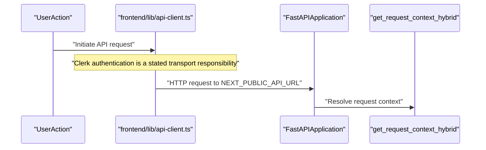
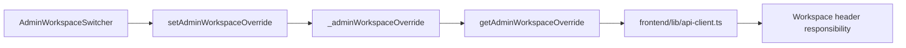
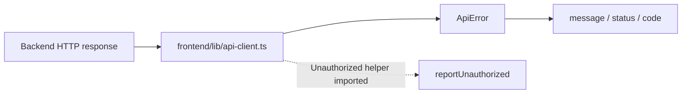

# API Client

Relevant source files

The following files were used as context for generating this wiki page:

- [frontend/lib/api-client.ts](frontend/lib/api-client.ts)
- [orchestrator/api/socials.py](orchestrator/api/socials.py)
- [orchestrator/config.py](orchestrator/config.py)
- [orchestrator/main.py](orchestrator/main.py)
- [orchestrator/modules/socials/__init__.py](orchestrator/modules/socials/__init__.py)
- [orchestrator/modules/socials/render.py](orchestrator/modules/socials/render.py)
- [orchestrator/modules/socials/service.py](orchestrator/modules/socials/service.py)
- [orchestrator/reports/config-surface.json](orchestrator/reports/config-surface.json)
- [orchestrator/reports/route-manifest.json](orchestrator/reports/route-manifest.json)
- [orchestrator/tests/test_prd251_api.py](orchestrator/tests/test_prd251_api.py)

## Purpose and Scope

Section 19.3 describes the frontend API transport boundary: `frontend/lib/api-client.ts` identifies the client as a single transport for backend API calls, covering Clerk authentication, workspace headers, and error handling, with `NEXT_PUBLIC_API_URL` as its base URL. The available source excerpt documents the client’s stated responsibilities and some public types, but does not show the request implementation; details such as token acquisition, header construction, and response parsing cannot be established from the excerpt. [frontend/lib/api-client.ts:2-7]()

Sources: [frontend/lib/api-client.ts:2-7]()

---

## Transport Module and Data Contracts

`frontend/lib/api-client.ts` defines shared TypeScript contracts alongside the transport module. `ApiResponse<T>` describes an envelope with `data`, `success`, and optional message and error fields; `ApiError` describes an error with a message, HTTP status, and optional code. The excerpt also shows domain-specific response types, including `ActivationMetric` and `ApprovalGrant`. [frontend/lib/api-client.ts:40-52](), [frontend/lib/api-client.ts:66-75](), [frontend/lib/api-client.ts:207-240]()

| Contract | Fields visible in the excerpt | Source |
|---|---|---|
| `ApiResponse<T>` | `data`, `success`, optional `message` and `error` | [frontend/lib/api-client.ts:40-46]() |
| `ApiError` | `message`, `status`, optional `code` | [frontend/lib/api-client.ts:47-52]() |
| `ActivationMetric` | `activated`, `total_workspaces`, `rate`, `generated_at` | [frontend/lib/api-client.ts:67-75]() |
| `ApprovalGrant` | Grant identity, workspace, subject, status, risk and approval fields, with optional details and owner information | [frontend/lib/api-client.ts:207-240]() |

The file also notes an exception to assuming every request returns an `ApiResponse<T>` envelope: for the analytics endpoints discussed in its comment, the `request()` helper returns the parsed JSON body directly. That note is specific to those endpoints and does not establish the response shape for every client method. [frontend/lib/api-client.ts:67-69]()

Sources: [frontend/lib/api-client.ts:40-52](), [frontend/lib/api-client.ts:67-75](), [frontend/lib/api-client.ts:207-240]()

---

## Authentication and Request Flow

The client’s module documentation states that its transport handles Clerk authentication. On the backend, `orchestrator/main.py` imports `get_request_context_hybrid`, and the Socials API imports that dependency for its request context. These code pointers identify the frontend transport’s stated authentication responsibility and a backend context-resolution dependency; the provided frontend excerpt does not show how a Clerk token is obtained, attached, or refreshed. [frontend/lib/api-client.ts:2-7](), [orchestrator/main.py:16-20](), [orchestrator/api/socials.py:116-119]()

**Diagram: Frontend API Transport and Backend Context Resolution**

Sources: [frontend/lib/api-client.ts:2-7](), [orchestrator/main.py:16-20](), [orchestrator/api/socials.py:116-119]()

**Natural-language-to-code map: Authentication boundary**

| System concept | Searchable code entity | What the provided source supports |
|---|---|---|
| Frontend API transport | `frontend/lib/api-client.ts` | Described as the single transport, including Clerk authentication. [frontend/lib/api-client.ts:2-7]() |
| Backend request context | `get_request_context_hybrid` | Imported by the FastAPI application and Socials API. [orchestrator/main.py:16-20](), [orchestrator/api/socials.py:116-119]() |
| Authenticated route dependency | `get_request_context_hybrid` | Used as a dependency in the Socials API; the excerpt does not establish behavior for all routes. [orchestrator/api/socials.py:116-119]() |

Sources: [frontend/lib/api-client.ts:2-7](), [orchestrator/main.py:16-20](), [orchestrator/api/socials.py:116-119]()

---

## Workspace Context and Multi-Tenancy

The client module documents workspace-header handling as part of its transport responsibilities. The shown implementation also defines a module-level administrative workspace override: `setAdminWorkspaceOverride(wsId)` assigns `_adminWorkspaceOverride`, and `getAdminWorkspaceOverride()` reads it. The comments state that this override takes priority over `localStorage`; the excerpt does not show where the value is added to request headers or how the normal workspace value is obtained. [frontend/lib/api-client.ts:2-7](), [frontend/lib/api-client.ts:169-179]()

**Diagram: Workspace Override Code Path**

Sources: [frontend/lib/api-client.ts:2-7](), [frontend/lib/api-client.ts:169-179]()

**Natural-language-to-code map: Workspace selection**

| System concept | Searchable code entity | What the provided source supports |
|---|---|---|
| Administrative workspace selection | `AdminWorkspaceSwitcher` | Identified in the client comments as the setter’s caller. [frontend/lib/api-client.ts:170-175]() |
| Set the override | `setAdminWorkspaceOverride(wsId)` | Stores the supplied workspace ID in `_adminWorkspaceOverride`. [frontend/lib/api-client.ts:172-176]() |
| Read the override | `getAdminWorkspaceOverride()` | Returns `_adminWorkspaceOverride`. [frontend/lib/api-client.ts:178-179]() |
| Workspace header injection | `frontend/lib/api-client.ts` | Stated as a transport responsibility; the header-building code is not in the provided excerpt. [frontend/lib/api-client.ts:2-7]() |

Sources: [frontend/lib/api-client.ts:2-7](), [frontend/lib/api-client.ts:169-179]()

---

## Error Handling and Consumer Behavior

The client documentation names error handling as part of the transport layer, and `ApiError` exposes `message`, `status`, and optional `code` fields. The available source does not show the implementation that converts HTTP responses into `ApiError`, nor the client’s behavior for network failures, unauthorized responses, retries, or parsing errors. [frontend/lib/api-client.ts:2-7](), [frontend/lib/api-client.ts:47-52]()

The module imports `reportUnauthorized` from `./api-unauthorized`, but the excerpt does not show the call site or specify when it is invoked. Therefore, its presence alone does not establish the client’s unauthorized-response flow. [frontend/lib/api-client.ts:38-39]()

**Diagram: Error Contract and Visible Integration Points**

Sources: [frontend/lib/api-client.ts:38-52]()

Sources: [frontend/lib/api-client.ts:2-7](), [frontend/lib/api-client.ts:38-52]()

---