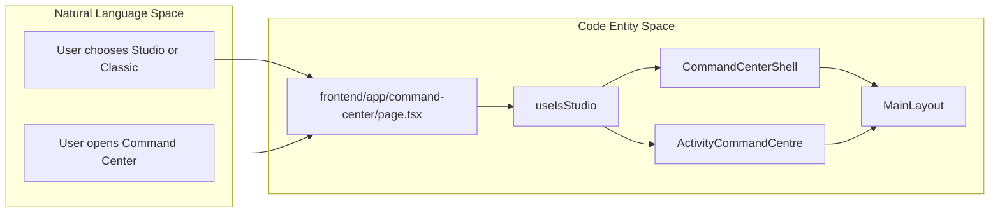
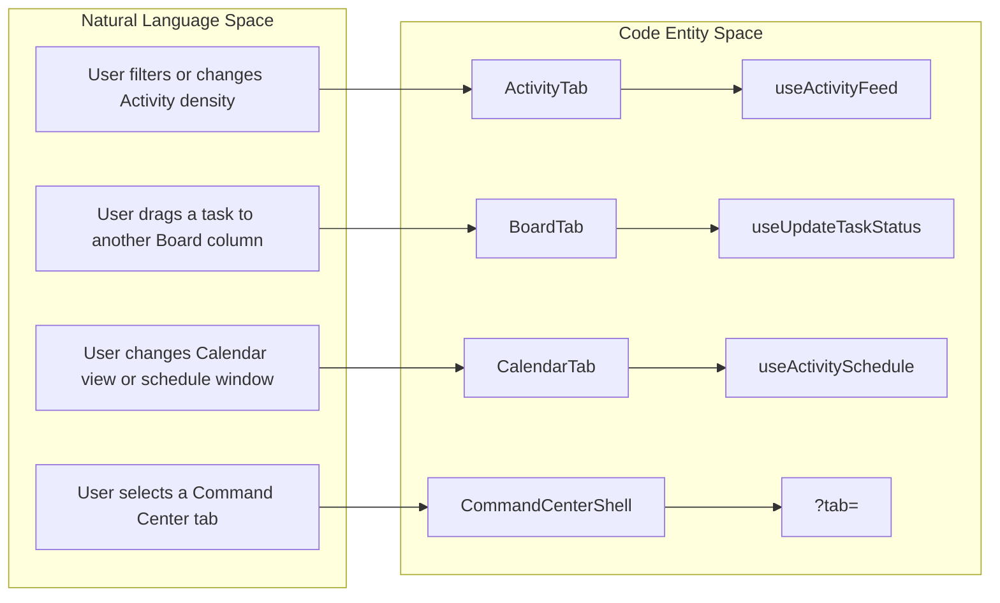
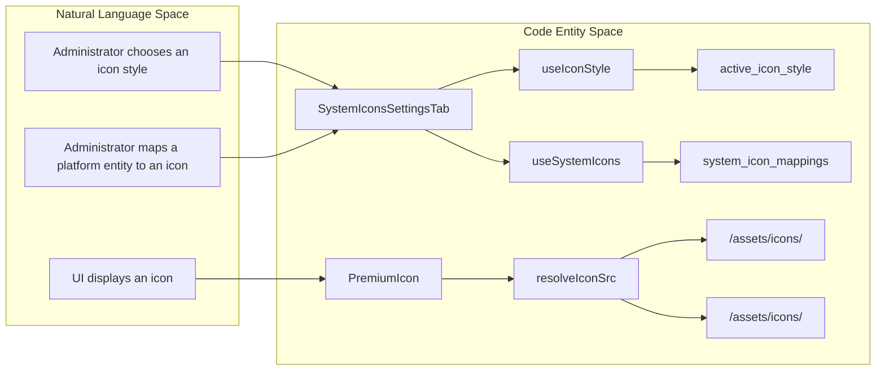
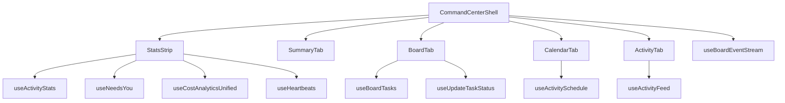

# Design System & UI Components

Relevant source files

The following files were used as context for generating this wiki page:

- [frontend/app/command-center/page.tsx](frontend/app/command-center/page.tsx)
- [frontend/app/globals.css](frontend/app/globals.css)
- [frontend/components/agents/skills/skill-browser.tsx](frontend/components/agents/skills/skill-browser.tsx)
- [frontend/components/assignments/studio/mission-card.tsx](frontend/components/assignments/studio/mission-card.tsx)
- [frontend/components/assignments/studio/mkt-card.tsx](frontend/components/assignments/studio/mkt-card.tsx)
- [frontend/components/assignments/studio/playbook-card.tsx](frontend/components/assignments/studio/playbook-card.tsx)
- [frontend/components/assignments/studio/status-head.tsx](frontend/components/assignments/studio/status-head.tsx)
- [frontend/components/command-center/activity-tab.tsx](frontend/components/command-center/activity-tab.tsx)
- [frontend/components/command-center/agent-tones.ts](frontend/components/command-center/agent-tones.ts)
- [frontend/components/command-center/board-tab.tsx](frontend/components/command-center/board-tab.tsx)
- [frontend/components/command-center/calendar-tab.tsx](frontend/components/command-center/calendar-tab.tsx)
- [frontend/components/command-center/command-center-shell.tsx](frontend/components/command-center/command-center-shell.tsx)
- [frontend/components/command-center/sparkline.tsx](frontend/components/command-center/sparkline.tsx)
- [frontend/components/command-center/stats-strip.tsx](frontend/components/command-center/stats-strip.tsx)
- [frontend/components/command-center/summary-tab.tsx](frontend/components/command-center/summary-tab.tsx)
- [frontend/components/settings/SystemIconsSettingsTab.tsx](frontend/components/settings/SystemIconsSettingsTab.tsx)
- [frontend/components/shared/icon-selector.tsx](frontend/components/shared/icon-selector.tsx)
- [frontend/components/shared/premium-icon.tsx](frontend/components/shared/premium-icon.tsx)
- [frontend/components/ui/dialog.tsx](frontend/components/ui/dialog.tsx)
- [frontend/components/ui/input.tsx](frontend/components/ui/input.tsx)
- [frontend/components/ui/select.tsx](frontend/components/ui/select.tsx)
- [frontend/components/ui/tabs.tsx](frontend/components/ui/tabs.tsx)
- [frontend/config/iconRegistry.json](frontend/config/iconRegistry.json)
- [frontend/hooks/use-system-config-api.ts](frontend/hooks/use-system-config-api.ts)

## Purpose and Scope

This page describes the frontend’s shared styling and component foundations: Tailwind theme tokens, Radix-based UI primitives, Studio and Classic presentation paths, premium icons and system icon mappings, and representative Command Center components. [frontend/app/globals.css:6-197](), [frontend/components/ui/dialog.tsx:3-145](), [frontend/components/shared/premium-icon.tsx:8-55](), [frontend/components/command-center/command-center-shell.tsx:50-77]()

Sources: [frontend/app/globals.css:6-197](), [frontend/components/ui/dialog.tsx:3-145](), [frontend/components/shared/premium-icon.tsx:8-55](), [frontend/components/command-center/command-center-shell.tsx:50-77]()

---

## 1. Design System & Theming: Studio vs. Classic

The frontend has Classic and Studio presentation paths for the Command Center. The `/command-center` page reads `useIsStudio()` and renders `CommandCenterShell` inside a full-bleed `MainLayout` when Studio is active; otherwise it renders the Classic `ActivityPage`. The page’s comment documents that below 1024 px both styles use `ActivityPage` until the mobile pass. [frontend/app/command-center/page.tsx:3-29]()

The stylesheet defines the default light theme in `:root`, a dark theme in `.dark`, and a Studio token layer in `.studio`. Studio uses a cream background, warm near-black foreground and primary, burnt-orange accent, and tan borders. [frontend/app/globals.css:6-85](), [frontend/app/globals.css:87-145](), [frontend/app/globals.css:147-197]()

### Theme Configuration and Providers

The earlier page describes a theme provider stack and boot-time theme resolution. Those implementation files are not included in the supplied file contents, so their provider and cookie behavior cannot be verified here. The available implementation confirms the Classic-versus-Studio route selection through `useIsStudio()` in `CommandCenterPage`. [frontend/app/command-center/page.tsx:3-29]()

The Studio stylesheet comment says the `.studio` class can be applied to `body` and that its variables flow through Shadcn primitives and custom utilities, avoiding color-layer rewrites for each primitive. [frontend/app/globals.css:147-162]()

Sources: [frontend/app/command-center/page.tsx:3-29](), [frontend/app/globals.css:147-162]()

---

## 2. Shared UI Primitives & Radix Integration

`Dialog` wraps Radix Dialog primitives and exports the root, trigger, portal, close, overlay, content, header, footer, title, and description components. `DialogContent` accepts a `size` prop (`sm`, `default`, `md`, `lg`, `xl`, or `full`), combines its classes with `cn`, and renders through a portal with an overlay. [frontend/components/ui/dialog.tsx:3-16](), [frontend/components/ui/dialog.tsx:17-76](), [frontend/components/ui/dialog.tsx:78-145]()

The content is centered with a fixed-position layout and inline `translate(-50%, -50%)`; the component comment explains that this avoids animation transforms overriding the centering transform. Its styling uses semantic utility classes such as `ring-offset-background`, `focus:ring-ring`, and `bg-accent`, allowing the dialog to use the active theme tokens. [frontend/components/ui/dialog.tsx:43-73]()

Sources: [frontend/components/ui/dialog.tsx:3-16](), [frontend/components/ui/dialog.tsx:17-76](), [frontend/components/ui/dialog.tsx:78-145]()

---

## 3. Component Architecture & Data Flow

The Studio page path is selected at the route component. Within the Studio Command Center, `CommandCenterShell` parses and validates the `tab` query parameter, reads data through hooks, and renders the active surface. The Classic path uses the existing `ActivityPage`. [frontend/app/command-center/page.tsx:9-29](), [frontend/components/command-center/command-center-shell.tsx:50-77](), [frontend/components/command-center/command-center-shell.tsx:92-145]()

### Diagram: Natural Language Choices to Theme Code Entities

Sources: [frontend/app/command-center/page.tsx:3-29]()

### Diagram: Studio Command Center User Actions to Code Entities

Sources: [frontend/components/command-center/command-center-shell.tsx:92-145](), [frontend/components/command-center/activity-tab.tsx:113-149](), [frontend/components/command-center/board-tab.tsx:62-103](), [frontend/components/command-center/calendar-tab.tsx:77-106]()

---

## 4. Tailwind Theme, Semantic Tokens & Color Systems

The global stylesheet includes Tailwind’s base, components, and utilities layers, then defines CSS custom properties for light and dark modes. The Studio class overrides the semantic token layer, including surface, text, primary, accent, border, and ring values. [frontend/app/globals.css:2-6](), [frontend/app/globals.css:7-85](), [frontend/app/globals.css:87-145](), [frontend/app/globals.css:163-197]()

The supplied content does not include `frontend/tailwind.config.ts`, so Tailwind configuration details such as font-family extensions and animation definitions are not independently described here.

| Token group | Role and implementation |
|---|---|
| Surface and text | `--background`, `--foreground`, `--card`, and popover tokens define primary surfaces and their text colors. [frontend/app/globals.css:9-18]() |
| Interactive emphasis | `--primary`, `--primary-foreground`, `--accent`, and `--accent-foreground` define action and accent colors. [frontend/app/globals.css:20-27]() |
| Borders and focus | `--border`, `--input`, and `--ring` provide edge and focus-ring tokens. [frontend/app/globals.css:30-33]() |
| Semantic status | `--success`, `--warning`, `--info`, `--running`, and `--agent` define status-related colors. [frontend/app/globals.css:57-66]() |
| Charts and stages | `--chart-*` variables supply chart palette tokens; `--stage-*` variables define pipeline stage tokens in the light theme. [frontend/app/globals.css:68-84]() |
| Studio overrides | `.studio` changes surface, primary, secondary, accent, border, and focus tokens for the Studio palette. [frontend/app/globals.css:163-197]() |

Sources: [frontend/app/globals.css:2-6](), [frontend/app/globals.css:7-85](), [frontend/app/globals.css:87-145](), [frontend/app/globals.css:163-197]()

---

## 5. Premium Icons & Icon Registry

`PremiumIcon` renders an icon asset through Next.js `Image`. It derives an `.svg` filename when the supplied name does not already include that suffix, obtains the global icon style using `useIconStyle()`, and permits an instance-level `style` override. If no icon name is provided it renders a Lucide `Bot` fallback. [frontend/components/shared/premium-icon.tsx:3-14](), [frontend/components/shared/premium-icon.tsx:25-37]()

`resolveIconSrc` uses `/assets/icons/<filename>` for the default style and `/assets/icons/<style>/<filename>` for a named style. If an image load fails, `PremiumIcon` switches to the default asset path; it also resets that fallback state when the icon name or active style changes. [frontend/components/shared/premium-icon.tsx:16-23](), [frontend/components/shared/premium-icon.tsx:25-55]()

System icon configuration is exposed through React Query hooks. `useIconStyle()` reads the `active_icon_style` system-config key and accepts only a non-empty string, falling back to `default` on invalid values or request failure. `useSystemIcons()` reads `system_icon_mappings`, can be disabled with its `enabled` argument, migrates the legacy `communication_agent` key when necessary, and returns empty mappings if fetching fails. [frontend/hooks/use-system-config-api.ts:94-138]()

`SystemIconsSettingsTab` imports `PremiumIcon`, `IconSelector`, `useSystemIcons`, `useIconStyle`, and `useUpdateSystemConfigKey`. It defines icon-style options and mapping sections for sidebar navigation, platform entities, agent categories, and skill domains. [frontend/components/settings/SystemIconsSettingsTab.tsx:3-9](), [frontend/components/settings/SystemIconsSettingsTab.tsx:26-92](), [frontend/components/settings/SystemIconsSettingsTab.tsx:94-172]()

The supplied file contents do not include the contents or line numbers of `frontend/config/iconRegistry.json` or `frontend/components/shared/icon-selector.tsx`; registry schema and selector behavior are therefore not specified here.

### Diagram: Icon Preferences to Rendered Icon

Sources: [frontend/components/settings/SystemIconsSettingsTab.tsx:3-9](), [frontend/components/settings/SystemIconsSettingsTab.tsx:36-48](), [frontend/components/settings/SystemIconsSettingsTab.tsx:94-172](), [frontend/hooks/use-system-config-api.ts:94-138](), [frontend/components/shared/premium-icon.tsx:16-55]()

---

## 6. Command Center & Studio Surface Components

`CommandCenterShell` defines the Studio Command Center’s tab set and obtains the selected tab from the URL’s `tab` parameter, defaulting to `summary` when the parameter is absent or invalid. It reads activity, needs-you, schedule, watchlist, and question data through hooks and subscribes to board events with `useBoardEventStream(true)`. [frontend/components/command-center/command-center-shell.tsx:50-77](), [frontend/components/command-center/command-center-shell.tsx:92-145]()

The shell’s child components provide distinct surfaces:

- **`StatsStrip`** reads activity stats, needs-you counts, cost analytics, and heartbeat data, then renders six metrics: working, agents, queue, attention, cache-hit, and cost per request. [frontend/components/command-center/stats-strip.tsx:32-126]()
- **`ActivityTab`** builds API filters from the selected type, errors-only toggle, period, and limit; it uses `useActivityFeed` for filtered rows and a second unfiltered request for filter-pill counts. [frontend/components/command-center/activity-tab.tsx:113-149]()
- **`CalendarTab`** loads schedule data through `useActivitySchedule`, derives a view with `useCalendarView`, and wires event actions to navigation, heartbeat toggling, scheduled-task updates, and social rescheduling. [frontend/components/command-center/calendar-tab.tsx:77-106]()
- **`BoardTab`** fetches board tasks with `useBoardTasks`, supports column and agent-lane modes, and applies a cross-column drag through `useUpdateTaskStatus`. [frontend/components/command-center/board-tab.tsx:62-103]()

`CommandCenterShell` keeps the selected tab in the URL and calculates tab counts from the same hook results used for the corresponding surfaces. [frontend/components/command-center/command-center-shell.tsx:92-145]()

Sources: [frontend/components/command-center/command-center-shell.tsx:50-77](), [frontend/components/command-center/command-center-shell.tsx:92-145](), [frontend/components/command-center/stats-strip.tsx:32-126](), [frontend/components/command-center/activity-tab.tsx:113-149](), [frontend/components/command-center/calendar-tab.tsx:77-106](), [frontend/components/command-center/board-tab.tsx:62-103]()

### Diagram: Command Center Surface Composition

Sources: [frontend/components/command-center/command-center-shell.tsx:24-45](), [frontend/components/command-center/command-center-shell.tsx:92-118](), [frontend/components/command-center/stats-strip.tsx:18-36](), [frontend/components/command-center/board-tab.tsx:30-80](), [frontend/components/command-center/calendar-tab.tsx:47-90](), [frontend/components/command-center/activity-tab.tsx:18-30]()

---

## 7. Typography & Contextual Elements

The available stylesheet defines semantic color and surface variables, but the supplied content does not include the Tailwind configuration or font-loading implementation needed to verify font stacks or typography utilities. Studio-specific typography is described in the stylesheet’s theme comment, but the corresponding token definitions are outside the supplied excerpt. [frontend/app/globals.css:147-162]()

Sources: [frontend/app/globals.css:147-162]()

---