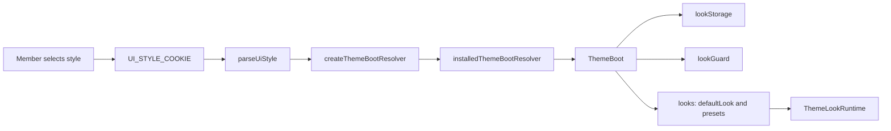
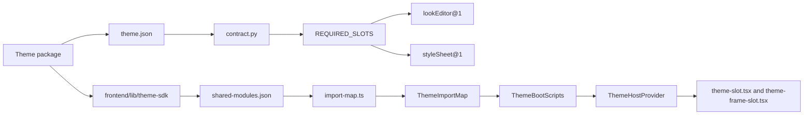
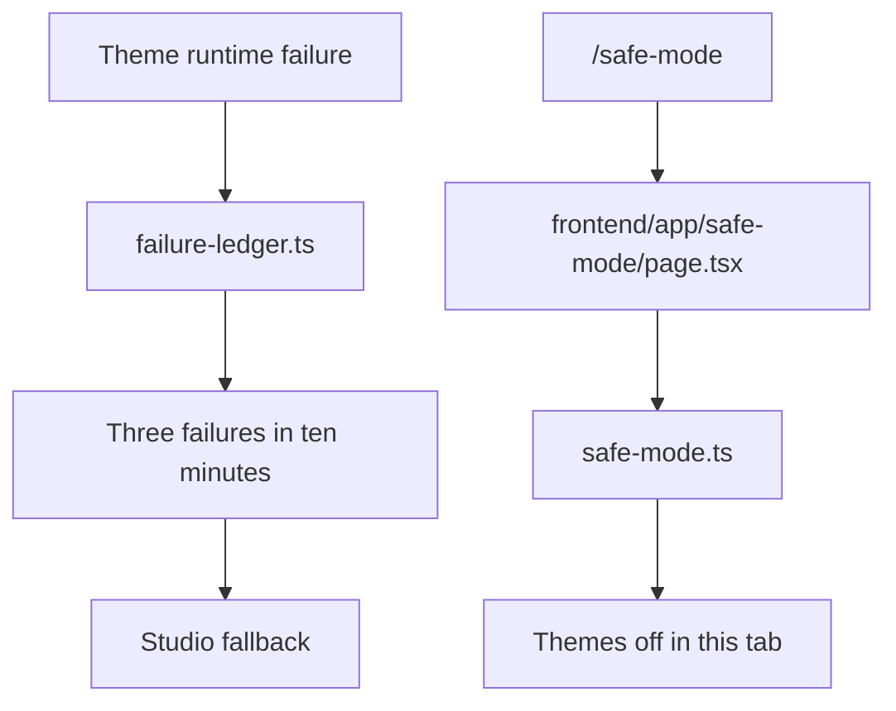
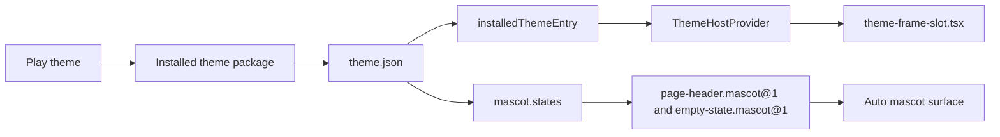

# Looks, Theme Host & Play Shell

Relevant source files

The following files were used as context for generating this wiki page:

- [docs/README.md](docs/README.md)
- [docs/assets/showcase/candy-1440-chat-nightbloom.png](docs/assets/showcase/candy-1440-chat-nightbloom.png)
- [docs/assets/showcase/candy-1440-deliverables-blush.png](docs/assets/showcase/candy-1440-deliverables-blush.png)
- [docs/assets/showcase/candy-1440-today-blush.png](docs/assets/showcase/candy-1440-today-blush.png)
- [docs/community-marketplace/_index.md](docs/community-marketplace/_index.md)
- [docs/community-marketplace/themes-tab.md](docs/community-marketplace/themes-tab.md)
- [docs/theme-host/_index.md](docs/theme-host/_index.md)
- [docs/theme-host/api-reference.md](docs/theme-host/api-reference.md)
- [docs/theme-host/operations.md](docs/theme-host/operations.md)
- [docs/theme-host/security-model.md](docs/theme-host/security-model.md)
- [docs/themes/_index.md](docs/themes/_index.md)
- [docs/themes/candy.md](docs/themes/candy.md)
- [docs/themes/faq.md](docs/themes/faq.md)
- [docs/themes/installing-and-choosing.md](docs/themes/installing-and-choosing.md)
- [docs/themes/looks.md](docs/themes/looks.md)
- [docs/themes/managing-themes.md](docs/themes/managing-themes.md)
- [docs/themes/on-your-phone.md](docs/themes/on-your-phone.md)
- [frontend/app/layout.tsx](frontend/app/layout.tsx)
- [frontend/components/__tests__/theme-choice-opt-in.test.tsx](frontend/components/__tests__/theme-choice-opt-in.test.tsx)
- [frontend/components/marketplace/themes/install-use.tsx](frontend/components/marketplace/themes/install-use.tsx)
- [frontend/components/providers.tsx](frontend/components/providers.tsx)
- [frontend/components/settings/themes/__tests__/appearance-tab.test.tsx](frontend/components/settings/themes/__tests__/appearance-tab.test.tsx)
- [frontend/components/settings/themes/__tests__/install-signature.test.tsx](frontend/components/settings/themes/__tests__/install-signature.test.tsx)
- [frontend/components/settings/themes/__tests__/scan-report.test.ts](frontend/components/settings/themes/__tests__/scan-report.test.ts)
- [frontend/components/settings/themes/__tests__/theme-fixtures.tsx](frontend/components/settings/themes/__tests__/theme-fixtures.tsx)
- [frontend/components/settings/themes/choose-install.tsx](frontend/components/settings/themes/choose-install.tsx)
- [frontend/components/settings/themes/installed-list.tsx](frontend/components/settings/themes/installed-list.tsx)
- [frontend/components/settings/themes/installed-row.tsx](frontend/components/settings/themes/installed-row.tsx)
- [frontend/components/settings/themes/scan-report.tsx](frontend/components/settings/themes/scan-report.tsx)
- [frontend/components/settings/themes/theme-labels.ts](frontend/components/settings/themes/theme-labels.ts)
- [frontend/components/ui/theme-toggle.tsx](frontend/components/ui/theme-toggle.tsx)
- [frontend/hooks/use-global-search.ts](frontend/hooks/use-global-search.ts)
- [frontend/hooks/use-installed-themes.ts](frontend/hooks/use-installed-themes.ts)
- [frontend/lib/__tests__/prd261-no-theme-in-core.test.ts](frontend/lib/__tests__/prd261-no-theme-in-core.test.ts)
- [frontend/lib/theme-host/__tests__/boot-server.test.ts](frontend/lib/theme-host/__tests__/boot-server.test.ts)
- [frontend/lib/theme-host/__tests__/choice-sync.test.tsx](frontend/lib/theme-host/__tests__/choice-sync.test.tsx)
- [frontend/lib/theme-host/__tests__/manifest.test.ts](frontend/lib/theme-host/__tests__/manifest.test.ts)
- [frontend/lib/theme-host/__tests__/validator-parity.test.ts](frontend/lib/theme-host/__tests__/validator-parity.test.ts)
- [frontend/lib/theme-host/choice-sync.ts](frontend/lib/theme-host/choice-sync.ts)
- [frontend/lib/theme-host/manifest.ts](frontend/lib/theme-host/manifest.ts)
- [frontend/lib/theme-host/package-manifest.ts](frontend/lib/theme-host/package-manifest.ts)
- [frontend/scripts/__tests__/frontend-ci-lane-paths.test.ts](frontend/scripts/__tests__/frontend-ci-lane-paths.test.ts)
- [frontend/tailwind.config.ts](frontend/tailwind.config.ts)
- [orchestrator/services/themes/bounded_cache.py](orchestrator/services/themes/bounded_cache.py)
- [orchestrator/services/themes/contract.py](orchestrator/services/themes/contract.py)
- [orchestrator/services/themes/listings.py](orchestrator/services/themes/listings.py)
- [orchestrator/services/themes/looks.py](orchestrator/services/themes/looks.py)
- [orchestrator/services/themes/manifest.py](orchestrator/services/themes/manifest.py)
- [orchestrator/services/themes/package.py](orchestrator/services/themes/package.py)
- [orchestrator/services/themes/review_stage.py](orchestrator/services/themes/review_stage.py)
- [orchestrator/services/themes/serve.py](orchestrator/services/themes/serve.py)
- [orchestrator/tests/fixtures/themes/cases.json](orchestrator/tests/fixtures/themes/cases.json)
- [orchestrator/tests/test_prd261_boot_files_cache.py](orchestrator/tests/test_prd261_boot_files_cache.py)
- [orchestrator/tests/test_prd261_mobile_endpoint.py](orchestrator/tests/test_prd261_mobile_endpoint.py)
- [orchestrator/tests/test_prd261_theme_files.py](orchestrator/tests/test_prd261_theme_files.py)
- [orchestrator/tests/test_prd261_theme_import.py](orchestrator/tests/test_prd261_theme_import.py)
- [orchestrator/tests/test_prd261_theme_listings.py](orchestrator/tests/test_prd261_theme_listings.py)
- [orchestrator/tests/test_prd261_theme_looks.py](orchestrator/tests/test_prd261_theme_looks.py)
- [orchestrator/tests/test_prd261_theme_package.py](orchestrator/tests/test_prd261_theme_package.py)

## Purpose and scope

This page describes the frontend appearance model and the PRD-261 theme host: how an installed theme’s boot data reaches the browser, how looks and presets are represented in that data, and how the Play shell and mascot fit into the package model. It also covers theme loading, the SDK boundary, and recovery paths. [docs/theme-host/_index.md:71-75](), [orchestrator/services/themes/serve.py:32-56](), [docs/themes/_index.md:81-86]()

Sources: [docs/theme-host/_index.md:71-75](), [orchestrator/services/themes/serve.py:32-56](), [docs/themes/_index.md:81-86]()

---

## Looks: Token Store & Presets

The appearance model separates the selected **style**—Classic, Studio, or an installed theme—from the **tone** used by the browser theme provider. The root layout reads the style cookie, resolves a boot for that style, and passes the resulting initial style, tone, and installed-theme entry to `Providers`. [frontend/app/layout.tsx:38-51](), [frontend/app/layout.tsx:63-69](), [frontend/components/providers.tsx:82-99]()

For an installed theme that can run, the backend boot includes look-related data: `lookStorage` identifies the active-look browser storage keys, `lookGuard` identifies the checked look-schema header, and `looks` carries the default look and presets. The serving path checks preset contents against the theme’s checked schema before including them in the boot. A missing or unreadable schema means the boot does not include those look files, so the default look paints instead. [orchestrator/services/themes/serve.py:42-56]()

| Concern | Code entity | Role |
|---|---|---|
| Style selected for the initial render | `parseUiStyle`, `createThemeBootResolver` | Read the style cookie and resolve the corresponding boot. [frontend/app/layout.tsx:38-51]() |
| Initial style and installed theme | `Providers`, `UiStyleProvider` | Receive the initial UI style and installed-theme entry. [frontend/components/providers.tsx:82-92](), [frontend/components/providers.tsx:109-122]() |
| Tone selected by a look | `lookTone`, `ThemeLookRuntime` | Carry a look-driven tone through the provider tree; the runtime is placed inside the workspace provider. [frontend/components/providers.tsx:92-99](), [frontend/components/providers.tsx:121-137]() |
| Active-look storage metadata | `lookStorage`, `lookGuard` | Boot fields used by the frontend look store to identify storage keys and guard the accepted look format. [orchestrator/services/themes/serve.py:42-48]() |
| Boot presets | `boot_looks`, `looks/schema.json`, `looks/presets/*.look.json` | Supply the default look and validated presets as boot data. [orchestrator/services/themes/serve.py:50-56]() |

The shared theme contract defines supported theme tones, including `from-look`, and requires themes to supply both the `lookEditor@1` and `styleSheet@1` slots. The contract also defines the look-schema format identifier. [orchestrator/services/themes/contract.py:67-85]()

### Look data flow: natural-language concepts to code entities

**Diagram: From a member’s selected appearance to look boot data**

Sources: [frontend/app/layout.tsx:38-51](), [orchestrator/services/themes/serve.py:32-56](), [frontend/components/providers.tsx:132-137]()

Sources: [frontend/app/layout.tsx:38-51](), [orchestrator/services/themes/serve.py:32-56](), [frontend/components/providers.tsx:132-137]()

---

## Look Editor & Manager UI

The host contract includes a versioned `lookEditor@1` slot, and the theme contract marks it as required for every theme. This makes the editor part of the theme package/host contract rather than a generic editor that is guaranteed to be rendered identically for every theme. [orchestrator/services/themes/contract.py:80-83]()

The frontend provider tree includes `ThemeLookRuntime`, which is mounted around page content and remains in the tree whether or not the active theme declares looks. The provider comments identify the runtime as the component that applies the active theme’s look and passes look-driven tone changes upward. [frontend/components/providers.tsx:132-137]()

The supplied source excerpts do not include the look editor component implementation or the look API’s route and persistence details. The precise editor controls, save calls, and server-side storage behavior therefore cannot be described from the available code excerpts.

Sources: [orchestrator/services/themes/contract.py:80-83](), [frontend/components/providers.tsx:132-137]()

---

## Theme Host Loader, Import Maps & Shared Modules

The root layout resolves the boot on the server before rendering. It places `ThemeImportMap` in the document head before `ThemeBootScripts`, then passes the boot’s tone and installed-theme entry to `Providers`. This ordering is intentional: the import map must precede module scripts, and the boot scripts apply theme data before first paint. [frontend/app/layout.tsx:43-51](), [frontend/app/layout.tsx:59-69]()

The theme-host module is organized around boot resolution, import-map construction, loading, and provider/slot rendering. The source inventory identifies `boot.ts`, `boot-server.ts`, `boot-client.ts`, `import-map.ts`, `loader.ts`, `manifest.ts`, `theme-host-provider.tsx`, and the slot components as parts of this path. The supplied excerpts do not include those modules’ implementations, so the details of loader functions and import-map entries are not inferred here. [docs/theme-host/_index.md:37-61]()

The backend boot is more than a module URL: it can carry the theme’s classes and tone policy, prepaint data, module-integrity values, registry entry, look storage metadata, look guard, and validated look presets. Before serving theme files, the backend checks that the caller is authorized for the package and that each requested file is present in the package’s file manifest and matches its recorded hash. [orchestrator/services/themes/serve.py:3-15](), [orchestrator/services/themes/serve.py:27-56]()

### `@automatos/theme-sdk` and `defineTheme`

The theme SDK is part of the theme-host source inventory, and the shared-module configuration is listed alongside the import-map implementation. The supplied excerpts do not show the definition or signature of `defineTheme`, so this page does not assert its exact arguments or return value. [docs/theme-host/_index.md:43-45](), [docs/theme-host/_index.md:55-62]()

The host contract does specify the versioned extension points a theme may implement. These include `frame@1`, `lookEditor@1`, `styleSheet@1`, `notFound@1`, `asleep@1`, and mascot-related page-header and empty-state slots. Every theme must provide `lookEditor@1` and `styleSheet@1`. [orchestrator/services/themes/contract.py:80-83]()

**Diagram: Theme package concepts mapped to host code entities**

Sources: [orchestrator/services/themes/contract.py:67-85](), [docs/theme-host/_index.md:37-62](), [frontend/app/layout.tsx:59-69]()

Sources: [orchestrator/services/themes/contract.py:67-85](), [docs/theme-host/_index.md:37-62](), [frontend/app/layout.tsx:59-69]()

---

## Safe Mode & Failure Ledger

Safe mode provides a route for opening the app with themes disabled in the current tab. The theme-host documentation identifies `safe-mode.ts`, `failure-ledger.ts`, and `/safe-mode` as the related frontend entities. [docs/theme-host/security-model.md:47-55]()

The documented recovery behavior distinguishes explicit safe mode from repeated runtime failures. The FAQ says that a theme failing three times within ten minutes returns the member to Studio, while safe mode displays the notice “themes are off in this tab.” [docs/themes/faq.md:46-57]()

The available source excerpts do not show the implementation of the failure counter or the safe-mode state checks; the flow below maps the documented recovery behavior to the named code entities without assuming additional internal mechanics.

**Diagram: Theme failure recovery mapped to code entities**

Sources: [docs/theme-host/security-model.md:47-55](), [docs/themes/faq.md:46-57]()

Sources: [docs/theme-host/security-model.md:47-55](), [docs/themes/faq.md:46-57]()

---

## The Alternate Play Shell & Auto Mascot Runtime

Play is an installed theme, not a shell compiled into the frontend. The themes documentation lists Play under the reserved `automatos` publisher and states that themes, including Play, are installed into a workspace as packages. A chosen theme can provide its own frame, pages, colors, fonts, and mascot. [docs/themes/_index.md:48-60](), [docs/themes/_index.md:70-86]()

The theme manifest contract supports a `mascot` field with declared states. The shared test fixture includes a valid manifest with `mascot.states` set to `idle` and `thinking`, and also a valid case with no mascot. The host contract separately lists mascot extension slots for page headers and empty states. These declarations establish package-level mascot support, but the supplied excerpts do not show Play’s mascot renderer or its animation state machine. [orchestrator/tests/fixtures/themes/cases.json:27-44](), [orchestrator/services/themes/contract.py:80-82]()

A theme runs only after the host has established that the package may be served. The backend’s serving logic checks membership, installation, private-package opt-in, revocations, and file hashes; private theme code requires opt-in for that package version. [orchestrator/services/themes/serve.py:3-25](), [orchestrator/services/themes/serve.py:27-35]()

**Diagram: Play shell and mascot concepts mapped to package and host entities**

Sources: [docs/themes/_index.md:48-60](), [docs/themes/_index.md:70-86](), [orchestrator/tests/fixtures/themes/cases.json:27-44](), [orchestrator/services/themes/contract.py:80-82](), [docs/theme-host/_index.md:55-60]()

Sources: [docs/themes/_index.md:48-60](), [docs/themes/_index.md:70-86](), [orchestrator/tests/fixtures/themes/cases.json:27-44](), [orchestrator/services/themes/contract.py:80-82](), [docs/theme-host/_index.md:55-60]()

---

## Glossary & Code Mappings

| Natural-language concept | Code entity |
|---|---|
| Style chosen for the first render | `UI_STYLE_COOKIE`, `parseUiStyle`, `createThemeBootResolver` [frontend/app/layout.tsx:38-51]() |
| Theme boot | `installedThemeBootResolver`, `ThemeBoot`, `ThemeBootScripts` [frontend/app/layout.tsx:43-51](), [frontend/app/layout.tsx:59-69](), [orchestrator/services/themes/serve.py:32-56]() |
| Look-driven tone | `lookTone`, `ThemeLookRuntime`, `onToneChange` [frontend/components/providers.tsx:92-99](), [frontend/components/providers.tsx:132-137]() |
| Look storage and format guard | `lookStorage`, `lookGuard` [orchestrator/services/themes/serve.py:42-48]() |
| Theme default look and presets | `boot_looks`, `looks/schema.json`, `looks/presets/*.look.json` [orchestrator/services/themes/serve.py:50-56]() |
| Required theme slots | `REQUIRED_SLOTS`, `lookEditor@1`, `styleSheet@1` [orchestrator/services/themes/contract.py:80-83]() |
| Theme manifest and mascot declaration | `theme.json`, `mascot.states` [orchestrator/services/themes/contract.py:67-70](), [orchestrator/tests/fixtures/themes/cases.json:27-44]() |
| Theme import map | `ThemeImportMap`, `import-map.ts`, `shared-modules.json` [frontend/app/layout.tsx:59-64](), [docs/theme-host/_index.md:43-45]() |
| Safe-mode recovery | `safe-mode.ts`, `failure-ledger.ts`, `/safe-mode` [docs/theme-host/security-model.md:47-55](), [docs/themes/faq.md:46-57]() |
| Play | Installed `automatos/play` theme package [docs/themes/_index.md:70-86]() |

Sources: [frontend/app/layout.tsx:38-69](), [frontend/components/providers.tsx:92-99](), [frontend/components/providers.tsx:132-137](), [orchestrator/services/themes/contract.py:67-85](), [orchestrator/services/themes/serve.py:32-56](), [docs/theme-host/_index.md:43-62](), [docs/themes/_index.md:70-86]()

---