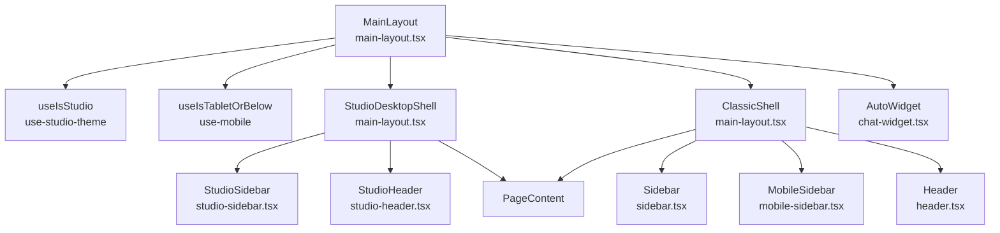
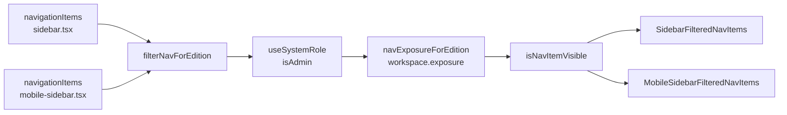
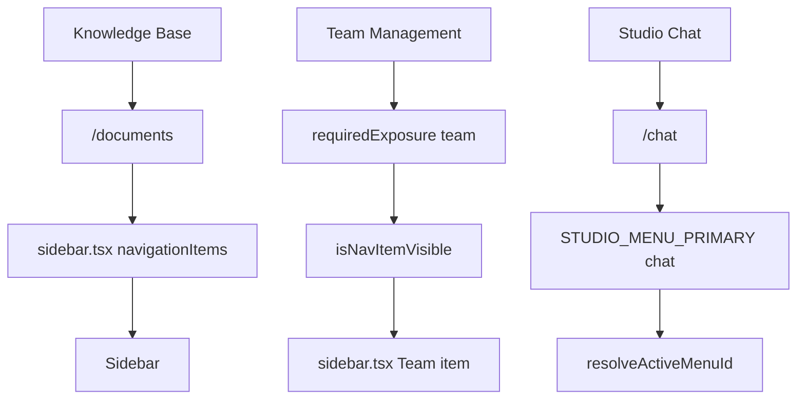
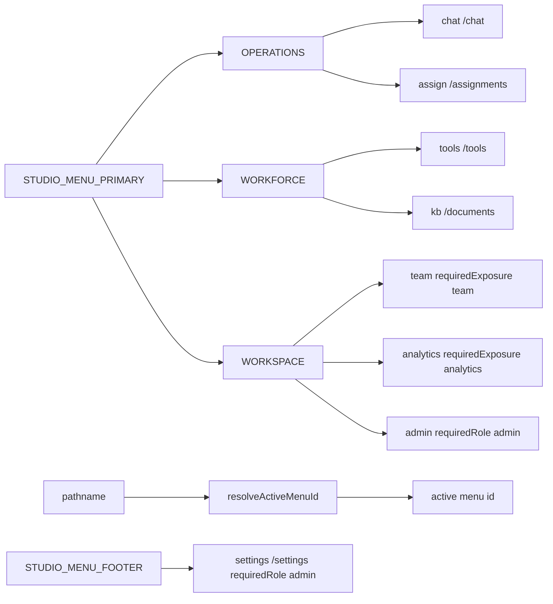
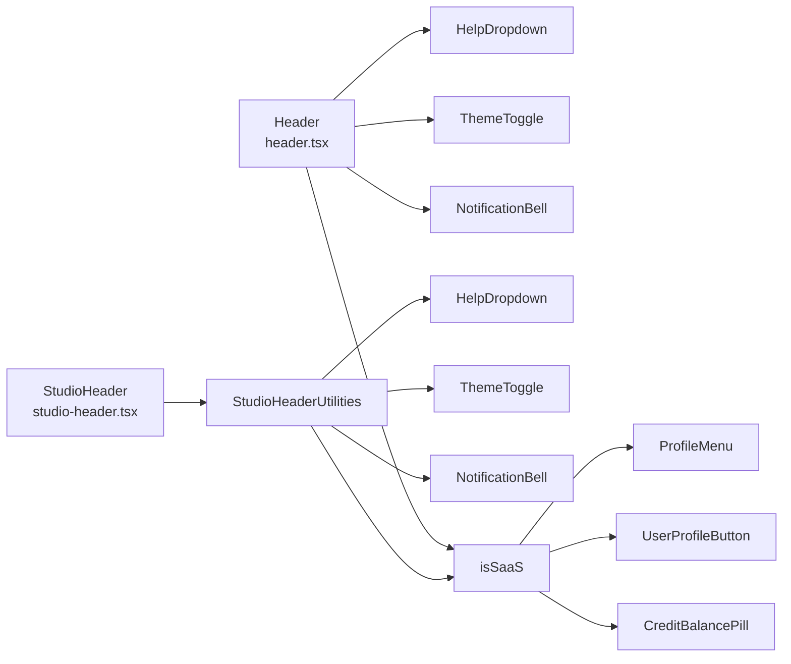
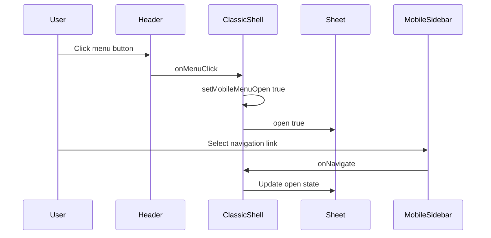
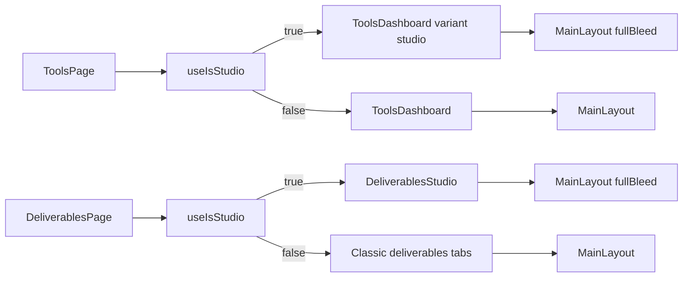

# Navigation & Layout

Relevant source files

The following files were used as context for generating this wiki page:

- [frontend/app/deliverables/__tests__/deliverables-route.test.tsx](frontend/app/deliverables/__tests__/deliverables-route.test.tsx)
- [frontend/app/deliverables/page.tsx](frontend/app/deliverables/page.tsx)
- [frontend/app/tools/__tests__/tools-route.test.tsx](frontend/app/tools/__tests__/tools-route.test.tsx)
- [frontend/app/tools/page.tsx](frontend/app/tools/page.tsx)
- [frontend/components/__tests__/prd244-w3-style-tone.test.ts](frontend/components/__tests__/prd244-w3-style-tone.test.ts)
- [frontend/components/__tests__/studio-honest-chrome.test.ts](frontend/components/__tests__/studio-honest-chrome.test.ts)
- [frontend/components/assignments/assignments-missions-grid.tsx](frontend/components/assignments/assignments-missions-grid.tsx)
- [frontend/components/assignments/assignments-page.tsx](frontend/components/assignments/assignments-page.tsx)
- [frontend/components/assignments/assignments-playbooks-grid.tsx](frontend/components/assignments/assignments-playbooks-grid.tsx)
- [frontend/components/deliverables/socials/__tests__/socials-shells.test.tsx](frontend/components/deliverables/socials/__tests__/socials-shells.test.tsx)
- [frontend/components/deliverables/studio/__tests__/deliverables-studio.test.tsx](frontend/components/deliverables/studio/__tests__/deliverables-studio.test.tsx)
- [frontend/components/deliverables/studio/deliverables-studio.tsx](frontend/components/deliverables/studio/deliverables-studio.tsx)
- [frontend/components/layout/header.tsx](frontend/components/layout/header.tsx)
- [frontend/components/layout/mobile-sidebar.tsx](frontend/components/layout/mobile-sidebar.tsx)
- [frontend/components/layout/sidebar.tsx](frontend/components/layout/sidebar.tsx)
- [frontend/components/missions/mission-list.tsx](frontend/components/missions/mission-list.tsx)
- [frontend/components/tools/__tests__/tools-studio-variant.test.ts](frontend/components/tools/__tests__/tools-studio-variant.test.ts)
- [frontend/components/tools/my-tools-dashboard.tsx](frontend/components/tools/my-tools-dashboard.tsx)
- [frontend/components/ui/__tests__/theme-toggle.test.tsx](frontend/components/ui/__tests__/theme-toggle.test.tsx)
- [frontend/components/workflows/playbook-execution-config.tsx](frontend/components/workflows/playbook-execution-config.tsx)
- [frontend/components/workflows/playbook-preview-panel.tsx](frontend/components/workflows/playbook-preview-panel.tsx)
- [frontend/components/workflows/playbook-schedule-config.tsx](frontend/components/workflows/playbook-schedule-config.tsx)
- [frontend/components/workflows/playbook-step-builder.tsx](frontend/components/workflows/playbook-step-builder.tsx)
- [frontend/components/workflows/playbooks-tab.tsx](frontend/components/workflows/playbooks-tab.tsx)
- [frontend/components/workflows/view-playbook-modal.tsx](frontend/components/workflows/view-playbook-modal.tsx)
- [frontend/hooks/use-assignments-api.ts](frontend/hooks/use-assignments-api.ts)
- [frontend/hooks/use-studio-theme.ts](frontend/hooks/use-studio-theme.ts)
- [frontend/lib/__tests__/studio-menu-consistency.test.ts](frontend/lib/__tests__/studio-menu-consistency.test.ts)
- [frontend/lib/deliverables/tabs.ts](frontend/lib/deliverables/tabs.ts)
- [frontend/lib/studio-menu.ts](frontend/lib/studio-menu.ts)
- [orchestrator/api/assignments.py](orchestrator/api/assignments.py)

## Purpose and Scope

This page documents the frontend layout shell and navigation: Classic and Studio sidebars, responsive navigation, headers and profile controls, Studio menu configuration, and the filters that determine which navigation items are displayed. It also describes how route state maps to navigation state and how pages opt into Studio and full-bleed layouts. [frontend/components/layout/main-layout.tsx:18-27](), [frontend/components/layout/sidebar.tsx:33-35](), [frontend/app/tools/page.tsx:8-27]()

Sources: [frontend/components/layout/main-layout.tsx:18-27](), [frontend/components/layout/sidebar.tsx:33-35](), [frontend/app/tools/page.tsx:8-27]()

---

## Navigation Architecture Overview

`MainLayout` is the composition point for the page shell. It imports the Classic `Sidebar`, `MobileSidebar`, and `Header`, the Studio `StudioSidebar` and `StudioHeader`, and the floating `AutoWidget`. It also reads viewport and theme state through hooks like `useIsTabletOrBelow` and `useIsStudio`. [frontend/components/layout/main-layout.tsx:4-16]()

The layout exposes a `fullBleed` prop for content that needs a full-height, unconstrained content region; its documented intent is for full-canvas surfaces such as chat. In the Studio desktop shell, `fullBleed` selects a flex-based main region, while the ordinary branch applies page padding and a maximum-width wrapper. [frontend/components/layout/main-layout.tsx:18-27](), [frontend/components/layout/main-layout.tsx:70-100]()

`StudioDesktopShell` owns Studio sidebar collapse state through `useStudioSidebarCollapsed`. The hook restores the preference from `localStorage` and writes it on toggle; if storage is blocked, the rail still toggles for the current render but the preference is not persisted. [frontend/components/layout/main-layout.tsx:36-63]()

The Classic shell maintains its own `sidebarCollapsed` and `mobileMenuOpen` state. Its menu handler opens the mobile sheet when `isMobileLayout` is true and toggles the desktop sidebar otherwise. [frontend/components/layout/main-layout.tsx:145-155]()

**Diagram: Layout component and code entities**

Sources: [frontend/components/layout/main-layout.tsx:4-16](), [frontend/components/layout/main-layout.tsx:29-34](), [frontend/components/layout/main-layout.tsx:70-100](), [frontend/components/layout/main-layout.tsx:145-185](), [frontend/components/layout/sidebar.tsx:132-151](), [frontend/components/layout/header.tsx:18-24]()

---

## Sidebar & Navigation Logic

The navigation surfaces are implemented separately for Classic desktop, mobile, and Studio. Classic desktop defines its item list in `sidebar.tsx`; the mobile implementation has its own list in `mobile-sidebar.tsx`. Studio primary and footer menu entries are configured in `frontend/lib/studio-menu.ts`. [frontend/components/layout/sidebar.tsx:38-130](), [frontend/components/layout/mobile-sidebar.tsx:34-117](), [frontend/lib/studio-menu.ts:28-90]()

The Classic desktop sidebar uses `usePathname` to determine whether the current path is a chat page, reads system role and workspace state, and resolves edition and exposure information before filtering its items. The mobile sidebar applies the corresponding edition, role, and exposure checks to its own item list. [frontend/components/layout/sidebar.tsx:132-151](), [frontend/components/layout/mobile-sidebar.tsx:119-135]()

Studio menu entries carry stable IDs, labels, descriptions, routes, icons, and group metadata. `StudioMenuItem` also supports `requiredExposure` and `requiredRole` gates; footer entries have an optional `requiredRole` and an `external` flag. [frontend/lib/studio-menu.ts:28-66]()

### Navigation Items Configuration & Edition Filtering

The Classic desktop and mobile lists include items such as Chat, Assignments, Deliverables, Command Center, Agents, Tools, Marketplace, Knowledge Base, Team, and Analytics. The desktop list also defines Workspace Admin with an `admin` role requirement. [frontend/components/layout/sidebar.tsx:38-130](), [frontend/components/layout/mobile-sidebar.tsx:34-117]()

The filtering flow distinguishes edition, role, and plan exposure. The Classic desktop sidebar first passes items through `filterNavForEdition`, then applies an admin check to items with `requiredRole` and `isNavItemVisible` to other items. The mobile sidebar uses the same sequence. [frontend/components/layout/sidebar.tsx:140-150](), [frontend/components/layout/mobile-sidebar.tsx:126-135]()

The sidebar comments explicitly describe a hidden navigation item as distinct from a deleted route: plan-tier-gated surfaces may be omitted from the rail while their routes still resolve. [frontend/components/layout/sidebar.tsx:140-145](), [frontend/components/layout/mobile-sidebar.tsx:126-130]()

| Navigation Item | Target Route | Role or Exposure Metadata |
|---|---|---|
| Chat | `/chat` | None configured |
| Command Center | `/command-center` | None configured |
| Assignments | `/assignments` | None configured |
| Deliverables | `/deliverables` | None configured |
| Agent Management | `/agents` | None configured |
| Tools & Integrations | `/tools` | None configured |
| Knowledge Base | `/documents` | None configured |
| Marketplace | `/marketplace` | None configured |
| Team Management | `/team` | `requiredExposure: 'team'` |
| Analytics | `/analytics` | `requiredExposure: 'analytics'` |
| Workspace Admin | `/admin/workspaces` | `requiredRole: 'admin'` |

Sources: [frontend/components/layout/sidebar.tsx:38-130](), [frontend/components/layout/sidebar.tsx:140-150](), [frontend/components/layout/mobile-sidebar.tsx:34-117](), [frontend/components/layout/mobile-sidebar.tsx:126-135]()

**Diagram: Navigation filtering from user and workspace context to visible rail items**

Sources: [frontend/components/layout/sidebar.tsx:27-31](), [frontend/components/layout/sidebar.tsx:132-150](), [frontend/components/layout/mobile-sidebar.tsx:24-28](), [frontend/components/layout/mobile-sidebar.tsx:119-135]()

**Diagram: Natural-language destinations mapped to route and configuration code entities**

Sources: [frontend/components/layout/sidebar.tsx:38-130](), [frontend/components/layout/sidebar.tsx:145-150](), [frontend/lib/studio-menu.ts:68-85](), [frontend/lib/studio-menu.ts:92-116]()

### Studio Menu Configuration & Active Route Resolution

`STUDIO_MENU_PRIMARY` is the Studio sidebar’s single source of truth. Its 11 entries are divided into `OPERATIONS`, `WORKFORCE`, and `WORKSPACE`; `STUDIO_MENU_FOOTER` contains Docs and Settings. The primary items cover Chat, Command Centre, Assignments, Deliverables, Agent Management, Tools & Integrations, Knowledge Base, Marketplace, Team Management, Analytics, and Workspace Admin. [frontend/lib/studio-menu.ts:1-8](), [frontend/lib/studio-menu.ts:28-53](), [frontend/lib/studio-menu.ts:68-90]()

`resolveActiveMenuId(pathname)` handles selected nested routes explicitly: `/chat` paths map to `chat`, mission details map to `assign`, activity details map to `cmd`, and marketplace, admin, playbooks, settings, and deliverables prefixes map to their corresponding IDs. Other paths fall through to exact-href matching and then prefix matching against `STUDIO_MENU_PRIMARY`. [frontend/lib/studio-menu.ts:92-116]()

The Studio menu does not define a shared header sub-navigation configuration. Studio pages compose their own tabs, as asserted by the menu consistency test. [frontend/lib/__tests__/studio-menu-consistency.test.ts:12-21]()

The consistency test also checks that the primary menu has 11 unique IDs, that Workspace Admin and Settings have admin role gates, and that execution detail routes resolve to the Command Centre menu item. [frontend/lib/__tests__/studio-menu-consistency.test.ts:12-33]()

| Studio group or footer | ID | Label | Route | Gate |
|---|---|---|---|---|
| `OPERATIONS` | `chat` | Chat | `/chat` | — |
| `OPERATIONS` | `cmd` | Command Centre | `/command-center` | — |
| `OPERATIONS` | `assign` | Assignments | `/assignments` | — |
| `OPERATIONS` | `deliv` | Deliverables | `/deliverables` | — |
| `WORKFORCE` | `agents` | Agent Management | `/agents` | — |
| `WORKFORCE` | `tools` | Tools & Integrations | `/tools` | — |
| `WORKFORCE` | `kb` | Knowledge Base | `/documents` | — |
| `WORKFORCE` | `market` | Marketplace | `/marketplace` | — |
| `WORKSPACE` | `team` | Team Management | `/team` | `requiredExposure: 'team'` |
| `WORKSPACE` | `analytics` | Analytics | `/analytics` | `requiredExposure: 'analytics'` |
| `WORKSPACE` | `admin` | Workspace Admin | `/admin/workspaces` | `requiredRole: 'admin'` |
| Footer | `docs` | Docs | External | `external: true` |
| Footer | `settings` | Settings | `/settings` | `requiredRole: 'admin'` |

Sources: [frontend/lib/studio-menu.ts:28-90](), [frontend/lib/__tests__/studio-menu-consistency.test.ts:12-33]()

**Diagram: Studio menu labels, IDs, route matching, and role/exposure metadata**

Sources: [frontend/lib/studio-menu.ts:28-90](), [frontend/lib/studio-menu.ts:92-116]()

---

## Header & Profile Menu

### Header Architecture

The Classic `Header` accepts an `onMenuClick` callback and renders a menu button, Automatos branding, a Help and documentation dropdown, a theme toggle, a notification bell, and an edition-dependent profile control. It also renders `CreditBalancePill` only when `isSaaS` is true. [frontend/components/layout/header.tsx:18-35](), [frontend/components/layout/header.tsx:37-49](), [frontend/components/layout/header.tsx:52-105]()

`StudioHeader` renders a search control followed by `StudioHeaderUtilities`. The utilities component includes the hosted-edition credit pill, Help dropdown, notifications, theme toggle, and the profile control. [frontend/components/layout/studio-header.tsx:28-49](), [frontend/components/layout/studio-header.tsx:51-60](), [frontend/components/layout/studio-header.tsx:62-117]()

### Profile Menu vs User Profile Button

The Classic header uses `isSaaS` to select `ProfileMenu` for the hosted edition and `UserProfileButton` otherwise. Its comments characterize `ProfileMenu` as the account menu and `UserProfileButton` as a sign-in affordance when signed out; they also note that the local edition has no accounts. [frontend/components/layout/header.tsx:101-105]()

**Diagram: Header utilities and edition-dependent profile control**

Sources: [frontend/components/layout/header.tsx:3-16](), [frontend/components/layout/header.tsx:52-105](), [frontend/components/layout/studio-header.tsx:3-17](), [frontend/components/layout/studio-header.tsx:56-117]()

---

## Mobile Sidebar

The Classic shell tracks `mobileMenuOpen` and uses it in a `Sheet` when the layout is mobile. [frontend/components/layout/main-layout.tsx:145-155](), [frontend/components/layout/main-layout.tsx:183-185]()

`MobileSidebar` receives an `onNavigate` callback. It renders its filtered navigation list, links to configured item hrefs, and calls `onNavigate` when selected. Its navigation links use a minimum 48-pixel height and show the item label and description alongside an icon. The mobile sidebar also renders a branded header above the navigation list. [frontend/components/layout/mobile-sidebar.tsx:30-32](), [frontend/components/layout/mobile-sidebar.tsx:137-175](), [frontend/components/layout/mobile-sidebar.tsx:187-200]()

**Diagram: Classic mobile menu interaction**

Sources: [frontend/components/layout/header.tsx:18-35](), [frontend/components/layout/main-layout.tsx:145-155](), [frontend/components/layout/mobile-sidebar.tsx:30-32](), [frontend/components/layout/mobile-sidebar.tsx:152-175]()

---

## Studio Shell & Full-Bleed Layout Patterns

The Studio shell renders `StudioSidebar` and `StudioHeader`, with a `main` content area. Its normal content branch applies responsive padding and a centered wrapper capped at `1720px`; the `fullBleed` branch instead renders children in a flex column without that wrapper. [frontend/components/layout/main-layout.tsx:70-100]()

Studio sidebar collapse state is owned by `MainLayout` and stored under `studioSidebarCollapsed` in local storage. [frontend/components/layout/main-layout.tsx:36-63](), [frontend/components/layout/main-layout.tsx:76-80]()

`useIsStudio()` reads the optional UI-style context and returns `false` if the provider is absent. `useActiveTheme()` reads the active theme from that context, and `useThemeLayout()` determines whether the theme renders, falls back, or remains pending based on the active theme’s `minWidth` and viewport-width state. [frontend/hooks/use-studio-theme.ts:7-21](), [frontend/hooks/use-studio-theme.ts:23-29](), [frontend/hooks/use-studio-theme.ts:31-52]()

Pages use `useIsStudio()` to select style-specific content. `ToolsPage` renders `ToolsDashboard variant="studio"` inside `MainLayout fullBleed` when Studio is active and uses the ordinary `MainLayout` and default dashboard variant otherwise. [frontend/app/tools/page.tsx:8-27]()

`DeliverablesPage` follows the same two-style pattern: it renders `DeliverablesStudio` in a full-bleed layout for Studio and the Classic deliverables tabs otherwise. The page’s comments state that both styles use Classic below 1024 pixels pending the mobile pass. [frontend/app/deliverables/page.tsx:47-63](), [frontend/app/deliverables/page.tsx:96-105](), [frontend/app/deliverables/page.tsx:107-184]()

**Diagram: Page selection to shell and full-bleed content**

Sources: [frontend/app/tools/page.tsx:8-27](), [frontend/app/deliverables/page.tsx:47-63](), [frontend/app/deliverables/page.tsx:96-108](), [frontend/components/layout/main-layout.tsx:70-100]()

---