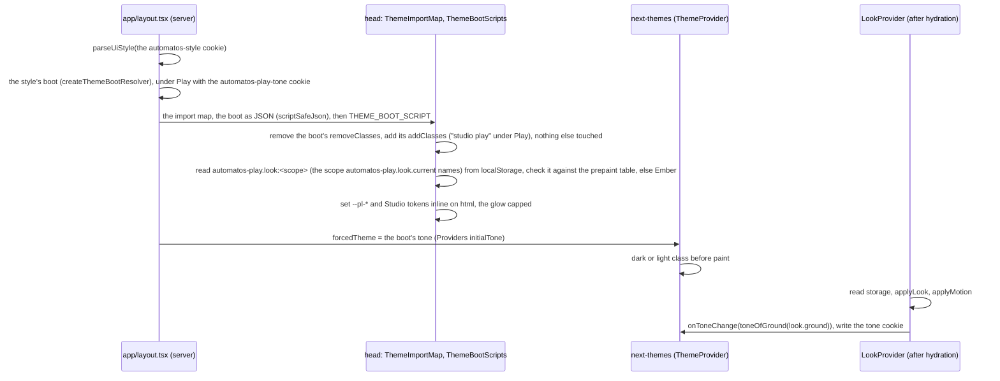
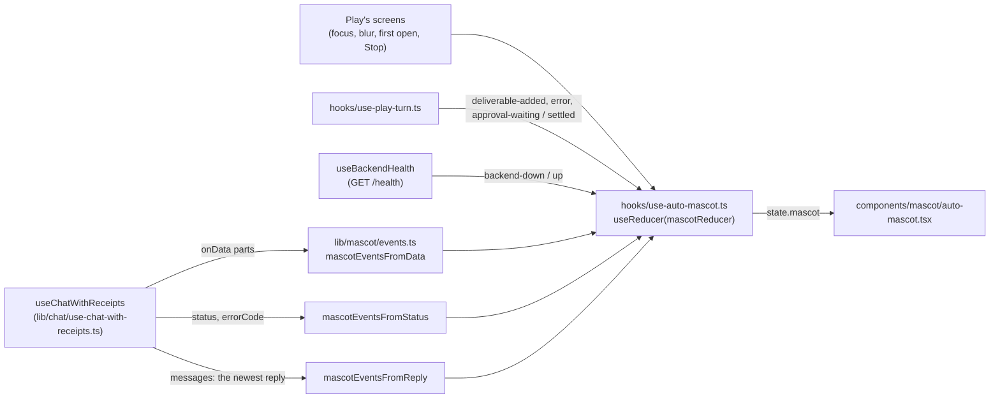

# Play Theme

<details>
<summary>Relevant source files</summary>

The following files were used as context for this page:

- [docs/PRDS/PRD-260-PLAY-THEME.md](docs/PRDS/PRD-260-PLAY-THEME.md)
- [scripts/ralph/prd260-review-fix-plan.md](scripts/ralph/prd260-review-fix-plan.md)
- [frontend/app/layout.tsx](frontend/app/layout.tsx)
- [frontend/app/play-theme.css](frontend/app/play-theme.css)
- [frontend/app/play-fonts.ts](frontend/app/play-fonts.ts)
- [frontend/app/fonts/play/README.md](frontend/app/fonts/play/README.md)
- [frontend/app/chat/layout.tsx](frontend/app/chat/layout.tsx)
- [frontend/app/conversations/page.tsx](frontend/app/conversations/page.tsx)
- [frontend/app/deliverables/layout.tsx](frontend/app/deliverables/layout.tsx)
- [frontend/app/looks/page.tsx](frontend/app/looks/page.tsx)
- [frontend/app/looks/style/page.tsx](frontend/app/looks/style/page.tsx)
- [frontend/app/not-found.tsx](frontend/app/not-found.tsx)
- [frontend/components/providers.tsx](frontend/components/providers.tsx)
- [frontend/components/layout/main-layout.tsx](frontend/components/layout/main-layout.tsx)
- [frontend/components/ui/theme-toggle.tsx](frontend/components/ui/theme-toggle.tsx)
- [frontend/components/looks/look-provider.tsx](frontend/components/looks/look-provider.tsx)
- [frontend/components/looks/use-look-store.ts](frontend/components/looks/use-look-store.ts)
- [frontend/components/looks/play-only-route.tsx](frontend/components/looks/play-only-route.tsx)
- [frontend/components/mascot/auto-mascot.tsx](frontend/components/mascot/auto-mascot.tsx)
- [frontend/components/theme-host/theme-slot.tsx](frontend/components/theme-host/theme-slot.tsx)
- [frontend/components/theme-host/theme-boot.tsx](frontend/components/theme-host/theme-boot.tsx)
- [frontend/components/theme-host/theme-import-map.tsx](frontend/components/theme-host/theme-import-map.tsx)
- [frontend/lib/theme-host/boot.ts](frontend/lib/theme-host/boot.ts)
- [frontend/lib/theme-host/boot-types.ts](frontend/lib/theme-host/boot-types.ts)
- [frontend/lib/theme-host/boot-sanitize.ts](frontend/lib/theme-host/boot-sanitize.ts)
- [frontend/lib/theme-host/boot-server.ts](frontend/lib/theme-host/boot-server.ts)
- [frontend/lib/theme-host/script-safe-json.ts](frontend/lib/theme-host/script-safe-json.ts)
- [frontend/lib/theme-host/import-map.ts](frontend/lib/theme-host/import-map.ts)
- [frontend/lib/theme-host/builtin/play-boot.ts](frontend/lib/theme-host/builtin/play-boot.ts)
- [frontend/lib/theme-host/builtin/clients.ts](frontend/lib/theme-host/builtin/clients.ts)
- [frontend/lib/theme-host/builtin/play-slots.tsx](frontend/lib/theme-host/builtin/play-slots.tsx)
- [frontend/components/play/shell/play-frame.tsx](frontend/components/play/shell/play-frame.tsx)
- [frontend/components/play/shell/play-sidebar.tsx](frontend/components/play/shell/play-sidebar.tsx)
- [frontend/components/play/shell/play-nav.ts](frontend/components/play/shell/play-nav.ts)
- [frontend/components/play/chat/play-chat.tsx](frontend/components/play/chat/play-chat.tsx)
- [frontend/components/play/chat/play-chat-view.tsx](frontend/components/play/chat/play-chat-view.tsx)
- [frontend/components/play/edges/asleep-gate.tsx](frontend/components/play/edges/asleep-gate.tsx)
- [frontend/contexts/ui-style-context.tsx](frontend/contexts/ui-style-context.tsx)
- [frontend/hooks/use-studio-theme.ts](frontend/hooks/use-studio-theme.ts)
- [frontend/hooks/use-auto-mascot.ts](frontend/hooks/use-auto-mascot.ts)
- [frontend/hooks/use-mascot-player.ts](frontend/hooks/use-mascot-player.ts)
- [frontend/hooks/use-backend-health.ts](frontend/hooks/use-backend-health.ts)
- [frontend/hooks/use-media-preferences.ts](frontend/hooks/use-media-preferences.ts)
- [frontend/hooks/use-play-conversation.ts](frontend/hooks/use-play-conversation.ts)
- [frontend/hooks/use-play-turn.ts](frontend/hooks/use-play-turn.ts)
- [frontend/hooks/use-stopped-reply.ts](frontend/hooks/use-stopped-reply.ts)
- [frontend/lib/ui-style.ts](frontend/lib/ui-style.ts)
- [frontend/lib/looks/catalogue.ts](frontend/lib/looks/catalogue.ts)
- [frontend/lib/looks/types.ts](frontend/lib/looks/types.ts)
- [frontend/lib/looks/presets.ts](frontend/lib/looks/presets.ts)
- [frontend/lib/look-kit/validate.ts](frontend/lib/look-kit/validate.ts)
- [frontend/lib/look-kit/contrast.ts](frontend/lib/look-kit/contrast.ts)
- [frontend/lib/look-kit/css.ts](frontend/lib/look-kit/css.ts)
- [frontend/lib/look-kit/studio-tokens.ts](frontend/lib/look-kit/studio-tokens.ts)
- [frontend/lib/looks/document.ts](frontend/lib/looks/document.ts)
- [frontend/lib/looks/prepaint.ts](frontend/lib/looks/prepaint.ts)
- [frontend/lib/looks/tone.ts](frontend/lib/looks/tone.ts)
- [frontend/lib/looks/scope.ts](frontend/lib/looks/scope.ts)
- [frontend/lib/looks/storage.ts](frontend/lib/looks/storage.ts)
- [frontend/lib/looks/store.ts](frontend/lib/looks/store.ts)
- [frontend/lib/looks/editor.ts](frontend/lib/looks/editor.ts)
- [frontend/lib/looks/transfer.ts](frontend/lib/looks/transfer.ts)
- [frontend/lib/text/plain-line.ts](frontend/lib/text/plain-line.ts)
- [frontend/lib/mascot/types.ts](frontend/lib/mascot/types.ts)
- [frontend/lib/mascot/reducer.ts](frontend/lib/mascot/reducer.ts)
- [frontend/lib/mascot/events.ts](frontend/lib/mascot/events.ts)
- [frontend/lib/mascot/player.ts](frontend/lib/mascot/player.ts)
- [frontend/lib/mascot/media.ts](frontend/lib/mascot/media.ts)
- [frontend/lib/mascot/ring.ts](frontend/lib/mascot/ring.ts)
- [frontend/lib/mascot/session.ts](frontend/lib/mascot/session.ts)
- [frontend/lib/mascot/tools.ts](frontend/lib/mascot/tools.ts)

</details>

## Purpose and Scope

For frontend developers working on the Play theme or on any page that renders under it.

**Play** is the third value of the Style axis (Classic · Studio · Play), added by PRD-260. It is the mascot theme ported from the `automatos-play` app: Play's frame, Play's own designs for the chat, Conversations, Deliverables, the look editor ("Make it yours"), the style sheet, the 404 and "Automatos is asleep", and **Auto**, the mascot, who reacts to what Auto is doing in the chat. Every other page renders Studio's version inside Play's frame, recoloured by the active **look**.

Play is opt-in. `DEFAULT_UI_STYLE` stays `'studio'` and `APPEARANCE_DEFAULTS_VERSION` is unchanged, so no browser is moved to Play (PRD-260 §7.1 is open). Play runs on the core's own data and hooks: there is no second data layer, no proxy and no backend change.

This page describes what the code does, the 15 Oct review's fixes (P260-FX-01 to FX-31, `scripts/ralph/prd260-review-fix-plan.md`) included; `Mnn` and `Fn` name that plan's merged findings and founder decisions. A path that doesn't start with `frontend/`, `docs/` or `scripts/` is under `frontend/`.

---

## The Style axis with Play

`frontend/lib/ui-style.ts` holds the axis: `UiStyle = 'classic' | 'studio' | \`theme:${ThemeRef}\`` (`lib/theme-host/registry-types.ts`, PRD-261 A-02a generalised the axis from the literal `'play'` third value to any theme ref). Builtin Play's style is `'theme:builtin:play'` (`BUILTIN_PLAY_STYLE`, `lib/theme-host/builtin/play-entry.ts`); `LEGACY_STYLE_ALIASES` still reads a stored `'play'` cookie as that style, so a browser that chose Play before the rename keeps it.

| Style | `<html>` classes (`styleHtmlClasses`) | `useIsStudio()` | `useActiveTheme()` |
|---|---|---|---|
| Classic | none | false | null |
| Studio | `studio` | true | null |
| Play | `studio play` | **true** (D2) | Play's registry entry |

- **The cookie.** `automatos-style` (`UI_STYLE_COOKIE`, one year, `SameSite=Lax`) carries the style; `parseUiStyle` turns a missing or tampered value into the default (`studio`). `frontend/app/layout.tsx` reads it on the server. localStorage (`automatos-style`) mirrors it.
- **The classes before first paint (M07, PRD-261 A-03).** React doesn't own the style's classes: `<html className>` holds only the font variables (`HTML_FONT_CLASSES`), the same string on every render. The classes come from the style's theme boot (`lib/theme-host/boot.ts`, see the first paint below): its `addClasses` are `styleHtmlClasses(style)` and its `removeClasses` the rest of `STYLE_HTML_CLASS_NAMES`, written into `<head>` as a JSON element and applied by `THEME_BOOT_SCRIPT`, one constant script for every style, which leaves next-themes' tone class and the font variables alone. The parsed style only picks the boot; no cookie text goes into the page. A server re-render (`router.refresh` after a client-side style switch) then changes only the JSON element's text, and the boot script never runs again, so it can't rewrite `<html class>` and drop the tone.
- **Switching.** `applyUiStyleToDocument` in `frontend/contexts/ui-style-context.tsx` toggles each class in `STYLE_HTML_CLASS_NAMES` (`studio`, `play`), writes the cookie (`writeCookie`, `lib/cookies.ts`) and the mirror. It never touches the tone. The once-per-browser defaults migration runs once per mount (a ref, M87), so a browser whose storage can't be read is never flipped back to Studio when next-themes hands out a new `setTheme`.
- **`studio` under Play.** Play keeps the `studio` class so Studio's stylesheet (`.studio {}` in `frontend/app/globals.css`) and every page that branches on `useIsStudio()` (`rendersStudio(style)` is true for Studio and Play) keep rendering Studio's layout. `useActiveTheme()` (`frontend/hooks/use-studio-theme.ts`) returns the active theme's registry entry (Play's under Play, null under Classic and Studio). Outside the provider `useIsStudio()` reads false and `useActiveTheme()` null.
- **The theme menu.** `frontend/components/ui/theme-toggle.tsx` lists Classic, Studio and Play under Style. Only while Play is the style, and from 1024 px up where `/looks` opens (D7), it adds **Customise look…**, a link to `/looks` (K9: the menu never switches style by surprise). Under Play, at every width, the Tone items (Light, Dark, System) rest under the note "Set by your look": `aria-disabled`, so they stay in the keyboard's reach and are described by the note, and choosing one changes nothing (M85). The radio shows the tone in effect (`forcedTheme ?? theme`).

**Sources:** [frontend/lib/ui-style.ts](), [frontend/contexts/ui-style-context.tsx](), [frontend/hooks/use-studio-theme.ts](), [frontend/app/layout.tsx](), [frontend/lib/theme-host/boot.ts](), [frontend/components/ui/theme-toggle.tsx]()

---

## Which pages have a Play design

Play's frame and Play's pages render only at 1024 px and wider (D7). Every place that decides reads one hook, `useThemeLayout()` (`hooks/use-studio-theme.ts`, FX-25; PRD-261 A-02a generalised it from the builtin-only `usePlayLayout()`): `'theme'` (the active theme, at least its entry's `minWidth`; Play's is `BUILTIN_PLAY_MIN_WIDTH_PX` = 1024 px), `'fallback'` (no theme, or the theme below its width) or `'pending'` (a theme, the width not known yet: on the server and while hydrating). It reads the width through `useSyncExternalStore` over `matchMedia('(max-width: <minWidth - 1>px)')`, the band `useIsTabletOrBelow()` reads at 1024 px, so a browser mount knows the width on its first render; while `'pending'`, those places render nothing of the theme (MainLayout renders nothing at all), so a phone never mounts Play's screens for a render and a desktop never mounts the core page first.

| Page | Route | How it mounts under Play | Code |
|---|---|---|---|
| Chat | `/chat` | `app/chat/layout.tsx` wraps the page in a `ThemeSlot` page entry (`page="/chat"`, `keepCorePage: ['repo', 'runtime', 'mode']`); builtin Play registers `PlayChat` (its lazy slot) as its `/chat` page | `components/play/chat/`, `hooks/use-play-conversation.ts`, `hooks/use-play-turn.ts`, `hooks/use-stopped-reply.ts` |
| Conversations | `/x/conversations`, Play's theme route (`/conversations` redirects there) | `app/conversations/page.tsx`, a server component, is the old address (K10): it redirects to `/x/conversations` when the style cookie's theme entry lists that route (builtin Play's does), else to `/chat`. `/x/conversations` itself is `app/x/[...path]/page.tsx` (PRD-261 A-04b, `ThemeSlotRoute`), which 404s for a style whose theme can't serve the route and otherwise renders it inside `MainLayout fullBleed`; builtin Play registers `PlayConversations` on it. `PlayConversations` still sends the browser to `/chat` in the browser when the layout is `'fallback'` | `components/play/conversations/`, `hooks/use-conversation-list.ts`, `lib/play/conversations.ts` |
| Deliverables shelf | `/deliverables` | `app/deliverables/layout.tsx` wraps the page in a `ThemeSlot` page entry (`page="/deliverables"`, `keepCorePage: ['tab', 'post', 'artifact_type']`, `themeServes: { tab: ['outputs'] }`); builtin Play registers `PlayShelf` (its lazy slot) as its `/deliverables` page | `components/play/deliverables/`, `lib/play/shelf.ts`, `lib/play/seen.ts`, `hooks/use-shelf-mascot.ts` |
| A Deliverable | `/deliverables?deliverable=<id>` (K8) | `PlayShelf` renders `PlayDeliverable` for an id that passes the id pattern; any other value shows the shelf with a notice | `components/play/deliverables/play-deliverable.tsx`, `deliverable-content.tsx`, `detail-panel.tsx`; `lib/play/detail.ts`, `lib/play/draft.ts`, `lib/deliverables/download.ts` |
| Make it yours | `/looks` | `app/looks/page.tsx`: `PlayOnlyRoute` (below) with `LooksScreen` | `components/looks/looks-screen.tsx` and its parts |
| Style sheet | `/looks/style` | `app/looks/style/page.tsx`: `PlayOnlyRoute` with `StyleScreen` | `components/looks/style/`, `lib/looks/style.ts` |
| 404 | any unknown route | `app/not-found.tsx` (a server component) wraps the plain page in a `ThemeSlot slot="notFound@1"` (PRD-261 A-04b); the active theme's `notFound@1` slot draws instead where it is registered and the layout allows it (builtin Play's is `LostScreen`, through its lazy slot) | `components/theme-host/theme-slot.tsx`, `lost-screen.tsx` |
| Automatos is asleep | any page in Play's frame | `AsleepGate` inside `PlayFrame` shows it in place of the whole frame while the backend is down | `components/play/edges/asleep-gate.tsx`, `asleep-screen.tsx`, `start-command.tsx` |
| Everything else | | `MainLayout` renders `PlayFrame` around the page; the page renders Studio's version (`isStudio` is true), recoloured by the look's Studio tokens | unchanged |

### The page seam (K7, PRD-261 A-04b)

`frontend/components/theme-host/theme-slot.tsx` is the one seam a Play-designed page mounts through: a `ThemeSlot` page entry. PRD-261 A-04b made it the seam for every theme's pages and removed PRD-260's `PlayRouteSwitch`. Builtin Play registers its chat and its shelf as its `/chat` and `/deliverables` pages (`BUILTIN_PLAY_REGISTRATIONS` in `lib/theme-host/builtin/play-slots.tsx`, module constants known on the first render), and `ThemeSlot` reads them through `useActiveThemeSlots()` (`components/theme-host/theme-slot-registrations.tsx`). On the page's route, when the link asks for no surface only the core page has, it renders Play's page at the `'theme'` layout (Play, from 1024 px up), nothing while the layout is `'pending'`, and the route's own page below 1024 px (`'narrow'`); everywhere else it renders the route's own page, exactly as before. Play's pages draw `MainLayout` (Play's frame) themselves, so `ThemeSlot` never frames them (`framesPages` is false for a builtin theme).

Why a layout and not the page: `frontend/scripts/check-changed-lines-eslint.js` fails on any touched line inside a function over the AGENTS.md limit, and the finding spans the whole function. `ChatPage` (`app/chat/page.tsx`) is far over the component limit, so the page file is never edited; the route's existing layout holds the seam.

`keepCorePage` covers links into a surface only the core page has. On `/chat`: `repo` (the Code canvas), `runtime` (a session's runtime) and `mode` (plan mode). On `/deliverables`: `tab` (Blogs, Templates, Brand kit, Socials), `post` and `artifact_type`. With one of those present the core's page renders inside Play's frame, like every page without a Play design. `themeServes` names values of such a parameter that Play's page still is (M13): the Deliverables page's Outputs tab is Play's shelf, so every `?tab=outputs` link (the explorer's Back, Generate's "Open Deliverables", the backend's own `?tab=outputs&deliverable=<id>`) keeps Play's page, and the shelf opens the Deliverable it names. `?artifact_type=` links keep today's routing to the core page (decision F14).

The seam reads the search params with no `Suspense` boundary of its own, and the route's own page is never a boundary's fallback. `PlayRouteSwitch` wrapped its choice in `<Suspense fallback={children}>` against a static prerender (M14), and `ThemeSlot` at first kept that boundary. React's streaming server renderer outlines a finished boundary of over 500 bytes once it and the bytes before it pass 12,800 (`progressiveChunkSize`): it sends the fallback, then the content again in a hidden `<div id="S:…">` that a script swaps in on a later frame. With the page as the fallback of a boundary around it, the server sent the page twice (`/agents` and `/chat`, about 17 KB each, in the browser lane's traces), and when a provider above the boundary changed before the swap, React rendered the page again in the browser beside the hidden copy: WebKit showed two Studio shells. No route is prerendered (`app/layout.tsx` is force-dynamic and reads `cookies()`; `next build` lists every route as dynamic), so reading the search params never suspends; were a route prerendered, `next build` would stop on it (missing-suspense-with-csr-bailout). With no boundary, the route's own page also stays at one place in the tree whatever the width, the style or the theme host does, so it mounts once (M69).

On `/deliverables`, the core's `DeliverableDeepLink` sheet is mounted inside the seam's `children`, so under Play it never opens over Play's Deliverable page (one detail, never two). Under Classic, Studio, and below 1024 px it opens as before.

### Play's code loads only when Play renders (M17)

The core's seams never import Play's screens statically. Builtin Play's registrations (`lib/theme-host/builtin/play-slots.tsx`, the one core module that names them) import small `'use client'` slots, and the seams (`MainLayout` through `components/theme-host/theme-frame-slot.tsx`; the two route layouts and `app/not-found.tsx` through `ThemeSlot`) draw them from there. Each slot exports `dynamic(() => import('./x').then((m) => m.X))` with SSR on: `components/play/shell/play-frame-lazy.tsx` (`PlayFrame`), `lib/theme-host/builtin/play-chat-lazy.tsx` (`PlayChat`; host code since PRD-261 A-14a, which also draws `MainLayout` around the chat, both through `import()`, since the chat imports the core only through `@automatos/theme-sdk`), `components/play/deliverables/play-shelf-lazy.tsx` (`PlayShelf`) and `components/play/edges/lost-screen-lazy.tsx` (`LostScreen`). Classic and Studio users download none of Play's frame, chat, shelf or 404 code and CSS. The slots keep SSR on, but the server never knows the width (`'pending'`), so Play's screens first render, and their chunks load, in the browser once Play renders them. `LookProvider` stays a static import: it must react to a runtime switch to Play. The guard test's section (e) walks the static import graph from each seam.

### Play's frame

`MainLayout` (`components/layout/main-layout.tsx`) returns nothing while `useThemeLayout()` is `'pending'`. Otherwise, from the active theme's width up (or the Studio desktop width, for Studio itself), it renders `ThemeFrameSlot` (`components/theme-host/theme-frame-slot.tsx`), which draws the theme's `frame@1` slot — builtin Play's `PlayFrame`, through `ThemeSlotScope` — with the Studio or Classic chrome as its fallback (PRD-261 A-04b replaced `MainLayout`'s direct `PlayFrame` render with this slot). The Studio desktop shell was extracted into `StudioDesktopShell` so `MainLayout` stays under the component limit.

`PlayFrame` (`components/play/shell/play-frame.tsx`) is `AsleepGate` (below) around the frame:

- **`PlaySidebar`**: the "Automatos Play" wordmark (to `/chat`); New chat (`useStartChat`: a new draft in the chat session store, then `/chat`; it hydrates the store itself and New chat stays disabled until it is, so on any page the draft is never overwritten by the stored session and, in SaaS, no empty tab list is saved to the server (M04); pressed over a new chat that is still unnamed, `stores/play-chat-store.ts` tells the chat to show a fresh one (M12)); the nav; Recent (`useRecentChats`: `getChatHistory`, at most 8, each to `/chat?chatId=<id>`; cached per account and asked again when the conversation on screen changes and after every turn, see Conversations below); Docs and Settings at the foot; the connection pill.
- **The nav** (`components/play/shell/play-nav.ts` `buildPlayNav`) is built from `lib/studio-menu.ts` (`STUDIO_MENU_PRIMARY`, `STUDIO_MENU_FOOTER`) with the filters `StudioSidebar` applies: the edition's route list (`filterNavForEdition`), the admin role gate, and the plan-tier exposure (`isNavItemVisible`). Play adds two items: Conversations right after Chat, and Look (`/looks`) last, on its own. The sidebar's current-page dot is the accent as text (M18).
- **The connection pill** reads `useBackendHealth` (`hooks/use-backend-health.ts`): one `GET /health` query through `apiClient` (`BACKEND_HEALTH_QUERY_KEY`, `fetchBackendHealth`) that every caller reads, Settings > Session mode included. Only a caller that asks for `poll` starts the timer, every `BACKEND_HEALTH_POLL_MS` (30 s): `AsleepGate`, mounted with the frame on every Play page (M88), so the pill, the chat and the shelf read its answers and the page asks once per period. A failed ask is repeated `BACKEND_HEALTH_RETRIES` times (3), `BACKEND_HEALTH_RETRY_DELAY_MS` apart (2.5 s), before the backend counts as down, so a blip (a wake from sleep, a Wi-Fi hand-over, one 502) never reads as down; while those retries run after an earlier answer the pill stays "Connected" (P260-RVW-1). Each ask gives up after `BACKEND_HEALTH_TIMEOUT_MS` (5 s: apiClient's own wait of up to 2 s for a Clerk token runs inside it) and counts as a failure, so a frozen backend that takes the connection and never answers reads as down too, at worst 4 × 5 s + 3 × 2.5 s = 27.5 s after the ask began (M43). Once every retry has failed it stays down until the next answer, also while it is asked again (react-query reads a query that never answered as loading again then) and on the first render of a hook that mounts then. It says "Connected · <host>", "Not running" or "Checking…".
- **The header row**: a Search button that opens the ⌘K dialog (`openGlobalSearch`), and `StudioHeaderUtilities` (Help, notifications, the theme menu, the profile control for the edition). Under Play, ⌘K also lists Play's own pages: Conversations, Make it yours and Style sheet (the theme entry's `nav`, `BUILTIN_PLAY_ENTRY.nav`, listed by `themePages` in `hooks/use-global-search.ts`; M90, PRD-261 A-02b).
- **The page**: `fullBleed` (no padding, no width cap: the chat) or padded with the Studio shell's 1720 px cap, in a `<main tabIndex={-1}>` that takes the focus back after a nap (M21). The floating Auto widget renders as in the Studio shell (every page except `/chat`); it names Play's pages as the page you're on: "Chat" on `/conversations`, "Make it yours" on `/looks` and `/looks/style`, never "Dashboard" (M70).

### Below 1024 px

Play's frame, the page seam (`ThemeSlot`), the Play-only pages and `/conversations` all step aside below 1024 px, and `MainLayout` falls through to the same fallback chrome Studio gets there. The look itself is not width-gated: the pre-paint script, the `LookProvider` and `app/play-theme.css` apply under `html.play` at any width, so the fallback chrome under Play takes the look's colours. Its tone is not width-gated either (K4): Studio's semantic tokens and the `dark:` classes must match the ground the look paints, so `forcedTheme` holds below 1024 px too, the Tone items stay under "Set by your look" there, and Light or Dark come back only by leaving Play (the other option, gating the look itself by width, is open for the owner).

**Sources:** [frontend/components/theme-host/theme-slot.tsx](), [frontend/lib/theme-host/builtin/play-slots.tsx](), [frontend/app/chat/layout.tsx](), [frontend/app/deliverables/layout.tsx](), [frontend/app/conversations/page.tsx](), [frontend/components/layout/main-layout.tsx](), [frontend/components/play/shell/play-frame.tsx](), [frontend/components/play/shell/play-nav.ts](), [frontend/hooks/use-backend-health.ts](), [frontend/hooks/use-studio-theme.ts]()

---

## Looks

### A look is data, not code

A look is a JSON object of exactly eleven fields (`LOOK_FIELDS` in `frontend/lib/looks/types.ts`). It names catalogue keys and one number. It never holds a colour, a font name, CSS or a URL, so a shared look can't inject styles or load anything, and every look made from the catalogue can only produce colour pairs the tests have checked.

| Field | Rule |
|---|---|
| `schema` | exactly `"automatos-interface-look/v1"` (`LOOK_SCHEMA`) |
| `id` | `LOOK_ID_PATTERN`: 1 to 64 letters, digits, dashes or underscores, starting with a letter or digit |
| `name` | one line of plain text, 1 to 40 characters after trimming |
| `sub` | one line of plain text, 0 to 40 characters after trimming |
| `interface` | exactly `"play"` (`LOOK_INTERFACE`) |
| `ground` | a key of `GROUNDS` |
| `accent` | a key of `ACCENTS` |
| `font` | a key of `TYPE_STYLES` |
| `shell` | a key of `SHELLS` |
| `light` | a key of `LIGHTS` |
| `glow` | a whole number from 0 to 40 (`GLOW_MIN`, `GLOW_MAX`) |

### The catalogue

`frontend/lib/looks/catalogue.ts` is the Ember catalogue, copied from Play's design. It is the only file in the frontend allowed to hold literal colours (the guard test, below).

| Section | Keys (name) |
|---|---|
| Grounds (`GROUNDS`: bg, surface, text, text2, line, chip, panel) | `graphite` (Graphite), `obsidian` (Obsidian), `indigo` (Night), `paper` (Paper) |
| Accents (`ACCENTS`: hex, ink) | `molten` (Molten), `cream` (Cream), `mint` (Mint), `gold` (Gold), `periwinkle` (Periwinkle), `rose` (Rose) |
| Type styles (`TYPE_STYLES`) | `serif` (Editorial: Instrument Serif italic 400), `clean` (Clean: Geist 600), `bric` (Characterful: Bricolage Grotesque 700), `round` (Playful: Fredoka 600) |
| Auto's shell (`SHELLS`: hex, filter) | `bronze`, `gold`, `silver`, `cobalt` |
| Auto's light (`LIGHTS`) | `mint`, `amber`, `ice`, `rose` |
| Fixed | `ERROR_COLOUR` `#FF6B6B`: errors are coral in every look |

- An accent carries its own **ink**, the text colour on a button filled with it.
- A type style is the **display** type only (headings, Auto's caption, card titles, the brand). Reading text is Geist and code is Geist Mono in every look. Its `family` is the face's `next/font` variable (`var(--pl-font-instrument-serif),serif`), because `next/font` renames families; `face` keeps the design's name, and `generic` its fallback, for the style sheet.
- There is one set of mascot renders (bronze). A shell is a CSS **filter** on Auto's clip and still (`none`, or a `hue-rotate`/`saturate`/`brightness`/`grayscale` chain). His eyes are part of the clips, so the shell tints them too.
- `isKeyOf` checks own keys only, so `toString` or `__proto__` are never catalogue entries.

### The presets

`frontend/lib/looks/presets.ts`. Presets live in code: they can't be saved over, renamed or deleted. `DEFAULT_LOOK` is Ember.

| id | Name | sub | ground | accent | font | shell | light | glow |
|---|---|---|---|---|---|---|---|---|
| `ember` | Ember | Warm, editorial | graphite | molten | serif | bronze | mint | 24 |
| `obsidian` | Obsidian | Mono, minimal | obsidian | cream | clean | bronze | mint | 6 |
| `aurora` | Aurora | Cool and glassy | obsidian | mint | bric | bronze | ice | 20 |
| `workshop` | Workshop | The original | indigo | molten | round | bronze | mint | 14 |
| `daylight` | Daylight | For daytime | paper | molten | serif | bronze | mint | 10 |

Daylight's stored glow, 10, paints as 9: Paper × Molten's safe glow (below).

### Validation

`validateLook(input)` in `frontend/lib/looks/engine.ts` is the one gate for a look from outside the code. It is pure and returns `{ ok: true, look }` or `{ ok: false, errors }`, every problem at once, as plain sentences. It refuses anything that isn't a JSON object; any unknown field (the first five named, the rest counted); a wrong `schema` or `interface`; an `id` that breaks the pattern; a `name` that is blank or only invisible characters; a `name` or `sub` over 40 characters or holding a character that doesn't belong in one line of plain text (`UNSAFE_TEXT` in `frontend/lib/text/plain-line.ts`: every Unicode format character except ZWNJ and ZWJ, so bidi controls, zero-width spaces, the BOM, soft hyphens and the tag characters; control characters; line and paragraph separators; private-use and unassigned code points; variation selectors 17 to 256); a catalogue field that isn't an own key; a `glow` that isn't a whole number from 0 to 40. Error messages quote at most 40 characters of input, with unsafe characters shown as `?`. The look it returns is a fresh object holding only the known fields, `name` and `sub` trimmed. Since PRD-261 A-13a it is the core look runtime's schema-driven `validateLook(spec, input)` (`frontend/lib/look-kit/validate.ts`) run against Play's spec (`PLAY_LOOK_SPEC`: the schema id, the `play` interface, the catalogue's keys as each knob's choices, the glow's range); the runtime itself names no theme. `oneLine` in the same module makes a link's `?draft=` one plain line the same way.

It runs on every look read from storage, every import, and every save or rename. The pre-paint script runs its own smaller check (below).

### Storage, state and the editor rules

- **Storage** (`frontend/lib/looks/storage.ts`), in localStorage, per signed-in user and workspace in this browser (F5, Gerard 15 Oct): `automatos-play.looks:<scope>` (the saved looks, a JSON array) and `automatos-play.look:<scope>` (the active look, whole, so an unsaved edit survives a reload), where the scope is `<workspace id>:<user id>` (`frontend/lib/looks/scope.ts`; the local edition has no user id, so its one user is `local`). `components/looks/account-look-scope.tsx` (`AccountLookScope`, inside the `WorkspaceProvider` in `components/providers.tsx`) gives the scope (read through `useLookScope`, `components/looks/look-scope.ts`) once Clerk and the workspace have loaded, and none while signed out or while the workspace hasn't answered: nothing is read or written until then. Looks a browser kept before F5 under the unscoped keys move to the first account that reads them, once (`automatos-play.looks.moved-to` names it), and are never deleted. A stored look that fails validation is skipped with a console warning; a saved look whose id is a preset's or a duplicate is skipped. Blocked or full storage means Play runs in Ember and nothing is kept: the write helpers return false, and Save, Duplicate, Rename and Import say so ("This browser isn't keeping looks, so it lasts until you close this tab.", M98). Nothing about looks is sent to the backend.
- **State** (`frontend/lib/looks/store.ts`, `components/looks/use-look-store.ts`): a pure reducer (`loaded`, `synced`, `written`, `set`, `save`, `delete`, `rename`). Storage is read after mount for the account's scope and written back only when the user changed that part, so a read never rewrites what is stored. Another account or workspace (`loaded` for a new scope) and another tab (`synced`, from the window's `storage` event for this scope's keys, M25) replace what the provider holds and mark nothing for writing, so tabs stay in step without writing back and forth, and the tone follows the stored look. `written` records a refused write (`useLook().persisted`); `useLook().loaded` says storage has been read. Deleting the active look switches Play back to Ember. `saveLook` refuses a preset id ("A preset can't be changed. Save it as a new look instead.") and validates before saving.
- **Editor rules** (`frontend/lib/looks/editor.ts`, pure): `EDITABLE_FIELDS` are ground, accent, font, shell, light, glow. `statusLine` reads "Ember" or "Ember · edited". Save as new look makes id `look-N` (the lowest free N), name "My look N", sub `SAVED_SUB`, "Your look" (F12: a sub is stored with the look and never updated, so a "Saved just now" stamp read so forever; looks saved before keep the sub they were stored with). `asDuplicate` names a copy "<name> copy", then "copy 2" and so on. `clampGlow(value, max)` keeps a glow between 0 and the look's safe glow; `glowLabel` reads "Off" at 0, else "24%".

### Export and import

`frontend/lib/looks/transfer.ts`. A file or pasted text is untrusted input.

- **Export**: `lookJson` writes the eleven fields only, in format order, pretty-printed; `lookFileName` is `<name>.look.json` with characters a file system refuses turned into dashes. The file is saved through `downloadText` (`lib/download-text.ts`, the core's one Blob download helper).
- **Import**: anything of 1 MB or more (`LOOK_FILE_MAX_BYTES`; a file's `size`, or a paste's length) is refused before it is read or parsed. Then `JSON.parse`, then `validateLook`; a valid import gets a fresh id (`freshLookId`), so it never replaces a look the user has. Its own messages: `TOO_BIG`, `NOTHING_TO_IMPORT`, `NOT_JSON`, `UNREADABLE`.

**Sources:** [frontend/lib/looks/types.ts](), [frontend/lib/looks/catalogue.ts](), [frontend/lib/looks/presets.ts](), [frontend/lib/look-kit/validate.ts](), [frontend/lib/looks/engine.ts](), [frontend/lib/text/plain-line.ts](), [frontend/lib/looks/scope.ts](), [frontend/lib/looks/storage.ts](), [frontend/lib/looks/store.ts](), [frontend/lib/looks/editor.ts](), [frontend/lib/looks/transfer.ts]()

---

## From a look to the page

A look becomes two sets of CSS custom properties, both set inline on `<html>` and only under Play.

### Play's variables: `--pl-*` (K2)

`lookToCssVars(look)` in `frontend/lib/looks/engine.ts`: the core look runtime's `lookToCssVars(catalogue, look)` (`frontend/lib/look-kit/css.ts`, PRD-261 A-13a) with Play's catalogue and the `pl` prefix bound in. Every name is prefixed `--pl-`: Play's own `--accent` and `--ring` would clobber Studio's HSL tokens of the same names, and the prefix is total so no later clash can arise.

| Variables | From |
|---|---|
| `--pl-ground-bg`, `-surface`, `-text`, `-text-2`, `-line`, `-chip`, `-panel` | the ground |
| `--pl-sheet-bg`, `--pl-sheet-text` | a Deliverable's printed sheet (`sheetOf`): on a dark ground the ground's text colour with its bg as ink, on Paper the surface |
| `--pl-auto-dusk` | Auto's ring asleep or lost: text2 mixed 55% toward bg (`duskOf`) |
| `--pl-error`, `--pl-error-text` | the fixed coral, and coral as readable text on this ground |
| `--pl-glow-snag` | the coral glow on a snag: 15% (`SNAG_GLOW`) on the dark grounds, lower where the page's text would drop under AA over it (10% on Paper; `snagGlowAlpha`) |
| `--pl-accent`, `--pl-accent-ink`, `--pl-accent-line`, `--pl-accent-fill` | the accent, its ink, and the accent at 45% and 12% alpha |
| `--pl-accent-text`, `--pl-sheet-accent` | the accent as readable text on the ground and over the accent's own tints (`accentTextOf`), and on the sheet |
| `--pl-display-family`, `-style`, `-weight`, `-tracking`, `-hero`, `-brand`, `-status`, `-card` | the type style |
| `--pl-auto-shell`, `--pl-auto-shell-filter` | the shell's hex and filter |
| `--pl-auto-light` | the light: Auto's ring and the "connected" dot (his eyes are part of the clips) |
| `--pl-glow` | the accent at `glow / 100` alpha, never past the ground and accent's safe glow |

**Readable text colours.** `readableOn(colour, bg, surface, text)` in `frontend/lib/look-kit/contrast.ts` keeps the colour when it reads at 4.8:1 (`READABLE_TARGET`, a margin over AA's 4.5) on both bg and surface, else mixes it toward the ground's text in 2% steps until it does; `readableOnAll` does the same over any list of fills. The accent as text must also read over Play's own accent tints, the focus halo at 18% (`ACCENT_HALO_ALPHA`), the fill at 12% and the faint 4% (`ACCENT_TEXT_TINTS`, M50). On the three dark grounds the raw accents and the coral read on bg and surface, as text and as fills and rings. On Paper they fail as text (molten is 2.49:1 on `#F4EEE8`) and fall below the 3:1 a ring or an edge needs too: from 1.07:1 (cream on bg) to 2.94:1 (rose on surface), and the coral is 2.41:1 on bg. On Paper molten text becomes `#93441B` (darker than the flat grounds alone need, `#AA4C1C`, so it also reads on molten's own 18% tint) and coral text `#A54B49`. So on Paper the raw accent never marks a state on its own: Make it yours rings the chosen option and the active look's card and tints the glow slider in `--pl-color-accent-text`, edges every accent swatch in `--pl-color-text-2`, and the sidebar's current-page dot is the accent as text too (M18). In forced colours (Windows High Contrast) the colour samples keep their own colours (`forced-color-adjust: none`), pressed controls get a `Highlight` outline (`app/play-theme.css`) and wider borders, and every focus style that draws a box-shadow keeps a transparent 2px outline, which forced colours paint (M19).

**The safe glow.** The page glow tints the ground under text. `safeGlow(ground, accent)` is the largest whole glow, at most 40, at which text, text2, the accent text and the error text all still read at AA over the bg tinted by the accent at its brightest (M50): 25 for Graphite × Molten (Ember), 9 for Paper × Molten (Daylight). `glowVars` never paints past it, the pre-paint script caps it from the same table, and the Glow slider's max is it (a stored glow past the cap reads as the cap).

`frontend/app/play-theme.css` is Play's one global stylesheet (K5), imported only by `lib/theme-host/builtin/play-client.ts` (see Play's stylesheet, below). Every rule sits under `html.play`; it maps the look's variables to Play's tokens (`--pl-color-*`, `--pl-text-*`, spacing, radii, motion, layout) and holds the base rules: `body` takes the look's ground, colour and page glow but **not** a font, so a Studio page under Play is recoloured, never re-typeset; unclassed links take `--pl-color-accent-text`; a zero-specificity `:focus-visible` outline in `--pl-focus-outline` (the accent text colour; the Deliverable sheet's `.document` sets it to the sheet's accent, M16); reduced motion stops animations and transitions. Play's components style themselves with CSS Modules beside each component, reading only `--pl-*`.

**Play's rules beat Studio's element rules (M01).** `<html>` carries `studio` and `play` together, and Tailwind 3.3.3 emits `@layer` content unlayered, so specificity decides between Studio's element rules in `globals.css` (`.studio h1, .studio h2`, `.studio kbd`, `.studio code:not(pre code)`, `.studio .md-view a` and its headings) and Play's single-class module rules. Every Play module rule whose class sits on an `h1`, `h2`, `kbd` or `code` element, and every rule of the two markdown surfaces (the sheet's `.prose`, the reply's `.markdown`), starts with `:global(html.play)`, which outranks them; `kbd` and `code` rules set their own background, padding, radius and size. `globals.css` is untouched (gate N16), so Studio pages inside Play's frame keep Studio's headings. The guard test's section (d) proves it statically.

### Studio's tokens (D3)

`lookToStudioTokens(look)` in `frontend/lib/looks/engine.ts` (the runtime's `frontend/lib/look-kit/studio-tokens.ts` with Play's catalogue) writes Studio's own tokens, so every Studio page under Play takes the look's colours with no change to it. Values are HSL triplets `H S% L%` (Tailwind reads `hsl(var(--x))`), converted by `frontend/lib/look-kit/hsl.ts`; the aliases `frontend/app/globals.css` writes pre-wrapped are written as `hsl(...)`.

| Tokens | From |
|---|---|
| `--background`, `--background-gradient-from`, `--background-gradient-to` | the ground's bg |
| `--foreground`, `--card-foreground`, `--popover-foreground`, `--secondary-foreground` | the ground's text |
| `--card`, `--popover` | the ground's surface |
| `--secondary` | the chip composited over the bg |
| `--muted`, `--cc-hover` | the chip composited over the surface |
| `--muted-foreground` | text2 |
| `--border`, `--input` | the line composited over the bg |
| `--glass-border-hover`, `--cc-hover-border` | the border mixed 15% toward the text |
| `--paper`, `--bg-1`, `--bg-2`, `--fg`, `--fg-2`, `--fg-3`, `--border-2` (wrapped) | surface, bg, secondary, text, text2, faded text2 (toward bg while it still reads on bg, surface, secondary and muted; text2 made readable on them when no fade does), strong border |
| `--primary`, `--ring` | the readable accent (`studioAccent`: `readableOnTinted` of the accent on bg, surface, secondary and muted, flat and under a `PRIMARY_TINT_MAX` = 0.2 tint of itself, for Studio's `bg-primary/20 text-primary` chips): `#FB9F6F` in Ember, `#793A1A` in Daylight |
| `--primary-foreground` | the accent's ink when the raw accent passes, else the ground's bg |
| `--accent`, `--destructive` | Play's coral readable on this ground (`studioConsequence`: `readableOn` of `ERROR_COLOUR`, the same colour as `--pl-error-text`), never the look's accent: Studio draws errors and destructive actions in them (its own `--accent` and `--destructive` are one burnt orange). Decision F9 (Gerard, 15 Oct), amending D3 |
| `--accent-foreground`, `--destructive-foreground` | the ground's bg when it reads at AA on that coral, else the surface |
| `--accent-2` (wrapped, with alpha) | the readable coral at 0.14 on a dark ground, 0.10 on Paper |

The other semantic tokens (success, warning, info, agent, `chart-*`, `stage-*`) are **not** set: the tone follows the ground (below), so Studio's own Light or Dark values apply and match it.

### On `<html>`, only under Play (K3)

`frontend/lib/looks/document.ts`:

- `lookDocumentVars(look)` is `lookToCssVars` plus `lookToStudioTokens`; `applyLook` sets them as inline custom properties on `<html>`. Inline values outrank `.studio` and `.studio.dark`.
- `applyMotion` sets `data-pl-motion` (`reduce` or `full`) and `--pl-motion` (`0` or `1`).
- `clearLook` removes every name in `LOOK_DOCUMENT_NAMES` (`LOOK_VAR_NAMES`, `STUDIO_TOKEN_NAMES`, `--pl-motion`) and the motion attribute. Other inline styles stay.

`LookProvider` (`frontend/components/looks/look-provider.tsx`) is the look runtime the host mounts (PRD-261 A-13c): `components/providers.tsx` mounts `ThemeLookRuntime` (`frontend/components/theme-host/theme-look-runtime.tsx`) inside `UiStyleProvider`, the `WorkspaceProvider` and the theme host, and it mounts `AccountLookScope` and the `LookProvider`, at every width, only while the active theme declares looks (fills `lookEditor@1`). Classic and Studio mount neither; leaving Play unmounts them, and `ThemeLookRuntime` then drops the forced tone and its cookie. It also hands the runtime to the SDK's `looks` area (`useLook`, `saveLook`, `listLooks`, `exportLook`, `importLook`), checking every look a theme hands in. While the style is Play it applies the motion marks at once and the look once storage has been read (until then the pre-paint values stand, so the default never flashes). When the style is not Play, and on unmount, it calls `clearLook`, so Classic and Studio are exactly as before. `useLook()` exposes the look, the saved looks, `loaded`, `persisted`, `reducedMotion`, the tone and `setLook`, `saveLook`, `deleteLook`, `renameLook`; every page follows a change at once because the variables live on `<html>`.

### The contrast guarantee

`frontend/lib/looks/__tests__/contrast.test.ts` holds all 24 ground × accent pairs to WCAG AA. For Play's variables: text and text2 on bg and surface, the accent's ink on the accent, the derived accent and error text on bg and surface and the accent text over the accent's 18%, 12% and 4% tints, the sheet's text and accent on the sheet, and text, text2, the accent text and the error text over the page glow at every glow up to the safe one and over the snag glow (M50; it also checks `app/play-theme.css`'s tint literals match the named alphas). For Studio's tokens: each `-foreground` on its background, `--muted-foreground` on the background, card, secondary and muted, `--primary`, `--accent` and `--destructive` as text on the background and the card, `--primary` over its own 0.1, 0.15 and 0.2 tints on the background, card, secondary and muted, `--fg-3` on `--bg-1`, `--paper`, `--bg-2` and `--muted`, and `--ring` at 3:1 (non-text) on the background. It also pins the ratios measured on 14 Oct (Graphite text on bg 16.36:1, text2 on bg 8.54:1, molten's ink on molten 6.74:1, Paper text2 on bg 5.12:1). `lib/looks/__tests__/studio-tokens.test.ts` checks every token is a valid triplet or wrapped alias for all 24 pairs, that `--accent` and `--destructive` are the ground's readable coral and never the look's accent, and that no Studio token name is a `--pl-*` name.

**Sources:** [frontend/lib/looks/engine.ts](), [frontend/lib/look-kit/css.ts](), [frontend/lib/look-kit/contrast.ts](), [frontend/lib/look-kit/studio-tokens.ts](), [frontend/lib/look-kit/hsl.ts](), [frontend/lib/looks/document.ts](), [frontend/components/looks/look-provider.tsx](), [frontend/app/play-theme.css]()

---

## The first paint: the theme boot, tone and fonts



### The theme boot (D4, M07; PRD-261 A-03)

`app/layout.tsx` parses the style cookie (`parseUiStyle`) and resolves the style's boot with `createThemeBootResolver(readCookie, installedThemeBootResolver)` (`frontend/lib/theme-host/boot.ts`). A boot (`ThemeBoot`, `lib/theme-host/boot-types.ts`) is data, never code: the `<html>` classes to add and remove (`addClasses`, `removeClasses`), the `tone` (the theme's tone policy and the tone it forces: `'light'`, `'dark'` or null), a `prepaint` table of what a look may paint, `lookStorage` (where the stored active look is), `lookGuard` (the schema and interface a stored look must carry) and `integrity` (an installed theme's module digests).

- **Classic, Studio and builtin Play** get `builtinThemeBoot(style, readCookie)`, built from compiled-in data and the request's cookies. `baseThemeBoot(style)` gives the classes and the registry entry's tone policy (`'user'`, the user's own tone, when there is no theme) and nothing to paint. For builtin Play it adds `BUILTIN_PLAY_BOOT` (`lib/theme-host/builtin/play-boot.ts`): the prepaint table (`lookPrepaintTable()`), the look storage keys (`bootLookStorage(BUILTIN_PLAY_LOOK_KEYS)`), the guard (`LOOK_SCHEMA`, `LOOK_INTERFACE`) and the tone cookie, read under Play's `'from-look'` policy (below).
- **An installed theme** (`theme:install:<uuid>`) gets its boot from the backend: `installedThemeBootResolver` (`lib/theme-host/boot-server.ts`) asks `GET /api/themes/boot/{installId}` with the user's session and gives it `INSTALLED_BOOT_TIMEOUT_MS` (300 ms). When the ask fails or is late the page gets `baseThemeBoot` (Studio's classes) and the client host loads the theme as before; a 401, 403 or 404 gets the base boot too, with nothing logged.
- **The gate.** Every boot passes `sanitizeThemeBoot` (`lib/theme-host/boot-sanitize.ts`) before it is written. A class that fails `HTML_CLASS_PATTERN` (`lib/theme-host/constants.ts`), a property name that fails `CSS_VAR_NAME_PATTERN` and a value that fails `isCssValue` (at most 200 characters of letters, digits and `#%.,()/ +-`, balanced parentheses, only the functions in `CSS_VALUE_FUNCTIONS`, so no `url()`, quote, `;` or `<`) are dropped; a prepaint table whose default look no longer fits what is left is dropped whole; an unknown tone policy leaves the tone to the user; integrity entries pass `sanitizeIntegrity` (`lib/theme-host/import-map.ts`).

The root layout's `<head>` holds two server components from `frontend/components/theme-host/`, in this order:

1. `ThemeImportMap` (`theme-import-map.tsx`): the `<script type="importmap">`, first on every page (PA-13), since a browser applies an import map only when it is parsed before any module load. Its body is `importMapScriptBody(boot.integrity)`: the constant `IMPORT_MAP_SCRIPT_BODY` (the theme SDK's shared modules, from `lib/theme-host/shared-modules.json`), with a checked `integrity` block only when the boot carries one, so under Classic, Studio and builtin Play it is the constant.
2. `ThemeBootScripts` (`theme-boot.tsx`): a `<script type="application/json" id="automatos-theme-boot">` (`THEME_BOOT_ELEMENT_ID`) holding `scriptSafeJson(boot)`, then a `<script>` holding `THEME_BOOT_SCRIPT`. `scriptSafeJson` (`lib/theme-host/script-safe-json.ts`) escapes `<`, U+2028 and U+2029, and its output is the element's whole body. `THEME_BOOT_SCRIPT` is a string literal, the same for every style and every user; no data is ever built into a script.

`THEME_BOOT_SCRIPT` runs once, as `<head>` is parsed. The rest of this page calls its look step the pre-paint script.

- It reads and parses the JSON element, and stops when there is none or it can't be read.
- It removes `removeClasses` and adds `addClasses` with `classList`, re-checking each against the class pattern; every other class on `<html>` stays. Under Play that is `studio play`.
- It stops there unless the boot carries a prepaint table. Of the styles compiled into the app only builtin Play's does; an installed theme's boot may.
- It reads the stored active look through `lookStorage`: the scope the pointer key names (`automatos-play.look.current`: the account under Play on the last load, kept there by the `LookProvider` through `rememberLookScope`; the script runs before anyone is signed in), at `automatos-play.look:<scope>`, else the unscoped `automatos-play.look` a browser kept before F5.
- It paints that look only when it fits the table and the guard: `schema` and `interface` match `lookGuard`, `ground`, `accent`, `font`, `shell` and `light` are own keys of their tables, and `glow` is a whole number from 0 to 40 (`GLOW_MIN`, `GLOW_MAX`). Otherwise, or when storage throws, it paints the table's `defaults` (Ember). It does not check `id`, `name` or `sub`: a look `validateLook` refuses only for those paints here, then gives way to Ember once the `LookProvider` reads storage.
- It writes with `style.setProperty` only, each name re-checked against the property pattern, never markup and never user text: each knob's variables, the ground × accent pair's, and the glow as `rgba(<the accent's r,g,b>,<glow / 100>)`, capped at the pair's safe glow.

**Play's table.** `lookPrepaintTable()` is all `frontend/lib/looks/prepaint.ts` now exports, and `play-boot.ts` is its only caller. It builds every catalogue entry's variables through the same builders `lookToCssVars` and `lookToStudioTokens` use: `knobs.ground` (Play's ground variables plus Studio's ground tokens), `knobs.accent`, `knobs.font`, `knobs.shell` and `knobs.light`; one pair, ground × accent (the readable accent text plus Studio's accent tokens); one numeric rule, the glow (`GLOW_VAR`, divided by `GLOW_SCALE`, capped per ground × accent by `safeGlowAlpha`, coloured by each accent's `r,g,b`); and `defaults`, `DEFAULT_LOOK`'s fields.

**After hydration.** Under Play, until the account's looks are read, the `LookProvider` paints the look the pre-paint script painted (`readPrepaintLook`, `lib/looks/storage.ts`, read after mount through the same keys), so the default never flashes over a stored look, and a switch to Play after the page loaded, which ran no pre-paint, still gets the look's variables.

**Play's stylesheet.** `app/play-theme.css` is imported only by `lib/theme-host/builtin/play-client.ts`, which `BUILTIN_THEME_CLIENTS` (`lib/theme-host/builtin/clients.ts`) loads through `next/dynamic`; `BuiltinThemeClient` in `components/providers.tsx` renders it while builtin Play is the active theme. Rendered on the server under Play, `next/dynamic` writes the chunk's stylesheet link into the first response, so the first paint is styled; a Classic or Studio page requests none of it.

The server renders nothing of Play's frame or pages (their width is `'pending'` there), so the first frame is the look's ground and colours, and the frame follows once the browser knows its width.

### The tone follows the ground (K4)

Under Play the look's ground sets Light or Dark: Graphite, Obsidian and Night force Dark, Paper forces Light (`toneOfGround`: a ground whose bg is darker than its text is dark). This matters because Studio's semantic tokens and the `dark:` classes must match the ground.

- `frontend/lib/looks/tone.ts`: the cookie `automatos-play-tone` (`PLAY_TONE_COOKIE`), `'dark' | 'light'`, written through `writeCookie` (`lib/cookies.ts`) by `writePlayToneCookie` and deleted by `clearPlayToneCookie`. Builtin Play's boot names it (`toneCookie`). On the server `builtinThemeBoot` reads it only under the `'from-look'` tone policy (Play's, `BUILTIN_PLAY_ENTRY.tone`), parsed strictly by `parseThemeTone` (`lib/theme-host/boot-sanitize.ts`: anything but `'light'` or `'dark'` is no tone), into the boot's `tone.value`. Classic and Studio have the `'user'` policy and no tone.
- `app/layout.tsx` passes `boot.tone.value` to `Providers` as `initialTone`. `components/providers.tsx` keeps `playTone` in state, starting from it, and passes it to next-themes' `ThemeProvider` as `forcedTheme`, at every width. `forcedTheme` forces the class without overwriting the stored tone (`automatos-theme`), so leaving Play restores the user's own Light, Dark or System.
- `LookProvider` writes the cookie and hands the tone up (`onToneChange`) once it paints a look: the pre-paint look read after mount, then the stored one. Until then the server's tone stands, so a reload never flips it. When the style leaves Play it deletes the cookie (only if one exists, so Classic and Studio loads write nothing) and hands up `undefined`.
- `THEME_BOOT_SCRIPT` does not set the tone: next-themes' own script owns the `dark`/`light` class, and gets the forced tone through `forcedTheme`, which starts from the server's boot.
- Toasts follow the tone in effect (`components/ui/sonner.tsx` reads `forcedTheme ?? theme`).

### The fonts (K6)

Play's display faces are vendored latin woff2 files in `frontend/app/fonts/play/` with their SIL OFL 1.1 licences (Instrument Serif 400 normal and italic, Bricolage Grotesque 700, Fredoka 600), loaded with `next/font/local` in `frontend/app/play-fonts.ts` under the variables `--pl-font-instrument-serif`, `--pl-font-bricolage` and `--pl-font-fredoka`, all `preload: false`. `app/layout.tsx` puts the three variable classes on `<html>` for every style, in `HTML_FONT_CLASSES` (`PLAY_FONT_VARIABLE_CLASSES`, which `lib/theme-host/builtin/play-fonts.ts` re-exports for the layout); they never pass through a boot's `addClasses`. A file downloads only when a Play type style uses it, so Classic and Studio pay nothing. Geist and Geist Mono reuse the core's `--font-geist-sans` and `--font-geist-mono`. Never `next/font/google` for these (the Turbopack build trap) and never an `@fontsource` package.

**Sources:** [frontend/app/layout.tsx](), [frontend/lib/theme-host/boot.ts](), [frontend/lib/theme-host/boot-types.ts](), [frontend/lib/theme-host/boot-sanitize.ts](), [frontend/lib/theme-host/boot-server.ts](), [frontend/lib/theme-host/script-safe-json.ts](), [frontend/lib/theme-host/import-map.ts](), [frontend/components/theme-host/theme-import-map.tsx](), [frontend/components/theme-host/theme-boot.tsx](), [frontend/lib/theme-host/builtin/play-boot.ts](), [frontend/lib/theme-host/builtin/clients.ts](), [frontend/lib/looks/prepaint.ts](), [frontend/lib/looks/storage.ts](), [frontend/lib/looks/tone.ts](), [frontend/components/looks/look-provider.tsx](), [frontend/components/providers.tsx](), [frontend/lib/ui-style.ts](), [frontend/app/play-fonts.ts](), [frontend/app/fonts/play/README.md]()

---

## Auto

Auto is a state machine ported from Play (`frontend/lib/mascot/`), fed from the core chat's own events, and drawn by `frontend/components/mascot/auto-mascot.tsx`.

### States and priority

`frontend/lib/mascot/types.ts`: 12 states: `hello`, `idle`, `listening`, `thinking`, `working`, `searching`, `reading`, `celebrate`, `oops`, `sleeping`, `lost`, `loading`.

- `ONE_SHOTS` (`hello`, `celebrate`) play once, then return to idle or to what was queued. A one-shot is never queued behind itself (M05), so Auto can't freeze on it.
- `URGENT` (`oops`, `hello`) swap at once instead of waiting for the clip boundary.
- `RANK` decides when several reasons hold: oops 8 > one-shots 7 > listening while waiting for the owner 6 > searching = reading 5 > working 4 > thinking 3 > listening while typing 2 > idle 1 > sleeping and lost 0, so any activity wakes him.

`mascotReducer` (`frontend/lib/mascot/reducer.ts`) is pure: no timers, no DOM. While `backendDown` it ignores everything but `backend-up`, `not-found` and `clip-ended`.

### From the core chat to Auto



| What happens in the core | Auto's event | What Auto shows |
|---|---|---|
| `status` goes to `streaming` (a send, or an awaited reply after a reload) | `send` | thinking |
| `status` goes from `streaming` to `idle` | `finish` | thinking or a tool state settles to idle; celebrate if the turn had a done receipt, unless a Deliverable already made him celebrate this turn or the owner pressed Stop (M05, M101) |
| the owner presses Stop | `stop` | the turn's done receipt no longer celebrates at its finish |
| the newest reply's words start while the chat streams and no tool runs on it (`replyProgress` → `mascotEventsFromReply`; once per tool round, since the narration frame clears the words each round) | `text` | thinking → idle |
| the newest reply's reasoning grows while the chat streams and no tool runs on it (M54) | `reasoning` | thinking (between tool rounds too) |
| the newest reply carries a cap (`limitReached`), once per reply (M100) | `limit_reached` | oops |
| `status` goes from `streaming` to `idle` with an `errorCode` (a blocked turn, e.g. `trial_exhausted`) | `error` | oops |
| `status` goes to `error` | `error` | oops |
| `tool-start` part | `tool-start` | searching, reading or working, by `toolActivity(toolName)` (`lib/mascot/tools.ts`) |
| `tool-end` part | `tool-end` | waiting → listening; failed and not skipped → oops; otherwise the highest tool still open, or idle |
| `tool-data` part with the receipts frame (read by `lib/chat/receipts.ts`) | `receipts` | a done receipt marks celebrate-on-finish; a refused receipt → oops |
| `memory-injected` part | `memory-injected` | reading |
| `workflow-update` part | `workflow-update` | working |
| `mission-suggestion`, `data-usage`, `agent-info`, an unknown or malformed part | nothing | unchanged |
| the message box gets or loses focus | `input-focus` / `input-blur` | listening (typing) / back to idle |
| the first open of Play's chat in this browser session (`claimFirstOpen`, sessionStorage `automatos-play.hello-played`; once per page load where sessionStorage is blocked) | `app-open` | hello; a pose above idle (an awaited reply's thinking) waits behind it and comes back when it ends (M102) |
| a part names a new Deliverable (`usePlayTurn`, once per id) | `deliverable-added` | celebrate; during a turn it is the turn's celebration |
| the newest reply failed in words (`usePlayTurn`, once per reply) | `error` | oops |
| a reply raises an approval: `tool_approval` or `mission_approval` in a `tool-data` part (`usePlayTurn`, once per grant or Mission) | `approval-waiting` | listening (above the turn's tools and thinking); while a card waits he rests on listening instead of idle and never naps |
| every approval card is answered or closed | `approval-settled` | what the turn shows without the card: a tool still running (its start was outranked by the card), thinking while the turn runs and neither its words nor a tool have started, otherwise idle |
| `useBackendHealth` reports down / connected | `backend-down` / `backend-up` | sleeping until up / idle |
| no key, pointer, wheel or touch input for 3 minutes (`useIdleTimeout`, `IDLE_MS`) / the next input | `idle-timeout` / `wake` | sleeping (a nap, not during a turn) / idle |
| the shelf loads after a failure (`useShelfMascot`, M47) | `request-ok` | oops outside a turn settles to rest |

The core's `useChat` hands its data callback no per-word event: it writes the words, and the model's reasoning, onto the reply. So the start of the answer is read from the reply itself. `replyProgress(messages)` (`lib/chat/message-text.ts`) gives the newest message when it is a reply (none while a turn still awaits its reply, so the previous turn's words never count), whether its words have started, how much reasoning it holds, whether one of its tool calls runs and whether a cap ended it; `mascotEventsFromReply` turns those into `text`, `reasoning` and `limit_reached` events. Words or reasoning that start while a tool runs change nothing: the tool's state wins, and its end settles Auto. Every part is checked field by field in `lib/mascot/events.ts`; a part that isn't what it says maps to nothing.

`toolActivity` matches exact names first (`SEARCHING_TOOLS`, `READING_TOOLS`, `WORKING_TOOLS`; `platform_acknowledge_report` is working, though its name holds "knowledge", M103), then the patterns `/web_|browse_marketplace/` (searching) and `/document|knowledge|memor|semantic|graph/` (reading); anything else is working. It is the only place in the frontend that knows tool names.

### The clips and the player

The 36 files are committed under `frontend/public/auto/`: each state as `<state>.webm` (VP9 with alpha), `<state>.mp4` (HEVC with alpha) and `<state>.png` (the poster and the reduced-motion still), served from `/auto` (`MASCOT_DIR`). `next.config.js` serves them with `Cache-Control: public, max-age=86400, stale-while-revalidate=604800` (`MASCOT_MAX_AGE_S`, `MASCOT_SWR_S`; not `immutable`, since the names carry no version), so a state swap doesn't wait on a revalidation (M75).

- **The format rule** (`videoFormat` in `lib/mascot/media.ts`): Safari and every iOS browser get `.mp4`, everything else `.webm`. iPadOS asking for a desktop site sends a Mac user agent, so a `Macintosh` agent with more than one touch point also gets `.mp4`. The choice is by browser, not `canPlayType`: each engine plays the other format but drops the alpha channel and shows a black box.
- **The player** (`lib/mascot/player.ts`, `hooks/use-mascot-player.ts`): every clip is 5 s (`CLIP_MS`). The `<video>` has no `loop` attribute; a loop restarts itself at the clip boundary (within 80 ms of the end on `timeupdate`, or on `ended`). A new target waits for the boundary unless it is urgent or the previous one-shot has finished; going back to the clip on screen cancels the queue, so a 200 ms tool call never shows. The boundary applies once per clip: each video's handlers carry the clip they belong to, so the old clip's last `timeupdate` and its `ended` can't both apply it and skip a one-shot queued behind it (M27). When a one-shot's clip ends the player reports `clip-ended` to the reducer.
- **`AutoMascot`**: a muted, `autoPlay`, `playsInline` `<video>` with the PNG as poster, keyed by state, started from its ref callback. Under reduced motion, on the server (`usePrefersReducedMotion` reads true and `useVideoFormat` null there), after any clip fails to play, and when the browser blocks autoplay (`play()` refused with `NotAllowedError`, M26), it shows the state's PNG instead; with no video a one-shot ends on a 5 s timer. `playing={false}` keeps him a still where a clip could play (the style sheet), and `decorative` hides a specimen from assistive technology (no role, no name, no caption read, M74). Otherwise the stage is `role="img"` named by the caption, and the caption is a polite live region.
- **The ring** (`lib/mascot/ring.ts`, drawn from `data-ring` by `components/mascot/auto-mascot.module.css`): the light when calm (hello, idle, listening, celebrate), the accent when busy (thinking, working, searching, reading), coral for oops, dusk for sleeping and lost, text2 while loading.
- **The shell** is `filter: var(--pl-filter-shell)` on the clip and the still, eyes included; the ring is drawn by the page, so the filter never touches it.
- **The page glow** (`pageGlow` in `lib/mascot/media.ts`): `data-glow` on Auto's stage (`calm`, `busy`, `bright`, `snag`, `off`) drives `body:has([data-glow=…])` in `app/play-theme.css`, which crossfades the accent glow behind the page (brighter while he works, brightest for hello and celebrate, `--pl-glow-snag` on a snag, off while he sleeps). A specimen (`lightsPage={false}`) leaves it alone.
- **The caption** (`captionFor`): "Hi, I'm Auto.", "Ready when you are", "Listening", "Thinking", "Working on it", "Searching the web", "Reading", "All done" (or "Your <kind> is ready", the type id in words: `blog_post` reads "blog post", M95), "Something went wrong", "Automatos isn't running", "I can't find that page", "Loading". The chat adds detail (`components/play/chat/caption.ts`): the running tool's query, "It's on your shelf too." after a Deliverable, "Waiting for your answer on the card." while an approval card waits, and "Having a little nap" / "Move or type to wake me." for the idle nap.

### Where Auto appears

- The chat: Auto's column beside the conversation (`PageColumns`, `MascotColumn` in `components/play/shell/page-columns.tsx`), large on the first open ("Hi, I'm Auto." with three example chips that fill the message box).
- The shelf's header (`hooks/use-shelf-mascot.ts`): proud of the count while idle, celebrating once for a Deliverable this account hasn't seen in this browser (`lib/play/seen.ts`, localStorage `automatos-play:seen-deliverables:<scope>`, the looks' scope), oops when the shelf fails to load and back to rest once it loads, asleep while `/health` doesn't answer.
- Conversations: idle in the mascot column.
- The style sheet (all 12 states as specimens), the 404 (lost) and the asleep screen (sleeping), below.

**Sources:** [frontend/lib/mascot/types.ts](), [frontend/lib/mascot/reducer.ts](), [frontend/lib/mascot/events.ts](), [frontend/lib/mascot/tools.ts](), [frontend/lib/mascot/player.ts](), [frontend/lib/mascot/media.ts](), [frontend/lib/mascot/ring.ts](), [frontend/lib/mascot/session.ts](), [frontend/hooks/use-auto-mascot.ts](), [frontend/hooks/use-mascot-player.ts](), [frontend/hooks/use-idle-timeout.ts](), [frontend/hooks/use-media-preferences.ts](), [frontend/components/mascot/auto-mascot.tsx](), [frontend/next.config.js]()

---

## Play's pages on the core's data

All data comes through the core's existing hooks and `lib/chat/api.ts` (`apiClient` underneath). Play's own proxy routes, API client and stream parser are not ported (D5).

### Chat

`components/play/chat/`, `hooks/use-play-conversation.ts`, `hooks/use-play-turn.ts`, `hooks/use-stopped-reply.ts`.

- **The conversation on screen.** `PlayChat` opens the core's SSE lane (`useBoardEventStream(true)`, as `components/chatbot/chat.tsx` does), so `chat_changed` reaches `useChat`'s merge listener: an awaited (detached) reply and a background post land live (M02). Inside the frame, `PlayChatScreen` runs `usePlayConversation`, which loads the conversation as `app/chat/page.tsx` does: the chat session store, a `?chatId=` deep link once per value (a blank one is no link and leaves the URL, M11), a cold start on the newest chat that acts only while no chat or draft has been opened meanwhile (M10), `getChat` + `getChatMessages`, a gone chat closed with a toast. It keeps a new chat on screen when the backend names it mid-turn (`adopt`, once, and only for the new chat on screen: a later move to that conversation loads it from the server, M03). Because it is held inside the frame, the conversation mounts again with it after "Automatos is asleep" and loads the active chat from the server, so what was said meanwhile shows (M09); a workspace refresh that returns the same workspace keeps the chat session bound, so saving a key from the trial banner doesn't remount the chat. The chat screen is keyed by the conversation, so switching conversations starts it afresh.
- **Sending and Stop.** Sending, streaming and Stop go through `useChatWithReceipts`. Stop tells Auto first (the stopped turn doesn't celebrate), then calls its `stop()`, which also cancels the turn on the server. Stop keeps what Auto had written, as the approved Play app does (decision F4, P260-FX-30): `useChat` drops the reply it was writing when the request is aborted, as Studio's chat still shows it, so Play keeps a copy (`useStoppedReplies`, without editing `lib/chat/hooks.ts`): Stop takes the reply as it is on screen, and the conversation Play shows (the list on screen and the one `usePlayTurn` reads) puts it back after the message it answered, where it stays through the turns that follow, until the chat screen mounts again. It reads "You stopped this answer." under its words, a tool call it left running reads "Stopped: …", the approval cards it raised stay in it, Auto leaves thinking, and the next message streams normally. Stop during an awaited (detached) reply still waits out the 5-minute guard: that is pre-existing on `main` (M48, section C of the plan).
- **A reply.** Play's tool lines (`tool-lines.tsx`, `labels.ts`: running, done with its time in seconds to one decimal through Play's own `toolSeconds` (`SECONDS_DECIMALS` = 1, "2.1 s"; the core's `formatDuration` keeps "2 s", F12), failed, "Waiting for you", skipped, and stopped for a call left running on a finished reply); "What Auto did" receipts (`receipts.tsx`) with Play's tags, an accent "Done" on a done write, "Not done" on a refused call, "Skipped" on a skipped one, the tone on the mark and the tag only (M34); a Deliverable card with Open to `/deliverables?deliverable=<id>` (`deliverable-card.tsx`, ids checked against the id pattern first); the core's withdraw offer and ticket cards (`reply-cards.tsx`, decision F1, P260-FX-29): `WithdrawOfferCard` (F091-C2: after a "no" in chat, Withdraw denies the request still waiting on a yes through `useDenyApproval`, and the card reads "Withdrawn.") and a `TaskCard` per ticket, live (`message.taskCards`) or stored (`task_card` parts, `taskCardsOf`), each opening its ticket on the board as in Studio; and "I hit a snag" with Try again (the hook's `reload()`) on the newest failed reply (`snag-box.tsx`), or after the conversation when the request failed before a reply began (`turn-end.tsx`). Markdown goes through `PlayMarkdown`: links in the accent as text, images as alt text, raw HTML dropped (`skipHtml`, M39), and code blocks as a plain `<pre>` in Play's own style (M36).
- **Stored replies.** The Deliverable card comes from the turn's live tool-data part: a reopened conversation's reply shows no Deliverable card, because receipts don't link Deliverables yet (`receipts.py`, decision F8, backend); `lib/chat/deliverables.ts` already reads a receipt link that names one, a path or the absolute `open_url`, keeping only the checked id and linking the core's page relatively. A failed turn the server saved (`source.origin` `turn_error`, reloaded or detached) is that failure, not an answer: its words without the ⚠️ in the snag box, with Try again when it is the newest (`savedTurnError` in `message-text.ts`), and Try again sends the owner's last message from its text parts when it was loaded from the server (`lib/chat/retry.ts`: stored rows carry parts, not content). A reply the turn didn't write shows who did under Auto's name (`provenanceOf`: `metadata.source`, "Auto · background"), as Studio's badge does. Try again re-asks on top of the stored turn: the backend has no way to retract it yet (decision F7, open).
- **Missions and approvals.** A Mission suggestion renders the core's `MissionSuggestionCard` and `MissionCreatedCard` behind `useMissionStore`'s `activePlanningMissionId` gate, as the core chat does. An approval the turn raises (`tool_approval`, `mission_approval`, read by `lib/chat/approvals.ts` as `chat.tsx` reads them, ids checked first) shows inside the reply as the core's own `ToolApprovalWidget` ("Action approval needed") and `MissionApprovalWidget` ("Mission plan — approval needed") (`approval-cards.tsx`), so Approve & run, Deny and Reject are Studio's calls (`useGrantApproval`, `useDenyApproval`, `useApproveMission`, `useRejectMission`); the cards draw on Studio's tokens, so the look colours them. A tool card shows its outcome once answered (its `onDecided`); a Mission card leaves the reply after a decision, as it leaves Studio's canvas. A card outlives its reply: `useChat` drops the reply when the request fails mid-turn and Try again replaces it, but the grant or Mission still waits on the server, so the card (`looseApprovals`) shows after the conversation, in the conversation's column (`TurnEnd`'s `before`, M80), under "Approvals still open" while it waits and under "Approvals" once answered (M77), until it is closed, as Studio's widget stays on its canvas; Auto listens while it waits. The cards outlive the chat screen too (M46): they live in `useChatApprovalsStore` (`lib/chat-controller/approvals.ts`, in memory only) by conversation (a new chat's under '' until the backend names it), not in the keyed screen, so leaving the chat or switching conversation and coming back shows them again (loose when the server's copy of the reply has its own id), and Auto listens again while one waits. Like Studio's widgets, they are held in memory only: they hold across navigation, not across a reload.
- **Around the conversation.** A spent trial shows the core's `TrialExhaustedBanner` above the message box. The SaaS onboarding surfaces Studio's chat shows (the onboarding opener, connect cards, power-up card, setup checklist, trial balance pill) are not in Play's chat (decision F2, open), nor are the core's tool results or an agent picker (F3, open): the discussion bar a ticket's Discuss shows over Play's chat says so ("You are talking to Auto in Play's chat. To ask {agent}, switch to Studio from the theme menu.", `discussionHint` in `lib/discussion.ts`, M67). After every turn the history lists are asked again (`useRefreshHistoryOnTurnEnd`).
- **A link's draft.** `/chat?draft=<words>` (`lib/play/draft.ts`, a Deliverable's "Ask Auto about this") opens a new chat with the words waiting in the message box once, then leaves the URL. The words are always one plain line (`oneLine`, M56): any link can carry a draft, and nothing may hide on a second line that one Enter would send.

### Conversations

`components/play/conversations/`: `useConversationList` (`getChatHistory`, 50), grouped Today, This week, Earlier (`lib/play/conversations.ts`), with the page's title and New chat in the list's own column (M35), a title search whose result one status line under the search box says (the count to screen readers, the no-match line on the page, M22), and New chat; a row opens `/chat?chatId=<id>`. The history caches (this list and Recent) are the account's own: keyed by `useChatScope()` (`hooks/use-chat-session.ts`, the workspace and the signed-in user once both have settled), and asked for nothing until then, so the next account on this browser never sees the last one's conversations (M45). They share the `CHAT_HISTORY_QUERY_PREFIX` key, are asked again after every turn, and this list again each time the page opens (M44).

### Shelf

`components/play/deliverables/play-shelf.tsx`: "Your shelf" with the count, type chips over the list's `artifact_type`, a grid with the newest in the spotlight, Load more through `useDeliverables`' next page (24 per page), loading, empty (Start a chat) and error (Try again) states, and a "More in Deliverables" line linking Blogs, Templates, Brand kit, Socials (while offered) and Explorer, so the core's sections stay in reach. The open shelf asks for its pages again every `SHELF_REFRESH_MS` (30 s) while the tab is visible, so a Deliverable a running Mission files lands, and Auto celebrates it, without a refocus (M38). `useDeliverables` throws on a page that answers `success: false`, so react-query keeps the last good pages on a failed refetch and the loaded shelf never gives way to an error (M57). When the last Load more goes, focus moves to the first new card's link (M20).

### A Deliverable

`components/play/deliverables/play-deliverable.tsx`: the Shelf back link, title, type, date and the "Made by" line; text and markdown on Play's sheet through the core's `MarkdownView` with `skipHtml` (raw HTML dropped, M39), images as alt text and code blocks in Play's `<pre>`; pictures and videos through `useAuthenticatedBlobUrl`; anything else, a `generate_document` PDF, DOCX or XLSX included, as a file card ("Play can't preview this document here.") with Download the file (whether Play previews those through the core's `FilePreview`, as Studio's sheet does, is decision F6, open); the side panel (`components/play/deliverables/detail-panel.tsx`) with Ask Auto about this, Download, About this Deliverable and, when it carries any, "Sources · N" (`sourcesOf`: `extra.sources` checked off the wire, a web address shown as its host, at most `SOURCES_SHOWN_MAX`, M81). "Made by" is the agent, else the core's own word for what Auto didn't make ("Uploaded", "Made in Templates", "Made in Socials", from `made-by.ts`), else Auto (M104). A loaded Deliverable stays on screen when a background refetch fails (M37); its loading and missing lines share one status line (M22). Download takes `deliverableDownloadUrl` (`lib/deliverables/download.ts`), which maps the workspace file's JSON content route to its raw route, so a text Deliverable downloads its own bytes, not the API's envelope (M49; Studio's sheet uses it too), and a failed download says "Couldn't download the file. Try again in a moment." (`DOWNLOAD_FAILED`, M82). Ask Auto about this links to `/chat?draft=<words>`: the core has no way to attach a Deliverable to a message, so the words go into a new chat's message box once.

---

## Make it yours and the style sheet

### Play-only pages

`/looks` and `/looks/style` are pages only Play has. Both render through `PlayOnlyRoute` (`frontend/components/looks/play-only-route.tsx`), which has three cases:

- **Play, from 1024 px up**: the page's screen, full bleed inside `MainLayout` (Play's frame). While the width is `'pending'` the screen goes to `MainLayout`, which renders nothing until it is known.
- **Classic or Studio**: the page's own note in the core's frame (the shared `PageHeader`, since Play's variables exist only under `html.play`): "Make it yours is part of the Play theme." on `/looks`, "The style sheet is part of the Play theme." on `/looks/style`, each with a **Switch to Play** button (K9) that calls `chooseStyle(playStyleFor(installedThemes))` (`components/looks/play-only-route.tsx`, PRD-261 A-17): the workspace's own usable install of Play's package when there is one, else builtin Play's style; `chooseStyle` stores the pick on the server, which refuses it when members may not choose (the pick is put back), and builtin Play shows at once regardless, never a redirect loop. Once Play's screen renders, its heading (marked `PLAY_ONLY_HEADING`, `tabIndex={-1}`) takes the focus the swap dropped (M21).
- **Play below 1024 px**: a note that the page opens on a wider screen ("It opens on a laptop or desktop screen: Play's pages need a wider window."), with no Switch to Play.

### `/looks`, Make it yours

`frontend/app/looks/page.tsx`, `frontend/components/looks/looks-screen.tsx` and its parts, ported from Play's `LooksScreen`, `LooksRow`, `LookPreview`, `LookEditor`, `LookOptions`, `LookManager`, `LookImport`, `LookNotice`:

- "Make it yours." with the active look's status (`statusLine`), and a link to the style sheet. Until the stored look is read (`useLook().loaded`) the page is only its heading, `aria-busy`, never Ember's choices in place of the user's look (M72). A long look name wraps: the status takes at most 40% of the row and a card breaks an unbroken name over lines (M73).
- **The Looks row** (`looks-row.tsx`): the five presets and the saved looks as cards, the active one pressed.
- **The preview** (`look-preview.tsx`): a small chat with Auto in the look.
- **The editor** (`look-editor.tsx`, `look-options.tsx`) over `EDITABLE_FIELDS`: the accent swatches, Background, Type, Auto's shell, "Auto's light · ring" (`LIGHT_LABEL`, F12: the eyes are part of the clips), and the Glow slider from 0 to the look's safe glow; Save as new look and Reset. On Paper and in forced colours the choices stay visible (M18, M19, above).
- **This look** (`look-manager.tsx`): a saved look can be saved with its edits, renamed, duplicated and deleted (with a confirmation that opens on "Keep it"); a preset can only be duplicated. Export saves a `.look.json` file and its notice says the browser is saving it and offers Copy JSON ("If it didn't appear, use Copy JSON.": a blocked or cancelled download can't be seen from the page, M71); Copy JSON copies the same text. When the control just used leaves the page (Save, Save name, Cancel, Keep it, Delete look), focus moves to a toolbar button that stays (M20).
- **Import** (`look-import.tsx`): a file or pasted text through `lib/looks/transfer.ts`, its messages shown.
- Every notice is numbered (`useNoticeSeq`, `hooks/use-notice-seq.ts`), so the same outcome twice is announced twice (M22); a success that changed the looks says when the browser isn't keeping them (M98).

Everything goes through `useLook()`, so every page follows a change at once.

### `/looks/style`, the style sheet

`frontend/app/looks/style/page.tsx`, `frontend/components/looks/style/style-screen.tsx` with its colour, type, scale, motion, components and mascots sections; the data in `frontend/lib/looks/style.ts`, pure. It shows the active look's colour (its variables with their values, and the ratios the engine computes), type, scale, motion ("Play the motion"), components (the receipts sample with its "Done" tag among them) and Auto's 12 states. The states are `AutoMascot` specimens: stills (`playing={false}`, M23) until "Play Auto's states" plays their clips, a toggle disabled under reduced motion; `decorative`, so none is announced as a live status, each slot's own name saying the state (M74); and none lights the page. Like `/looks`, it is only its heading, `aria-busy`, until the stored look is read; the reduced-motion note waits for the browser's answer. Copy tokens' `:root` block names the display face itself (`--pl-display-family: 'Instrument Serif',serif`, the catalogue's `face` and `generic`), since the next/font variables the app uses exist only inside Automatos (M99).

---

## The 404 and "Automatos is asleep"

- **`frontend/app/not-found.tsx`** is new (the base had none, so Next's default 404 showed). It is a server component that exports `metadata` with Next's own 404 title, `NOT_FOUND_TITLE` ("404: This page could not be found."), so every style's tab and screen reader say it, not the app's title (M68), and wraps its own plain page in `<ThemeSlot slot="notFound@1">` (PRD-261 A-04b; it replaced the client `components/play/edges/not-found-view.tsx`, which no longer exists). Where the active theme registered that slot and the layout allows it, `ThemeSlot` draws the theme's version instead — builtin Play's `LostScreen`, through its lazy slot (`components/play/edges/lost-screen.tsx`): Auto lost, "This page wandered off", a way back to `/chat`. Under every other style, an unregistered theme, or below the theme's width it renders the plain page with Next's default words ("404", "This page could not be found.") and a link home, so Classic and Studio users see no new design. While the layout is `'pending'` `ThemeSlot` renders nothing.
- **`AsleepGate`** (`components/play/edges/asleep-gate.tsx`) wraps Play's frame and owns the frame's `/health` poll. While the connection hook reports the backend down it shows `components/play/edges/asleep-screen.tsx` in place of the frame and its page: the whole window, sidebar and pill included (Ember mock 07): "Not connected" at the top, Auto sleeping, "Automatos is asleep", the way back, Check again with the recheck countdown, and "Automatos didn't answer at <host>." When the backend answers it mounts the frame and the page again, fresh; Auto gets `backend-down` and `backend-up` (`useBackendMascot`). Down means `GET /health` through `apiClient` failed on the first ask and on every one of its retries (about 7.5 s, see the connection pill above; up to 27.5 s when every ask times out), never one failed request: the swap unmounts the page, so unsent words and unsaved form input, a failed turn's Try again included, go with it, and a blip must not cause it (P260-RVW-1). The gate starts Auto from the connection it mounts with: a frame that mounts while the backend is down (browser Back) shows the screen on its first render, and its page never mounts in between (M89). The swap drops keyboard focus with the frame, so the asleep screen focuses its heading as it opens and, after a nap, the frame's `<main>` takes focus when it mounts again; one visually hidden status line outside the swap says "Automatos is asleep", then "Automatos is back" (M21).
- **The countdown** (`hooks/use-recheck-countdown.ts`) asks again every 10 s (`ASLEEP_RECHECK_MS`). While a check is in flight (the ask and its retries, `checking`: react-query's `isFetching`) it holds and the screen says "Checking…"; the next count starts from 10 when the check ends, so the recheck never cuts into a check (M94).
- **The way back** (`start-command.tsx`): in the local edition the command that starts Automatos, `make up` (`START_COMMAND`, SETUP.md's day-to-day start; Copy writes exactly it), with `START_HINT` under it ("Installed with the published images? Run make up-images. No make? docker compose up -d", M84); in the hosted edition `HOSTED_LINE`. While the browser is offline (`hooks/use-online.ts`: `navigator.onLine` and the `online`/`offline` events) both give way to `OFFLINE_LINE`, so an offline user is never told nothing is broken on their side (M83).

---

## Keyboard and screen readers

Beyond each control's own role and name, the fixes of 15 Oct keep focus and announcements whole where Play swaps whole pieces of the page (`lib/play/focus.ts`: `refocus`, and `refocusWhenShown` for a heading that renders late):

- **Focus is never dropped to `<body>`** (M20, M21): This look's toolbar returns focus to a button that stays; Try again moves it to the message box; the last Load more to the first new card; the asleep screen to its heading and, after a nap, the frame's `<main>`; Switch to Play to the Play-only screen's heading.
- **Changes are announced** (M22): look notices by sequence number (a repeat is a new node), the Conversations search's status line, the Deliverable page's loading and missing line, the asleep gate's status line.
- **Specimens are quiet** (M74): the style sheet's 12 Autos are `decorative`.
- **Forced colours** (M19): see "Readable text colours" above.

---

## Where the files live

```
frontend/
├── app/
│   ├── layout.tsx                 # style cookie → the style's boot (ThemeImportMap, ThemeBootScripts), its tone → Providers, font classes
│   ├── play-theme.css             # Play's tokens and base rules, all under html.play, all --pl-*
│   ├── play-fonts.ts              # next/font/local: Instrument Serif, Bricolage Grotesque, Fredoka
│   ├── fonts/play/                # the four woff2 files, their OFL licences, README
│   ├── chat/layout.tsx            # ThemeSlot page entry → Play's PlayChat (lazy slot)
│   ├── conversations/page.tsx     # server component; redirect to /x/conversations when the style's theme lists it, else /chat
│   ├── deliverables/layout.tsx    # ThemeSlot page entry → Play's PlayShelf (lazy slot), and one Deliverable
│   ├── looks/page.tsx             # PlayOnlyRoute → Make it yours
│   ├── looks/style/page.tsx       # PlayOnlyRoute → the style sheet
│   └── not-found.tsx              # server component, Next's 404 title; ThemeSlot slot="notFound@1" picks the page
├── components/
│   ├── looks/                     # LookProvider, useLookStore, AccountLookScope, PlayOnlyRoute; looks-screen and its parts; style/
│   ├── mascot/                    # AutoMascot and its CSS module
│   ├── play/
│   │   ├── shell/                 # PlayFrame (+ lazy slot), PlaySidebar, play-nav, ConnectionPill, PageColumns
│   │   ├── chat/                  # Play's chat, the reply, its cards and turn details (its slot is lib/theme-host/builtin/play-chat-lazy.tsx)
│   │   ├── conversations/         # Play's Conversations
│   │   ├── deliverables/          # the shelf (+ lazy slot) and a Deliverable
│   │   └── edges/                 # AsleepGate, the asleep and lost screens (+ lazy slot)
│   ├── providers.tsx              # ThemeProvider forcedTheme, UiStyleProvider, AccountLookScope, LookProvider
│   └── ui/theme-toggle.tsx        # Classic · Studio · Play, Customise look…, "Set by your look"
├── hooks/                         # use-auto-mascot, use-mascot-player, use-idle-timeout, use-media-preferences,
│                                  # use-backend-health, use-backend-mascot, use-recheck-countdown, use-online,
│                                  # use-play-conversation, use-play-turn, use-stopped-reply, use-start-chat,
│                                  # use-conversation-list, use-recent-chats, use-refresh-history-on-turn-end,
│                                  # use-shelf-mascot, use-celebrate-new, use-notice-seq
├── lib/
│   ├── ui-style.ts                # the Style axis, styleHtmlClasses, STYLE_HTML_CLASS_NAMES
│   ├── theme-host/                # boot.ts (THEME_BOOT_SCRIPT), boot-sanitize, boot-server; builtin/play-boot.ts (Play's boot data)
│   ├── looks/                     # the look engine (catalogue … transfer), scope.ts, style.ts
│   ├── mascot/                    # Auto's state machine, player, media, ring, tools, events
│   ├── play/                      # pure helpers for Play's pages: conversations, shelf, seen, detail, draft, focus
│   ├── text/plain-line.ts         # one plain line: looks' names, ?draft=
│   ├── chat/retry.ts              # Try again's last turn, stored rows included
│   ├── deliverables/download.ts   # a Deliverable's file and download URLs
│   ├── cookies.ts                 # the one cookie writer (the style and the tone)
│   └── download-text.ts           # the one Blob download helper
├── stores/                        # play-chat-store (New chat over a new chat); the cards live in lib/chat-controller/approvals.ts
└── public/auto/                   # Auto's 36 clips and stills
```

Storage and cookies Play uses: the cookies `automatos-style` and `automatos-play-tone`; localStorage `automatos-play.look:<scope>`, `automatos-play.looks:<scope>` and `automatos-play:seen-deliverables:<scope>` (the scope is `<workspace id>:<user id>`), `automatos-play.look.current` (the scope the pre-paint script reads) and the two `…moved-to` markers (the scope the unscoped keys moved to, once); sessionStorage `automatos-play.hello-played`.

## Guards and tests

- **`frontend/lib/__tests__/prd260-play-guards.test.ts`**: (a) nothing in `app`, `components`, `lib`, `hooks`, `contexts` or `stores` reaches the Play reference or `automatos-play`: module specifiers, `next/font/local` paths and stylesheet `@import`/`url()` references, read through the TypeScript compiler API and the stylesheet's syntax (`module-references.ts`), so a comment or string that mentions it never counts (M96); (b) Play's stylesheets (`components/play`, `components/looks`, `components/mascot`, `app/play-theme.css`) define and read only `--pl-*` plus `--font-geist-sans`, `--font-geist-mono`, `--font-newsreader` and `--radius`; (c) no literal colour in Play's stylesheets or components outside `lib/looks/catalogue.ts`: no hex, no colour function of numbers (rgb() to oklch() and color(), in color-mix() too), no named colour, and a system colour only inside forced colours (`css-colours.ts`, M96); (d) Play's heading, code and markdown rules outrank Studio's element rules, and the sheet's focus ring is its accent (M01, M16; `css-cascade.ts`); (e) the core's seams load Play's screens only through the lazy slots (M17); and a second (e) section: Make it yours on Paper, in forced colours and with a long name (M18, M19, M73).
- **`frontend/lib/__tests__/dark-variant-tokens.test.ts`** (cherry-picked from PRD-259, widened by P260-FX-05): no `dark:` class with a fixed palette colour, neutral, hue or arbitrary colour; no `dark:text-<token>/<n>` under 90%; no bare `dark:` class that cancels a hover or focus in the same class list. `dark-tone-contrast.test.ts` holds the ratios the `dark:text-foreground` fixes rely on. Play's code uses its tokens, never `dark:` palette classes.
- Unit and screen tests sit beside the code: `lib/looks/__tests__/`, `lib/mascot/__tests__/`, `lib/play/__tests__/`, `lib/text/__tests__/`, `lib/chat/__tests__/retry.test.ts`, `lib/deliverables/__tests__/download.test.ts`, `lib/__tests__/ui-style-play.test.ts`, `lib/__tests__/mascot-cache-headers.test.ts`, `app/__tests__/root-layout.test.tsx`, `components/looks/__tests__/`, `components/mascot/__tests__/auto-mascot.test.tsx`, `components/play/**/__tests__/`, `hooks/__tests__/` (Auto, the health query, the start of a chat, history, the stopped reply, the idle nap), `lib/chat-controller/__tests__/approvals.test.ts`, `app/conversations/__tests__/page.test.tsx`, `app/deliverables/__tests__/deliverables-layout.test.tsx`, `components/__tests__/prd260-theme-menu.test.tsx`, `components/__tests__/global-search-play-pages.test.tsx`, `components/layout/__tests__/main-layout-widget-page.test.tsx`, `components/ui/__tests__/sonner-tone.test.tsx`. Vitest runs with `css: false`, so a CSS-module class is a proxy: tests assert roles and text, never class names, and the cascade guards read the stylesheets statically.
- CI runs them (`npm run test` and the baselined `tsc --noEmit` in `.github/workflows/test.yml`). No CI lane runs `next build` for a frontend-only PR, and `next.config.js` sets `ignoreBuildErrors` and `ignoreDuringBuilds`: the frontend image build on the owner's machine is the build proof (see `docs/testing/PRD-260-PLAY-RUN-CHECKLIST.md`).

## Non-goals and open questions

Not built in PRD-260 (§6, D10; Gerard's to revisit, not deferred decisions):

- Play designs for Missions, Agents and Knowledge: under Play they render Studio's version in Play's frame.
- Phones: below 1024 px Play uses the fallback chrome, as Studio does.
- The Design Kit and the theme Marketplace (steps 2 and 3 of the plan).
- Saving looks per user on the server: looks live in the browser only (per user and workspace there, F5).

Open (§7): whether Play becomes the default for new users (§7.1; nothing changed here). "Customise look…" in the theme menu (§7.2) is added.

Open from the 15 Oct review (`scripts/ralph/prd260-review-fix-plan.md`, section A): F2 (the SaaS onboarding and trial surfaces in Play's chat), F3 (the core's tool results and an agent picker for Discuss), F6 (previewing PDF, DOCX and XLSX Deliverables), F7 and F8 (backend: retract the last turn before Try again; receipts that link a Deliverable), F10 (a Pause Auto control), F11 (step-2 refactors: theme-agnostic chat parsing out of `components/play`, a per-style table, a theme registry) and F13 (defects already on `main`, as their own PRs). Decided and built: F1, F4, F5, F9, F12, F14.

The colour-only skin format from PRD-259 is not part of this; only PRD-259 Wave 1's `--radius` and `dark:` fixes were cherry-picked into this wave (§5).

**Sources:** [docs/PRDS/PRD-260-PLAY-THEME.md](), [scripts/ralph/prd260-review-fix-plan.md](), [frontend/lib/__tests__/prd260-play-guards.test.ts]()
