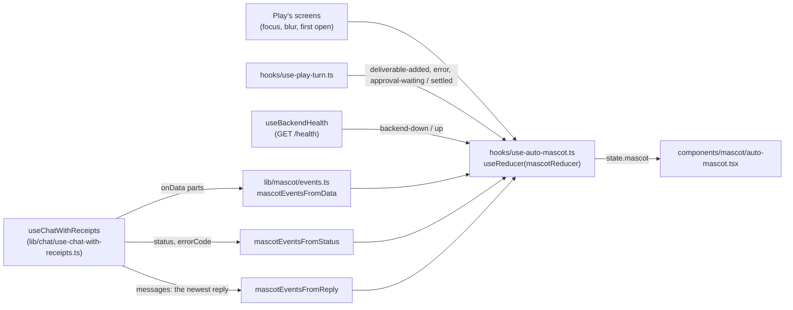

# Play Theme

<details>
<summary>Relevant source files</summary>

The following files were used as context for this page:

- [docs/PRDS/PRD-260-PLAY-THEME.md](docs/PRDS/PRD-260-PLAY-THEME.md)
- [frontend/app/layout.tsx](frontend/app/layout.tsx)
- [frontend/app/play-theme.css](frontend/app/play-theme.css)
- [frontend/app/play-fonts.ts](frontend/app/play-fonts.ts)
- [frontend/app/fonts/play/README.md](frontend/app/fonts/play/README.md)
- [frontend/app/chat/layout.tsx](frontend/app/chat/layout.tsx)
- [frontend/app/conversations/page.tsx](frontend/app/conversations/page.tsx)
- [frontend/app/deliverables/layout.tsx](frontend/app/deliverables/layout.tsx)
- [frontend/components/providers.tsx](frontend/components/providers.tsx)
- [frontend/components/layout/main-layout.tsx](frontend/components/layout/main-layout.tsx)
- [frontend/components/ui/theme-toggle.tsx](frontend/components/ui/theme-toggle.tsx)
- [frontend/components/looks/look-provider.tsx](frontend/components/looks/look-provider.tsx)
- [frontend/components/looks/use-look-store.ts](frontend/components/looks/use-look-store.ts)
- [frontend/components/mascot/auto-mascot.tsx](frontend/components/mascot/auto-mascot.tsx)
- [frontend/components/play/play-route-switch.tsx](frontend/components/play/play-route-switch.tsx)
- [frontend/components/play/shell/play-frame.tsx](frontend/components/play/shell/play-frame.tsx)
- [frontend/components/play/shell/play-sidebar.tsx](frontend/components/play/shell/play-sidebar.tsx)
- [frontend/components/play/shell/play-nav.ts](frontend/components/play/shell/play-nav.ts)
- [frontend/contexts/ui-style-context.tsx](frontend/contexts/ui-style-context.tsx)
- [frontend/hooks/use-studio-theme.ts](frontend/hooks/use-studio-theme.ts)
- [frontend/hooks/use-auto-mascot.ts](frontend/hooks/use-auto-mascot.ts)
- [frontend/hooks/use-mascot-player.ts](frontend/hooks/use-mascot-player.ts)
- [frontend/hooks/use-backend-health.ts](frontend/hooks/use-backend-health.ts)
- [frontend/hooks/use-media-preferences.ts](frontend/hooks/use-media-preferences.ts)
- [frontend/lib/ui-style.ts](frontend/lib/ui-style.ts)
- [frontend/lib/looks/catalogue.ts](frontend/lib/looks/catalogue.ts)
- [frontend/lib/looks/types.ts](frontend/lib/looks/types.ts)
- [frontend/lib/looks/presets.ts](frontend/lib/looks/presets.ts)
- [frontend/lib/looks/validate.ts](frontend/lib/looks/validate.ts)
- [frontend/lib/looks/contrast.ts](frontend/lib/looks/contrast.ts)
- [frontend/lib/looks/css.ts](frontend/lib/looks/css.ts)
- [frontend/lib/looks/studio-tokens.ts](frontend/lib/looks/studio-tokens.ts)
- [frontend/lib/looks/document.ts](frontend/lib/looks/document.ts)
- [frontend/lib/looks/prepaint.ts](frontend/lib/looks/prepaint.ts)
- [frontend/lib/looks/tone.ts](frontend/lib/looks/tone.ts)
- [frontend/lib/looks/storage.ts](frontend/lib/looks/storage.ts)
- [frontend/lib/looks/store.ts](frontend/lib/looks/store.ts)
- [frontend/lib/looks/editor.ts](frontend/lib/looks/editor.ts)
- [frontend/lib/looks/transfer.ts](frontend/lib/looks/transfer.ts)
- [frontend/lib/mascot/types.ts](frontend/lib/mascot/types.ts)
- [frontend/lib/mascot/reducer.ts](frontend/lib/mascot/reducer.ts)
- [frontend/lib/mascot/events.ts](frontend/lib/mascot/events.ts)
- [frontend/lib/mascot/player.ts](frontend/lib/mascot/player.ts)
- [frontend/lib/mascot/media.ts](frontend/lib/mascot/media.ts)
- [frontend/lib/mascot/ring.ts](frontend/lib/mascot/ring.ts)
- [frontend/lib/mascot/session.ts](frontend/lib/mascot/session.ts)
- [frontend/lib/mascot/tools.ts](frontend/lib/mascot/tools.ts)

</details>

## Purpose and Scope

For frontend developers working on the Play theme or on any page that renders under it.

**Play** is the third value of the Style axis (Classic · Studio · Play), added by PRD-260. It is the mascot theme ported from the `automatos-play` app: Play's frame, Play's own designs for the chat, Conversations, Deliverables, the look editor ("Make it yours"), the style sheet, the 404 and "Automatos is asleep", and **Auto**, the mascot, who reacts to what Auto is doing in the chat. Every other page renders Studio's version inside Play's frame, recoloured by the active **look**.

Play is opt-in. `DEFAULT_UI_STYLE` stays `'studio'` and `APPEARANCE_DEFAULTS_VERSION` is unchanged, so no browser is moved to Play (PRD-260 §7.1 is open). Play runs on the core's own data and hooks: there is no second data layer, no proxy and no backend change.

This page describes what the code on `feat/prd-260-play-theme` does. A path that doesn't start with `frontend/`, `docs/` or `scripts/` is under `frontend/`. Three stories of the wave (T-008a, T-008b, T-009) were built on parallel branches; their sections below are written from their acceptance criteria in `scripts/ralph/prd-260.json` and say so.

---

## The Style axis with Play

`frontend/lib/ui-style.ts` holds the axis: `UiStyle = 'classic' | 'studio' | 'play'`.

| Style | `<html>` classes (`styleHtmlClasses`) | `useIsStudio()` | `useIsPlay()` |
|---|---|---|---|
| Classic | none | false | false |
| Studio | `studio` | true | false |
| Play | `studio play` | **true** (D2) | true |

- **The cookie.** `automatos-style` (`UI_STYLE_COOKIE`, one year, `SameSite=Lax`) carries the style; `parseUiStyle` turns a missing or tampered value into the default (`studio`). `frontend/app/layout.tsx` reads it on the server and renders the classes on `<html>`, so the first paint is already the right design system. localStorage (`automatos-style`) mirrors it.
- **Switching.** `applyUiStyleToDocument` in `frontend/contexts/ui-style-context.tsx` toggles each class in `STYLE_HTML_CLASS_NAMES` (`studio`, `play`), writes the cookie and the mirror. It never touches the tone.
- **`studio` under Play.** Play keeps the `studio` class so Studio's stylesheet (`.studio {}` in `frontend/app/globals.css`) and every page that branches on `useIsStudio()` (`rendersStudio(style)` is true for Studio and Play) keep rendering Studio's layout. `useIsPlay()` (`frontend/hooks/use-studio-theme.ts`) is the switch for Play's frame and Play's pages. Both hooks read false outside the provider.
- **The theme menu.** `frontend/components/ui/theme-toggle.tsx` lists Classic, Studio and Play under Style. Only while Play is the style it adds **Customise look…**, a link to `/looks` (K9: the menu never switches style by surprise). Under Play the Tone items (Light, Dark, System) are disabled under the note "Set by your look", and the radio shows the tone in effect (`forcedTheme ?? theme`).

**Sources:** [frontend/lib/ui-style.ts](), [frontend/contexts/ui-style-context.tsx](), [frontend/hooks/use-studio-theme.ts](), [frontend/app/layout.tsx](), [frontend/components/ui/theme-toggle.tsx]()

---

## Which pages have a Play design

Play's frame and Play's pages render only at 1024 px and wider (D7). Each check uses `useIsTabletOrBelow()` (`frontend/hooks/use-mobile.ts`, max-width 1023 px).

| Page | Route | How it mounts under Play | Code |
|---|---|---|---|
| Chat | `/chat` | `app/chat/layout.tsx` wraps the page in `PlayRouteSwitch` (`paths: ['/chat']`, `keepPageFor: ['repo', 'runtime', 'mode']`) with `PlayChat` | `components/play/chat/`, `hooks/use-play-conversation.ts`, `hooks/use-play-turn.ts` |
| Conversations | `/conversations` (new) | `app/conversations/page.tsx`, a server component: redirects to `/chat` unless the style cookie is `play` (K10); `PlayConversations` sends the browser to `/chat` when the style leaves Play or the window is under 1024 px | `components/play/conversations/`, `hooks/use-conversation-list.ts`, `lib/play/conversations.ts` |
| Deliverables shelf | `/deliverables` | `app/deliverables/layout.tsx` wraps the page in `PlayRouteSwitch` (`paths: ['/deliverables']`, `keepPageFor: ['tab', 'post', 'artifact_type']`) with `PlayShelf` | `components/play/deliverables/`, `lib/play/shelf.ts`, `lib/play/seen.ts`, `hooks/use-shelf-mascot.ts` |
| A Deliverable | `/deliverables?deliverable=<id>` (K8) | `PlayShelf` renders `PlayDeliverable` for an id that passes the id pattern; any other value shows the shelf with a notice | `components/play/deliverables/play-deliverable.tsx`, `deliverable-content.tsx`, `detail-panel.tsx`; `lib/play/detail.ts`, `lib/play/draft.ts` |
| Make it yours | `/looks` | T-008a (see below) | `app/looks/page.tsx`, `components/looks/looks-screen.tsx` |
| Style sheet | `/looks/style` | T-008b (see below) | `app/looks/style/page.tsx`, `components/looks/style/style-screen.tsx`, `lib/looks/style.ts` |
| 404 | any unknown route | T-009 (see below) | `app/not-found.tsx`, `components/play/edges/lost-screen.tsx` |
| Automatos is asleep | any page in Play's frame | T-009 (see below) | `components/play/edges/asleep-screen.tsx` |
| Everything else | | `MainLayout` renders `PlayFrame` around the page; the page renders Studio's version (`isStudio` is true), recoloured by the look's Studio tokens | unchanged |

### The route switch (K7)

`frontend/components/play/play-route-switch.tsx` is the one seam a Play-designed page mounts through. It renders the `play` node instead of `children` when all of these hold: `useIsPlay()`, not `useIsTabletOrBelow()`, the pathname is one of `paths`, and none of the `keepPageFor` query parameters is present. Otherwise it renders the route's own page, exactly as before.

Why a layout and not the page: `scripts/check-changed-lines-eslint.js` fails on any touched line inside a function over the AGENTS.md limit, and the finding spans the whole function. `ChatPage` (`app/chat/page.tsx`) is far over the component limit, so the page file is never edited; the route's existing layout does the switching.

`keepPageFor` covers links into a surface only the core page has. On `/chat`: `repo` (the Code canvas), `runtime` (a session's runtime) and `mode` (plan mode). On `/deliverables`: `tab` (Blogs, Templates, Brand kit, Socials), `post` and `artifact_type`. With one of those present the core's page renders inside Play's frame, like every page without a Play design.

On `/deliverables`, the core's `DeliverableDeepLink` sheet is mounted inside the switch's `children`, so under Play it never opens over Play's Deliverable page (one detail, never two). Under Classic, Studio, and below 1024 px it opens as before.

### Play's frame

`MainLayout` (`components/layout/main-layout.tsx`) renders `PlayFrame` when `isPlay && !isMobileLayout`, before the Studio check. The Studio desktop shell was extracted into `StudioDesktopShell` so `MainLayout` stays under the component limit.

`PlayFrame` (`components/play/shell/play-frame.tsx`):

- **`PlaySidebar`**: the "Automatos Play" wordmark (to `/chat`); New chat (`useStartChat`: a new draft in the chat session store, then `/chat`; it hydrates the store itself and stays disabled until it is, so on any page the draft is never overwritten by the stored session and, in SaaS, no empty tab list is saved to the server; pressed over a new chat that is still unnamed, `stores/play-chat-store.ts` tells the chat to show a fresh one); the nav; Recent (`useRecentChats`: `getChatHistory`, at most 8, each to `/chat?chatId=<id>`); Docs and Settings at the foot; the connection pill.
- **The nav** (`components/play/shell/play-nav.ts` `buildPlayNav`) is built from `lib/studio-menu.ts` (`STUDIO_MENU_PRIMARY`, `STUDIO_MENU_FOOTER`) with the filters `StudioSidebar` applies: the edition's route list (`filterNavForEdition`), the admin role gate, and the plan-tier exposure (`isNavItemVisible`). Play adds two items: Conversations right after Chat, and Look (`/looks`) last, on its own.
- **The connection pill** reads `useBackendHealth` (`hooks/use-backend-health.ts`): `GET /health` through `apiClient`, polled every `BACKEND_HEALTH_POLL_MS` (30 s). A failed ask is repeated `BACKEND_HEALTH_RETRIES` times (3), `BACKEND_HEALTH_RETRY_DELAY_MS` apart (2.5 s), before the backend counts as down, so a blip (a wake from sleep, a Wi-Fi hand-over, one 502) never reads as down; while those retries run after an earlier answer the pill stays "Connected" (P260-RVW-1). Each ask gives up after `BACKEND_HEALTH_TIMEOUT_MS` (5 s: apiClient's own wait of up to 2 s for a Clerk token runs inside it) and counts as a failure, so a frozen backend that takes the connection and never answers reads as down too, at worst 4 × 5 s + 3 × 2.5 s = 27.5 s after the ask began (P260-FX-21). Once every retry has failed it stays down until the next answer, also while it is asked again (react-query reads a query that never answered as loading again then) and on the first render of a hook that mounts then. It says "Connected · <host>", "Not running" or "Checking…".
- **The header row**: a Search button that opens the ⌘K dialog (`openGlobalSearch`), and `StudioHeaderUtilities` (Help, notifications, the theme menu, the profile control for the edition).
- **The page**: `fullBleed` (no padding, no width cap: the chat) or padded with the Studio shell's 1720 px cap. The floating Auto widget renders as in the Studio shell (every page except `/chat`).

### Below 1024 px

Play's frame, the route switch and `/conversations` all step aside below 1024 px, and `MainLayout` falls through to the same fallback chrome Studio gets there. The look itself is not width-gated: the pre-paint script, the `LookProvider` and `app/play-theme.css` apply under `html.play` at any width, so the fallback chrome under Play takes the look's colours.

**Sources:** [frontend/components/play/play-route-switch.tsx](), [frontend/app/chat/layout.tsx](), [frontend/app/deliverables/layout.tsx](), [frontend/app/conversations/page.tsx](), [frontend/components/layout/main-layout.tsx](), [frontend/components/play/shell/play-frame.tsx](), [frontend/components/play/shell/play-nav.ts](), [frontend/hooks/use-backend-health.ts]()

---

## Looks

### A look is data, not code

A look is a JSON object of exactly eleven fields (`LOOK_FIELDS` in `frontend/lib/looks/types.ts`). It names catalogue keys and one number. It never holds a colour, a font name, CSS or a URL, so a shared look can't inject styles or load anything, and every look made from the catalogue can only produce colour pairs the tests have checked.

| Field | Rule |
|---|---|
| `schema` | exactly `"automatos-interface-look/v1"` (`LOOK_SCHEMA`) |
| `id` | `LOOK_ID_PATTERN`: 1 to 64 letters, digits, dashes or underscores, starting with a letter or digit |
| `name` | one line of plain text, 1 to 40 characters after trimming |
| `sub` | one line of plain text, 0 to 40 characters after trimming |
| `interface` | exactly `"play"` (`LOOK_INTERFACE`) |
| `ground` | a key of `GROUNDS` |
| `accent` | a key of `ACCENTS` |
| `font` | a key of `TYPE_STYLES` |
| `shell` | a key of `SHELLS` |
| `light` | a key of `LIGHTS` |
| `glow` | a whole number from 0 to 40 (`GLOW_MIN`, `GLOW_MAX`) |

### The catalogue

`frontend/lib/looks/catalogue.ts` is the Ember catalogue, copied from Play's design. It is the only file in the frontend allowed to hold literal colours (the guard test, below).

| Section | Keys (name) |
|---|---|
| Grounds (`GROUNDS`: bg, surface, text, text2, line, chip, panel) | `graphite` (Graphite), `obsidian` (Obsidian), `indigo` (Night), `paper` (Paper) |
| Accents (`ACCENTS`: hex, ink) | `molten` (Molten), `cream` (Cream), `mint` (Mint), `gold` (Gold), `periwinkle` (Periwinkle), `rose` (Rose) |
| Type styles (`TYPE_STYLES`) | `serif` (Editorial: Instrument Serif italic 400), `clean` (Clean: Geist 600), `bric` (Characterful: Bricolage Grotesque 700), `round` (Playful: Fredoka 600) |
| Auto's shell (`SHELLS`: hex, filter) | `bronze`, `gold`, `silver`, `cobalt` |
| Auto's light (`LIGHTS`) | `mint`, `amber`, `ice`, `rose` |
| Fixed | `ERROR_COLOUR` `#FF6B6B`: errors are coral in every look |

- An accent carries its own **ink**, the text colour on a button filled with it.
- A type style is the **display** type only (headings, Auto's caption, card titles, the brand). Reading text is Geist and code is Geist Mono in every look. Its `family` is the face's `next/font` variable (`var(--pl-font-instrument-serif),serif`), because `next/font` renames families; `face` keeps the design's name for the style sheet.
- There is one set of mascot renders (bronze). A shell is a CSS **filter** on Auto's clip and still (`none`, or a `hue-rotate`/`saturate`/`brightness`/`grayscale` chain).
- `isKeyOf` checks own keys only, so `toString` or `__proto__` are never catalogue entries.

### The presets

`frontend/lib/looks/presets.ts`. Presets live in code: they can't be saved over, renamed or deleted. `DEFAULT_LOOK` is Ember.

| id | Name | sub | ground | accent | font | shell | light | glow |
|---|---|---|---|---|---|---|---|---|
| `ember` | Ember | Warm, editorial | graphite | molten | serif | bronze | mint | 24 |
| `obsidian` | Obsidian | Mono, minimal | obsidian | cream | clean | bronze | mint | 6 |
| `aurora` | Aurora | Cool and glassy | obsidian | mint | bric | bronze | ice | 20 |
| `workshop` | Workshop | The original | indigo | molten | round | bronze | mint | 14 |
| `daylight` | Daylight | For daytime | paper | molten | serif | bronze | mint | 10 |

### Validation

`validateLook(input)` in `frontend/lib/looks/validate.ts` is the one gate for a look from outside the code. It is pure and returns `{ ok: true, look }` or `{ ok: false, errors }`, every problem at once, as plain sentences. It refuses anything that isn't a JSON object; any unknown field (the first five named, the rest counted); a wrong `schema` or `interface`; an `id` that breaks the pattern; a `name` that is blank or only invisible characters; a `name` or `sub` over 40 characters or holding control characters, line or paragraph separators, bidi overrides and isolates, zero-width spaces or a BOM (ZWJ and ZWNJ stay allowed); a catalogue field that isn't an own key; a `glow` that isn't a whole number from 0 to 40. Error messages quote at most 40 characters of input, with unsafe characters shown as `?`. The look it returns is a fresh object holding only the known fields, `name` and `sub` trimmed.

It runs on every look read from storage, every import, and every save or rename. The pre-paint script runs its own smaller check (below).

### Storage, state and the editor rules

- **Storage** (`frontend/lib/looks/storage.ts`), per browser, in localStorage: `automatos-play.looks` (the saved looks, a JSON array) and `automatos-play.look` (the active look, whole, so an unsaved edit survives a reload). A stored look that fails validation is skipped with a console warning; a saved look whose id is a preset's or a duplicate is skipped. Blocked or full storage means Play runs in Ember and nothing is kept. Nothing about looks is sent to the backend.
- **State** (`frontend/lib/looks/store.ts`, `components/looks/use-look-store.ts`): a pure reducer (`loaded`, `set`, `save`, `delete`, `rename`). Storage is read after mount and written back only when the user changed that part, so a read never rewrites what is stored. Deleting the active look switches Play back to Ember. `saveLook` refuses a preset id ("A preset can't be changed. Save it as a new look instead.") and validates before saving.
- **Editor rules** (`frontend/lib/looks/editor.ts`, pure): `EDITABLE_FIELDS` are ground, accent, font, shell, light, glow. `statusLine` reads "Ember" or "Ember · edited". Save as new look makes id `look-N` (the lowest free N), name "My look N", sub "Saved just now". `asDuplicate` names a copy "<name> copy", then "copy 2" and so on. `glowLabel` reads "Off" at 0, else "24%".

### Export and import

`frontend/lib/looks/transfer.ts`. A file or pasted text is untrusted input.

- **Export**: `lookJson` writes the eleven fields only, in format order, pretty-printed; `lookFileName` is `<name>.look.json` with characters a file system refuses turned into dashes.
- **Import**: anything of 1 MB or more (`LOOK_FILE_MAX_BYTES`; a file's `size`, or a paste's length) is refused before it is read or parsed. Then `JSON.parse`, then `validateLook`; a valid import gets a fresh id (`freshLookId`), so it never replaces a look the user has. Its own messages: `TOO_BIG`, `NOTHING_TO_IMPORT`, `NOT_JSON`, `UNREADABLE`.

**Sources:** [frontend/lib/looks/types.ts](), [frontend/lib/looks/catalogue.ts](), [frontend/lib/looks/presets.ts](), [frontend/lib/looks/validate.ts](), [frontend/lib/looks/storage.ts](), [frontend/lib/looks/store.ts](), [frontend/lib/looks/editor.ts](), [frontend/lib/looks/transfer.ts]()

---

## From a look to the page

A look becomes two sets of CSS custom properties, both set inline on `<html>` and only under Play.

### Play's variables: `--pl-*` (K2)

`lookToCssVars(look)` in `frontend/lib/looks/css.ts`. Every name is prefixed `--pl-`: Play's own `--accent` and `--ring` would clobber Studio's HSL tokens of the same names, and the prefix is total so no later clash can arise.

| Variables | From |
|---|---|
| `--pl-ground-bg`, `-surface`, `-text`, `-text-2`, `-line`, `-chip`, `-panel` | the ground |
| `--pl-sheet-bg`, `--pl-sheet-text` | a Deliverable's printed sheet (`sheetOf`): on a dark ground the ground's text colour with its bg as ink, on Paper the surface |
| `--pl-auto-dusk` | Auto's ring asleep or lost: text2 mixed 55% toward bg (`duskOf`) |
| `--pl-error`, `--pl-error-text` | the fixed coral, and coral as readable text on this ground |
| `--pl-accent`, `--pl-accent-ink`, `--pl-accent-line`, `--pl-accent-fill` | the accent, its ink, and the accent at 45% and 12% alpha |
| `--pl-accent-text`, `--pl-sheet-accent` | the accent as readable text on the ground, and on the sheet |
| `--pl-display-family`, `-style`, `-weight`, `-tracking`, `-hero`, `-brand`, `-status`, `-card` | the type style |
| `--pl-auto-shell`, `--pl-auto-shell-filter` | the shell's hex and filter |
| `--pl-auto-light` | the light: Auto's eyes, his calm ring, the "connected" dot |
| `--pl-glow` | the accent at `glow / 100` alpha |

**Readable text colours.** The raw accents and coral are fine as fills and rings on every ground and as text on the three dark grounds, but fail as text on Paper (molten is 2.49:1 on `#F4EEE8`). `readableOn(colour, bg, surface, text)` in `frontend/lib/looks/contrast.ts` keeps the colour when it reads at 4.8:1 (`READABLE_TARGET`, a margin over AA's 4.5) on both bg and surface, else mixes it toward the ground's text in 2% steps until it does. On Paper, molten text becomes `#AA4C1C` and coral text `#A54B49`.

`frontend/app/play-theme.css` is Play's one global stylesheet (K5), imported by `app/layout.tsx`. Every rule sits under `html.play`; it maps the look's variables to Play's tokens (`--pl-color-*`, `--pl-text-*`, spacing, radii, motion, layout) and holds the base rules: `body` takes the look's ground, colour and page glow but **not** a font, so a Studio page under Play is recoloured, never re-typeset; unclassed links take `--pl-color-accent-text`; a zero-specificity `:focus-visible` outline in the accent text colour; reduced motion stops animations and transitions. Play's components style themselves with CSS Modules beside each component, reading only `--pl-*`.

### Studio's tokens (D3)

`lookToStudioTokens(look)` in `frontend/lib/looks/studio-tokens.ts` writes Studio's own tokens, so every Studio page under Play takes the look's colours with no change to it. Values are HSL triplets `H S% L%` (Tailwind reads `hsl(var(--x))`), converted by `frontend/lib/looks/hsl.ts`; the aliases `frontend/app/globals.css` writes pre-wrapped are written as `hsl(...)`.

| Tokens | From |
|---|---|
| `--background`, `--background-gradient-from`, `--background-gradient-to` | the ground's bg |
| `--foreground`, `--card-foreground`, `--popover-foreground`, `--secondary-foreground` | the ground's text |
| `--card`, `--popover` | the ground's surface |
| `--secondary` | the chip composited over the bg |
| `--muted`, `--cc-hover` | the chip composited over the surface |
| `--muted-foreground` | text2 |
| `--border`, `--input` | the line composited over the bg |
| `--glass-border-hover`, `--cc-hover-border` | the border mixed 15% toward the text |
| `--paper`, `--bg-1`, `--bg-2`, `--fg`, `--fg-2`, `--fg-3`, `--border-2` (wrapped) | surface, bg, secondary, text, text2, faded text2 (toward bg while still readable), strong border |
| `--primary`, `--accent`, `--ring` | the readable accent (`studioAccent`: `readableOn` of the accent on this ground) |
| `--primary-foreground`, `--accent-foreground` | the accent's ink when the raw accent reads, else the ground's bg |
| `--accent-2` (wrapped, with alpha) | the readable accent at 0.14 on a dark ground, 0.10 on Paper |

The semantic tokens (destructive, success, warning, info, agent, `chart-*`, `stage-*`) are **not** set: the tone follows the ground (below), so Studio's own Light or Dark values apply and match it.

### On `<html>`, only under Play (K3)

`frontend/lib/looks/document.ts`:

- `lookDocumentVars(look)` is `lookToCssVars` plus `lookToStudioTokens`; `applyLook` sets them as inline custom properties on `<html>`. Inline values outrank `.studio` and `.studio.dark`.
- `applyMotion` sets `data-pl-motion` (`reduce` or `full`) and `--pl-motion` (`0` or `1`).
- `clearLook` removes every name in `LOOK_DOCUMENT_NAMES` (`LOOK_VAR_NAMES`, `STUDIO_TOKEN_NAMES`, `--pl-motion`) and the motion attribute. Other inline styles stay.

`LookProvider` (`frontend/components/looks/look-provider.tsx`) sits inside `UiStyleProvider` in `components/providers.tsx`. While the style is Play it applies the motion marks at once and the look once storage has been read (until then the pre-paint values stand, so the default never flashes). When the style is not Play, and on unmount, it calls `clearLook`, so Classic and Studio are exactly as before. `useLook()` exposes the look, the saved looks, `reducedMotion`, the tone and `setLook`, `saveLook`, `deleteLook`, `renameLook`; every page follows a change at once because the variables live on `<html>`.

### The contrast guarantee

`frontend/lib/looks/__tests__/contrast.test.ts` holds all 24 ground × accent pairs to WCAG AA. For Play's variables: text and text2 on bg and surface, the accent's ink on the accent, the derived accent and error text on bg and surface, and the sheet's text and accent on the sheet. For Studio's tokens: each `-foreground` on its background, `--muted-foreground` on the background, card and muted, `--primary` as text on the background and the card, `--fg-3` on `--bg-1` and `--paper`, and `--ring` at 3:1 (non-text) on the background. It also pins the ratios measured on 14 Oct (Graphite text on bg 16.36:1, text2 on bg 8.54:1, molten's ink on molten 6.74:1, Paper text2 on bg 5.12:1). `lib/looks/__tests__/studio-tokens.test.ts` checks every token is a valid triplet or wrapped alias for all 24 pairs and that no Studio token name is a `--pl-*` name.

**Sources:** [frontend/lib/looks/css.ts](), [frontend/lib/looks/contrast.ts](), [frontend/lib/looks/studio-tokens.ts](), [frontend/lib/looks/hsl.ts](), [frontend/lib/looks/document.ts](), [frontend/components/looks/look-provider.tsx](), [frontend/app/play-theme.css]()

---

## The first paint: pre-paint script, tone and fonts

```mermaid
sequenceDiagram
    participant Server as app/layout.tsx (server)
    participant Head as head: LOOK_PREPAINT_SCRIPT
    participant NT as next-themes (ThemeProvider)
    participant LP as LookProvider (after hydration)

    Server->>Server: read automatos-style and automatos-play-tone cookies
    Server->>Head: html class "studio play"; script rendered only when the style is play
    Head->>Head: read automatos-play.look from localStorage, check it, else Ember
    Head->>Head: set --pl-* and Studio tokens inline on html
    Server->>NT: forcedTheme = the tone cookie (playToneFor)
    NT->>NT: dark or light class before paint
    LP->>LP: read storage, applyLook, applyMotion
    LP->>NT: onToneChange(toneOfGround(look.ground)), write the tone cookie
```

### The pre-paint script (D4)

`LOOK_PREPAINT_SCRIPT` in `frontend/lib/looks/prepaint.ts` is the one `dangerouslySetInnerHTML` the wave adds, rendered in `<head>` by `app/layout.tsx` only when the style cookie says `play`; the script also returns at once when `<html>` lacks the `play` class.

- Its body is a constant built at module load. `prepaintTable()` precomputes every catalogue entry's variables through the same builders `lookToCssVars` and `lookToStudioTokens` use: `g` per ground (Play's ground variables plus Studio's ground tokens), `a` per accent, `x` per ground × accent (the readable accent text plus Studio's accent tokens), `f`, `s`, `l` per type style, shell and light, `r` each accent's `r,g,b` for the glow, and `d` the default look. `scriptSafeJson` escapes `<`, U+2028 and U+2029.
- At run time its only input is the stored active look. It is used only when `schema` and `interface` match and `ground`, `accent`, `font`, `shell`, `light` are own keys of the table and `glow` is a whole number from 0 to 40; otherwise, or when storage throws, it paints Ember. It does not check `id`, `name` or `sub`: a look `validateLook` refuses only for those paints here, then gives way to Ember once the `LookProvider` reads storage.
- It writes custom properties only, never markup, and never user text into the script.

### The tone follows the ground (K4)

Under Play the look's ground sets Light or Dark: Graphite, Obsidian and Night force Dark, Paper forces Light (`toneOfGround`: a ground whose bg is darker than its text is dark). This matters because Studio's semantic tokens and the `dark:` classes must match the ground.

- `frontend/lib/looks/tone.ts`: the cookie `automatos-play-tone`, `'dark' | 'light'`, parsed strictly (`parsePlayTone`); `playToneFor(style, cookie)` returns a tone only when the style is `play`.
- `components/providers.tsx` keeps `playTone` in state, starting from the server's value, and passes it to next-themes' `ThemeProvider` as `forcedTheme`. `forcedTheme` forces the class without overwriting the stored tone (`automatos-theme`), so leaving Play restores the user's own Light, Dark or System.
- `LookProvider` writes the cookie and hands the tone up once storage is read; when the style leaves Play it deletes the cookie (only if one exists, so Classic and Studio loads write nothing) and hands up `undefined`.
- The pre-paint script does not set the tone: next-themes' own script owns the `dark`/`light` class, and gets the forced tone from the cookie through the server.
- Toasts follow the tone in effect (`components/ui/sonner.tsx` reads `forcedTheme ?? theme`).

### The fonts (K6)

Play's display faces are vendored latin woff2 files in `frontend/app/fonts/play/` with their SIL OFL 1.1 licences (Instrument Serif 400 normal and italic, Bricolage Grotesque 700, Fredoka 600), loaded with `next/font/local` in `frontend/app/play-fonts.ts` under the variables `--pl-font-instrument-serif`, `--pl-font-bricolage` and `--pl-font-fredoka`, all `preload: false`. `app/layout.tsx` puts the three variable classes on `<html>` for every style; a file downloads only when a Play type style uses it, so Classic and Studio pay nothing. Geist and Geist Mono reuse the core's `--font-geist-sans` and `--font-geist-mono`. Never `next/font/google` for these (the Turbopack build trap) and never an `@fontsource` package.

**Sources:** [frontend/lib/looks/prepaint.ts](), [frontend/lib/looks/tone.ts](), [frontend/components/providers.tsx](), [frontend/app/layout.tsx](), [frontend/app/play-fonts.ts](), [frontend/app/fonts/play/README.md]()

---

## Auto

Auto is a state machine ported from Play (`frontend/lib/mascot/`), fed from the core chat's own events, and drawn by `frontend/components/mascot/auto-mascot.tsx`.

### States and priority

`frontend/lib/mascot/types.ts`: 12 states: `hello`, `idle`, `listening`, `thinking`, `working`, `searching`, `reading`, `celebrate`, `oops`, `sleeping`, `lost`, `loading`.

- `ONE_SHOTS` (`hello`, `celebrate`) play once, then return to idle or to what was queued.
- `URGENT` (`oops`, `hello`) swap at once instead of waiting for the clip boundary.
- `RANK` decides when several reasons hold: oops 8 > one-shots 7 > listening while waiting for the owner 6 > searching = reading 5 > working 4 > thinking 3 > listening while typing 2 > idle 1 > sleeping and lost 0, so any activity wakes him.

`mascotReducer` (`frontend/lib/mascot/reducer.ts`) is pure: no timers, no DOM. While `backendDown` it ignores everything but `backend-up`, `not-found` and `clip-ended`.

### From the core chat to Auto



| What happens in the core | Auto's event | What Auto shows |
|---|---|---|
| `status` goes to `streaming` (a send, or an awaited reply after a reload) | `send` | thinking |
| `status` goes from `streaming` to `idle` | `finish` | thinking or a tool state settles to idle; celebrate if the turn had a done receipt |
| the newest reply's words start while the chat streams and no tool runs on it (`replyProgress` → `mascotEventsFromReply`, once per reply) | `text` | thinking → idle |
| `status` goes from `streaming` to `idle` with an `errorCode` (a blocked turn, e.g. `trial_exhausted`) | `error` | oops |
| `status` goes to `error` | `error` | oops |
| `tool-start` part | `tool-start` | searching, reading or working, by `toolActivity(toolName)` (`lib/mascot/tools.ts`) |
| `tool-end` part | `tool-end` | waiting → listening; failed and not skipped → oops; otherwise the highest tool still open, or idle |
| `tool-data` part with the receipts frame (read by `lib/chat/receipts.ts`) | `receipts` | a done receipt marks celebrate-on-finish; a refused receipt → oops |
| `memory-injected` part | `memory-injected` | reading |
| `workflow-update` part | `workflow-update` | working |
| `mission-suggestion`, `data-usage`, `agent-info`, an unknown or malformed part | nothing | unchanged |
| the message box gets or loses focus | `input-focus` / `input-blur` | listening (typing) / back to idle |
| the first open of Play's chat in this browser session (`claimFirstOpen`, sessionStorage `automatos-play.hello-played`; once per page load where sessionStorage is blocked) | `app-open` | hello |
| a part names a new Deliverable (`usePlayTurn`, once per id) | `deliverable-added` | celebrate |
| the newest reply failed in words (`usePlayTurn`, once per reply) | `error` | oops |
| a reply raises an approval: `tool_approval` or `mission_approval` in a `tool-data` part (`usePlayTurn`, once per grant or Mission) | `approval-waiting` | listening (above the turn's tools and thinking); while a card waits he rests on listening instead of idle and never naps |
| every approval card is answered or closed | `approval-settled` | what the turn shows without the card: a tool still running (its start was outranked by the card), thinking while the turn runs and neither its words nor a tool have started, otherwise idle |
| `useBackendHealth` reports down / connected | `backend-down` / `backend-up` | sleeping until up / idle |
| no key, pointer, wheel or touch input for 3 minutes (`useIdleTimeout`, `IDLE_MS`) / the next input | `idle-timeout` / `wake` | sleeping (a nap, not during a turn) / idle |

The core's `useChat` hands its data callback no per-word event: it writes the words into the reply. So the start of the answer is read from the reply itself. `replyProgress(messages)` (`components/play/chat/message-text.ts`) gives the newest message when it is a reply (none while a turn still awaits its reply, so the previous turn's words never count), whether its words have started and whether one of its tool calls runs; `mascotEventsFromReply` turns the words starting, while the chat streams and no tool runs, into one `text` event, which ends thinking as in the standalone Play app. Words that start while a tool runs change nothing: the tool's state wins, and its end settles Auto. Every part is checked field by field in `lib/mascot/events.ts`; a part that isn't what it says maps to nothing.

`toolActivity` matches exact names first (`SEARCHING_TOOLS`, `READING_TOOLS`, `WORKING_TOOLS`), then the patterns `/web_|browse_marketplace/` (searching) and `/document|knowledge|memor|semantic|graph/` (reading); anything else is working. It is the only place in the frontend that knows tool names.

### The clips and the player

The 36 files are committed under `frontend/public/auto/`: each state as `<state>.webm` (VP9 with alpha), `<state>.mp4` (HEVC with alpha) and `<state>.png` (the poster and the reduced-motion still), served from `/auto` (`MASCOT_DIR`).

- **The format rule** (`videoFormat` in `lib/mascot/media.ts`): Safari and every iOS browser get `.mp4`, everything else `.webm`. iPadOS asking for a desktop site sends a Mac user agent, so a `Macintosh` agent with more than one touch point also gets `.mp4`. The choice is by browser, not `canPlayType`: each engine plays the other format but drops the alpha channel and shows a black box.
- **The player** (`lib/mascot/player.ts`, `hooks/use-mascot-player.ts`): every clip is 5 s (`CLIP_MS`). The `<video>` has no `loop` attribute; a loop restarts itself at the clip boundary (within 80 ms of the end on `timeupdate`, or on `ended`). A new target waits for the boundary unless it is urgent or the previous one-shot has finished; going back to the clip on screen cancels the queue, so a 200 ms tool call never shows. When a one-shot's clip ends the player reports `clip-ended` to the reducer.
- **`AutoMascot`**: a muted, `autoPlay`, `playsInline` `<video>` with the PNG as poster, keyed by state. Under reduced motion, on the server (`usePrefersReducedMotion` reads true and `useVideoFormat` null there), and after any clip fails to play, it shows the state's PNG instead; with no video a one-shot ends on a 5 s timer. The stage is `role="img"` named by the caption; the caption is a polite live region.
- **The ring** (`lib/mascot/ring.ts`, drawn from `data-ring` by `components/mascot/auto-mascot.module.css`): the light when calm (hello, idle, listening, celebrate), the accent when busy (thinking, working, searching, reading), coral for oops, dusk for sleeping and lost, text2 while loading.
- **The shell** is `filter: var(--pl-filter-shell)` on the clip and the still; the ring is drawn by the page, so the filter never touches it.
- **The page glow** (`pageGlow` in `lib/mascot/media.ts`): `data-glow` on Auto's stage (`calm`, `busy`, `bright`, `snag`, `off`) drives `body:has([data-glow=…])` in `app/play-theme.css`, which crossfades the accent glow behind the page (brighter while he works, brightest for hello and celebrate, coral on a snag, off while he sleeps).
- **The caption** (`captionFor`): "Hi, I'm Auto.", "Ready when you are", "Listening", "Thinking", "Working on it", "Searching the web", "Reading", "All done" (or "Your <kind> is ready"), "Something went wrong", "Automatos isn't running", "I can't find that page", "Loading". The chat adds detail (`components/play/chat/caption.ts`): the running tool's query, "It's on your shelf too." after a Deliverable, "Waiting for your answer on the card." while an approval card waits, and "Having a little nap" / "Move or type to wake me." for the idle nap.

### Where Auto appears

- The chat: Auto's column beside the conversation (`PageColumns`, `MascotColumn` in `components/play/shell/page-columns.tsx`), large on the first open ("Hi, I'm Auto." with three example chips that fill the message box).
- The shelf's header (`hooks/use-shelf-mascot.ts`): proud of the count while idle, celebrating once for a Deliverable this browser hasn't seen (`lib/play/seen.ts`, localStorage `automatos-play:seen-deliverables`), oops when the shelf fails to load, asleep while `/health` doesn't answer.
- Conversations: idle in the mascot column.
- The style sheet, the 404 and the asleep screen (T-008b, T-009, below).

**Sources:** [frontend/lib/mascot/types.ts](), [frontend/lib/mascot/reducer.ts](), [frontend/lib/mascot/events.ts](), [frontend/lib/mascot/tools.ts](), [frontend/lib/mascot/player.ts](), [frontend/lib/mascot/media.ts](), [frontend/lib/mascot/ring.ts](), [frontend/lib/mascot/session.ts](), [frontend/hooks/use-auto-mascot.ts](), [frontend/hooks/use-mascot-player.ts](), [frontend/hooks/use-idle-timeout.ts](), [frontend/hooks/use-media-preferences.ts](), [frontend/components/mascot/auto-mascot.tsx]()

---

## Play's pages on the core's data

All data comes through the core's existing hooks and `lib/chat/api.ts` (`apiClient` underneath). Play's own proxy routes, API client and stream parser are not ported (D5).

- **Chat** (`components/play/chat/`, `hooks/use-play-conversation.ts`): `usePlayConversation` loads the conversation as `app/chat/page.tsx` does (the chat session store, a `?chatId=` deep link once per value, a cold start on the newest chat, `getChat` + `getChatMessages`, a gone chat closed with a toast) and keeps a new chat on screen when the backend names it mid-turn (once, and only for the new chat on screen: a later move to that conversation loads it from the server). Sending, streaming and Stop go through `useChatWithReceipts`; Stop calls its `stop()`, which also cancels the turn on the server. Stop keeps what Auto had written, as the approved Play app does (decision F4, P260-FX-30): `useChat` drops the reply it was writing when the request is aborted, as Studio's chat still shows it, so Play keeps a copy (`hooks/use-stopped-reply.ts`, without editing `lib/chat/hooks.ts`): Stop takes the reply as it is on screen, and the conversation Play shows (the list on screen and the one `usePlayTurn` reads) puts it back after the message it answered, where it stays through the turns that follow, until the chat screen mounts again. It reads "You stopped this answer." under its words, a tool call it left running reads "Stopped: …", the approval cards it raised stay in it, Auto leaves thinking, and the next message streams normally. A reply shows Play's tool lines (`components/play/chat/tool-lines.tsx`, `labels.ts`: running, done with its time, failed, "Waiting for you", skipped, and stopped for a call left running on a finished reply), "What Auto did" receipts (`receipts.tsx`), a Deliverable card with Open to `/deliverables?deliverable=<id>` (`deliverable-card.tsx`, ids checked against the id pattern first), and "I hit a snag" with Try again (the hook's `reload()`) on the newest failed reply (`snag-box.tsx`). The card comes from the turn's live tool-data part: a reopened conversation's reply shows no Deliverable card, because receipts don't link Deliverables yet (`receipts.py`, decision F8, backend); `deliverables.ts` already reads a receipt link that names one, a path or the absolute `open_url`, keeping only the checked id and linking the core's page relatively. A failed turn the server saved (`source.origin` `turn_error`, reloaded or detached) is that failure, not an answer: its words without the ⚠️ in the snag box, with Try again when it is the newest (`savedTurnError` in `message-text.ts`), and Try again sends the owner's last message from its text parts when it was loaded from the server (`lib/chat/retry.ts`: stored rows carry parts, not content). A reply the turn didn't write shows who did under Auto's name (`provenanceOf`: `metadata.source`, "Auto · background"), as Studio's badge does. A Mission suggestion renders the core's `MissionSuggestionCard` and `MissionCreatedCard` behind `useMissionStore`'s `activePlanningMissionId` gate, as the core chat does. An approval the turn raises (`tool_approval`, `mission_approval`, read by `components/play/chat/approvals.ts` as `chat.tsx` reads them, ids checked first) shows inside the reply as the core's own `ToolApprovalWidget` ("Action approval needed") and `MissionApprovalWidget` ("Mission plan — approval needed") (`approval-cards.tsx`), so Approve & run, Deny and Reject are Studio's calls (`useGrantApproval`, `useDenyApproval`, `useApproveMission`, `useRejectMission`); the cards draw on Studio's tokens, so the look colours them. A tool card shows its outcome once answered (its `onDecided`); a Mission card leaves the reply after a decision, as it leaves Studio's canvas. A card outlives its reply: `useChat` drops the reply when the request fails mid-turn and Try again replaces it, but the grant or Mission still waits on the server, so the card (`looseApprovals`) shows after the conversation, in the conversation's column (`TurnEnd`'s `before`), under "Approvals still open" while it waits and under "Approvals" once answered, until it is closed, as Studio's widget stays on its canvas; Auto listens while it waits. The cards outlive the chat screen too: they live in `stores/play-approvals-store.ts` by conversation (a new chat's under '' until the backend names it), not in the keyed screen, so leaving the chat or switching conversation and coming back shows them again (loose when the server's copy of the reply has its own id), and Auto listens again while one waits. Like Studio's widgets, they are held in memory only: they hold across navigation, not across a reload, so a reloaded page doesn't show them again. A spent trial shows the core's `TrialExhaustedBanner`.
- **Conversations** (`components/play/conversations/`): `useConversationList` (`getChatHistory`, 50), grouped Today, This week, Earlier (`lib/play/conversations.ts`), a title search, New chat; a row opens `/chat?chatId=<id>`.
- **Shelf** (`components/play/deliverables/play-shelf.tsx`): "Your shelf" with the count, type chips over the list's `artifact_type`, a grid with the newest in the spotlight, Load more through `useDeliverables`' next page (24 per page), loading, empty (Start a chat) and error (Try again) states, and a "More in Deliverables" line linking Blogs, Templates, Brand kit, Socials (while offered) and Explorer, so the core's sections stay in reach.
- **A Deliverable** (`components/play/deliverables/play-deliverable.tsx`): the Shelf back link, title, type, date and "Made by"; text and markdown on Play's sheet through the core's `MarkdownView` with no raw HTML and images as alt text; pictures and videos through `useAuthenticatedBlobUrl`; anything else as a file card with Download; the side panel (`components/play/deliverables/detail-panel.tsx`) with Ask Auto about this, Download, and About this Deliverable. Ask Auto about this links to `/chat?draft=<words>` (`lib/play/draft.ts`): the core has no way to attach a Deliverable to a message, so the words go into a new chat's message box once.

---

## Make it yours and the style sheet (T-008a, T-008b)

Written from the acceptance criteria of T-008a and T-008b (built on parallel branches); check against the code once merged.

- **`/looks`, Make it yours** (`frontend/app/looks/page.tsx`, `frontend/components/looks/looks-screen.tsx` and its parts, ported from Play's `LooksScreen`, `LooksRow`, `LookPreview`, `LookEditor`, `LookOptions`, `LookManager`, `LookImport`, `LookNotice`): the five presets and the saved looks in a row; a live preview with Auto; the editor over `EDITABLE_FIELDS` (ground, accent, type, shell, light, glow 0 to 40); Save, Save as, Rename and Delete for saved looks; Export as a `.look.json` download; Import from a file or pasted text through `lib/looks/transfer.ts`, its messages shown. Everything goes through `useLook()`, so every page follows a change at once.
- **`/looks/style`, the style sheet** (`frontend/app/looks/style/page.tsx`, `frontend/components/looks/style/style-screen.tsx` with its colour, type, scale, motion, components and mascots sections; the data in `frontend/lib/looks/style.ts`, pure): the active look's colour, type, scale, motion, components and Auto's states. Auto's states use `AutoMascot`, every state's PNG under reduced motion.
- **Under Classic or Studio** both routes render a short note ("Make it yours is part of the Play theme.") with a **Switch to Play** button that calls `setStyle('play')` (K9): no redirect, no loop.

## The 404 and "Automatos is asleep" (T-009)

Written from the acceptance criteria of T-009 (built on a parallel branch); check against the code once merged.

- **`frontend/app/not-found.tsx`** is new (the base had none, so Next's default 404 showed). It is a server component that exports `metadata` with Next's own 404 title, `NOT_FOUND_TITLE` ("404: This page could not be found."), so every style's tab and screen reader say it, not the app's title (P260-FX-21), and renders the client `components/play/edges/not-found-view.tsx`. Under Play at 1024 px and wider that renders `components/play/edges/lost-screen.tsx`: Auto lost, "This page wandered off", a way back to `/chat`. Under every other style or width it renders a plain page with Next's default words ("404", "This page could not be found.") and a link home, so Classic and Studio users see no new design.
- **`components/play/edges/asleep-screen.tsx`**: Auto sleeping, "Automatos is asleep", the detail, a Check again button and an automatic recheck countdown. Play's frame (`components/play/edges/asleep-gate.tsx`) shows it in place of the page while the connection hook reports the backend down and mounts the page again when it answers; Auto gets `backend-down` and `backend-up`. Down means `GET /health` through `apiClient` failed on the first ask and on every one of its retries (about 7.5 s, see the connection pill above; up to 27.5 s when every ask times out), never one failed request: the swap unmounts the page, so unsent words and unsaved form input go with it, and a blip must not cause it (P260-RVW-1). The gate starts Auto from the connection it mounts with (`useBackendMascot`): a frame that mounts while the backend is down (browser Back) shows the screen on its first render, and its page never mounts in between.
- **The countdown** (`hooks/use-recheck-countdown.ts`) asks again every 10 s (`ASLEEP_RECHECK_MS`). While a check is in flight (the ask and its retries, `checking`: react-query's `isFetching`) it holds and the screen says "Checking…"; the next count starts from 10 when the check ends, so the recheck never cuts into a check.
- **The way back**: in the local edition the command that starts Automatos, `make up` (`START_COMMAND`, SETUP.md's day-to-day start; Copy writes exactly it), with `START_HINT` under it ("Installed with the published images? Run make up-images. No make? docker compose up -d"); in the hosted edition `HOSTED_LINE`. While the browser is offline (`hooks/use-online.ts`: `navigator.onLine` and the `online`/`offline` events) both give way to `OFFLINE_LINE`, so an offline user is never told nothing is broken on their side.

---

## Where the files live

```
frontend/
├── app/
│   ├── layout.tsx                 # style cookie → <html class>, pre-paint script under play, tone cookie, font classes
│   ├── play-theme.css             # Play's tokens and base rules, all under html.play, all --pl-*
│   ├── play-fonts.ts              # next/font/local: Instrument Serif, Bricolage Grotesque, Fredoka
│   ├── fonts/play/                # the four woff2 files, their OFL licences, README
│   ├── chat/layout.tsx            # PlayRouteSwitch → PlayChat
│   ├── conversations/page.tsx     # server component; redirect to /chat unless play
│   ├── deliverables/layout.tsx    # PlayRouteSwitch → PlayShelf (and one Deliverable)
│   ├── looks/page.tsx             # T-008a
│   ├── looks/style/page.tsx       # T-008b
│   └── not-found.tsx              # T-009: server component, Next's 404 title; NotFoundView picks the page
├── components/
│   ├── looks/                     # LookProvider, useLookStore; looks-screen (T-008a), style/ (T-008b)
│   ├── mascot/                    # AutoMascot and its CSS module
│   ├── play/
│   │   ├── play-route-switch.tsx  # K7
│   │   ├── shell/                 # PlayFrame, PlaySidebar, play-nav, ConnectionPill, PageColumns
│   │   ├── chat/                  # Play's chat and turn details
│   │   ├── conversations/         # Play's Conversations
│   │   ├── deliverables/          # the shelf and a Deliverable
│   │   └── edges/                 # lost and asleep screens, not-found-view (T-009)
│   ├── providers.tsx              # ThemeProvider forcedTheme, UiStyleProvider, LookProvider
│   └── ui/theme-toggle.tsx        # Classic · Studio · Play, Customise look…, "Set by your look"
├── hooks/                         # use-auto-mascot, use-mascot-player, use-idle-timeout, use-media-preferences,
│                                  # use-backend-health, use-play-conversation, use-play-turn, use-conversation-list,
│                                  # use-recent-chats, use-start-chat, use-shelf-mascot, use-celebrate-new,
│                                  # use-backend-mascot, use-recheck-countdown, use-online
├── lib/
│   ├── ui-style.ts                # the Style axis
│   ├── looks/                     # the look engine (catalogue … transfer), style.ts (T-008b)
│   ├── mascot/                    # Auto's state machine, player, media, ring, tools, events
│   └── play/                      # pure helpers for Play's pages: conversations, shelf, seen, detail, draft
└── public/auto/                   # Auto's 36 clips and stills
```

Storage and cookies Play uses: the cookies `automatos-style` and `automatos-play-tone`; localStorage `automatos-play.look`, `automatos-play.looks` and `automatos-play:seen-deliverables`; sessionStorage `automatos-play.hello-played`.

## Guards and tests

- **`frontend/lib/__tests__/prd260-play-guards.test.ts`**: (a) nothing in `app`, `components`, `lib`, `hooks`, `contexts` or `stores` imports the Play reference or `automatos-play`, read through the TypeScript compiler API so a comment or string that mentions it never counts; (b) Play's stylesheets (`components/play`, `components/looks`, `components/mascot`, `app/play-theme.css`) define and read only `--pl-*` plus `--font-geist-sans`, `--font-geist-mono`, `--font-newsreader` and `--radius`; (c) no literal colour in Play's stylesheets or components outside `lib/looks/catalogue.ts`.
- **`frontend/lib/__tests__/dark-variant-tokens.test.ts`** (cherry-picked from PRD-259): no `dark:` class with a fixed palette colour, so Play's code uses its tokens, never `dark:` palette classes.
- Unit and screen tests sit beside the code: `lib/looks/__tests__/`, `lib/mascot/__tests__/`, `lib/play/__tests__/`, `lib/__tests__/ui-style-play.test.ts`, `components/looks/__tests__/look-provider.test.tsx`, `components/mascot/__tests__/auto-mascot.test.tsx`, `hooks/__tests__/use-auto-mascot.test.tsx`, `components/play/**/__tests__/`, `app/conversations/__tests__/page.test.tsx`, `app/deliverables/__tests__/deliverables-layout.test.tsx`, `components/__tests__/prd260-theme-menu.test.tsx`, `components/ui/__tests__/sonner-tone.test.tsx`. Vitest runs with `css: false`, so a CSS-module class is a proxy: tests assert roles and text, never class names.
- CI runs them (`npm run test` and the baselined `tsc --noEmit` in `.github/workflows/test.yml`). No CI lane runs `next build` for a frontend-only PR, and `next.config.js` sets `ignoreBuildErrors` and `ignoreDuringBuilds`: the frontend image build on the owner's machine is the build proof (see `docs/testing/PRD-260-PLAY-RUN-CHECKLIST.md`).

## Non-goals and open questions

Not built in PRD-260 (§6, D10; Gerard's to revisit, not deferred decisions):

- Play designs for Missions, Agents and Knowledge: under Play they render Studio's version in Play's frame.
- Phones: below 1024 px Play uses the fallback chrome, as Studio does.
- The Design Kit and the theme Marketplace (steps 2 and 3 of the plan).
- Saving looks per user on the server: looks live in the browser only.

Open (§7): whether Play becomes the default for new users (§7.1; nothing changed here). "Customise look…" in the theme menu (§7.2) is added.

The colour-only skin format from PRD-259 is not part of this; only PRD-259 Wave 1's `--radius` and `dark:` fixes were cherry-picked into this wave (§5).

**Sources:** [docs/PRDS/PRD-260-PLAY-THEME.md](), [frontend/lib/__tests__/prd260-play-guards.test.ts]()
