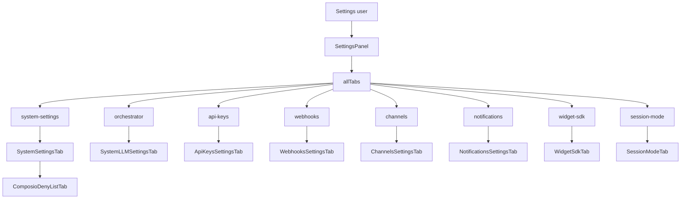
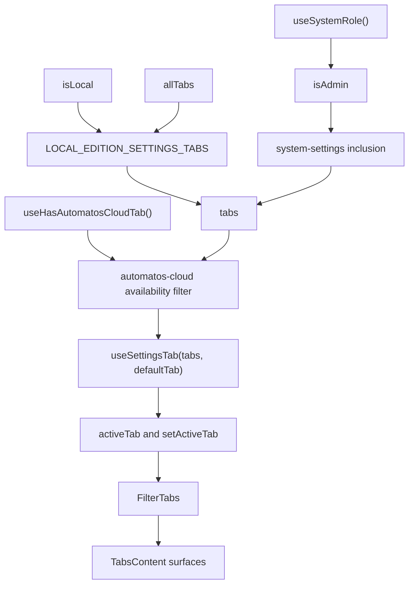
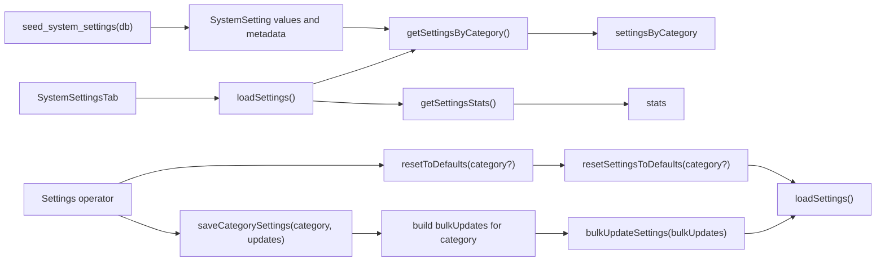
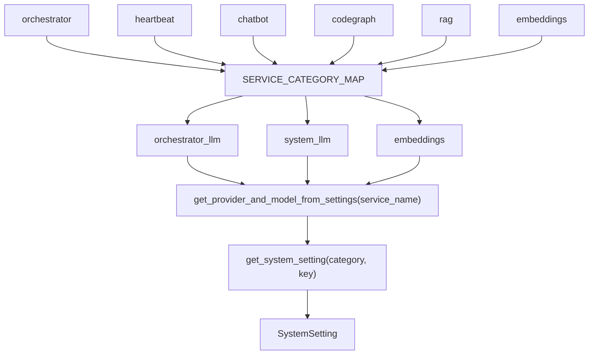
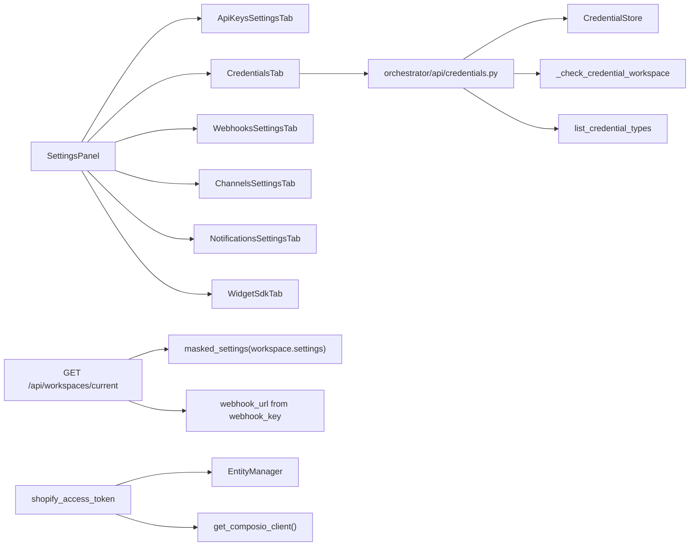

# Settings Panels

Relevant source files

The following files were used as context for generating this wiki page:

- [.gitignore](.gitignore)
- [docs/PRDS/126-BUSINESS-KNOWLEDGE-GRAPH.md](docs/PRDS/126-BUSINESS-KNOWLEDGE-GRAPH.md)
- [docs/testing/CUSTOMER-NIGHTS-PLAN.md](docs/testing/CUSTOMER-NIGHTS-PLAN.md)
- [frontend/components/__tests__/prd264-voice-ai-label.test.tsx](frontend/components/__tests__/prd264-voice-ai-label.test.tsx)
- [frontend/components/settings/DynamicCredentialForm.tsx](frontend/components/settings/DynamicCredentialForm.tsx)
- [frontend/components/settings/SettingsPanel.tsx](frontend/components/settings/SettingsPanel.tsx)
- [frontend/components/settings/SystemLLMSettingsTab.tsx](frontend/components/settings/SystemLLMSettingsTab.tsx)
- [frontend/components/settings/SystemSettingsTab.tsx](frontend/components/settings/SystemSettingsTab.tsx)
- [frontend/components/settings/WorkspaceVoiceLiveCard.tsx](frontend/components/settings/WorkspaceVoiceLiveCard.tsx)
- [frontend/components/settings/__tests__/settings-panel-edition.test.tsx](frontend/components/settings/__tests__/settings-panel-edition.test.tsx)
- [frontend/components/settings/__tests__/settings-panel-tab-param.test.tsx](frontend/components/settings/__tests__/settings-panel-tab-param.test.tsx)
- [frontend/components/settings/__tests__/workspace-voice-live-card.test.tsx](frontend/components/settings/__tests__/workspace-voice-live-card.test.tsx)
- [frontend/components/workspace-provider.tsx](frontend/components/workspace-provider.tsx)
- [frontend/hooks/use-voice-live-settings.ts](frontend/hooks/use-voice-live-settings.ts)
- [frontend/lib/api/credentials.ts](frontend/lib/api/credentials.ts)
- [frontend/lib/voice/live/refusal.ts](frontend/lib/voice/live/refusal.ts)
- [graphify-out/snapshots/bucket-1-pre-drop.sql](graphify-out/snapshots/bucket-1-pre-drop.sql)
- [orchestrator/.env.example](orchestrator/.env.example)
- [orchestrator/alembic/versions/prd135_drop_bucket_1.py](orchestrator/alembic/versions/prd135_drop_bucket_1.py)
- [orchestrator/api/credentials.py](orchestrator/api/credentials.py)
- [orchestrator/api/system_settings.py](orchestrator/api/system_settings.py)
- [orchestrator/api/workspaces.py](orchestrator/api/workspaces.py)
- [orchestrator/core/auth/hybrid.py](orchestrator/core/auth/hybrid.py)
- [orchestrator/core/composio/models.py](orchestrator/core/composio/models.py)
- [orchestrator/core/credentials/integration_bridges/__init__.py](orchestrator/core/credentials/integration_bridges/__init__.py)
- [orchestrator/core/credentials/integration_bridges/base.py](orchestrator/core/credentials/integration_bridges/base.py)
- [orchestrator/core/credentials/integration_bridges/shopify.py](orchestrator/core/credentials/integration_bridges/shopify.py)
- [orchestrator/core/credentials/service.py](orchestrator/core/credentials/service.py)
- [orchestrator/core/llm/manager.py](orchestrator/core/llm/manager.py)
- [orchestrator/core/models/credentials.py](orchestrator/core/models/credentials.py)
- [orchestrator/core/models/system_settings.py](orchestrator/core/models/system_settings.py)
- [orchestrator/core/monitoring/automatos_alerts.py](orchestrator/core/monitoring/automatos_alerts.py)
- [orchestrator/core/monitoring/automatos_logs_api.py](orchestrator/core/monitoring/automatos_logs_api.py)
- [orchestrator/core/seeds/seed_system_settings.py](orchestrator/core/seeds/seed_system_settings.py)
- [orchestrator/core/services/audit_service.py](orchestrator/core/services/audit_service.py)
- [orchestrator/core/services/plugin_cache.py](orchestrator/core/services/plugin_cache.py)
- [orchestrator/modules/context/sections/product_facts.py](orchestrator/modules/context/sections/product_facts.py)
- [orchestrator/modules/voice/mint.py](orchestrator/modules/voice/mint.py)
- [orchestrator/tests/test_1057_credential_stats_and_health_reach_their_handlers.py](orchestrator/tests/test_1057_credential_stats_and_health_reach_their_handlers.py)
- [orchestrator/tests/test_f232_auto_knows_what_automatos_is.py](orchestrator/tests/test_f232_auto_knows_what_automatos_is.py)
- [orchestrator/tests/test_invitation_routing.py](orchestrator/tests/test_invitation_routing.py)
- [orchestrator/tests/test_p2w2_credentials_null_workspace.py](orchestrator/tests/test_p2w2_credentials_null_workspace.py)
- [orchestrator/tests/test_prd266_ai_providers_route.py](orchestrator/tests/test_prd266_ai_providers_route.py)

## 1. Overview and Scope

This page documents the settings entry point, `SettingsPanel`, and the implementation details visible in the supplied code for system settings, LLM configuration, credentials, workspace settings, and the Composio deny-list tab. The panel imports components for API keys, webhooks, channels, notifications, the widget SDK, and session mode; detailed behavior for those individual components is not shown in the supplied file contents, so this page limits those descriptions to their registration and visible gating [frontend/components/settings/SettingsPanel.tsx:1-26]().

The main configuration surfaces have distinct data paths: system settings are loaded and saved by category through frontend API functions, while orchestrator configuration combines legacy system-settings form data with workspace/Auto configuration [frontend/components/settings/SystemSettingsTab.tsx:44-50](), [frontend/components/settings/SystemSettingsTab.tsx:52-131](), [frontend/components/settings/SystemLLMSettingsTab.tsx:40-61]().

### Diagram: Settings names mapped to frontend entities

Sources: [frontend/components/settings/SettingsPanel.tsx:1-26](), [frontend/components/settings/SystemSettingsTab.tsx:27-38]()

### Edition and Role Gating

`SettingsPanel` reads `isAdmin` from `useSystemRole()` and includes `system-settings` in `allTabs` only for administrators. In local edition, `LOCAL_EDITION_SETTINGS_TABS` is the allowlist used to filter the available tabs. The visible allowlist includes profile, system settings, orchestrator, API keys, credentials, channels, notifications, voice, socials, session mode, appearance, phones/devices, and Automatos Cloud [frontend/components/settings/SettingsPanel.tsx:28-73](), [frontend/components/settings/SettingsPanel.tsx:75-99]().

The component’s comments identify webhooks and Widget SDK as hosted-edition surfaces and explain that local edition filters tabs through the explicit allowlist rather than role [frontend/components/settings/SettingsPanel.tsx:28-39](). The supplied lines show `webhooks` and `widget-sdk` in `allTabs`, but not in the local allowlist [frontend/components/settings/SettingsPanel.tsx:59-73](), [frontend/components/settings/SettingsPanel.tsx:79-97]().

Sources: [frontend/components/settings/SettingsPanel.tsx:28-39](), [frontend/components/settings/SettingsPanel.tsx:59-99]()

---

## 2. SettingsPanel Composition and Tab Routing

`SettingsPanel` is a client component. It imports the tab components and shared `FilterTabs`/`TabsContent` UI, obtains system-role state using `useSystemRole()`, and obtains local-edition state through `isLocal` [frontend/components/settings/SettingsPanel.tsx:1-26](). It constructs `allTabs`, applies local-edition filtering and the Automatos Cloud availability filter, and initializes the active tab with `useSettingsTab` [frontend/components/settings/SettingsPanel.tsx:75-100]().

The supplied excerpt shows the `FilterTabs` control wired to `activeTab` and `setActiveTab`; it also shows a local-edition profile `TabsContent` linking to `/settings/profile` [frontend/components/settings/SettingsPanel.tsx:101-136](). The remaining tab-content rendering is outside the supplied excerpt.

### Diagram: Tab selection flow

Sources: [frontend/components/settings/SettingsPanel.tsx:59-100](), [frontend/components/settings/SettingsPanel.tsx:101-136]()

### Settings Tab Inventory

| Tab identifier | Imported component | What the supplied code establishes |
|---|---|---|
| `system-settings` | `SystemSettingsTab` | Admin-gated tab for database-backed system configuration [frontend/components/settings/SettingsPanel.tsx:6-8](), [frontend/components/settings/SettingsPanel.tsx:79-83](), [frontend/components/settings/SystemSettingsTab.tsx:1-7]() |
| `orchestrator` | `SystemLLMSettingsTab` | Orchestrator configuration component; supplied code shows LLM, soul/personality, heartbeat, and HARNESS sections [frontend/components/settings/SettingsPanel.tsx:7](), [frontend/components/settings/SystemLLMSettingsTab.tsx:5-13](), [frontend/components/settings/SystemLLMSettingsTab.tsx:72-114]() |
| `api-keys` | `ApiKeysSettingsTab` | API keys tab is imported and registered [frontend/components/settings/SettingsPanel.tsx:9](), [frontend/components/settings/SettingsPanel.tsx:84-87]() |
| `webhooks` | `WebhooksSettingsTab` | Webhooks tab is imported and registered; panel comments identify it as hosted-only [frontend/components/settings/SettingsPanel.tsx:8](), [frontend/components/settings/SettingsPanel.tsx:28-39](), [frontend/components/settings/SettingsPanel.tsx:83-86]() |
| `channels` | `ChannelsSettingsTab` | Channels tab is imported and registered; panel comments state that channels are available in local edition [frontend/components/settings/SettingsPanel.tsx:10](), [frontend/components/settings/SettingsPanel.tsx:35-39](), [frontend/components/settings/SettingsPanel.tsx:87-90]() |
| `notifications` | `NotificationsSettingsTab` | Notifications tab is imported and registered [frontend/components/settings/SettingsPanel.tsx:13](), [frontend/components/settings/SettingsPanel.tsx:87-90]() |
| `widget-sdk` | `WidgetSdkTab` | Widget SDK tab is imported and registered; panel comments identify it as hosted-only [frontend/components/settings/SettingsPanel.tsx:12](), [frontend/components/settings/SettingsPanel.tsx:28-33](), [frontend/components/settings/SettingsPanel.tsx:94-96]() |
| `session-mode` | `SessionModeTab` | Session mode tab is imported and included in the local-edition allowlist [frontend/components/settings/SettingsPanel.tsx:14](), [frontend/components/settings/SettingsPanel.tsx:59-73]() |
| `credentials` | `CredentialsTab` | Credentials tab is imported and included in the local-edition allowlist [frontend/components/settings/SettingsPanel.tsx:5](), [frontend/components/settings/SettingsPanel.tsx:59-73]() |
| System settings nested tab | `ComposioDenyListTab` | Imported into `SystemSettingsTab`; its backend category is `composio` [frontend/components/settings/SystemSettingsTab.tsx:27-38](), [orchestrator/core/models/system_settings.py:61-66]() |

Sources: [frontend/components/settings/SettingsPanel.tsx:1-26](), [frontend/components/settings/SettingsPanel.tsx:28-99](), [frontend/components/settings/SystemSettingsTab.tsx:27-38](), [orchestrator/core/models/system_settings.py:61-66]()

---

## 3. System Settings: Loading, Editing, Saving, and Resetting

`SystemSettingsTab` owns category-grouped settings, settings statistics, loading/saving flags, an error value, and the selected nested tab [frontend/components/settings/SystemSettingsTab.tsx:40-50](). Its `loadSettings()` function calls `getSettingsByCategory()` and `getSettingsStats()` concurrently, stores the results, reports load errors, and clears the loading flag in `finally` [frontend/components/settings/SystemSettingsTab.tsx:52-72]().

`saveCategorySettings(category, updates)` finds the selected category and constructs a bulk update for every setting in that category. For each row it uses the supplied update when present; otherwise it preserves the current value or falls back to the setting’s default value. It calls `bulkUpdateSettings()` and reloads settings after a successful save [frontend/components/settings/SystemSettingsTab.tsx:74-109]().

`resetToDefaults(category?)` calls `resetSettingsToDefaults(category)`, reports success or failure, and reloads the settings afterward. The initial load is triggered by `useEffect` when the component mounts [frontend/components/settings/SystemSettingsTab.tsx:111-131]().

### Diagram: System settings read and write flow

Sources: [frontend/components/settings/SystemSettingsTab.tsx:18-25](), [frontend/components/settings/SystemSettingsTab.tsx:52-131](), [orchestrator/core/seeds/seed_system_settings.py:5-16](), [orchestrator/core/seeds/seed_system_settings.py:58-72]()

The `SystemSetting` database model stores `category`, `key`, `value`, `value_type`, `description`, sensitivity and required flags, default values, validation rules, and timestamps. Its Pydantic response model exposes those fields, while the by-category response groups settings and includes a count [orchestrator/core/models/system_settings.py:68-91](), [orchestrator/core/models/system_settings.py:94-159]().

`seed_system_settings(db)` seeds defaults and metadata. The seed contract explicitly preserves an existing user-selected `value`; for existing rows, it updates defaults and metadata rather than overwriting the saved value [orchestrator/core/seeds/seed_system_settings.py:5-16](). The settings categories include general configuration, LLM tiers, operational categories, voice, model policy, decision engine, socials, and Composio [orchestrator/core/models/system_settings.py:19-66]().

Sources: [orchestrator/core/models/system_settings.py:68-159](), [orchestrator/core/seeds/seed_system_settings.py:5-16](), [orchestrator/core/seeds/seed_system_settings.py:58-72](), [orchestrator/core/models/system_settings.py:19-66]()

---

## 4. LLM Models and Provider Configuration

The code defines three canonical LLM configuration tiers: `orchestrator_llm`, `system_llm`, and `embeddings`. The system settings seed describes these as Auto, System, and Embeddings tiers, respectively [orchestrator/core/models/system_settings.py:19-34](), [orchestrator/core/seeds/seed_system_settings.py:35-55](), [orchestrator/core/seeds/seed_system_settings.py:58-70]().

`SERVICE_CATEGORY_MAP` maps service names to tiers. For example, `orchestrator` and `heartbeat` map to `orchestrator_llm`, while `chatbot`, `codegraph`, `rag`, and other internal services map to `system_llm`; `embeddings` maps to the embeddings tier [orchestrator/core/llm/manager.py:40-67]().

### Diagram: LLM service names mapped to settings and runtime lookup

Sources: [orchestrator/core/llm/manager.py:40-67](), [orchestrator/core/llm/manager.py:123-153](), [orchestrator/core/models/system_settings.py:19-34]()

`get_provider_and_model_from_settings(service_name)` selects a category using `SERVICE_CATEGORY_MAP`, then reads `provider` (or `llm_provider`) and `model` (or `llm_model`) from system settings. It raises `ValueError` if either provider or model is not configured, rather than applying a hardcoded fallback [orchestrator/core/llm/manager.py:123-153]().

The manager distinguishes strict and lenient setting reads. `read_system_setting()` returns the stored value or `None` and allows read failures to propagate; `get_system_setting()` catches read failures and returns the supplied default [orchestrator/core/llm/manager.py:70-120](). Provider credentials are resolved through `get_credential_data()`, which is cached with a five-minute TTL; its documented resolution strategy checks settings mappings, naming patterns, credential types, and environment variables [orchestrator/core/llm/manager.py:156-179]().

The `SystemLLMSettingsTab` frontend component composes `OrchestratorLLMSection`, `OrchestratorSoulSection`, `OrchestratorHeartbeatSection`, and `HarnessSettingsSection`. It loads standalone LLM form data and orchestrator configuration through hooks, obtains model options for the configured provider, and exposes separate save handling for LLM and orchestrator settings [frontend/components/settings/SystemLLMSettingsTab.tsx:1-31](), [frontend/components/settings/SystemLLMSettingsTab.tsx:40-61](), [frontend/components/settings/SystemLLMSettingsTab.tsx:72-114]().

Sources: [orchestrator/core/llm/manager.py:70-179](), [frontend/components/settings/SystemLLMSettingsTab.tsx:1-31](), [frontend/components/settings/SystemLLMSettingsTab.tsx:40-61](), [frontend/components/settings/SystemLLMSettingsTab.tsx:72-114]()

---

## 5. API Keys, Credentials, Webhooks, Channels, Notifications, and Widget SDK

The panel registers separate tabs for API keys, credentials, webhooks, channels, notifications, and Widget SDK. The supplied code establishes their component names and edition visibility, but does not include the implementations of the corresponding API-key, webhook, channel, notification, or widget components [frontend/components/settings/SettingsPanel.tsx:3-15](), [frontend/components/settings/SettingsPanel.tsx:59-97]().

The credentials API uses `CredentialStore` through a dependency provider and exposes credential-type listing. The API code describes credential types as schemas used for dynamic form generation. Credential access is workspace-scoped: `_check_credential_workspace()` rejects a credential with a mismatched workspace, and denies a null-workspace credential to non-admin callers except for the specified API-key lane [orchestrator/api/credentials.py:33-37](), [orchestrator/api/credentials.py:53-56](), [orchestrator/api/credentials.py:66-84](), [orchestrator/api/credentials.py:90-109]().

The visible Shopify bridge is an example of credential integration. It accepts decrypted credential data, resolves or creates a Composio entity for the workspace, and mirrors connection results into Composio connection metadata. Its registered `shopify_access_token` bridge supports an Admin API token path and a Partner App OAuth path [orchestrator/core/credentials/integration_bridges/shopify.py:24-32](), [orchestrator/core/credentials/integration_bridges/shopify.py:74-112](), [orchestrator/core/credentials/integration_bridges/shopify.py:119-162]().

The workspace endpoint returns a computed `webhook_url` based on the workspace webhook key and masks sensitive integration tokens in the settings included in its response. Its allowed integration keys include Telegram and Slack tokens/default destinations and trigger modes, plus WhatsApp identifiers and tokens [orchestrator/api/workspaces.py:50-67](), [orchestrator/api/workspaces.py:89-99](), [orchestrator/api/workspaces.py:118-154]().

### Diagram: Integration settings code entities

Sources: [frontend/components/settings/SettingsPanel.tsx:3-15](), [orchestrator/api/credentials.py:33-37](), [orchestrator/api/credentials.py:53-84](), [orchestrator/api/credentials.py:90-109](), [orchestrator/api/workspaces.py:50-67](), [orchestrator/api/workspaces.py:89-99](), [orchestrator/api/workspaces.py:118-154](), [orchestrator/core/credentials/integration_bridges/shopify.py:24-32](), [orchestrator/core/credentials/integration_bridges/shopify.py:74-112]()

Sources: [frontend/components/settings/SettingsPanel.tsx:3-15](), [orchestrator/api/credentials.py:33-37](), [orchestrator/api/credentials.py:53-109](), [orchestrator/api/workspaces.py:50-67](), [orchestrator/api/workspaces.py:89-99](), [orchestrator/core/credentials/integration_bridges/shopify.py:24-32](), [orchestrator/core/credentials/integration_bridges/shopify.py:74-112]()

---

## 6. Notifications and Session Mode

`NotificationsSettingsTab` and `SessionModeTab` are imported and registered by `SettingsPanel`. The local-edition allowlist includes `session-mode`, while the panel comments identify the CLI host lane as local-only [frontend/components/settings/SettingsPanel.tsx:13-14](), [frontend/components/settings/SettingsPanel.tsx:59-73](). The supplied file contents do not include either tab’s internal data flow or API calls.

Sources: [frontend/components/settings/SettingsPanel.tsx:13-14](), [frontend/components/settings/SettingsPanel.tsx:59-73]()

---

## 7. Composio Deny List

`SystemSettingsTab` imports `ComposioDenyListTab` as one of its nested settings components [frontend/components/settings/SystemSettingsTab.tsx:27-38](). The system-settings model defines `SettingCategory.COMPOSIO` with the value `composio`, describing it as the platform-wide Composio deny list [orchestrator/core/models/system_settings.py:61-66]().

The Shopify credential bridge imports `composio_action_denial` from `core.composio.deny_list` and identifies `SHOPIFY_GET_SHOP_DETAILS` as the action used for its post-create probe [orchestrator/core/credentials/integration_bridges/shopify.py:24-40](). The supplied excerpt does not show the deny-list tab’s UI implementation or the bridge’s subsequent denial-check call, so those details cannot be established from the provided code.

Sources: [frontend/components/settings/SystemSettingsTab.tsx:27-38](), [orchestrator/core/models/system_settings.py:61-66](), [orchestrator/core/credentials/integration_bridges/shopify.py:24-40]()

---