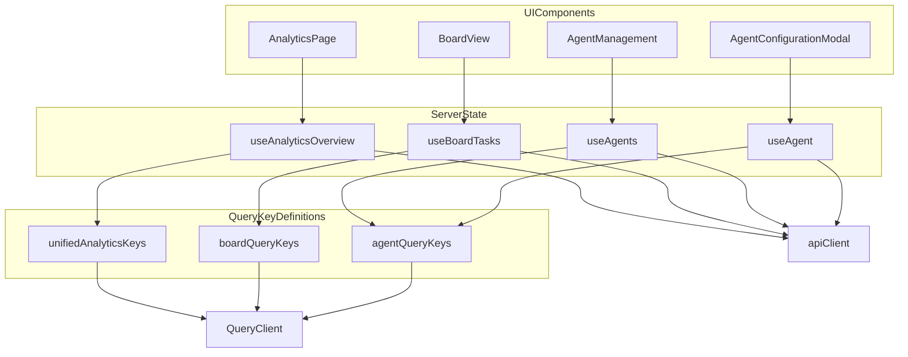
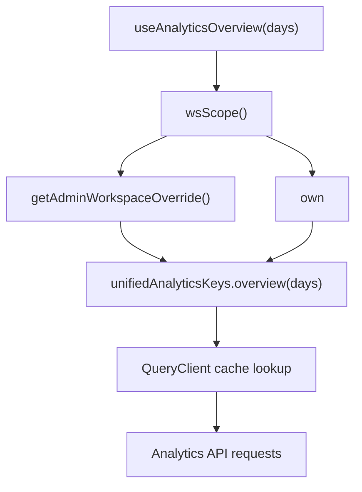
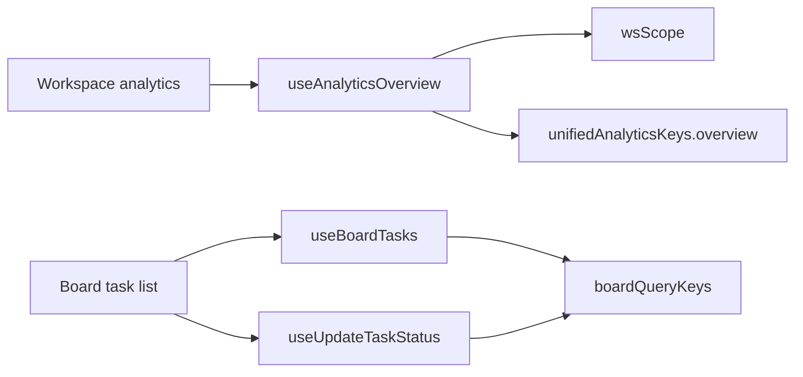
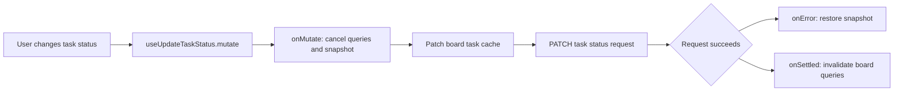
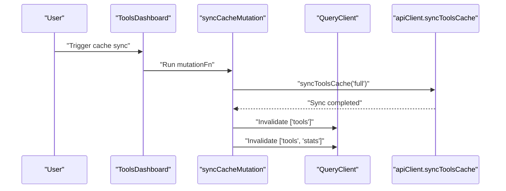
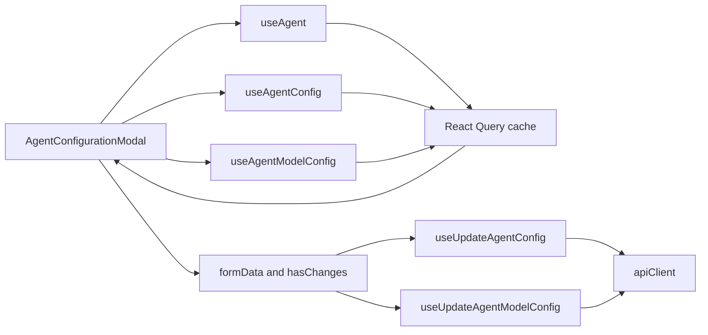

# State Management & Hooks

Relevant source files

The following files were used as context for generating this wiki page:

- [frontend/components/agents/agent-configuration-modal.tsx](frontend/components/agents/agent-configuration-modal.tsx)
- [frontend/components/agents/agent-configuration.tsx](frontend/components/agents/agent-configuration.tsx)
- [frontend/components/agents/agent-details-modal.tsx](frontend/components/agents/agent-details-modal.tsx)
- [frontend/components/agents/agent-management.tsx](frontend/components/agents/agent-management.tsx)
- [frontend/components/agents/agent-performance.tsx](frontend/components/agents/agent-performance.tsx)
- [frontend/components/agents/agent-roster.tsx](frontend/components/agents/agent-roster.tsx)
- [frontend/components/agents/agent-skills.tsx](frontend/components/agents/agent-skills.tsx)
- [frontend/components/agents/agent-status-control-modal.tsx](frontend/components/agents/agent-status-control-modal.tsx)
- [frontend/components/agents/create-agent-modal.tsx](frontend/components/agents/create-agent-modal.tsx)
- [frontend/components/agents/create-skill-modal.tsx](frontend/components/agents/create-skill-modal.tsx)
- [frontend/components/agents/skill-configuration-modal.tsx](frontend/components/agents/skill-configuration-modal.tsx)
- [frontend/components/documents/document-management.tsx](frontend/components/documents/document-management.tsx)
- [frontend/components/tools/tools-dashboard.tsx](frontend/components/tools/tools-dashboard.tsx)
- [frontend/components/workflows/active-workflows-panel.tsx](frontend/components/workflows/active-workflows-panel.tsx)
- [frontend/components/workflows/workflow-management.tsx](frontend/components/workflows/workflow-management.tsx)
- [frontend/hooks/use-agent-api.ts](frontend/hooks/use-agent-api.ts)
- [frontend/lib/agent-constants.ts](frontend/lib/agent-constants.ts)
- [orchestrator/alembic/versions/add_job_title_to_agents.py](orchestrator/alembic/versions/add_job_title_to_agents.py)
- [orchestrator/api/agents.py](orchestrator/api/agents.py)

## Purpose and Scope

This page describes frontend state management in Automatos AI: React Query server-state hooks and query keys, workspace scoping with `wsScope()`, component-local state, cache invalidation, and optimistic updates. It also catalogs the visible agent-data hooks and shows how UI components consume them. [frontend/hooks/use-unified-analytics.ts:34-64](), [frontend/hooks/use-board-tasks.ts:50-181](), [frontend/hooks/use-agent-api.ts:63-175]()

Sources: [frontend/hooks/use-unified-analytics.ts:34-64](), [frontend/hooks/use-board-tasks.ts:50-181](), [frontend/hooks/use-agent-api.ts:63-175]()

---

## State Management Architecture

State is divided between server data managed by React Query and transient UI state managed in components. Domain hooks wrap API calls and define query-cache behavior; components combine these hooks with local state for selections, forms, filters, and modal visibility. Analytics and board-task query keys include workspace scope, while the agent query keys shown here are defined without an explicit `wsScope()` segment. [frontend/hooks/use-agent-api.ts:9-20](), [frontend/hooks/use-agent-api.ts:63-87](), [frontend/hooks/use-unified-analytics.ts:34-64](), [frontend/hooks/use-board-tasks.ts:50-54]()

### Diagram: State Layers and Code Entities

Sources: [frontend/hooks/use-unified-analytics.ts:34-125](), [frontend/hooks/use-board-tasks.ts:50-181](), [frontend/hooks/use-agent-api.ts:23-87](), [frontend/components/agents/agent-management.tsx:41-65](), [frontend/components/agents/agent-configuration-modal.tsx:55-62]()

### Server State and UI State

| State category | Examples | Ownership |
|---|---|---|
| Server state | Agents, agent configuration, analytics metrics, and board tasks | React Query hooks and its query cache [frontend/hooks/use-agent-api.ts:89-175](), [frontend/hooks/use-board-tasks.ts:50-134]() |
| Component-local state | Active tabs, selected agent IDs, filters, modal state, and form values | React `useState` and related component effects [frontend/components/agents/agent-management.tsx:45-65](), [frontend/components/agents/agent-configuration-modal.tsx:98-116]() |
| Persistent UI preference | View mode per page | `useViewMode`, consumed by agent-management and agent-roster [frontend/components/agents/agent-management.tsx:28-29](), [frontend/components/agents/agent-roster.tsx:39-40]() |

Sources: [frontend/hooks/use-agent-api.ts:89-175](), [frontend/hooks/use-board-tasks.ts:50-134](), [frontend/components/agents/agent-management.tsx:28-65](), [frontend/components/agents/agent-configuration-modal.tsx:98-116](), [frontend/components/agents/agent-roster.tsx:39-40]()

---

## React Query Hooks Catalog & Query Keys with `wsScope`

Domain hooks use query keys to identify cached results and associate them with query functions. For the analytics and board-task domains, workspace-aware key construction uses `wsScope()`; the available agent-hook excerpt defines `agentQueryKeys` without that helper. Do not assume all domains share identical workspace-key conventions. [frontend/hooks/use-unified-analytics.ts:34-64](), [frontend/hooks/use-board-tasks.ts:50-54](), [frontend/hooks/use-agent-api.ts:63-87]()

Sources: [frontend/hooks/use-unified-analytics.ts:34-64](), [frontend/hooks/use-board-tasks.ts:50-54](), [frontend/hooks/use-agent-api.ts:63-87]()

### Analytics Hooks

The analytics hook family defines `unifiedAnalyticsKeys`; its overview key includes the scope returned by `wsScope()` and a day-window parameter. `useAnalyticsOverview(days)` fetches several analytics datasets and uses a 60-second stale time. [frontend/hooks/use-unified-analytics.ts:34-43](), [frontend/hooks/use-unified-analytics.ts:68-125]()

| Hook or key | Role |
|---|---|
| `wsScope()` | Resolves the admin workspace override or returns `'own'` for the current workspace scope. [frontend/hooks/use-unified-analytics.ts:34-38]() |
| `unifiedAnalyticsKeys.overview(days)` | Builds an overview key containing the workspace scope and requested day window. [frontend/hooks/use-unified-analytics.ts:42-43]() |
| `useAnalyticsOverview(days)` | Loads overview metrics through parallel requests and applies a 60-second `staleTime`. [frontend/hooks/use-unified-analytics.ts:68-125]() |
| `useWorkflowAnalytics(days)` | Used by the workflow analytics UI to retrieve workflow metrics. [frontend/components/analytics/analytics-workflows.tsx:37]() |
| `useCostAnalyticsUnified(days)` | Used by the costs analytics UI to retrieve cost data. [frontend/components/analytics/analytics-costs.tsx:164]() |

Sources: [frontend/hooks/use-unified-analytics.ts:34-43](), [frontend/hooks/use-unified-analytics.ts:68-125](), [frontend/components/analytics/analytics-workflows.tsx:37](), [frontend/components/analytics/analytics-costs.tsx:164]()

### Board Task Hooks

Board-task hooks define shared query-key constructors and fetch task data for board views. `useBoardTasks(filters)` loads tasks and groups them into board columns; `useBoardTask(taskId)` supports retrieval of one task. `useUpdateTaskStatus()` implements optimistic status updates and rollback behavior. [frontend/hooks/use-board-tasks.ts:50-181]()

| Hook or key | Role |
|---|---|
| `boardQueryKeys` | Defines the board query-key family, including all tasks, filtered task lists, and an individual task. [frontend/hooks/use-board-tasks.ts:50-54]() |
| `useBoardTask(taskId)` | Fetches one task by ID. [frontend/hooks/use-board-tasks.ts:63-70]() |
| `useBoardTasks(filters)` | Fetches task data and groups the result into `BOARD_COLUMNS`. [frontend/hooks/use-board-tasks.ts:75-134]() |
| `useUpdateTaskStatus()` | Applies an optimistic task-status mutation, restores prior data on error, then invalidates board queries. [frontend/hooks/use-board-tasks.ts:139-181]() |

Sources: [frontend/hooks/use-board-tasks.ts:50-181]()

### Agent Hooks

`frontend/hooks/use-agent-api.ts` centralizes agent endpoint calls through `apiClient` and defines `agentQueryKeys`. The shown hook implementations also incorporate system-icon mappings into agent-list and single-agent query keys and returned data. [frontend/hooks/use-agent-api.ts:23-87](), [frontend/hooks/use-agent-api.ts:91-175]()

| Hook or key | Role and behavior |
|---|---|
| `agentQueryKeys.agents` | Base key for agent lists. [frontend/hooks/use-agent-api.ts:63-68]() |
| `agentQueryKeys.agent(id)` | Key for one agent; other keys cover stats, types, logs, metrics, and performance. [frontend/hooks/use-agent-api.ts:66-72]() |
| `agentQueryKeys.agentSkills(agentId)` | Key for an agent’s skills. [frontend/hooks/use-agent-api.ts:78-80]() |
| `useAgents(options)` | Fetches up to 100 agents, incorporates sorted system-icon keys and the system-agent inclusion option into its query key, and maps icon data onto the returned agents. Automatic refetching is disabled; the result has a 30-second stale time. [frontend/hooks/use-agent-api.ts:94-125]() |
| `useAssignableAgents()` | Calls `useAgents()` with `includeWorkspaceSystem: true`, making it suitable for assignment pickers that should include workspace system agents. [frontend/hooks/use-agent-api.ts:128-136]() |
| `useAgent(agentId)` | Fetches a single agent when an ID is present, includes icon keys in the query key, and polls every 10 seconds. [frontend/hooks/use-agent-api.ts:138-156]() |
| `useAgentStats()` | Fetches agent statistics, polls every 30 seconds, and uses a 15-second stale time. [frontend/hooks/use-agent-api.ts:159-167]() |
| `useAgentTypes()` | Fetches agent types with a five-minute stale time. [frontend/hooks/use-agent-api.ts:169-175]() |

The management page consumes `useAgents`, `useAgentStats`, and `useAgentTypes`; the roster also consumes `useAgents` and uses `useStartAgent` and `useStopAgent`. [frontend/components/agents/agent-management.tsx:41-65](), [frontend/components/agents/agent-roster.tsx:47-51]()

### Diagram: Workspace Scope and Query-Key Resolution

Sources: [frontend/hooks/use-unified-analytics.ts:34-43](), [frontend/hooks/use-unified-analytics.ts:68-82]()

### Natural-Language Concepts Mapped to Code Entities

This diagram connects user-facing concepts—workspace-specific analytics and task boards—to the named hook and key implementations that realize them. [frontend/hooks/use-unified-analytics.ts:34-43](), [frontend/hooks/use-board-tasks.ts:50-97]()

Sources: [frontend/hooks/use-unified-analytics.ts:34-43](), [frontend/hooks/use-board-tasks.ts:50-54](), [frontend/hooks/use-board-tasks.ts:75-181]()

---

## Cache Invalidation & Optimistic Updates

Mutations can update the query cache immediately for responsive UI behavior, then reconcile it with the server. In the board-task flow, `useUpdateTaskStatus()` cancels relevant queries, snapshots prior data, patches the task, restores the snapshot on error, and invalidates board queries after settlement. [frontend/hooks/use-board-tasks.ts:139-181]()

### Optimistic Status Updates in Board Tasks

The board view calls the status-update mutation when a task changes status. The mutation’s optimistic-update lifecycle is: [frontend/components/activity/board/board-view.tsx:42-52](), [frontend/hooks/use-board-tasks.ts:139-181]()

1. **`onMutate`:** Cancels outgoing board queries, snapshots previous data, and patches the affected task in cache. [frontend/hooks/use-board-tasks.ts:149-166]()
2. **`onError`:** Restores the snapshot and reports the failure to the user. [frontend/hooks/use-board-tasks.ts:168-176]()
3. **`onSettled`:** Invalidates board queries so later reads reflect backend state. [frontend/hooks/use-board-tasks.ts:177-179]()

The tools dashboard illustrates invalidation without an optimistic patch: after syncing the tools cache, it invalidates the `['tools']` and `['tools', 'stats']` query families. [frontend/components/tools/tools-dashboard.tsx:187-193]()

### Diagram: Optimistic Mutation Flow

Sources: [frontend/hooks/use-board-tasks.ts:139-181](), [frontend/components/activity/board/board-view.tsx:42-52]()

Sources: [frontend/hooks/use-board-tasks.ts:139-181](), [frontend/components/activity/board/board-view.tsx:42-52]()

### Diagram: Tools Cache Refresh

Sources: [frontend/components/tools/tools-dashboard.tsx:67-69](), [frontend/components/tools/tools-dashboard.tsx:183-193]()

---

## Client-Side Stores & Local Storage

The supplied components show transient UI state held in React component state, and a shared `useViewMode` hook used for remembered display preferences. These examples do not establish a global Zustand store; no Zustand store implementation is present in the supplied file excerpts. [frontend/components/agents/agent-management.tsx:45-65](), [frontend/components/agents/agent-configuration-modal.tsx:98-116](), [frontend/components/agents/agent-roster.tsx:218-220]()

| Component or hook | Local state examples |
|---|---|
| `AgentManagement` | Active tab, selected agent, modal visibility, search term, and status filter. [frontend/components/agents/agent-management.tsx:45-92]() |
| `AgentConfigurationModal` | Active tab, dirty-state flag, form data, and original agent type. [frontend/components/agents/agent-configuration-modal.tsx:98-116]() |
| `CreateAgentModal` | Multi-step form state, agent fields, model configuration, runtime fields, and persona selection. [frontend/components/agents/create-agent-modal.tsx:67-105]() |
| `useViewMode` | Shared view-mode preference consumed by agent-management and agent-roster. [frontend/components/agents/agent-management.tsx:28-29](), [frontend/components/agents/agent-roster.tsx:39-40](), [frontend/components/agents/agent-roster.tsx:218-220]() |
| `ToolsDashboard` | Category, search, sort, tab, pagination, and cached-tools UI state. Search is debounced and resets pagination. [frontend/components/tools/tools-dashboard.tsx:129-155]() |

The configuration modal uses React Query hooks for agent and model data while keeping editable form values in component state. A ref marks whether the form has been initialized, preventing polling refetches from overwriting in-progress edits. [frontend/components/agents/agent-configuration-modal.tsx:98-116](), [frontend/components/agents/agent-configuration-modal.tsx:173-178]()

### Diagram: Agent Configuration Data Flow

Sources: [frontend/components/agents/agent-configuration-modal.tsx:55-62](), [frontend/components/agents/agent-configuration-modal.tsx:98-123](), [frontend/components/agents/agent-configuration-modal.tsx:173-178]()

---

## State Entities & Hook Summary

| Hook / component | Source file and location | Responsibility |
|---|---|---|
| `wsScope()` | [frontend/hooks/use-unified-analytics.ts:34-38]() | Resolves the workspace scope used in analytics query keys. |
| `unifiedAnalyticsKeys` | [frontend/hooks/use-unified-analytics.ts:42-65]() | Defines analytics query-key constructors. |
| `useAnalyticsOverview` | [frontend/hooks/use-unified-analytics.ts:68-125]() | Loads analytics overview data and configures freshness behavior. |
| `boardQueryKeys` | [frontend/hooks/use-board-tasks.ts:50-54]() | Defines board-task query keys. |
| `useBoardTasks` | [frontend/hooks/use-board-tasks.ts:75-134]() | Fetches and groups tasks for the board. |
| `useBoardTask` | [frontend/hooks/use-board-tasks.ts:63-70]() | Fetches a single task by ID. |
| `useUpdateTaskStatus` | [frontend/hooks/use-board-tasks.ts:139-181]() | Performs optimistic status changes, rollback, and invalidation. |
| `agentQueryKeys` | [frontend/hooks/use-agent-api.ts:63-87]() | Defines agent, skills, configuration, and coordination query-key families. |
| `useAgents` | [frontend/hooks/use-agent-api.ts:94-125]() | Fetches and decorates agent lists; supports optional system-agent inclusion. |
| `useAssignableAgents` | [frontend/hooks/use-agent-api.ts:128-136]() | Provides the agent-list variant that includes workspace system agents. |
| `useAgent` | [frontend/hooks/use-agent-api.ts:138-156]() | Fetches one agent and polls for updates. |
| `AgentManagement` | [frontend/components/agents/agent-management.tsx:45-65]() | Combines agent queries with local page and selection state. |
| `AgentConfigurationModal` | [frontend/components/agents/agent-configuration-modal.tsx:98-123]() | Combines query-backed data with locally edited configuration state. |
| `ToolsDashboard` | [frontend/components/tools/tools-dashboard.tsx:166-193]() | Queries tools and invalidates tools-related cache after cache synchronization. |

Sources: [frontend/hooks/use-unified-analytics.ts:34-125](), [frontend/hooks/use-board-tasks.ts:50-181](), [frontend/hooks/use-agent-api.ts:63-175](), [frontend/components/agents/agent-management.tsx:45-65](), [frontend/components/agents/agent-configuration-modal.tsx:98-123](), [frontend/components/tools/tools-dashboard.tsx:166-193]()

---