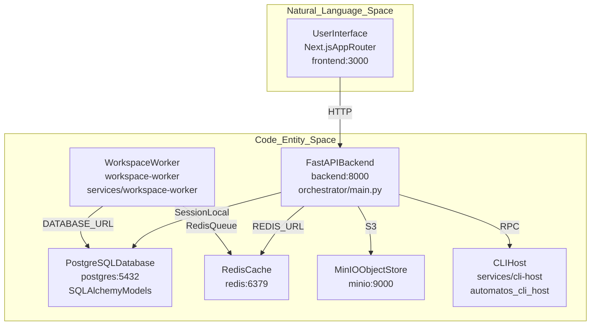
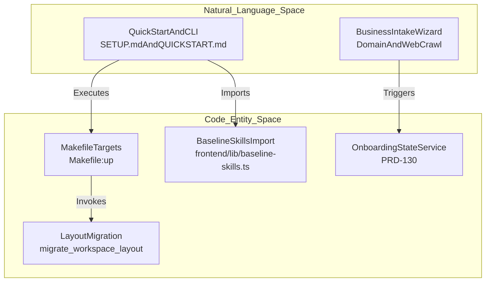

# Getting Started

Relevant source files

The following files were used as context for generating this wiki page:

- [.github/workflows/images.yml](.github/workflows/images.yml)
- [.github/workflows/test.yml](.github/workflows/test.yml)
- [QUICKSTART.md](QUICKSTART.md)
- [SETUP.md](SETUP.md)
- [charts/automatos/README.md](charts/automatos/README.md)
- [charts/automatos/templates/worker.yaml](charts/automatos/templates/worker.yaml)
- [docs/agents/llm-provider-management.md](docs/agents/llm-provider-management.md)
- [docs/getting-started/self-hosting.md](docs/getting-started/self-hosting.md)
- [frontend/components/marketplace/__tests__/github-import-modal.test.tsx](frontend/components/marketplace/__tests__/github-import-modal.test.tsx)
- [frontend/components/marketplace/__tests__/marketplace-admin-gate.test.ts](frontend/components/marketplace/__tests__/marketplace-admin-gate.test.ts)
- [frontend/lib/baseline-skills.ts](frontend/lib/baseline-skills.ts)
- [frontend/lib/tooltips.json](frontend/lib/tooltips.json)
- [orchestrator/tests/test_818_every_make_target_has_its_commands_in_the_guide.py](orchestrator/tests/test_818_every_make_target_has_its_commands_in_the_guide.py)
- [orchestrator/tests/test_compose_published_images.py](orchestrator/tests/test_compose_published_images.py)
- [orchestrator/tests/test_f452_worker_cannot_regain_privileges.py](orchestrator/tests/test_f452_worker_cannot_regain_privileges.py)
- [orchestrator/tests/test_prd262_core_stack.py](orchestrator/tests/test_prd262_core_stack.py)
- [orchestrator/tests/test_prd262_dependabot.py](orchestrator/tests/test_prd262_dependabot.py)
- [orchestrator/tests/test_prd262_worker_boot.py](orchestrator/tests/test_prd262_worker_boot.py)
- [orchestrator/tests/test_prd262_worker_diet.py](orchestrator/tests/test_prd262_worker_diet.py)
- [orchestrator/tests/test_setup_runbook.py](orchestrator/tests/test_setup_runbook.py)
- [scripts/ci/image_worker_toolchain.py](scripts/ci/image_worker_toolchain.py)
- [scripts/ci/smoke-core-stack.sh](scripts/ci/smoke-core-stack.sh)
- [services/workspace-worker/Dockerfile](services/workspace-worker/Dockerfile)
- [services/workspace-worker/entrypoint.sh](services/workspace-worker/entrypoint.sh)

This guide provides a high-level roadmap for installing, configuring, and running Automatos AI. It covers essential prerequisites, local self-hosting editions across macOS, Linux, and Windows (via WSL2 or native session mode), environment setup, and onboarding wizards.

For detailed installation and setup procedures, see [Installation & Setup](#2.1). For comprehensive configuration options, see [Configuration Guide](#2.2). For hands-on tutorials creating agents and workflows, see [Quick Start Tutorial](#2.3). For domain intake and knowledge graph creation, see [Business Intake Wizard](#2.4). For conversational onboarding and first-run experiences, see [Onboarding & First-Run Experience](#2.5).

Sources: [docs/getting-started/self-hosting.md:1-12](), [QUICKSTART.md:1-10](), [SETUP.md:1-15]()

---

## Prerequisites & Architecture Overview

Automatos AI follows a containerized multi-tier architecture designed to bridge natural language user intent to autonomous execution. The system coordinates FastAPI backends, Next.js frontends, isolated execution workers, and session hosts, supporting containerized local deployment via Docker Compose and pre-built GHCR images.

### System Entity Map: Bridging Natural Language to Code (Infrastructure)

This diagram links the conceptual components of the platform’s infrastructure architecture in natural language to their concrete code entities and container names deployed via Docker:

**Notes:**
- The `frontend` container runs the Next.js app (`frontend/app/layout.tsx`).
- The `backend` is a FastAPI app serving APIs and orchestrating agents (`orchestrator/main.py`).
- `postgres` provides the relational database and vector search store (`pgvector`).
- `redis` is used for caching, pub/sub messaging, and queuing.
- `minio` provides an S3-compatible object store for documents, plugin assets, and images.
- The `workspace-worker` container manages isolated agent execution and filesystem operations (`services/workspace-worker`).
- The `services/cli-host` module manages local session sandboxing and tool hooks for CLI agents (`services/cli-host/automatos_cli_host/sandbox.py`).

Sources: [frontend/app/layout.tsx:1-15](), [docs/getting-started/self-hosting.md:1-28](), [services/cli-host/automatos_cli_host/sandbox.py:1-20]()

---

### Onboarding & Setup Map: Bridging Natural Language to Code (Initialization)

This diagram connects user-facing setup actions and intake prompts to the concrete initialization routines and migration entrypoints in the codebase:

**Notes:**
- `Makefile` coordinates container orchestration and layout validation (`Makefile:44-55`).
- `migrate_workspace_layout` ensures backward compatibility for deliverables roots.
- `frontend/lib/baseline-skills.ts` defines the open-source capability import repo (`frontend/lib/baseline-skills.ts:1-18`).
- `OnboardingState` coordinates conversational onboarding and multi-step initialization.

Sources: [Makefile:44-115](), [frontend/lib/baseline-skills.ts:1-18](), [QUICKSTART.md:70-90]()

---

## 2.1. Installation & Setup

Automatos AI local edition uses Docker Compose to orchestrate services with zero cloud account requirements [QUICKSTART.md:3-8](). A fresh install requires setting three mandatory secrets in a local `.env` file copied from `.env.example`: `POSTGRES_PASSWORD`, `REDIS_PASSWORD`, and `API_KEY` [QUICKSTART.md:13-30](). Docker Compose v2 syntax enforces that missing required variables prevent startup with clear validation errors [docs/getting-started/self-hosting.md:18-24]().

The `make up` command checks for Docker Engine 25+ and Docker Compose 2.24.4+ before proceeding [QUICKSTART.md:14-16](). It also generates random values for the required secrets if they are still placeholders in `.env` [QUICKSTART.md:31-36]().

On Windows, the recommended installation path runs inside WSL2 (`Ubuntu-24.04`) with Docker Engine or Docker Desktop WSL integration, ensuring proper POSIX file speeds and compatibility with session mode sandboxes [docs/getting-started/self-hosting.md:75-128](), [SETUP.md:49-80](). Fresh installs can import baseline skills from the public repository `https://github.com/AutomatosAI/automatos-skills` via **Marketplace → Capabilities → Import from GitHub** [QUICKSTART.md:72-74](), [frontend/lib/baseline-skills.ts:1-18]().

The `workspace-worker` service's `entrypoint.sh` script handles ownership of the mounted `AUTOMATOS_WORKSPACE_DIR` volume, ensuring the worker user (uid 1000) can write to it, even if the host user has a different UID [services/workspace-worker/entrypoint.sh:1-80](), [orchestrator/tests/test_prd262_worker_boot.py:19-25]().

For detailed installation procedures across macOS, Linux, and Windows, see [Installation & Setup](#2.1).

Sources: [docs/getting-started/self-hosting.md:1-128](), [QUICKSTART.md:1-124](), [SETUP.md:1-100](), [frontend/lib/baseline-skills.ts:1-18](), [services/workspace-worker/entrypoint.sh:1-80](), [orchestrator/tests/test_prd262_worker_boot.py:19-25]()

---

## 2.2. Configuration Guide

Automatos AI reads configuration through environment variables and system settings [QUICKSTART.md:35-50](). LLM providers such as OpenRouter, Anthropic, OpenAI, and NVIDIA can be configured dynamically in the app under **Settings → API Keys** or via environment variables [QUICKSTART.md:36-50](). OpenRouter serves as the default routing layer, while NVIDIA endpoints offer free trial open models under specified trial usage terms [QUICKSTART.md:41-70]().

Core services like PostgreSQL, Redis, and MinIO S3 object storage are configured via connection parameters in `.env` and defaults in `envs/*.defaults` [docs/getting-started/self-hosting.md:8-12](). The `.env.example` file provides a template for these configurations, including `POSTGRES_DB`, `REDIS_PASSWORD`, `MINIO_ROOT_USER`, and `S3_ENDPOINT_URL` [.env.example:15-124](). Credentials are encrypted securely in the backend database, and API keys stored in settings are validated live on entry.

For full configuration details, environment variable lists, and service secrets, see [Configuration Guide](#2.2).

Sources: [QUICKSTART.md:35-70](), [docs/getting-started/self-hosting.md:8-12](), [.env.example:15-124]()

---

## 2.3. Quick Start Tutorial

Once platform services are running (`docker compose up` or `make up`), access the frontend dashboard at `http://localhost:3000` [QUICKSTART.md:91-131](). A fresh local install seeds Auto, a starter roster of specialized agents, a default playbook, and welcome deliverables under **Deliverables → Blogs** [QUICKSTART.md:139-143]().

The quick start tutorial walks users through:
1. Creating or customizing an AI agent persona and assigning skills and capabilities [QUICKSTART.md:76-89](). The frontend provides tooltips for agent configuration parameters like `temperature`, `max_tokens`, and `top_p` to guide users [frontend/lib/tooltips.json:143-159]().
2. Connecting external tools and applications via marketplace integrations [QUICKSTART.md:41-60]().
3. Running chat conversations routed to appropriate agents with real-time streaming [charts/automatos/README.md:58-65]().
4. Executing multi-agent playbooks and exploring the shared workspace directory `AUTOMATOS_WORKSPACE_DIR` [QUICKSTART.md:89-103](). This directory, by default `./workspaces`, is mounted into the `workspace-worker` container as `/workspaces` [charts/automatos/templates/worker.yaml:34-36]().

For step-by-step tutorial instructions, see [Quick Start Tutorial](#2.3).

Sources: [QUICKSTART.md:76-151](), [charts/automatos/README.md:58-65](), [frontend/lib/tooltips.json:143-159](), [charts/automatos/templates/worker.yaml:34-36]()

---

## 2.4. Business Intake Wizard

The Business Intake Wizard (PRD-130) automates first-time workspace provisioning and domain initialization:
- Accepts user domain entries during setup.
- Crawls target corporate websites via `Firecrawl` for initial context gathering. The `FIRECRAWL_API_KEY` environment variable can be set in `.env` for this purpose [.env.example:72-73]().
- Ingests extracted documentation into the vector database (`pgvector`) for retrieval-augmented generation (RAG).
- Constructs the semantic business knowledge graph via `Graphify`.
- Generates an initial "Mission Zero" draft plan guiding subsequent agent orchestration and goal decomposition.

This wizard primes workspace agents and knowledge layers for domain-specific autonomy. For comprehensive details on ingestion pipelines and graph builders, see [Business Intake Wizard](#2.4).

Sources: [QUICKSTART.md:114-148](), [.env.example:72-73]()

---

## 2.5. Onboarding & First-Run Experience

The conversational onboarding experience (PRD-222/233) guides new operators through platform capabilities via:
- The `OnboardingState` service tracking progress and context.
- Dedicated onboarding prompt sections injected dynamically by the `ContextService`.
- `platform_onboarding` tool actions executed directly from onboarding dialogues.
- Segment-implied advance logic and trial ledger enforcement managing tier limits.
- Local seeding of starter content and agent roles on fresh container boots.

This creates an interactive first-run experience that helps operators bootstrap agents and playbooks smoothly. For implementation details, see [Onboarding & First-Run Experience](#2.5).

Sources: [QUICKSTART.md:114-148](), [docs/getting-started/self-hosting.md:65-78]()

---

This Getting Started overview connects installation, configuration, and first agent workflows, mapping natural language concepts to concrete components and illustrating the onboarding lifecycle. Follow the linked child pages for detailed step-by-step instructions in each area.

# End of Getting Started – Section 2

---