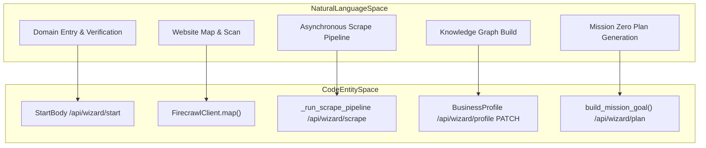
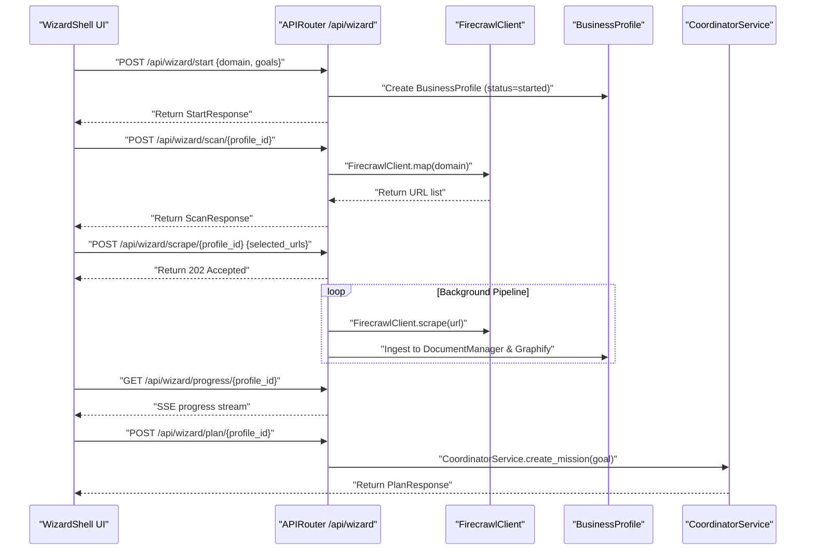
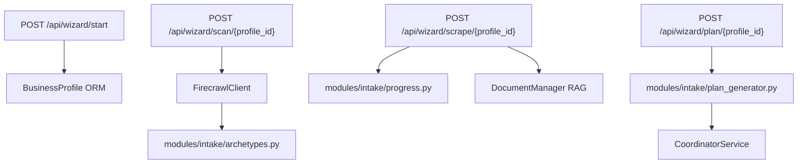

# Business Intake Wizard

Relevant source files

The following files were used as context for generating this wiki page:

- [docs/PRDS/130-BUSINESS-INTAKE-WIZARD-POC.md](docs/PRDS/130-BUSINESS-INTAKE-WIZARD-POC.md)
- [docs/audits/prd-research-status-review-2026-04-11.md](docs/audits/prd-research-status-review-2026-04-11.md)
- [orchestrator/alembic/versions/drop_agents_model_config_default.py](orchestrator/alembic/versions/drop_agents_model_config_default.py)
- [orchestrator/alembic/versions/prd130_business_profile.py](orchestrator/alembic/versions/prd130_business_profile.py)
- [orchestrator/api/wizard.py](orchestrator/api/wizard.py)
- [orchestrator/core/database/add_missing_agent_columns.sql](orchestrator/core/database/add_missing_agent_columns.sql)
- [orchestrator/core/models/business_profiles.py](orchestrator/core/models/business_profiles.py)
- [orchestrator/modules/intake/__init__.py](orchestrator/modules/intake/__init__.py)
- [orchestrator/modules/intake/firecrawl_client.py](orchestrator/modules/intake/firecrawl_client.py)

The **Business Intake Wizard** (PRD-130) is a specialized onboarding subsystem implemented in `[orchestrator/api/wizard.py:1-18]()` and supported by auxiliary modules in the `[orchestrator/modules/intake/__init__.py:1-13]()` package. It automates workspace bootstrapping by capturing key business domain metadata, executing targeted website mapping via Firecrawl, performing retrieval-augmented generation (RAG) document ingestion, constructing a business knowledge graph via Graphify, and generating a Mission Zero draft onboarding plan.

Sources: `[orchestrator/api/wizard.py:1-18]`, `[orchestrator/modules/intake/__init__.py:1-13]`

---

## Overview & System Architecture

The intake wizard executes as a sequential multi-stage pipeline exposed through FastAPI router endpoints:

1. **Domain Entry & Verification**: Accepts target domain strings and optional business goals, optionally validating email domain ownership via `_verify_domain_match` in `[orchestrator/api/wizard.py:147-158]`.
2. **Website Mapping**: Discovers domain URLs using `FirecrawlClient.map()` defined in `[orchestrator/modules/intake/firecrawl_client.py:79-138]`.
3. **Archetype Detection**: Classifies business structures (e.g., Shopify storefronts) via `detect_archetype` in `[orchestrator/modules/intake/archetypes.py:1-47]()`.
4. **Asynchronous Scrape Pipeline**: Dispatches background scrape tasks via `launch_guarded` in `[orchestrator/api/wizard.py:41-41]()`, extracting content into vector databases.
5. **Knowledge Graph & RAG Ingestion**: Triggers Graphify builders and populates the `[orchestrator/core/models/business_profiles.py:20-61]` ORM model.
6. **Draft Plan Generation**: Produces natural-language goals via `build_mission_goal` in `[orchestrator/modules/intake/plan_generator.py:42-106]()`.

### Natural Language to Code Entity Mapping

Diagram: Natural Language to Code Entity Mapping for Business Intake

Sources: `[orchestrator/api/wizard.py:75-121]`, `[orchestrator/modules/intake/firecrawl_client.py:79-138]`, `[orchestrator/core/models/business_profiles.py:20-61]`, `[orchestrator/modules/intake/plan_generator.py:42-50]()`

---

## Technical Data Flow

Diagram: Wizard Execution Sequence Flow

Sources: `[orchestrator/api/wizard.py:7-12]`, `[orchestrator/modules/intake/firecrawl_client.py:79-137]`, `[orchestrator/core/models/business_profiles.py:20-61]`

---

## Implementation Details

### Intake Initialization & Domain Validation
The intake workflow initializes via `POST /api/wizard/start` handling `StartBody` validation schemas in `[orchestrator/api/wizard.py:75-78]`. It provisions a `BusinessProfile` row (`[orchestrator/core/models/business_profiles.py:20-61]`) and enforces domain verification through `_verify_domain_match` (`[orchestrator/api/wizard.py:147-158]`) when `WIZARD_REQUIRE_DOMAIN_VERIFY` is enabled.

Sources: `[orchestrator/api/wizard.py:75-158]`, `[orchestrator/core/models/business_profiles.py:20-61]`

### Firecrawl Website Scanning & Archetype Detection
The `/api/wizard/scan/{profile_id}` route invokes `FirecrawlClient.map()` (`[orchestrator/modules/intake/firecrawl_client.py:79-138]`). Discovered URLs undergo domain-lock filtering (`_is_same_domain`) and page cap enforcement (`_max_pages`). Archetype detection processes the URL set to classify business types.

Sources: `[orchestrator/modules/intake/firecrawl_client.py:32-138]`, `[orchestrator/api/wizard.py:87-96]`

### Background Scrape Pipeline & Progress Streaming
The `/api/wizard/scrape/{profile_id}` endpoint accepts `ScrapeBody` (`[orchestrator/api/wizard.py:98-100]`), returning HTTP `202 Accepted` before spawning background tasks via `launch_guarded` (`[orchestrator/api/wizard.py:41]`). Progress metrics are broadcast using Redis pub/sub helpers `progress_emit` and streamed via `/api/wizard/progress/{profile_id}` (`[orchestrator/api/wizard.py:51-63]`).

Sources: `[orchestrator/api/wizard.py:41-63]`, `[orchestrator/api/wizard.py:98-106]`

### Mission Zero Draft Plan Generation
Upon scrape completion and graph construction, `/api/wizard/plan/{profile_id}` calls `build_mission_goal` (`[orchestrator/modules/intake/plan_generator.py:42-106]()`). The resulting structured prompt is registered with the coordination backend to create the Mission Zero execution tree. The `model_config` for agents created during Mission Zero is explicitly set from `config.LLM_MODEL` to avoid issues with outdated default models, as noted in `[orchestrator/alembic/versions/drop_agents_model_config_default.py:20-22]()`.

Sources: `[orchestrator/modules/intake/plan_generator.py:42-106]()`, `[orchestrator/api/wizard.py:117-121]`, `[orchestrator/alembic/versions/drop_agents_model_config_default.py:20-22]`

---

## Data Model: BusinessProfile

The persistent state is managed by `BusinessProfile` in `[orchestrator/core/models/business_profiles.py:20-61]`, mapped in table `business_profiles` (`[orchestrator/alembic/versions/prd130_business_profile.py:21-61]`):

| Field | Type | Description |
|---|---|---|
| `id` | UUID | Primary key (`gen_random_uuid`) |
| `workspace_id` | UUID | Foreign key to `workspaces.id` (CASCADE) |
| `domain` | Text | Target business domain |
| `archetype` | Text | Detected business pattern (e.g., `shopify`) |
| `company_name` | Text | Extracted organization name |
| `sectors` | JSONB | Business classification tags |
| `brands` | JSONB | Discovered product brands and suppliers |
| `standards` | JSONB | Compliance frameworks and certifications |
| `voice_notes` | Text | Tone and brand voice notes |
| `goals` | JSONB | User intake objectives |
| `raw_map_urls` | JSONB | Complete URL inventory from Firecrawl map |
| `selected_urls` | JSONB | User-filtered scrape targets |
| `draft_plan` | JSONB | Generated Mission Zero draft payload |
| `status` | Text | Lifecycle state (`started`, `scanning`, `scraped`, `planned`) |

Sources: `[orchestrator/core/models/business_profiles.py:20-61]`, `[orchestrator/alembic/versions/prd130_business_profile.py:21-61]`

---

## Key Components and Functions

### FirecrawlClient
Defined in `[orchestrator/modules/intake/firecrawl_client.py:32-191]`, this wrapper handles cloud requests to `https://api.firecrawl.dev/v1`. Core methods include `map()` for URL enumeration and `scrape()` for markdown and schema-guided extractions.

Sources: `[orchestrator/modules/intake/firecrawl_client.py:32-191]`

### Plan Generator
Located in `[orchestrator/modules/intake/plan_generator.py:1-106]()`, `build_mission_goal()` compiles business profiles into multi-agent operational directives assigning specialized roles (`voyager`, `blueprint`, `scribe`, `forge`).

Sources: `[orchestrator/modules/intake/plan_generator.py:1-106]()`

---

## API Reference

All routes are mounted under `/api/wizard` (`[orchestrator/api/wizard.py:68]`):

| Method | Path | Description |
|---|---|---|
| `POST` | `/api/wizard/start` | Initialize intake profile and validate domain |
| `POST` | `/api/wizard/scan/{profile_id}` | Execute Firecrawl map and archetype analysis |
| `POST` | `/api/wizard/scrape/{profile_id}` | Trigger background scrape and RAG ingestion |
| `GET` | `/api/wizard/progress/{profile_id}` | Stream live progress events (SSE) |
| `PATCH` | `/api/wizard/profile/{profile_id}` | Update business profile attributes |
| `POST` | `/api/wizard/plan/{profile_id}` | Generate Mission Zero draft plan |

Sources: `[orchestrator/api/wizard.py:7-13]`

---

## Summary Diagram: Intake Subsystem Architecture

Diagram: Intake Subsystem Architecture Overview

Sources: `[orchestrator/api/wizard.py:1-199]`, `[orchestrator/modules/intake/firecrawl_client.py:32-137]`, `[orchestrator/modules/intake/plan_generator.py:42-106]()`

---