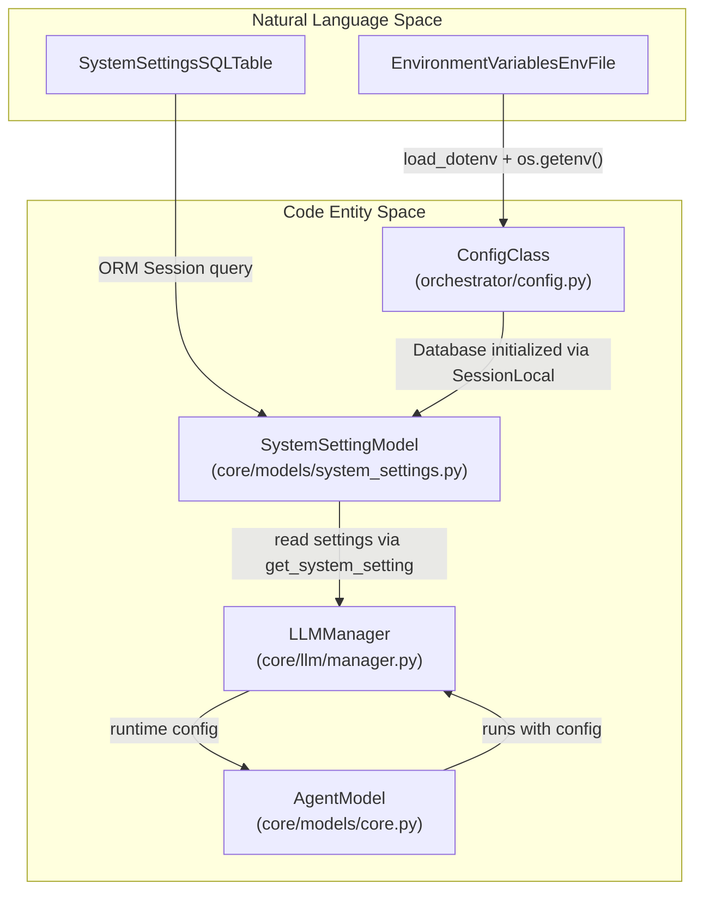
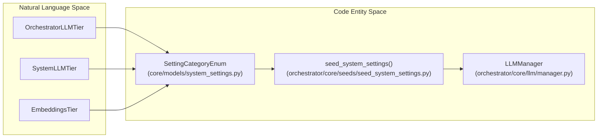
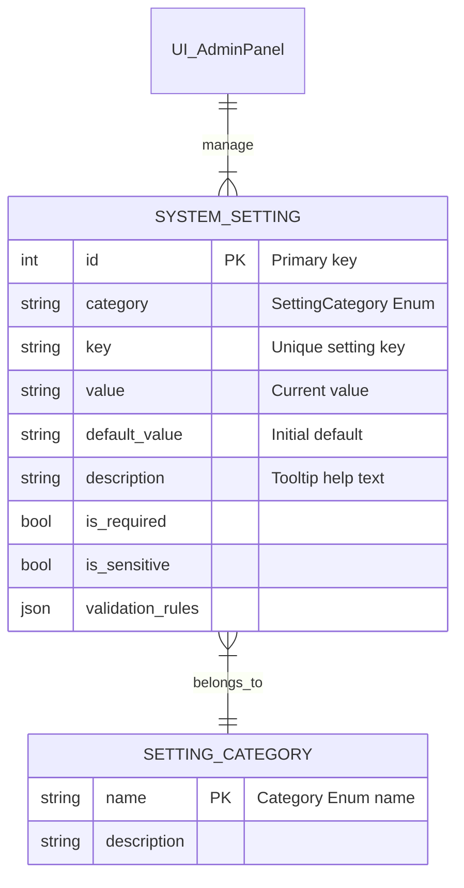

# Configuration Guide

Relevant source files

The following files were used as context for generating this wiki page:

- [.gitignore](.gitignore)
- [docs/PRDS/126-BUSINESS-KNOWLEDGE-GRAPH.md](docs/PRDS/126-BUSINESS-KNOWLEDGE-GRAPH.md)
- [docs/testing/CUSTOMER-NIGHTS-PLAN.md](docs/testing/CUSTOMER-NIGHTS-PLAN.md)
- [frontend/components/settings/DynamicCredentialForm.tsx](frontend/components/settings/DynamicCredentialForm.tsx)
- [frontend/components/settings/SystemSettingsTab.tsx](frontend/components/settings/SystemSettingsTab.tsx)
- [frontend/lib/api-client.ts](frontend/lib/api-client.ts)
- [frontend/lib/api/credentials.ts](frontend/lib/api/credentials.ts)
- [graphify-out/snapshots/bucket-1-pre-drop.sql](graphify-out/snapshots/bucket-1-pre-drop.sql)
- [orchestrator/.env.example](orchestrator/.env.example)
- [orchestrator/alembic/versions/prd135_drop_bucket_1.py](orchestrator/alembic/versions/prd135_drop_bucket_1.py)
- [orchestrator/api/credentials.py](orchestrator/api/credentials.py)
- [orchestrator/api/socials.py](orchestrator/api/socials.py)
- [orchestrator/api/system_settings.py](orchestrator/api/system_settings.py)
- [orchestrator/config.py](orchestrator/config.py)
- [orchestrator/core/composio/models.py](orchestrator/core/composio/models.py)
- [orchestrator/core/credentials/integration_bridges/__init__.py](orchestrator/core/credentials/integration_bridges/__init__.py)
- [orchestrator/core/credentials/integration_bridges/base.py](orchestrator/core/credentials/integration_bridges/base.py)
- [orchestrator/core/credentials/integration_bridges/shopify.py](orchestrator/core/credentials/integration_bridges/shopify.py)
- [orchestrator/core/credentials/service.py](orchestrator/core/credentials/service.py)
- [orchestrator/core/llm/manager.py](orchestrator/core/llm/manager.py)
- [orchestrator/core/models/credentials.py](orchestrator/core/models/credentials.py)
- [orchestrator/core/models/system_settings.py](orchestrator/core/models/system_settings.py)
- [orchestrator/core/monitoring/automatos_alerts.py](orchestrator/core/monitoring/automatos_alerts.py)
- [orchestrator/core/monitoring/automatos_logs_api.py](orchestrator/core/monitoring/automatos_logs_api.py)
- [orchestrator/core/seeds/seed_system_settings.py](orchestrator/core/seeds/seed_system_settings.py)
- [orchestrator/core/services/audit_service.py](orchestrator/core/services/audit_service.py)
- [orchestrator/core/services/plugin_cache.py](orchestrator/core/services/plugin_cache.py)
- [orchestrator/main.py](orchestrator/main.py)
- [orchestrator/modules/socials/__init__.py](orchestrator/modules/socials/__init__.py)
- [orchestrator/modules/socials/render.py](orchestrator/modules/socials/render.py)
- [orchestrator/modules/socials/service.py](orchestrator/modules/socials/service.py)
- [orchestrator/reports/config-surface.json](orchestrator/reports/config-surface.json)
- [orchestrator/reports/route-manifest.json](orchestrator/reports/route-manifest.json)
- [orchestrator/tests/test_1057_credential_stats_and_health_reach_their_handlers.py](orchestrator/tests/test_1057_credential_stats_and_health_reach_their_handlers.py)
- [orchestrator/tests/test_p2w2_credentials_null_workspace.py](orchestrator/tests/test_p2w2_credentials_null_workspace.py)
- [orchestrator/tests/test_prd251_api.py](orchestrator/tests/test_prd251_api.py)

## Purpose & Scope

This page details the comprehensive configuration architecture of Automatos AI, covering how core infrastructure services—such as PostgreSQL with `pgvector`, Redis, S3/cloud storage, and multi-tier LLM providers—are configured via the centralized Python `Config` class and database-backed system settings seeds [orchestrator/config.py:1-34](), [orchestrator/core/seeds/seed_system_settings.py:1-25]().

---

## Configuration Architecture & Loading Flow

Automatos AI adopts a hybrid configuration model separating core infrastructure secrets from dynamic application settings:

- **Environment Variables**: Low-level infrastructure bindings (PostgreSQL, Redis, server ports, file paths) are loaded strictly through `os.getenv()` inside the centralized `Config` class located at `orchestrator/config.py` [orchestrator/config.py:1-34](). No other module is permitted to call `os.getenv()` directly.
- **System Settings Database**: Higher-level runtime configurations (LLM provider models, temperature, token budgets, feature flags, and governance parameters) are persisted in the `system_settings` relational table, represented by the `SystemSetting` model in `core/models/system_settings.py`. These settings are editable dynamically via the admin UI without requiring container restarts [orchestrator/core/seeds/seed_system_settings.py:10-17]().

### Data Flow Summary

Title: "Configuration Loading & Runtime Mapping Flow"

Sources: [orchestrator/config.py:10-34](), [orchestrator/core/models/system_settings.py](), [orchestrator/core/llm/manager.py:10-160]()

---

## Core Infrastructure Services

### PostgreSQL with `pgvector` Support

PostgreSQL serves as the primary relational database, supporting high-performance vector operations via the `pgvector` extension [orchestrator/config.py:37-44]().

- **Connection Parameters**: Configured via individual variables (`POSTGRES_DB`, `POSTGRES_USER`, `POSTGRES_PASSWORD`, `POSTGRES_HOST`, `POSTGRES_PORT`) or overridden entirely by `DATABASE_URL` [orchestrator/config.py:39-44]().
- **SSL Enforcement**: Production environments enforce `sslmode=require` automatically through `Config.get_database_url()` unless operating on recognized local hosts (`localhost`, `127.0.0.1`, `postgres`, `db`) [orchestrator/config.py:47-60]().
- **SQL Debugging**: `SQL_DEBUG` toggles SQLAlchemy statement logging [orchestrator/config.py:45]().

| Parameter | Required | Config Symbol | Description |
|---|---|---|---|
| `DATABASE_URL` | Yes | `Config.DATABASE_URL` | Full DB connection URL |
| `POSTGRES_DB` | Yes | `Config.POSTGRES_DB` | Database name |
| `POSTGRES_USER` | Yes | `Config.POSTGRES_USER` | Database user |
| `POSTGRES_PASSWORD` | Yes | `Config.POSTGRES_PASSWORD` | Database password |
| `POSTGRES_HOST` | Yes | `Config.POSTGRES_HOST` | Database host |
| `POSTGRES_PORT` | No | `Config.POSTGRES_PORT` | Database port |
| `SQL_DEBUG` | No | `Config.SQL_DEBUG` | ORM SQL logging toggle |

Sources: [orchestrator/config.py:37-60]()

### Redis Configuration

Redis handles high-frequency caching, background task queues, pub/sub messaging, and L1 session memory persistence [orchestrator/config.py:63-81]().

- **Connection Resolution**: Constructed via `REDIS_URL` or assembled dynamically from `REDIS_HOST`, `REDIS_PORT`, `REDIS_PASSWORD`, and `REDIS_DB` [orchestrator/config.py:70-81]().

| Parameter | Required | Config Symbol | Description |
|---|---|---|---|
| `REDIS_URL` | No | `Config.REDIS_URL` | Full Redis connection URL |
| `REDIS_HOST` | Yes | `Config.REDIS_HOST` | Redis host |
| `REDIS_PORT` | Yes | `Config.REDIS_PORT` | Redis port |
| `REDIS_PASSWORD` | No | `Config.REDIS_PASSWORD` | Redis password |
| `REDIS_DB` | No | `Config.REDIS_DB` | Redis DB index (defaults to `"0"`) |

Sources: [orchestrator/config.py:63-81]()

### S3 & Cloud Storage Integration

Object storage (such as AWS S3 or S3-compatible vector storage) is configured using AWS credentials (`AWS_ACCESS_KEY_ID`, `AWS_SECRET_ACCESS_KEY`, `AWS_REGION`) for cold storage of step logs, generated deliverables, and cloud document sync [orchestrator/reports/config-surface.json:21-25]().

Sources: [orchestrator/reports/config-surface.json:21-25]()

### Sign-in (hosted edition, Clerk)
The hosted edition (`AUTH_EDITION=saas`) signs people in with Clerk, and the API verifies each Clerk session token itself (`orchestrator/core/auth/clerk.py`). The local edition has no Clerk and reads none of these settings. Set them in the environment only; never commit their values.

| Parameter / Variable | Required | Description |
| :--- | :--- | :--- |
| `CLERK_JWKS_URL` | **Yes** (hosted) | Where the API fetches the Clerk instance's public keys to check each token's signature. A hosted boot without it fails [orchestrator/config.py:577](../../orchestrator/config.py#L577) |
| `CLERK_SECRET_KEY` | **Yes** (hosted) | The API's key for Clerk's Backend API: a user's email when the token carries none, invitations and organisation members, deleting a user. A hosted boot without it fails [orchestrator/config.py:575](../../orchestrator/config.py#L575) |
| `CLERK_AUDIENCE` | No | When set, a token's `aud` claim must match it; empty skips that check [orchestrator/config.py:578](../../orchestrator/config.py#L578) |
| `CLERK_AUTHORIZED_PARTIES` | No | The browser origins whose tokens the API accepts (the `azp` check), comma-separated. It has a shipped default [orchestrator/config.py:33-36](../../orchestrator/config.py#L33-L36), [orchestrator/config.py:582](../../orchestrator/config.py#L582) |
| `CLERK_AZP_REQUIRED` | No | What happens to a token with no `azp` that isn't Automatos Go's: off (the default) logs a warning and accepts it, on refuses it with 401 [orchestrator/config.py:586](../../orchestrator/config.py#L586) |
| `FRONTEND_URL` | No | The frontend's public URL. Its origin is always added to the authorized parties, and invitation links are built from it [orchestrator/config.py:611](../../orchestrator/config.py#L611) |

The boot check that refuses a hosted start without Clerk is `validate_auth_edition` [orchestrator/config.py:2664-2668](../../orchestrator/config.py#L2664-L2668). For how the `azp` check works, its log lines and how to turn `CLERK_AZP_REQUIRED` on, see [Clerk Authorized Parties (azp)](../authentication-multi-tenancy/clerk-authorized-parties.md).

---

## LLM Tier Management (PRD-136)

Automatos AI consolidates numerous model configuration silos into **three canonical LLM tiers** to balance reasoning capabilities, operational speed, and cost efficiency [orchestrator/core/llm/manager.py:39-66](). Service mappings are resolved through `SERVICE_CATEGORY_MAP` [orchestrator/core/llm/manager.py:44-67]().

| Tier Name | Usage | SettingCategory Enum Value | Description |
|---|---|---|---|
| **Orchestrator LLM** | Premium reasoning, user-facing chat orchestration, mission planning | `orchestrator_llm` | High-context, powerful LLM tier driving autonomous agent decisions and core chat responses. |
| **System LLM** | High-volume internal tasks (memory consolidation, RAG, complexity) | `system_llm` | Cost-effective, fast LLM tier handling routine internal platform operations. |
| **Embeddings** | Vectorization for semantic search, knowledge bases, and graphs | `embeddings` | Dedicated models utilized solely for generating vector embeddings. |

### Tier Settings Seed Structure

System settings seeds define default parameters for each tier, ensuring robust out-of-the-box operation while allowing runtime adjustments [orchestrator/core/seeds/seed_system_settings.py:35-160]().

- `provider`: Provider identifier (`openrouter`, `openai`, `anthropic`, `google`, `azure`, `huggingface`) [orchestrator/core/seeds/seed_system_settings.py:44-54]().
- `model`: Model name in OpenRouter format (e.g., `google/gemini-2.5-flash`) [orchestrator/core/seeds/seed_system_settings.py:56-68]().
- `temperature`: Sampling temperature (default `0.7` for chat) [orchestrator/core/seeds/seed_system_settings.py:70-81]().
- `max_tokens`: Output token ceiling [orchestrator/core/seeds/seed_system_settings.py:83-95]().

### Diagram: LLM Tier Configuration Mapping

Title: "LLM Tier Configuration Mapping Flow"

Sources: [orchestrator/core/models/system_settings.py](), [orchestrator/core/seeds/seed_system_settings.py:35-160](), [orchestrator/core/llm/manager.py:32-170]()

---

## Memory & Operational Parameter Configuration

Operational parameters governing memory retention, context budgets, and background jobs are configured via environment variables read by `Config` [orchestrator/config.py:84-135]().

### Key Memory Parameters

| Parameter | Default Value | Description |
|---|---|---|
| `MEMORY_SESSION_TTL_SECONDS` | `86400` | Time-to-live for active L1 memory sessions (24 hours) [orchestrator/config.py:94-94]()|
| `MEMORY_SESSION_CONSOLIDATION_TTL_SECONDS` | `3600` | Consolidation window after `end_session()` is called (1 hour) [orchestrator/config.py:96-96]()|
| `MEMORY_DECAY_RATE` | `0.004` | Hourly decay rate for archived L2 memories [orchestrator/config.py:115-115]()|
| `MEMORY_PROMOTION_MIN_IMPORTANCE` | `0.7` | Minimum importance score to promote memories to L3 [orchestrator/config.py:126-126]()|

### Context Budget Fallbacks

When model context windows cannot be determined dynamically, the Context Router falls back to token budgets defined in `Config`:

| Budget Setting | Default Tokens | Description |
|---|---|---|
| `CONTEXT_BUDGET_SESSION` | 500 | Token budget allocated for session memory [orchestrator/config.py:103-103]()|
| `CONTEXT_BUDGET_LONG_TERM` | 800 | Token budget for long-term memory retrieval [orchestrator/config.py:104-104]()|
| `CONTEXT_BUDGET_TEMPORAL` | 600 | Token budget for temporal memory [orchestrator/config.py:105-105]()|
| `CONTEXT_BUDGET_DAILY` | 400 | Token budget for daily log summaries [orchestrator/config.py:106-106]()|
| `CONTEXT_BUDGET_TOOLS` | 1000 | Token budget reserved for tool definitions [orchestrator/config.py:108-108]()|

Sources: [orchestrator/config.py:84-135]()

---

## System Settings Seeding & Database Storage

Database-backed global configurations and feature flags are managed through the `SystemSetting` model, structured around categories defined in `SettingCategory` [orchestrator/core/models/system_settings.py]().

- **Idempotent Seeding**: The seeding script (`seed_system_settings.py`) initializes missing settings with their default values but strictly preserves existing user-configured values [orchestrator/core/seeds/seed_system_settings.py:10-17]().
- **Admin UI Integration**: The React component `SystemSettingsTab.tsx` provides administrators with an interactive dashboard to review and update system-wide configurations [frontend/components/settings/SystemSettingsTab.tsx:1-50]().

### Diagram: System Settings Domain Model & UI Interaction

Title: "System Settings Database Entity & Management Architecture"

Sources: [orchestrator/core/models/system_settings.py](), [orchestrator/core/seeds/seed_system_settings.py:10-171](), [frontend/components/settings/SystemSettingsTab.tsx:1-50]()

---