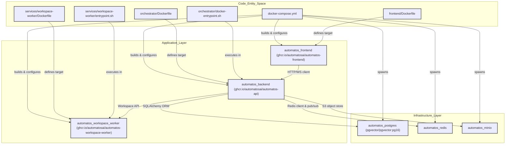
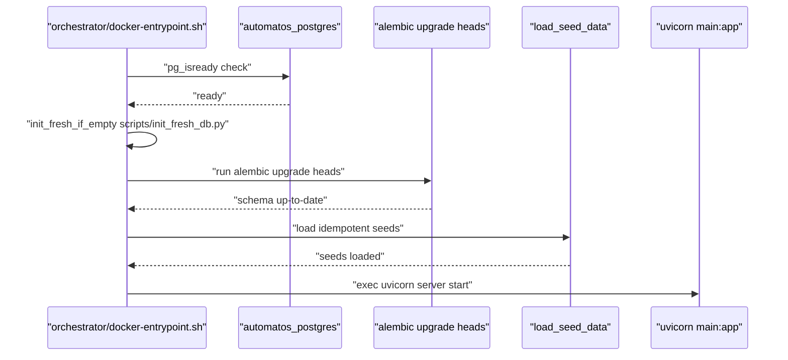
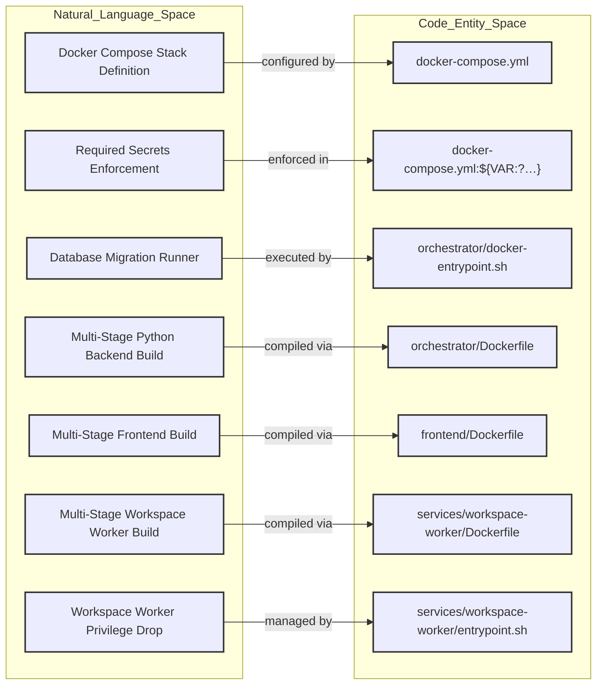

# Installation & Setup

<details>
<summary>Relevant source files</summary>

The following files were used as context for generating this wiki page:

- [.env.example](.env.example)
- [.github/workflows/images.yml](.github/workflows/images.yml)
- [.github/workflows/test.yml](.github/workflows/test.yml)
- [.grype.yaml](.grype.yaml)
- [QUICKSTART.md](QUICKSTART.md)
- [SETUP.md](SETUP.md)
- [charts/automatos/README.md](charts/automatos/README.md)
- [charts/automatos/templates/worker.yaml](charts/automatos/templates/worker.yaml)
- [docker-compose.yml](docker-compose.yml)
- [docs/agents/llm-provider-management.md](docs/agents/llm-provider-management.md)
- [docs/getting-started/self-hosting.md](docs/getting-started/self-hosting.md)
- [frontend/Dockerfile](frontend/Dockerfile)
- [frontend/components/marketplace/__tests__/github-import-modal.test.tsx](frontend/components/marketplace/__tests__/github-import-modal.test.tsx)
- [frontend/components/marketplace/__tests__/marketplace-admin-gate.test.ts](frontend/components/marketplace/__tests__/marketplace-admin-gate.test.ts)
- [frontend/lib/baseline-skills.ts](frontend/lib/baseline-skills.ts)
- [frontend/lib/tooltips.json](frontend/lib/tooltips.json)
- [orchestrator/Dockerfile](orchestrator/Dockerfile)
- [orchestrator/requirements-dev.lock](orchestrator/requirements-dev.lock)
- [orchestrator/requirements-dev.txt](orchestrator/requirements-dev.txt)
- [orchestrator/requirements.lock](orchestrator/requirements.lock)
- [orchestrator/tests/test_818_every_make_target_has_its_commands_in_the_guide.py](orchestrator/tests/test_818_every_make_target_has_its_commands_in_the_guide.py)
- [orchestrator/tests/test_compose_published_images.py](orchestrator/tests/test_compose_published_images.py)
- [orchestrator/tests/test_f452_worker_cannot_regain_privileges.py](orchestrator/tests/test_f452_worker_cannot_regain_privileges.py)
- [orchestrator/tests/test_prd262_agent_opt_worker_image.py](orchestrator/tests/test_prd262_agent_opt_worker_image.py)
- [orchestrator/tests/test_prd262_core_stack.py](orchestrator/tests/test_prd262_core_stack.py)
- [orchestrator/tests/test_prd262_dependabot.py](orchestrator/tests/test_prd262_dependabot.py)
- [orchestrator/tests/test_prd262_media_render_esbuild.py](orchestrator/tests/test_prd262_media_render_esbuild.py)
- [orchestrator/tests/test_prd262_media_render_stages.py](orchestrator/tests/test_prd262_media_render_stages.py)
- [orchestrator/tests/test_prd262_worker_boot.py](orchestrator/tests/test_prd262_worker_boot.py)
- [orchestrator/tests/test_prd262_worker_diet.py](orchestrator/tests/test_prd262_worker_diet.py)
- [orchestrator/tests/test_setup_runbook.py](orchestrator/tests/test_setup_runbook.py)
- [scripts/ci/image_worker_toolchain.py](scripts/ci/image_worker_toolchain.py)
- [scripts/ci/smoke-core-stack.sh](scripts/ci/smoke-core-stack.sh)
- [services/agent-opt-worker/Dockerfile](services/agent-opt-worker/Dockerfile)
- [services/agent-opt-worker/overrides.txt](services/agent-opt-worker/overrides.txt)
- [services/agent-opt-worker/requirements.in](services/agent-opt-worker/requirements.in)
- [services/agent-opt-worker/requirements.lock](services/agent-opt-worker/requirements.lock)
- [services/media-render/Dockerfile](services/media-render/Dockerfile)
- [services/media-render/requirements.lock](services/media-render/requirements.lock)
- [services/media-render/tests/test_image_esbuild.py](services/media-render/tests/test_image_esbuild.py)
- [services/workspace-worker/Dockerfile](services/workspace-worker/Dockerfile)
- [services/workspace-worker/entrypoint.sh](services/workspace-worker/entrypoint.sh)
- [services/workspace-worker/requirements.lock](services/workspace-worker/requirements.lock)

</details>


## Purpose & Scope
This page provides a comprehensive technical guide for installing, configuring, and initializing Automatos AI using Docker Compose in a self-hosted environment. It covers system prerequisites, environment variable management and required secrets enforcement, container orchestration profiles (`docker-compose.yml`), database initialization and migration lifecycles, multi-stage Docker builds (`orchestrator/Dockerfile`, `frontend/Dockerfile`, `services/workspace-worker/Dockerfile`), container diet optimizations under PRD-262, workspace worker volume permission handling (`services/workspace-worker/entrypoint.sh`), and validation/troubleshooting procedures.

Sources:  
[docker-compose.yml:1-81](), [docs/getting-started/self-hosting.md:1-25](), [.env.example:1-44](), [QUICKSTART.md:1-44](), [SETUP.md:1-85]()

---

## Prerequisites & System Requirements

Before initializing the installation, ensure the host system meets the following requirements:

- **Docker Engine 25+** with **Docker Compose 2.24.4+** (Docker Desktop on macOS/Windows, or Docker Engine on Linux). The composition file utilizes healthcheck `start_interval` probes and Compose v2 syntax (`${VAR:?…}` required variable expansion), making older Docker versions unsupported [docs/getting-started/self-hosting.md:24](), [docker-compose.yml:5-7]().
- **Git** for cloning the repository and managing updates (supports shallow clones `--depth 1`, fetching under 80 MB) [docs/getting-started/self-hosting.md:26](), [QUICKSTART.md:10]().
- **Disk Space**: Approximately 1.33 GB (amd64) or 1.28 GB (arm64) for compressed container image downloads, plus persistent data volumes for PostgreSQL (`pgvector`), Redis, MinIO, and workspace directories [docs/getting-started/self-hosting.md:25](), [QUICKSTART.md:119-120]().
- **Port Availability**: Default ports `3000` (frontend), `8000` (backend API), `5432` (PostgreSQL), `6379` (Redis), `9000` and `9001` (MinIO) must be unallocated or remapped via environment variables [docs/getting-started/self-hosting.md:27](), [SETUP.md:95]().
- **Platform Specifics**: On Windows, running Docker and the stack inside WSL2 is recommended for optimal performance and path compatibility [docs/getting-started/self-hosting.md:32-112](), [SETUP.md:49-80]().

Sources:  
[docs/getting-started/self-hosting.md:20-29](), [SETUP.md:37-96](), [QUICKSTART.md:14-20](), [docker-compose.yml:5-7]()

---

## Docker Compose Stack & Profiles

The platform defines its microservices in `docker-compose.yml`, supporting pre-built production images published to GitHub Container Registry (`ghcr.io/automatosai/automatos-*`) alongside source-build overrides [docker-compose.yml:1-82](), [QUICKSTART.md:110-115]().

| Service | Container Name | Role & Description |
| :--- | :--- | :--- |
| `postgres` | `automatos_postgres` | PostgreSQL 16 database with the `pgvector` extension (`pgvector/pgvector:pg16`) for vector memory [docker-compose.yml:88-105]() |
| `redis` | `automatos_redis` | Redis 7 cache, session store, and pub/sub message broker |
| `minio` | `automatos_minio` | Local S3-compatible object storage for durable artifact and document persistence [docker-compose.yml:122-138]() |
| `backend` | `automatos_backend` | FastAPI orchestrator API server running migrations and background loops [docker-compose.yml:1-180]() |
| `frontend` | `automatos_frontend` | Next.js frontend serving the operator user interface [docker-compose.yml:1-219]() |
| `workspace-worker`| `automatos_workspace_worker` | Filesystem sandboxed execution worker for Code Canvas and terminal sessions [docker-compose.yml:1-269]() |

### Compose Profiles
- **Default**: Runs `postgres`, `redis`, `minio`, `qdrant`, `backend`, `frontend`, and `workspace-worker` (plus `minio-volume-owner`) [docker-compose.yml:52-66]()
- **Core (`CORE=1`)**: Runs without the workspace-worker [docker-compose.yml:72-78]()
- **Memory**: `qdrant` durable memory runs in the default stack; memory also needs an embeddings key in Settings → API Keys [docker-compose.yml:68]()
- **Search (`--profile search`)**: Adds `searxng` web search engine [docker-compose.yml:69]()
- **Media (`--profile media`)**: Adds `media-render` for socials rendering [docker-compose.yml:70-71]()
- **Voice (`--profile voice`)**: Adds `voice-tts` for Auto's server voice [docker-compose.yml:71-72]()
- **All (`--profile all`)**: Adds `adminer` database GUI [docker-compose.yml:67]()

Sources:  
[docker-compose.yml:1-82](), [docs/getting-started/self-hosting.md:52-80]()

---

## Environment Variables & Required Secrets

Docker Compose enforces strict startup validation for three mandatory credentials. If any of these are missing or retain placeholder `CHANGE_ME` values, container initialization aborts via `orchestrator/docker-secrets-guard.sh` [docker-compose.yml:46-48](), [.env.example:1-35]():

| Variable | Requirement & Validation | Affected Services |
| :--- | :--- | :--- |
| `POSTGRES_PASSWORD` | Mandatory secure password [docker-compose.yml:95]() | `postgres`, `backend`, `workspace-worker` |
| `REDIS_PASSWORD` | Mandatory secure password [.env.example:23]() | `redis`, `backend`, `workspace-worker` |
| `API_KEY` | Mandatory backend API authentication key [.env.example:30]() | Backend API |

Running `make up` automatically executes `make env`, generating random hex values (`openssl rand -hex 24`) for unconfigured or placeholder secrets in `.env` before initial startup [QUICKSTART.md:31-36](), [.env.example:4-7]().

Sources:  
[docker-compose.yml:46-48](), [.env.example:1-44](), [QUICKSTART.md:22-37]()

---

## System Architecture & Component Mapping

Title: "System Architecture to Code Entity Mapping"


Sources:  
[docker-compose.yml:1-82](), [orchestrator/Dockerfile:1-30](), [frontend/Dockerfile:1-25](), [services/workspace-worker/Dockerfile:1-30]()

---

## Service Initialization & Startup Sequence

When the backend container boots, its entrypoint executes a sequential readiness and migration lifecycle before starting the `uvicorn` application server:

1. **PostgreSQL Health Probe**: Verifies database responsiveness using health checks (`pg_isready`) [docker-compose.yml:100-105]()
2. **Fresh DB Initialization**: If no Alembic revision stamp exists, initialization scripts bootstrap baseline schema and tables
3. **Migration Enforcement**: Executes database schema revisions, failing closed upon any migration error
4. **Seed Loading**: Populates baseline data, default agents, and workspace records idempotently
5. **Server Launch**: Starts the FastAPI application via `uvicorn`

The `workspace-worker` container uses `services/workspace-worker/entrypoint.sh` to handle ownership of mounted volumes before dropping privileges to the non-root `worker` user via `setpriv` [services/workspace-worker/entrypoint.sh:54-93](). If `uid 1000` cannot write to `LOCAL_WORKSPACE_ROOT`, the entrypoint assigns the folder owner's UID/GID to the worker process so host deliverables remain fully accessible without permission denied errors [services/workspace-worker/entrypoint.sh:4-52]().

Title: "Backend Initialization Lifecycle Sequence"


Sources:  
[docker-compose.yml:100-105](), [orchestrator/Dockerfile:1-50](), [services/workspace-worker/entrypoint.sh:1-93]()

---

## Dependency Installation & Multi-Stage Docker Builds

Automatos AI implements multi-stage Docker builds under PRD-262 container diet specifications to separate compilation toolchains from lean runtime images:

- **Orchestrator Build (`orchestrator/Dockerfile`)**: Uses `python:3.11-slim` with `uv` installer (`ghcr.io/astral-sh/uv:0.13.4`) and compilers (`gcc`, `g++`) to install locked dependencies from `requirements.lock` into isolated prefix trees (`/install/stable`, `/install/rest`), stripping debug symbols (`strip --strip-unneeded`) and test suites before building the final slim runtime image [orchestrator/Dockerfile:20-95]().
- **Frontend Build (`frontend/Dockerfile`)**: Uses Node.js 24 Alpine base (`node:24-alpine3.24`) to execute `npm ci` and compile Next.js standalone outputs, minimizing bundle footprints [frontend/Dockerfile:22-110]().
- **Workspace Worker Build (`services/workspace-worker/Dockerfile`)**: Uses `python:3.12-slim` and `node:24-trixie-slim`. It compiles `psycopg2` against Debian's `libpq` for a smaller footprint and installs a minimal set of DevOps tools (`git`, `curl`, `wget`, `openssh-client`) for agent workspaces [services/workspace-worker/Dockerfile:39-106](). Node.js is stripped of symbols to reduce image size [services/workspace-worker/Dockerfile:15-21]().

Sources:  
[orchestrator/Dockerfile:1-110](), [frontend/Dockerfile:1-125](), [services/workspace-worker/Dockerfile:1-106]()

---

## Natural Language to Code Entity Mapping

Title: "Natural Language to Code Entity Bridge"


Sources:  
[docker-compose.yml:1-82](), [orchestrator/Dockerfile:1-50](), [frontend/Dockerfile:1-50](), [services/workspace-worker/Dockerfile:1-50](), [services/workspace-worker/entrypoint.sh:1-93]()

---

## Verification & Troubleshooting

To verify a successful installation and container health:

1. Check container execution status:
   ```bash
   docker compose ps
   ```
2. Query backend health endpoints:
   ```bash
   curl -f http://localhost:8000/health
   curl -f http://localhost:8000/health/ready
   ```
3. Inspect container logs for migration or startup errors:
   ```bash
   docker logs automatos_postgres
   docker logs automatos_backend
   docker logs automatos_workspace_worker
   ```

Sources:  
[docker-compose.yml:100-105](), [docs/getting-started/self-hosting.md:1-25](), [QUICKSTART.md:104-140]()

---