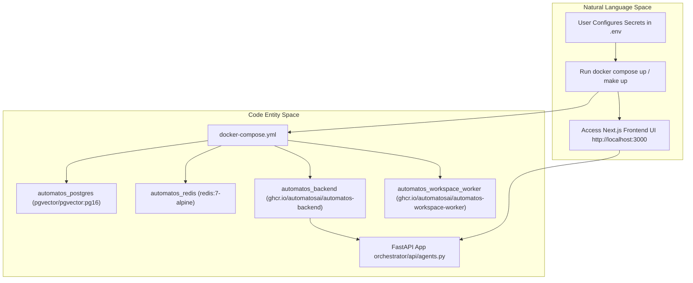
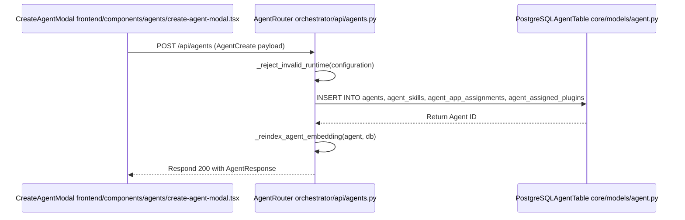
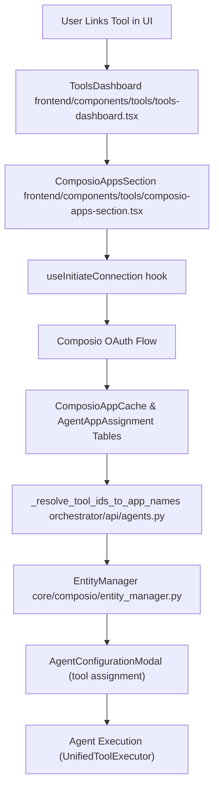
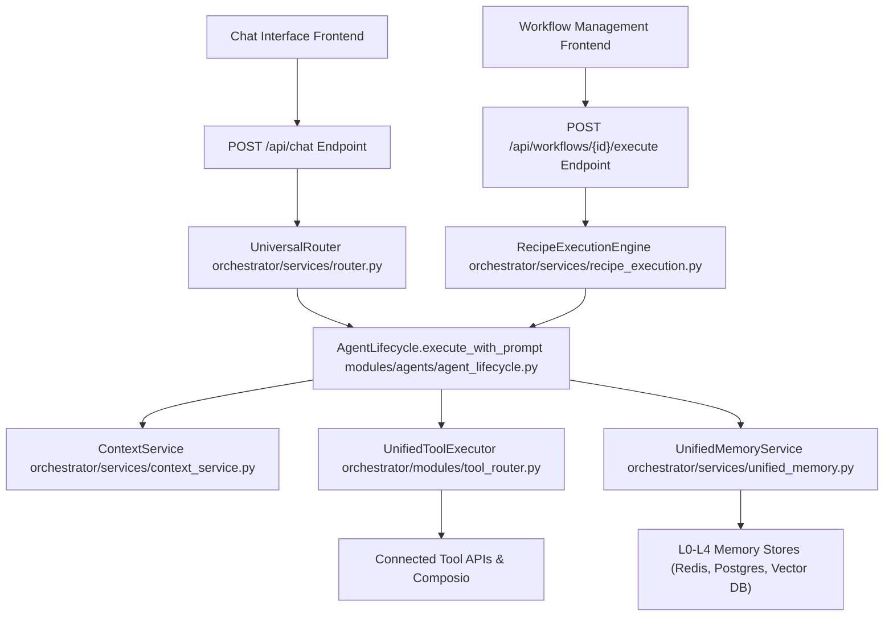

# Quick Start Tutorial

Relevant source files

The following files were used as context for generating this wiki page:

- [frontend/components/agents/agent-configuration-modal.tsx](frontend/components/agents/agent-configuration-modal.tsx)
- [frontend/components/agents/agent-configuration.tsx](frontend/components/agents/agent-configuration.tsx)
- [frontend/components/agents/agent-details-modal.tsx](frontend/components/agents/agent-details-modal.tsx)
- [frontend/components/agents/agent-management.tsx](frontend/components/agents/agent-management.tsx)
- [frontend/components/agents/agent-performance.tsx](frontend/components/agents/agent-performance.tsx)
- [frontend/components/agents/agent-roster.tsx](frontend/components/agents/agent-roster.tsx)
- [frontend/components/agents/agent-skills.tsx](frontend/components/agents/agent-skills.tsx)
- [frontend/components/agents/agent-status-control-modal.tsx](frontend/components/agents/agent-status-control-modal.tsx)
- [frontend/components/agents/create-agent-modal.tsx](frontend/components/agents/create-agent-modal.tsx)
- [frontend/components/agents/create-skill-modal.tsx](frontend/components/agents/create-skill-modal.tsx)
- [frontend/components/agents/skill-configuration-modal.tsx](frontend/components/agents/skill-configuration-modal.tsx)
- [frontend/components/documents/document-management.tsx](frontend/components/documents/document-management.tsx)
- [frontend/components/tools/tools-dashboard.tsx](frontend/components/tools/tools-dashboard.tsx)
- [frontend/components/workflows/active-workflows-panel.tsx](frontend/components/workflows/active-workflows-panel.tsx)
- [frontend/components/workflows/workflow-management.tsx](frontend/components/workflows/workflow-management.tsx)
- [frontend/hooks/use-agent-api.ts](frontend/hooks/use-agent-api.ts)
- [frontend/lib/agent-constants.ts](frontend/lib/agent-constants.ts)
- [orchestrator/alembic/versions/add_job_title_to_agents.py](orchestrator/alembic/versions/add_job_title_to_agents.py)
- [orchestrator/api/agents.py](orchestrator/api/agents.py)

This page provides a technical walkthrough for getting started with Automatos AI. You will learn how to initialize the platform environment, create your first agent via UI components and backend helpers (`_reindex_agent_embedding`), connect third-party tools via `ToolsDashboard`, and execute chats or workflows using the orchestrator infrastructure.

---

## 1. Environment Initialization & Setup

Before creating agents or running workflows, platform services must be provisioned. Automatos AI relies on PostgreSQL with `pgvector`, Redis, and optional S3/MinIO storage orchestrated via Docker Compose [docs/getting-started/self-hosting.md:8-25]().

### Configuration Prerequisites

- **Secrets**: Three core secrets (`POSTGRES_PASSWORD`, `REDIS_PASSWORD`, `API_KEY`) must be set in `.env` to enable database access, Redis caching, and API authentication [docs/getting-started/self-hosting.md:16-25](). The backend refuses to start if these are placeholders [docker-compose.yml:46-48]().
- **LLM Keys**: Provider API keys (`OPENAI_API_KEY`, `ANTHROPIC_API_KEY`, or `OPENROUTER_API_KEY`) can be supplied via environment variables or managed through the UI credential store [docs/getting-started/self-hosting.md:27-111]().

### Boot and Initialization Flow

Running `docker compose up` or `make up` initializes the architecture stack:

- PostgreSQL with `pgvector` for relational data and semantic embeddings [docker-compose.yml:88-104]().
- Redis for pub/sub, caching, and background task queues [docker-compose.yml:106-120]().
- FastAPI orchestrator backend (`orchestrator/api/`) serving REST endpoints [docker-compose.yml:122-160]().
- Next.js frontend user interface (`frontend/`) [docker-compose.yml:162-196]().
- Workspace worker for sandboxed code execution (`services/workspace-worker/`) [docker-compose.yml:198-236]().

Title: "Environment Initialization Bridge"

Sources: [docs/getting-started/self-hosting.md:8-25](), [docs/getting-started/self-hosting.md:27-111](), [orchestrator/api/agents.py:1-36](), [docker-compose.yml:46-48](), [docker-compose.yml:88-104](), [docker-compose.yml:106-120](), [docker-compose.yml:122-160](), [docker-compose.yml:162-196](), [docker-compose.yml:198-236]()

---

## 2. Agent Creation & Configuration Flow

Agents are autonomous AI workers configured with models, skills, plugins, and tool grants. Management relies on React components on the frontend and factory services on the backend.

### Frontend Agent Components

- **CreateAgentModal**: Captures user inputs for agent creation including name, category, description, initial plugins, and tools [frontend/components/agents/create-agent-modal.tsx:67-79](). It also handles model configuration and runtime settings [frontend/components/agents/create-agent-modal.tsx:82-85]().
- **AgentConfigurationModal**: Manages persistent agent settings, resource limits, heartbeat configurations, persona, and skill/plugin assignments [frontend/components/agents/agent-configuration-modal.tsx:98-171]().
- **AgentRoster**: Renders the active roster in grid or list views, supporting status changes, configuration, and deletion [frontend/components/agents/agent-roster.tsx:206-221]().

### Backend Factory & Endpoints

- The frontend issues requests to `/api/agents` managed by `router` in [orchestrator/api/agents.py:35-36]().
- The backend processes the request, validating parameters (e.g., `_reject_invalid_runtime` for session mode agents [orchestrator/api/agents.py:38-54]()) and provisioning database records within `Agent` and association tables [orchestrator/api/agents.py:1-26]().
- Background semantic re-indexing is triggered via `_reindex_agent_embedding()` to update agent routing vectors [orchestrator/api/agents.py:61-89]().

Title: "Agent Creation Sequence"

Sources: [frontend/components/agents/create-agent-modal.tsx:67-79](), [frontend/components/agents/create-agent-modal.tsx:82-85](), [orchestrator/api/agents.py:35-89](), [orchestrator/api/agents.py:38-54](), [orchestrator/api/agents.py:1-26](), [frontend/components/agents/agent-configuration-modal.tsx:98-171](), [frontend/components/agents/agent-roster.tsx:206-221](), [frontend/hooks/use-agent-api.ts:23-46]()

---

## 3. Connecting Tools & Integrations

Agents execute tasks by invoking tools, which are managed workspace-wide through the tools dashboard and resolved dynamically at runtime.

### Tool Management & Resolution

- **ToolsDashboard**: Provides tabs for marketplace tools and connected integrations [frontend/components/tools/tools-dashboard.tsx:129-136](). It uses `useTools` and `useIntegrationsStatus` hooks to fetch data [frontend/components/tools/tools-dashboard.tsx:166-185]().
- **_resolve_tool_ids_to_app_names**: Maps incoming tool IDs (`ComposioAppCache.id` or frontend stable hash) into `app_name` strings, ensuring only tools connected for the current workspace are allowed [orchestrator/api/agents.py:142-164](). This uses `EntityManager` to get connected apps [orchestrator/api/agents.py:151-162]().
- **Composio Integration**: The `ComposioAppsSection` component handles the display and interaction with Composio-powered integrations, including connection initiation and disconnection [frontend/components/tools/tools-dashboard.tsx:62-65]().

Title: "Tool Connection Architecture"

Sources: [frontend/components/tools/tools-dashboard.tsx:129-136](), [frontend/components/tools/tools-dashboard.tsx:166-185](), [orchestrator/api/agents.py:142-164](), [orchestrator/api/agents.py:151-162](), [frontend/components/tools/tools-dashboard.tsx:62-65]()

---

## 4. Executing Chats & Workflows

Once agents and tools are configured, users can interact via real-time chat or orchestrate multi-agent operations through recipes and workflows.

### Execution Components & Services

| Component / Service | Responsibility | Code Reference |
|-------------------|----------------|----------------|
| `AgentManagement` | Unified management UI for rosters, org charts, and configurations | [frontend/components/agents/agent-management.tsx:45-56]() |
| `AgentRoster` | Grid/list view for monitoring agent statuses and quick actions, including starting/stopping agents | [frontend/components/agents/agent-roster.tsx:206-221]() |
| `WorkflowManagement` | UI for workflow templates, active runs, and execution kitchens | [frontend/components/workflows/workflow-management.tsx:175-185]() |
| `ActiveWorkflowsPanel` | Displays currently running workflows and their status | [frontend/components/workflows/active-workflows-panel.tsx:30-35]() |

### Natural Language to Code Entity Space: Execution Flow

Title: "Execution Bridge"

Sources: [frontend/components/agents/agent-management.tsx:45-56](), [frontend/components/agents/agent-roster.tsx:206-221](), [frontend/components/workflows/workflow-management.tsx:175-185](), [frontend/components/workflows/active-workflows-panel.tsx:30-35]()

---