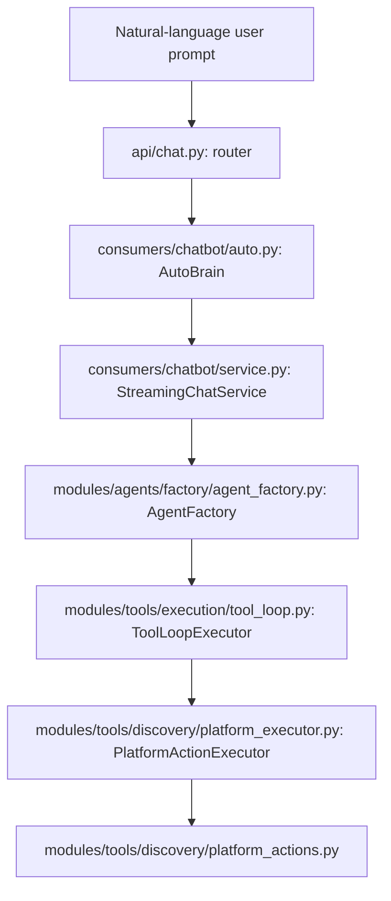
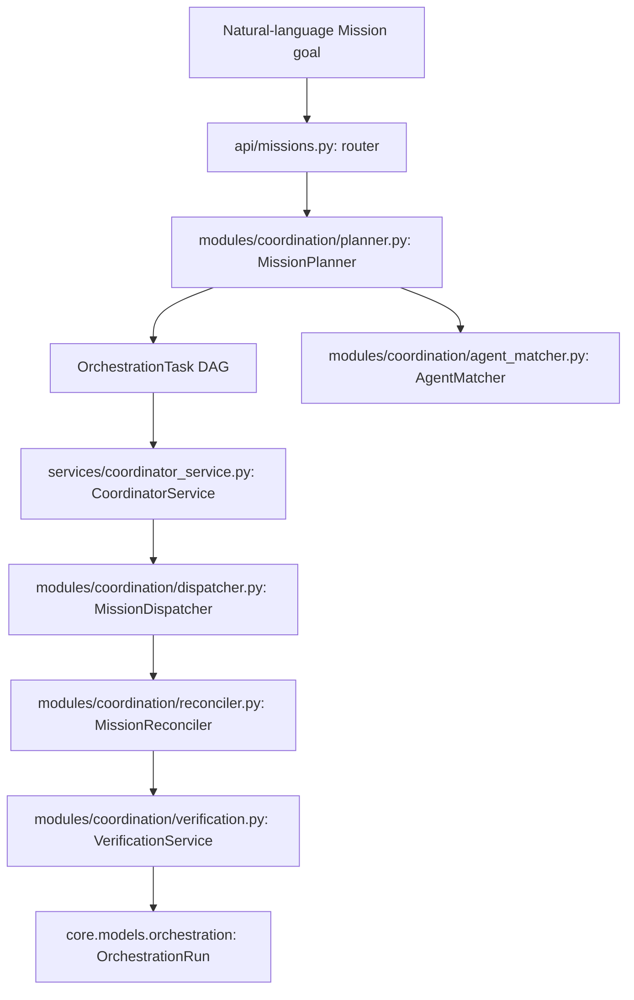

# Glossary

Relevant source files

The following files were used as context for generating this wiki page:

- [README.md](README.md)
- [docs/PRDS/PRD-269-AUTOMATIC-LANGUAGE.md](docs/PRDS/PRD-269-AUTOMATIC-LANGUAGE.md)
- [docs/assets/showcase/go-play-chat-laptop.jpg](docs/assets/showcase/go-play-chat-laptop.jpg)
- [docs/assets/showcase/go-play-shelf-blog.jpg](docs/assets/showcase/go-play-shelf-blog.jpg)
- [docs/voice-auto-live/voice-ui-components.md](docs/voice-auto-live/voice-ui-components.md)
- [docs/voice/_index.md](docs/voice/_index.md)
- [frontend/lib/chat/__tests__/turn-stream.test.ts](frontend/lib/chat/__tests__/turn-stream.test.ts)
- [frontend/lib/chat/turn-stream.ts](frontend/lib/chat/turn-stream.ts)
- [frontend/lib/voice/quick-ask/__tests__/audio-player.test.ts](frontend/lib/voice/quick-ask/__tests__/audio-player.test.ts)
- [frontend/lib/voice/quick-ask/__tests__/quick-ask-browser.test.ts](frontend/lib/voice/quick-ask/__tests__/quick-ask-browser.test.ts)
- [frontend/lib/voice/quick-ask/__tests__/quick-ask-engine.test.ts](frontend/lib/voice/quick-ask/__tests__/quick-ask-engine.test.ts)
- [frontend/lib/voice/quick-ask/__tests__/quick-ask-server-voice.test.ts](frontend/lib/voice/quick-ask/__tests__/quick-ask-server-voice.test.ts)
- [frontend/lib/voice/quick-ask/__tests__/server-speech-fakes.ts](frontend/lib/voice/quick-ask/__tests__/server-speech-fakes.ts)
- [frontend/lib/voice/quick-ask/__tests__/server-speech-fallback.test.ts](frontend/lib/voice/quick-ask/__tests__/server-speech-fallback.test.ts)
- [frontend/lib/voice/quick-ask/__tests__/server-speech.test.ts](frontend/lib/voice/quick-ask/__tests__/server-speech.test.ts)
- [frontend/lib/voice/quick-ask/config.ts](frontend/lib/voice/quick-ask/config.ts)
- [frontend/lib/voice/quick-ask/create-engine.ts](frontend/lib/voice/quick-ask/create-engine.ts)
- [frontend/lib/voice/quick-ask/deps.ts](frontend/lib/voice/quick-ask/deps.ts)
- [frontend/lib/voice/quick-ask/turn.ts](frontend/lib/voice/quick-ask/turn.ts)
- [orchestrator/alembic/versions/prd263_harness_ledger_grants.py](orchestrator/alembic/versions/prd263_harness_ledger_grants.py)
- [orchestrator/alembic/versions/prd266_merge_heads.py](orchestrator/alembic/versions/prd266_merge_heads.py)
- [orchestrator/alembic/versions/prd266_mobile_devices.py](orchestrator/alembic/versions/prd266_mobile_devices.py)
- [orchestrator/core/auth/device.py](orchestrator/core/auth/device.py)
- [orchestrator/core/models/__init__.py](orchestrator/core/models/__init__.py)
- [orchestrator/core/models/core.py](orchestrator/core/models/core.py)
- [orchestrator/core/models/harness.py](orchestrator/core/models/harness.py)
- [orchestrator/core/services/auto_cadence.py](orchestrator/core/services/auto_cadence.py)
- [orchestrator/router_manifest.py](orchestrator/router_manifest.py)
- [orchestrator/scripts/harness_backfill_runs.py](orchestrator/scripts/harness_backfill_runs.py)
- [orchestrator/services/themes/data/core-pages.json](orchestrator/services/themes/data/core-pages.json)
- [orchestrator/tests/test_prd209_alembic_single_head.py](orchestrator/tests/test_prd209_alembic_single_head.py)
- [orchestrator/tests/test_prd236_w1_routes.py](orchestrator/tests/test_prd236_w1_routes.py)
- [orchestrator/tests/test_prd263_harness_backfill_runs.py](orchestrator/tests/test_prd263_harness_backfill_runs.py)
- [orchestrator/tests/test_prd263_harness_history_runs.py](orchestrator/tests/test_prd263_harness_history_runs.py)
- [orchestrator/tests/test_prd263_harness_ledger_migration.py](orchestrator/tests/test_prd263_harness_ledger_migration.py)
- [orchestrator/tests/test_prd263_harness_review_cadence.py](orchestrator/tests/test_prd263_harness_review_cadence.py)
- [orchestrator/tests/test_prd266_device_lane.py](orchestrator/tests/test_prd266_device_lane.py)
- [orchestrator/tests/test_prd266_mobile_devices_model.py](orchestrator/tests/test_prd266_mobile_devices_model.py)
- [orchestrator/tests/test_prd266_mobile_devices_routes.py](orchestrator/tests/test_prd266_mobile_devices_routes.py)
- [services/voice-tts/README.md](services/voice-tts/README.md)

## Purpose and Scope

This page defines codebase-specific terms for onboarding engineers. It maps product language to the classes, services, models, and routes that implement those concepts. [README.md:22-40]()

Sources: [README.md:22-40]()

---

## Core Concepts & Entities

### Auto

**Auto** is the conversational interface through which a user can direct work to an agent, tool, or Playbook. It is the platform’s “shell” concept: users express a goal, and Automatos routes and executes it. [README.md:29-40]()

Sources: [README.md:29-40]()

### AutoBrain

**AutoBrain** is the complexity-assessment and tool-hinting concept associated with chat routing. The existing page identifies `orchestrator/consumers/chatbot/auto.py` as its implementation; consult that module when tracing how an incoming request is assessed and how its hints reach chat execution. [orchestrator/consumers/chatbot/auto.py:1-25]()

Sources: [orchestrator/consumers/chatbot/auto.py:1-25]()

### Workspace

A **Workspace** is the tenant and organizational boundary for a user’s agents, data, and Deliverables. Workspace scoping appears in the model and request-context paths; follow `workspace_id` through those paths when investigating isolation behavior. [orchestrator/core/models/workspaces.py:1-30](), [orchestrator/core/auth/hybrid.py:1-25]()

Sources: [orchestrator/core/models/workspaces.py:1-30](), [orchestrator/core/auth/hybrid.py:1-25]()

### Mission

A **Mission** is a goal coordinated across agents and tasks. The orchestration data model includes `OrchestrationRun`, `OrchestrationTask`, dependencies, and events; orchestration state enums define the run and task lifecycle. [orchestrator/core/models/__init__.py:60-82](), [orchestrator/core/models/orchestration_enums.py:43-80]()

Sources: [orchestrator/core/models/__init__.py:60-82](), [orchestrator/core/models/orchestration_enums.py:43-80]()

### Playbook / Recipe

A **Playbook** (also called a **Recipe**) is a reusable, multi-step automation. Playbooks are the “programs” concept in the product’s operating-system analogy; execution and scheduling details live in the workflow and recipe execution paths. [README.md:31-40](), [orchestrator/api/workflow_recipes.py:81-169](), [orchestrator/api/recipe_executor.py:1-19]()

Sources: [README.md:31-40](), [orchestrator/api/workflow_recipes.py:81-169](), [orchestrator/api/recipe_executor.py:1-19]()

### BoardTask / Ticket Number

A **BoardTask** is a unit of work represented on the Command Center board. A **Ticket Number** is its human-readable, workspace-scoped identifier. `BoardTask` is exposed through the model package, and `WorkspaceTicketCounter` provides the per-workspace counter model. [orchestrator/core/models/__init__.py:99-101](), [orchestrator/core/models/__init__.py:112-115](), [orchestrator/core/models/ticket_numbers.py:1-20]()

Sources: [orchestrator/core/models/__init__.py:99-101](), [orchestrator/core/models/__init__.py:112-115](), [orchestrator/core/models/ticket_numbers.py:1-20]()

### Deliverable

A **Deliverable** is an output produced by platform work—such as a report, code, content, or analysis—that is surfaced as a durable workspace artifact. The backend API surface includes a `deliverables` router; the service and UI pointers below are useful entry points for tracing its lifecycle. [README.md:22-22](), [orchestrator/router_manifest.py:71-73](), [frontend/lib/api-client.ts:149-155]()

Sources: [README.md:22-22](), [orchestrator/router_manifest.py:71-73](), [frontend/lib/api-client.ts:149-155]()

### Automatos Go

**Automatos Go** is the mobile companion app. The README describes its phone experience; backend route registration identifies the mobile-device and mobile-push APIs, and the model package exposes the associated device and push models. [README.md:89-90](), [orchestrator/router_manifest.py:107-112](), [orchestrator/core/models/__init__.py:20-21]()

Sources: [README.md:89-90](), [orchestrator/router_manifest.py:107-112](), [orchestrator/core/models/__init__.py:20-21]()

### Core Stack

The **Core Stack** is the infrastructure base on which Automatos runs. The README describes the local edition as using PostgreSQL with pgvector and Redis, alongside the orchestrator and other supporting services. Database initialization and migration guards are covered by the fresh-database and Alembic single-head test. [README.md:43-50](), [orchestrator/tests/test_prd209_alembic_single_head.py:1-29]()

Sources: [README.md:43-50](), [orchestrator/tests/test_prd209_alembic_single_head.py:1-29]()

---

## Architecture, Routing & Execution Subsystems

### Composio

**Composio** is an integration path for third-party tools. The README describes it as one source of tool integrations; the model package imports Composio-related models optionally, and the router manifest treats the Composio API router as an optional integration. [README.md:37-41](), [orchestrator/core/models/__init__.py:133-137](), [orchestrator/router_manifest.py:51-57]()

Sources: [README.md:37-41](), [orchestrator/core/models/__init__.py:133-137](), [orchestrator/router_manifest.py:51-57]()

### Platform Action

A **Platform Action** is an agent-callable capability for inspecting or managing Automatos itself. Use `PlatformActionExecutor` and the platform action definitions as entry points for action dispatch and registration. The available source pointers identify the executor and action definitions, but action-specific permissions and effects should be verified in those implementations. [orchestrator/modules/tools/discovery/platform_executor.py:1-10](), [orchestrator/modules/tools/discovery/platform_actions.py:1-15]()

Sources: [orchestrator/modules/tools/discovery/platform_executor.py:1-10](), [orchestrator/modules/tools/discovery/platform_actions.py:1-15]()

### Context Mode

A **Context Mode** selects a prompt-assembly profile for a particular consumer. The named modes include `CHATBOT`, `TASK_EXECUTION`, `HEARTBEAT`, `RECIPE`, `ROUTER`, `ORCHESTRATOR_STAGE`, and `NL2SQL`. Trace the mode configuration and `ContextService` implementation when investigating which sections are assembled for a given operation. [orchestrator/config.py:99-109]()

Sources: [orchestrator/config.py:99-109]()

### RequestEnvelope

A **RequestEnvelope** is the common representation of an incoming request used by the Universal Router. It provides a code entry point for tracing normalized request data into routing decisions. [orchestrator/core/models/routing.py:1-30]()

Sources: [orchestrator/core/models/routing.py:1-30]()

### Harness

**Harness** refers to the platform’s self-management and improvement system. Its persisted records include `HarnessTaskLedger` for proposed changes and their outcomes, and `HarnessRun` for a workspace run, its judged time window, status, counts, prescriptions, and report. These records are defined in `core/models/harness.py`; the model package exports them. [orchestrator/core/models/harness.py:1-18](), [orchestrator/core/models/harness.py:61-131](), [orchestrator/core/models/__init__.py:112-113]()

Sources: [orchestrator/core/models/harness.py:1-18](), [orchestrator/core/models/harness.py:61-131](), [orchestrator/core/models/__init__.py:112-113]()

### Scratchpad

A **Scratchpad** is structured intermediate data shared between steps of a workflow or Recipe. The existing implementation pointer is the recipe executor; inspect it alongside the `scratchpad_write` tool to trace how values are written and made available to later steps. [orchestrator/api/recipe_executor.py:14-19]()

Sources: [orchestrator/api/recipe_executor.py:14-19]()

### Vector Field

A **Vector Field** is the shared semantic-memory concept used for retrieval across agents. The existing code pointer is `VectorFieldSharedContext`, which implements the shared-context adapter boundary. [orchestrator/modules/context/adapters/vector_field.py:1-20]()

Sources: [orchestrator/modules/context/adapters/vector_field.py:1-20]()

### Power Mode

A **Power Mode** is an execution profile used to scale resource use for orchestration work. The existing coordinator pointer is where to trace its use in Mission execution and dispatch policies. [orchestrator/services/coordinator_service.py:101-107]()

Sources: [orchestrator/services/coordinator_service.py:101-107]()

### Dispatch Spine

The **Dispatch Spine** is the shared dispatch path for queued work. The existing implementation pointer is the dispatch configuration and background-service path; follow those settings into the dispatcher and worker code to understand claim and execution behavior. [orchestrator/config.py:41-47]()

Sources: [orchestrator/config.py:41-47]()

### Lease Heartbeat

A **Lease Heartbeat** is a periodic liveness signal associated with a worker or leased task. The existing pointer identifies dispatch lease settings; inspect the worker and lease implementation together to determine how a lease is renewed and how stale work is handled. [orchestrator/config.py:44-45]()

Sources: [orchestrator/config.py:44-45]()

---

## Memory, Proactive & Intelligence Subsystems

### Memory Layer L0-L4

The **L0–L4** labels describe a tiered memory model, from immediate focus through working and longer-term memory to organization knowledge. The existing configuration pointer is the starting point for the tier settings; consult each layer’s storage and retrieval implementation before relying on a particular backend or retention policy. [orchestrator/config.py:93-130]()

| Layer | Glossary meaning |
|---|---|
| `L0` | Focus: immediate context relevant to the current interaction. |
| `L1` | Working memory: active, short-lived context. |
| `L2` | Short-term memory: persisted conversational or task memory. |
| `L3` | Long-term memory: selected, durable memories. |
| `L4` | Organization knowledge: shared knowledge and retrieval sources. |

Sources: [orchestrator/config.py:93-130]()

### Check-In / Suggestion (PRD-268)

A **Check-In** is a proactive run; a **Suggestion** is a persisted item that the user can act on or dismiss. The model package exports `ProactiveRun` and `ProactiveSuggestion`, and the router manifest registers the proactive routes. [orchestrator/core/models/__init__.py:118-119](), [orchestrator/router_manifest.py:115-123]()

Sources: [orchestrator/core/models/__init__.py:118-119](), [orchestrator/router_manifest.py:115-123]()

### Brief

A **Brief** is a proactive summary presented to a user, with an API route for recording a brief-open event. The relevant backend entry point is `api.proactive_brief`; the frontend API client is an additional pointer for tracing its consumer. [orchestrator/router_manifest.py:118-120](), [frontend/lib/api-client.ts:149-155]()

Sources: [orchestrator/router_manifest.py:118-120](), [frontend/lib/api-client.ts:149-155]()

### Readiness

**Readiness** describes whether the platform or its dependencies meet the conditions checked by the readiness surface. The router manifest registers `api.readiness` and its check route; use the readiness service and API implementation to identify the probes and their failure semantics. [orchestrator/router_manifest.py:124-126](), [frontend/lib/api-client.ts:118-122]()

Sources: [orchestrator/router_manifest.py:124-126](), [frontend/lib/api-client.ts:118-122]()

---

## Runtime, Themes & Session Host

### Theme Host / Look

A **Theme Host** loads a theme’s UI into the application shell. A **Look** is a saved or selected visual configuration within that theming system. The model package exports theme entities such as `ThemeLook`, `ThemeInstallation`, and `ThemePackage`; the README describes themes as packages that redraw Studio. [README.md:58-80](), [orchestrator/core/models/__init__.py:26-50]()

Sources: [README.md:58-80](), [orchestrator/core/models/__init__.py:26-50]()

### Session Mode / CLI Host

**Session Mode** lets an external command-line agent runtime participate in Automatos. The model package exports `CliHost`, and the router manifest registers CLI-host and session-tools APIs. The README notes that using one’s own Claude Code session as an agent is local-edition functionality. [README.md:47-50](), [orchestrator/core/models/__init__.py:19](), [orchestrator/router_manifest.py:93-98]()

Sources: [README.md:47-50](), [orchestrator/core/models/__init__.py:19](), [orchestrator/router_manifest.py:93-98]()

### Widget Scope

**Widget Scope** is the access boundary associated with an embedded widget’s request and workspace context. The frontend API-client pointer is an entry point for seeing how widget requests are scoped; the backend widget routes and authorization checks define the enforcement details. [frontend/lib/api-client.ts:91-96]()

Sources: [frontend/lib/api-client.ts:91-96]()

### Trial Ledger

A **Trial Ledger** is a workspace’s recorded accounting of trial or credit-related state. The model package exports `CreditBalance` and `CreditLedgerEntry`; use the billing and credits implementations to trace balance updates and enforcement. [orchestrator/core/models/__init__.py:116-118](), [orchestrator/core/models/credits.py:1-25]()

Sources: [orchestrator/core/models/__init__.py:116-118](), [orchestrator/core/models/credits.py:1-25]()

### Content Hash

A **Content Hash** is a digest associated with content, used by relevant workflows to identify content or detect changes. The socials API pointer is an entry point for the existing social-post use; inspect its write and state-transition paths before assuming the hash has a particular concurrency guarantee. [orchestrator/api/socials.py:68-78]()

Sources: [orchestrator/api/socials.py:68-78]()

---

## Architecture Bridges: Natural Language to Code Entity Mapping

### Natural Language Chat Routing to Code Entities

This diagram connects the user-facing request path to named code entry points. Read it as a navigation map, then verify each call edge in the cited implementation. [README.md:29-40](), [orchestrator/consumers/chatbot/auto.py:1-25](), [orchestrator/consumers/chatbot/service.py:1-20]()

Title: "Natural Language Chat Routing to Code Entities"

Sources: [README.md:29-40](), [orchestrator/api/chat.py:1-40](), [orchestrator/consumers/chatbot/auto.py:1-25](), [orchestrator/consumers/chatbot/service.py:1-20](), [orchestrator/modules/agents/factory/agent_factory.py:1-110](), [orchestrator/modules/tools/discovery/platform_executor.py:1-15](), [orchestrator/modules/tools/discovery/platform_actions.py:1-15]()

### Mission Goal to Orchestration Entities

This diagram maps a natural-language Mission goal to the planning and orchestration concepts that represent it in code. [orchestrator/core/models/__init__.py:60-82](), [orchestrator/core/models/orchestration_enums.py:43-80]()

Title: "Mission Goal Decomposition to Code Entities"

Sources: [orchestrator/api/missions.py:1-20](), [orchestrator/modules/coordination/planner.py:1-15](), [orchestrator/modules/coordination/agent_matcher.py:1-15](), [orchestrator/services/coordinator_service.py:1-20](), [orchestrator/modules/coordination/dispatcher.py:1-15](), [orchestrator/modules/coordination/reconciler.py:1-15](), [orchestrator/modules/coordination/verification.py:1-15](), [orchestrator/core/models/__init__.py:60-82]()

Sources: [orchestrator/core/models/__init__.py:60-82](), [orchestrator/core/models/orchestration_enums.py:43-80]()

---

## Comprehensive Glossary Reference Table

| Term | Technical definition | Code pointer |
|---|---|---|
| **Auto** | Conversational interface for routing user requests to work. | [README.md:29-40]() |
| **AutoBrain** | Chat complexity-assessment and tool-hinting entry point. | [orchestrator/consumers/chatbot/auto.py:1-25]() |
| **Workspace** | Tenant and organizational boundary for platform data and work. | [orchestrator/core/models/workspaces.py:1-30]() |
| **Mission** | Multi-agent goal represented by orchestration runs, tasks, dependencies, and events. | [orchestrator/core/models/__init__.py:60-82]() |
| **Playbook / Recipe** | Reusable multi-step automation. | [orchestrator/api/workflow_recipes.py:81-169]() |
| **BoardTask / Ticket Number** | Board work item and workspace-scoped human-readable identifier. | [orchestrator/core/models/__init__.py:99-101](), [orchestrator/core/models/ticket_numbers.py:1-20]() |
| **Deliverable** | Persisted output surfaced through the Deliverables API. | [orchestrator/router_manifest.py:71-73]() |
| **Automatos Go** | Mobile companion app and its device/push API surface. | [README.md:89-90](), [orchestrator/router_manifest.py:107-112]() |
| **Core Stack** | Core infrastructure and application services required to run Automatos. | [README.md:43-50]() |
| **Composio** | Optional third-party tool integration. | [orchestrator/router_manifest.py:51-57]() |
| **Platform Action** | Agent-callable platform-management capability. | [orchestrator/modules/tools/discovery/platform_executor.py:1-10]() |
| **Context Mode** | Prompt-assembly profile selected for a consumer. | [orchestrator/config.py:99-109]() |
| **RequestEnvelope** | Standardized inbound request representation used by routing. | [orchestrator/core/models/routing.py:1-30]() |
| **Harness** | Self-management runs and governed task-change records. | [orchestrator/core/models/harness.py:61-131]() |
| **Scratchpad** | Structured intermediate data shared across workflow steps. | [orchestrator/api/recipe_executor.py:14-19]() |
| **Vector Field** | Shared semantic-context adapter concept. | [orchestrator/modules/context/adapters/vector_field.py:1-20]() |
| **Power Mode** | Execution profile for scaling orchestration resource use. | [orchestrator/services/coordinator_service.py:101-107]() |
| **Dispatch Spine** | Shared dispatch path for queued work. | [orchestrator/config.py:41-47]() |
| **Lease Heartbeat** | Liveness signal associated with worker or task leases. | [orchestrator/config.py:44-45]() |
| **Memory L0–L4** | Tier labels spanning focus, working, short-term, long-term, and organization knowledge. | [orchestrator/config.py:93-130]() |
| **Check-In / Suggestion** | Proactive run and its user-facing suggestion record. | [orchestrator/core/models/__init__.py:118-119]() |
| **Brief** | Proactive summary surface and its open-event route. | [orchestrator/router_manifest.py:118-120]() |
| **Readiness** | Probe surface for evaluating platform readiness. | [orchestrator/router_manifest.py:124-126]() |
| **Theme Host / Look** | Theme package/runtime and its visual configuration. | [orchestrator/core/models/__init__.py:26-50]() |
| **Session Mode / CLI Host** | External CLI runtime integration and host API. | [orchestrator/core/models/__init__.py:19](), [orchestrator/router_manifest.py:93-98]() |
| **Widget Scope** | Access and workspace boundary for widget requests. | [frontend/lib/api-client.ts:91-96]() |
| **Trial Ledger** | Credit and billing state represented by balance and ledger models. | [orchestrator/core/models/__init__.py:116-118]() |
| **Content Hash** | Content digest used in content-related flows. | [orchestrator/api/socials.py:68-78]() |

Sources: [README.md:22-50](), [README.md:89-90](), [orchestrator/config.py:41-47](), [orchestrator/config.py:93-130](), [orchestrator/core/models/__init__.py:19-118](), [orchestrator/core/models/harness.py:61-131](), [orchestrator/router_manifest.py:51-126](), [orchestrator/api/socials.py:68-78]()