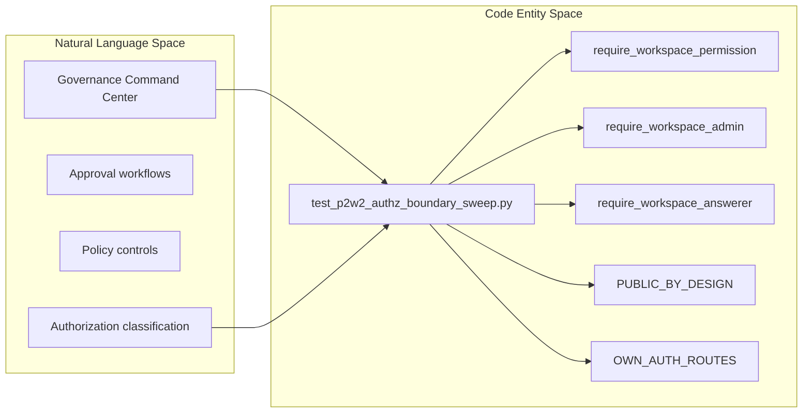
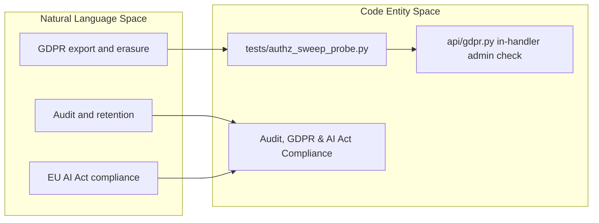
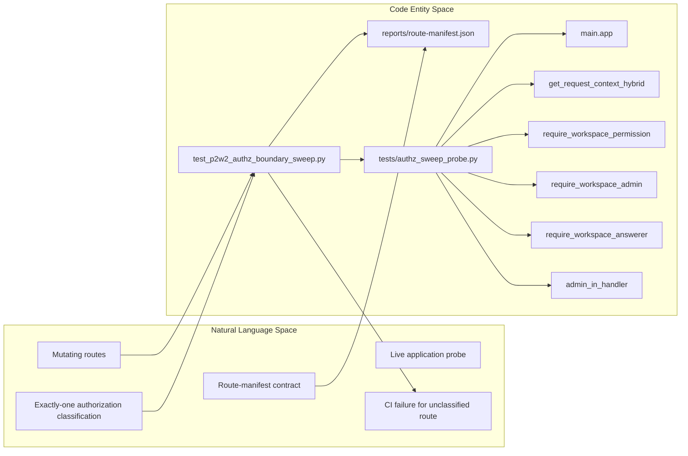

# Governance, Compliance & Security

Relevant source files

The following files were used as context for generating this wiki page:

- [orchestrator/api/mobile_push.py](orchestrator/api/mobile_push.py)
- [orchestrator/services/mobile/digest_now.py](orchestrator/services/mobile/digest_now.py)
- [orchestrator/services/mobile/discovery.py](orchestrator/services/mobile/discovery.py)
- [orchestrator/tests/authz_sweep_probe.py](orchestrator/tests/authz_sweep_probe.py)
- [orchestrator/tests/test_p2w2_authz_boundary_sweep.py](orchestrator/tests/test_p2w2_authz_boundary_sweep.py)
- [orchestrator/tests/test_prd266_digest_now.py](orchestrator/tests/test_prd266_digest_now.py)
- [orchestrator/tests/test_prd266_discovery.py](orchestrator/tests/test_prd266_discovery.py)

## Purpose and scope

This page introduces Automatos AI’s governance, compliance, and security concerns at a high level. It connects human approval and policy workflows with audit and data-subject processes, and with tests that check authorization boundaries. For implementation detail, see the child pages linked below. The available boundary-sweep test describes a contract for classifying mutating routes and failing CI when a route is left unclassified. [orchestrator/tests/test_p2w2_authz_boundary_sweep.py:1-30]()

- [Governance Command Center](#26.1) — governance-tab, policy plane, approvals inbox, audit and compliance panes, questions tab, governance hooks and APIs, and `modules/policy`.
- [Audit, GDPR & AI Act Compliance](#26.2) — audit service and retention, GDPR export and erasure, `/api/gdpr`, EU AI Act policy modules, `ai_label`, and content provenance.
- [Security Hardening & AuthZ Sweeps](#26.3) — authorization-boundary sweep, CORS coverage, widget fail-closed checks, hierarchy gates, git sanitizer, pinned HTTP validator, and template security.

Sources: [orchestrator/tests/test_p2w2_authz_boundary_sweep.py:1-30]()

---

## 26.1 Governance Command Center

The governance command center brings together approval handling, policy controls, audit visibility, and compliance information. These are related but distinct responsibilities: approvals provide a human decision point, policy modules describe governance rules, and audit views support review of system activity. For details on the UI, hooks, routes, and policy modules, see [Governance Command Center](#26.1).

The boundary-sweep contract also distinguishes authorization patterns, including workspace permissions, administrator gates, routes using their own authentication, and routes public by design. This helps connect governance features to the broader question of who may perform a mutating action. [orchestrator/tests/test_p2w2_authz_boundary_sweep.py:7-24]()

**Diagram: Governance concepts mapped to available code entities**

Sources: [orchestrator/tests/test_p2w2_authz_boundary_sweep.py:7-24]()

---

## 26.2 Audit, GDPR & AI Act Compliance

Audit logging and retention, GDPR export and erasure, and EU AI Act compliance are grouped here because they address different parts of accountable platform operation: recording activity, handling data-subject requests, and applying AI-related governance requirements. The child page covers the relevant services, routes, and policy modules in detail. See [Audit, GDPR & AI Act Compliance](#26.2).

The available authorization probe recognizes an in-handler workspace-admin check in `api/gdpr.py` as a distinct classification case; it is treated as classified rather than silently changed by the boundary sweep. [orchestrator/tests/authz_sweep_probe.py:89-99]() For retention behavior, GDPR cascades, and AI Act policy details, see the child page.

**Diagram: Compliance topics mapped to the available route-probe reference**

Sources: [orchestrator/tests/authz_sweep_probe.py:89-99]()

---

## 26.3 Security Hardening & AuthZ Sweeps

The authorization-boundary sweep uses the committed route manifest as its contract and probes the live FastAPI application as ground truth. Its stated goal is to classify each mutating route exactly one way; an unclassified route is intended to fail CI. [orchestrator/tests/test_p2w2_authz_boundary_sweep.py:1-30]() The probe gathers authorization facts from the route dependency tree and endpoint source, including workspace permissions, administrator dependencies, and explicit in-handler gates. [orchestrator/tests/authz_sweep_probe.py:41-55]() [orchestrator/tests/authz_sweep_probe.py:78-110]()

This sweep is one part of the security-hardening picture. The child page covers it alongside CORS tests, widget fail-closed checks, hierarchy gates, and other security checks. See [Security Hardening & AuthZ Sweeps](#26.3).

**Diagram: Mutating-route authorization sweep mapped to code entities**

Sources: [orchestrator/tests/test_p2w2_authz_boundary_sweep.py:1-30](), [orchestrator/tests/authz_sweep_probe.py:41-55](), [orchestrator/tests/authz_sweep_probe.py:78-110]()

---