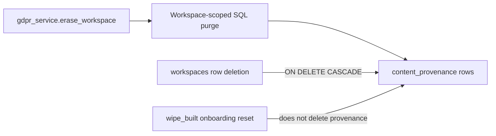
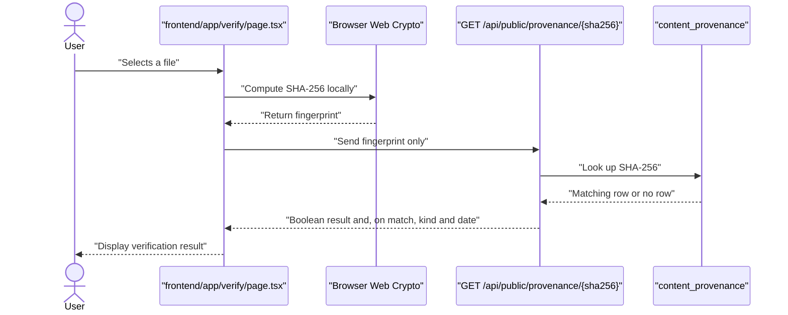
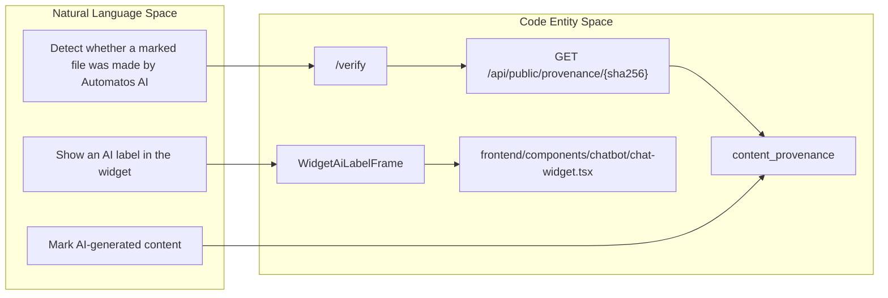
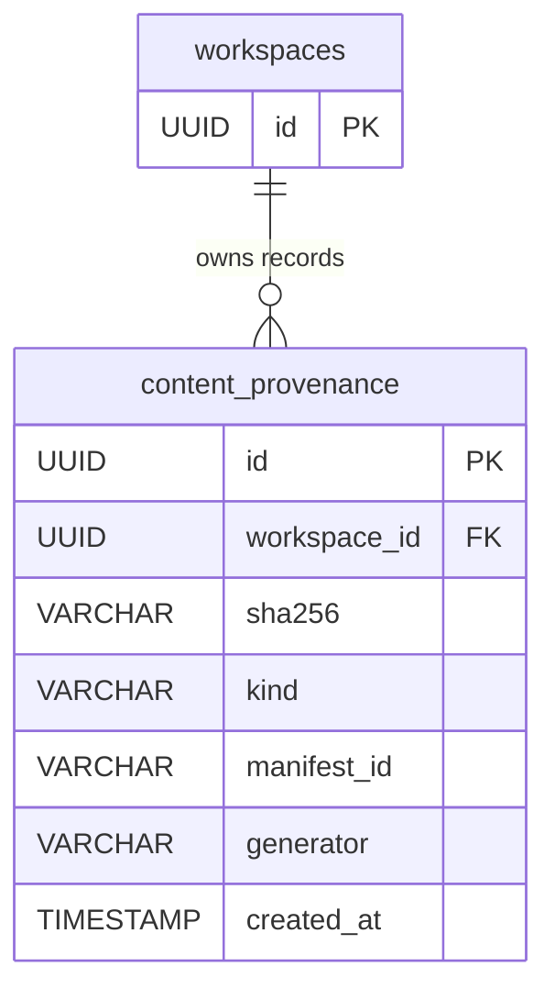

# Audit, GDPR & AI Act Compliance

Relevant source files

The following files were used as context for generating this wiki page:

- [docs/compliance/ARTICLE-50-GAP-ANALYSIS.md](docs/compliance/ARTICLE-50-GAP-ANALYSIS.md)
- [docs/compliance/ARTICLE-50.md](docs/compliance/ARTICLE-50.md)
- [docs/compliance/DETECTION.md](docs/compliance/DETECTION.md)
- [docs/compliance/README.md](docs/compliance/README.md)
- [docs/theme-host/placement-reach.md](docs/theme-host/placement-reach.md)
- [frontend/app/__tests__/verify-page.test.tsx](frontend/app/__tests__/verify-page.test.tsx)
- [frontend/app/accept-invitation/page.tsx](frontend/app/accept-invitation/page.tsx)
- [frontend/app/assignments/__tests__/assignments-route.test.tsx](frontend/app/assignments/__tests__/assignments-route.test.tsx)
- [frontend/app/assignments/page.tsx](frontend/app/assignments/page.tsx)
- [frontend/app/chat/__tests__/chat-page-resume.test.tsx](frontend/app/chat/__tests__/chat-page-resume.test.tsx)
- [frontend/app/chat/page.tsx](frontend/app/chat/page.tsx)
- [frontend/app/missions/__tests__/missions-redirect.test.tsx](frontend/app/missions/__tests__/missions-redirect.test.tsx)
- [frontend/app/missions/page.tsx](frontend/app/missions/page.tsx)
- [frontend/app/playbooks/__tests__/playbooks-route.test.tsx](frontend/app/playbooks/__tests__/playbooks-route.test.tsx)
- [frontend/app/playbooks/page.tsx](frontend/app/playbooks/page.tsx)
- [frontend/app/reset-password/page.tsx](frontend/app/reset-password/page.tsx)
- [frontend/app/verify/page.tsx](frontend/app/verify/page.tsx)
- [frontend/components/auth/sign-in-form.tsx](frontend/components/auth/sign-in-form.tsx)
- [frontend/components/chatbot/__tests__/auto-now-mounts.test.ts](frontend/components/chatbot/__tests__/auto-now-mounts.test.ts)
- [frontend/components/chatbot/__tests__/studio-chat-compact.test.tsx](frontend/components/chatbot/__tests__/studio-chat-compact.test.tsx)
- [frontend/components/chatbot/__tests__/studio-surfaces-scope.test.ts](frontend/components/chatbot/__tests__/studio-surfaces-scope.test.ts)
- [frontend/components/chatbot/__tests__/widget-message.test.tsx](frontend/components/chatbot/__tests__/widget-message.test.tsx)
- [frontend/components/chatbot/__tests__/widget-quick-prompts.test.ts](frontend/components/chatbot/__tests__/widget-quick-prompts.test.ts)
- [frontend/components/chatbot/auto-now-pill.tsx](frontend/components/chatbot/auto-now-pill.tsx)
- [frontend/components/chatbot/auto-now-rail.tsx](frontend/components/chatbot/auto-now-rail.tsx)
- [frontend/components/chatbot/chat-widget.tsx](frontend/components/chatbot/chat-widget.tsx)
- [frontend/components/chatbot/studio-chat-shell.tsx](frontend/components/chatbot/studio-chat-shell.tsx)
- [frontend/components/chatbot/widget-message.tsx](frontend/components/chatbot/widget-message.tsx)
- [frontend/components/command-center/__tests__/cc-compact.test.tsx](frontend/components/command-center/__tests__/cc-compact.test.tsx)
- [frontend/components/layout/main-layout.tsx](frontend/components/layout/main-layout.tsx)
- [frontend/components/verify/provenance-check.tsx](frontend/components/verify/provenance-check.tsx)
- [frontend/components/workflows/json-schema-editor.tsx](frontend/components/workflows/json-schema-editor.tsx)
- [frontend/components/workflows/playbook-step-progress.tsx](frontend/components/workflows/playbook-step-progress.tsx)
- [frontend/components/workflows/theater/theater-step-execution.tsx](frontend/components/workflows/theater/theater-step-execution.tsx)
- [frontend/lib/__tests__/provenance.test.ts](frontend/lib/__tests__/provenance.test.ts)
- [frontend/lib/provenance.ts](frontend/lib/provenance.ts)
- [frontend/middleware.ts](frontend/middleware.ts)
- [orchestrator/alembic/versions/add_clerk_invitation_id.py](orchestrator/alembic/versions/add_clerk_invitation_id.py)
- [orchestrator/alembic/versions/prd264_content_provenance.py](orchestrator/alembic/versions/prd264_content_provenance.py)
- [orchestrator/api/provenance.py](orchestrator/api/provenance.py)
- [orchestrator/api/widgets/rate_limit.py](orchestrator/api/widgets/rate_limit.py)
- [orchestrator/core/monitoring/automatos_logging.py](orchestrator/core/monitoring/automatos_logging.py)
- [orchestrator/core/monitoring/automatos_metrics.py](orchestrator/core/monitoring/automatos_metrics.py)
- [orchestrator/core/monitoring/path_digests.py](orchestrator/core/monitoring/path_digests.py)
- [orchestrator/core/observability/error_response.py](orchestrator/core/observability/error_response.py)
- [orchestrator/core/utils/logging_adapter.py](orchestrator/core/utils/logging_adapter.py)
- [orchestrator/services/content_provenance.py](orchestrator/services/content_provenance.py)
- [orchestrator/tests/test_prd264_article50_docs.py](orchestrator/tests/test_prd264_article50_docs.py)
- [orchestrator/tests/test_prd264_content_provenance.py](orchestrator/tests/test_prd264_content_provenance.py)

## Purpose and scope

This page documents the compliance behavior supported by the supplied code and documentation: content provenance, public verification, AI-generated-content marks and notices, and the available evidence about workspace erasure. It also identifies where the supplied files do **not** establish implementation details: the audit-retention subsystem, a `/api/gdpr` router and service cascade, and EU AI Act Annex IV policy modules. Those implementation details should not be inferred from documentation that is not present here. [docs/compliance/DETECTION.md:54-69]()[docs/compliance/ARTICLE-50.md:1-5]()

Sources: [docs/compliance/DETECTION.md:54-69](), [docs/compliance/ARTICLE-50.md:1-5]()

---

## 1. Audit Service & Retention Architecture

The supplied files do not include the definition of `AuditService`, an audit-retention job implementation, or the audit-log model and scheduler wiring. As a result, this page cannot verify the event types, persistence format, retention period, scheduling frequency, or workspace-specific policy behavior of those components.

The available compliance material does establish one specific erasure behavior: workspace erasure through `gdpr_service.erase_workspace` deletes that workspace’s `content_provenance` rows. The provenance documentation says this deletion uses the same self-maintaining SQL purge as other workspace-scoped tables, and that the workspace foreign key also has `ON DELETE CASCADE`. These are claims about provenance erasure, not evidence for a general audit-log retention or purge mechanism. [docs/compliance/DETECTION.md:67-69]()

### Audit and retention evidence boundary

| Area | What can be verified from the supplied files |
|---|---|
| `AuditService` | No definition or call site was supplied; behavior cannot be documented here. |
| Audit retention jobs | No job definition, scheduler registration, or retention policy implementation was supplied. |
| Provenance erasure | Workspace erasure removes that workspace’s provenance rows; the provenance schema declares a workspace foreign key with cascade deletion. [docs/compliance/DETECTION.md:67-69]()[orchestrator/tests/test_prd264_content_provenance.py:136-163]() |

Sources: [docs/compliance/DETECTION.md:67-69](), [orchestrator/tests/test_prd264_content_provenance.py:136-163]()

---

## 2. GDPR Compliance & Data Subject Cascades

The supplied files do not include the implementation of a GDPR service cascade for data-subject export or erasure. In particular, they do not establish an orchestrated deletion across PostgreSQL, Qdrant, durable stores, attachments, or user-linked records. Do not treat such a multi-store cascade as verified based on this source set.

The narrower, documented behavior is workspace-level provenance deletion: `gdpr_service.erase_workspace` deletes rows in `content_provenance` associated with the workspace. The model’s workspace foreign key is declared with `ON DELETE CASCADE`; the schema test also checks that constraint. The erasure description explicitly distinguishes workspace erasure from `wipe_built`: an onboarding reset keeps provenance rows because marked files may already be published. [docs/compliance/DETECTION.md:67-69]()[orchestrator/tests/test_prd264_content_provenance.py:136-163]()

### Verified provenance erasure path

**Diagram: Workspace erasure and provenance records**

Sources: [docs/compliance/DETECTION.md:67-69](), [orchestrator/tests/test_prd264_content_provenance.py:136-163]()

Sources: [docs/compliance/DETECTION.md:67-69](), [orchestrator/tests/test_prd264_content_provenance.py:136-163]()

---

## 3. GDPR REST API Endpoints (`/api/gdpr`)

The supplied files do not contain a `/api/gdpr` router, endpoint definitions, authentication dependencies, request and response schemas, or service call sites. Therefore, this page cannot verify endpoint paths such as export or erasure routes, their authorization rules, or the data included in an export.

The public provenance lookup is a separate interface: `GET /api/public/provenance/{sha256}`. It is a content-detection lookup, not a GDPR export or erasure API. The detection documentation describes the public route and its response, while the test file identifies the route and checks its behavior. [docs/compliance/DETECTION.md:12-27]()[orchestrator/tests/test_prd264_content_provenance.py:1-15]()

Sources: [docs/compliance/DETECTION.md:12-27](), [orchestrator/tests/test_prd264_content_provenance.py:1-15]()

---

## 4. EU AI Act Annex IV Policy & Governance Module

The supplied material documents Article 50 transparency and marking behavior. It does not include an Annex IV technical-documentation policy module, `modules.policy.ai_act`, governance API implementation, risk-assessment model, or human-oversight policy call sites. Those code entities and their behavior therefore cannot be described as verified implementation details here.

The Article 50 documentation describes provider and deployer responsibilities, including notices that a person is interacting with AI and marking AI-generated content. It also states that the material describes PRD-264 work, is not legal advice, and claims no conformity or certification. Its status notes that measures are live only once the corresponding story is merged and deployed; the posture page is identified as the production-status source. [docs/compliance/ARTICLE-50.md:1-11]()

### Article 50 documentation versus implementation evidence

| Topic | Supported by supplied material |
|---|---|
| Article 50 responsibilities | The documentation distinguishes provider and deployer duties and describes transparency and content-marking obligations. [docs/compliance/ARTICLE-50.md:1-5]()[docs/compliance/ARTICLE-50.md:13-26]() |
| Annex IV policy module | No implementation file or symbol definition was supplied; its behavior cannot be verified here. |
| Production status | The documentation says a notice or mark is live only after its story is merged and deployed, and points to the posture page for production status. [docs/compliance/ARTICLE-50.md:7-11]() |
| Legal status | The documentation says it is not legal advice and claims no conformity or certification. [docs/compliance/ARTICLE-50.md:3-5]() |

Sources: [docs/compliance/ARTICLE-50.md:1-11](), [docs/compliance/ARTICLE-50.md:13-26]()

---

## 5. Content Provenance and AI Act Article 50 Compliance

The provenance design supports detection of marked files by recording file fingerprints and exposing a public lookup. The detection documentation says the `/verify` page hashes a selected file in the browser and sends only the SHA-256 fingerprint; the file itself is not uploaded. The public route accepts a 64-character lowercase hexadecimal hash and returns whether Automatos has a matching record, plus `kind` and `date` for a match. [docs/compliance/DETECTION.md:5-18]()[docs/compliance/DETECTION.md:20-27]()

The docs describe this as one mechanism supporting Article 50(2) detection, alongside metadata marks. They also state limits: a modified or re-encoded file has a different hash; only marked files with provenance records can match; and a negative answer does not prove that AI was not involved. [docs/compliance/DETECTION.md:29-37]()

### 5.1. Public Verification Endpoint

`GET /api/public/provenance/{sha256}` is documented as public and does not require an account. The frontend `/verify` flow computes the fingerprint locally using Web Crypto, then sends the hash rather than the file. Hash values not matching the documented 64-character lowercase-hex form are refused with `422`. A known record returns `made_by_automatos_ai: true`, `kind`, and the UTC date; an unknown hash returns `made_by_automatos_ai: false`. The response does not disclose the workspace, customer, person, prompt, or file name. [docs/compliance/DETECTION.md:5-27]()

The route is rate-limited per IP; the documentation specifies a configurable per-minute limit and a `429` response with `Retry-After` when exceeded. It says responses, including refusals, carry `Cache-Control: no-store`. The limiter implementation documents fail-open behavior when Redis is unavailable, with an error log for ungated requests. [docs/compliance/DETECTION.md:35-36]()[orchestrator/core/monitoring/automatos_logging.py:49-53]()

**Diagram: `/verify` browser-to-route provenance lookup**

Sources: [docs/compliance/DETECTION.md:5-27](), [orchestrator/tests/test_prd264_content_provenance.py:1-15]()

Sources: [docs/compliance/DETECTION.md:5-27](), [orchestrator/tests/test_prd264_content_provenance.py:1-15]()

### 5.2. Embedded Marks and Metadata

The detection documentation describes machine-readable marks embedded in generated content. It identifies IPTC Digital Source Type values including `compositeWithTrainedAlgorithmicMedia` for documents and `trainedAlgorithmicMedia` for model-generated images. The mark also contains a random per-file instance ID; it does not contain a workspace, person, prompt, or file name. [docs/compliance/DETECTION.md:39-52]()

The documented locations vary by format:

| Content type | Mark location or representation |
|---|---|
| PDF | XMP in the document catalogue’s `/Metadata` stream, with `Iptc4xmpExt:DigitalSourceType` and `xmpMM:InstanceID`. [docs/compliance/DETECTION.md:43-46]() |
| DOCX, XLSX | Custom document properties `AIGenerated` and `AIInstanceID`. [docs/compliance/DETECTION.md:45-47]() |
| PNG | XMP packet in an `iTXt` chunk (`XML:com.adobe.xmp`). [docs/compliance/DETECTION.md:46-48]() |
| JPEG | XMP packet in an `APP1` segment. [docs/compliance/DETECTION.md:47-48]() |
| Chat answers | `ai_generated: true` on stream frames and `data-ai-generated="true"` on the rendered message. [docs/compliance/DETECTION.md:48-50]() |
| Blog posts | `ai_generated: true` in the blog API for agent-written posts. [docs/compliance/DETECTION.md:49-50]() |

The supplied frontend code shows an `AutoWidget` import of `WidgetAiLabelFrame` from `@/components/ai-label/widget-ai-label`, annotated as PRD-264 EUAI-11a. This establishes the widget’s connection to that label component, but the component implementation was not supplied, so its rendering details cannot be verified here. [frontend/components/chatbot/chat-widget.tsx:32-40]()

**Diagram: Natural-language compliance concepts mapped to code entities**

Sources: [docs/compliance/DETECTION.md:5-18](), [docs/compliance/DETECTION.md:39-52](), [frontend/components/chatbot/chat-widget.tsx:32-40]()

Sources: [docs/compliance/DETECTION.md:5-18](), [docs/compliance/DETECTION.md:39-52](), [frontend/components/chatbot/chat-widget.tsx:32-40]()

### 5.3. Content Provenance Storage (`content_provenance` table)

The provenance record stores a SHA-256 fingerprint, content kind, optional C2PA manifest identifier, generator name, creation time, and workspace ID. The documentation says it does not store a prompt, user, file name, or path. [docs/compliance/DETECTION.md:54-68]()

The model and migration shape are also checked by the supplied test: the table has `id`, `workspace_id`, `sha256`, `kind`, `manifest_id`, `generator`, and `created_at`; the SHA-256 field has an index; `(workspace_id, sha256)` has a uniqueness constraint; the workspace foreign key cascades on deletion; and checks constrain the hash format and allowed kinds. [orchestrator/tests/test_prd264_content_provenance.py:32-37]()[orchestrator/tests/test_prd264_content_provenance.py:136-163]()

Records are written through `services/content_provenance.py` using `record_marked_file(...)` or `record_produced_file(...)`. The documentation says that recording the same file twice in one workspace keeps the first row. [docs/compliance/DETECTION.md:67-68]()

**Diagram: Provenance data model and workspace relationship**

Sources: [docs/compliance/DETECTION.md:54-68](), [orchestrator/tests/test_prd264_content_provenance.py:35-37](), [orchestrator/tests/test_prd264_content_provenance.py:136-163]()

Sources: [docs/compliance/DETECTION.md:54-68](), [orchestrator/tests/test_prd264_content_provenance.py:35-37](), [orchestrator/tests/test_prd264_content_provenance.py:136-163]()

### 5.4. Verification Limits and Erasure Semantics

A provenance lookup is an exact-fingerprint match. The documentation warns that editing, cropping, resizing, trimming, converting, or re-encoding changes the SHA-256 fingerprint, so a modified copy can return “no” even when Automatos produced the original. The result is not proof that a file was or was not AI-generated; it indicates whether Automatos has a record for that exact fingerprint. [docs/compliance/DETECTION.md:29-32]()

Workspace erasure removes that workspace’s provenance rows, after which its files no longer return a positive match. An onboarding `wipe_built` reset does not remove these records. The distinction is documented as intentional because marked files may already have been distributed. [docs/compliance/DETECTION.md:67-69]()

Sources: [docs/compliance/DETECTION.md:29-32](), [docs/compliance/DETECTION.md:67-69]()

---