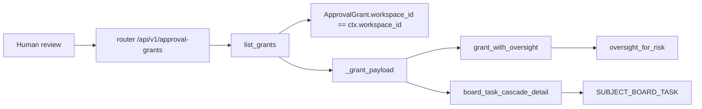
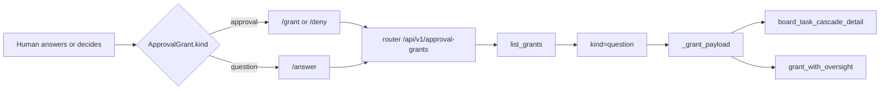
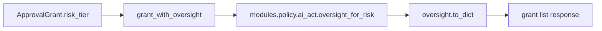
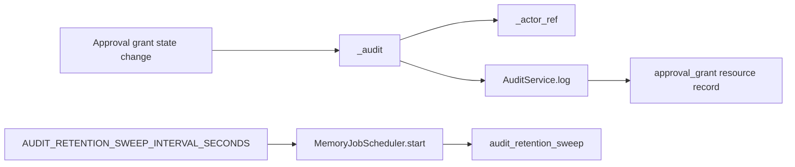

# Governance Command Center

Relevant source files

The following files were used as context for generating this wiki page:

- [docs/PRDS/136-LLM-CONTEXT-BUDGET-SETTINGS.md](docs/PRDS/136-LLM-CONTEXT-BUDGET-SETTINGS.md)
- [docs/PRDS/PRD-228-FLEET-STATE.md](docs/PRDS/PRD-228-FLEET-STATE.md)
- [frontend/components/agents/__tests__/use-fleet-state.test.tsx](frontend/components/agents/__tests__/use-fleet-state.test.tsx)
- [frontend/components/command-center/__tests__/board-event-stream.test.tsx](frontend/components/command-center/__tests__/board-event-stream.test.tsx)
- [frontend/components/settings/ApiKeyManager.tsx](frontend/components/settings/ApiKeyManager.tsx)
- [frontend/components/settings/LLMModelsSettingsTab.tsx](frontend/components/settings/LLMModelsSettingsTab.tsx)
- [frontend/components/settings/LLMTierCard.tsx](frontend/components/settings/LLMTierCard.tsx)
- [frontend/components/widgets/CodeWidget/index.tsx](frontend/components/widgets/CodeWidget/index.tsx)
- [frontend/components/widgets/DataWidget/index.tsx](frontend/components/widgets/DataWidget/index.tsx)
- [frontend/components/widgets/ImageWidget/index.tsx](frontend/components/widgets/ImageWidget/index.tsx)
- [frontend/components/widgets/WidgetBase.tsx](frontend/components/widgets/WidgetBase.tsx)
- [frontend/components/widgets/WidgetWrapper.tsx](frontend/components/widgets/WidgetWrapper.tsx)
- [frontend/components/widgets/__tests__/registration-manifest.test.ts](frontend/components/widgets/__tests__/registration-manifest.test.ts)
- [frontend/components/widgets/registry.ts](frontend/components/widgets/registry.ts)
- [frontend/hooks/use-board-event-stream.ts](frontend/hooks/use-board-event-stream.ts)
- [frontend/lib/chat/api.ts](frontend/lib/chat/api.ts)
- [frontend/stores/index.ts](frontend/stores/index.ts)
- [frontend/stores/workspace-store.ts](frontend/stores/workspace-store.ts)
- [orchestrator/alembic/versions/prd136_collapse_llm_tiers.py](orchestrator/alembic/versions/prd136_collapse_llm_tiers.py)
- [orchestrator/alembic/versions/prd181_s2_approval_grants.py](orchestrator/alembic/versions/prd181_s2_approval_grants.py)
- [orchestrator/alembic/versions/prd206_chat_summary.py](orchestrator/alembic/versions/prd206_chat_summary.py)
- [orchestrator/api/approval_grants.py](orchestrator/api/approval_grants.py)
- [orchestrator/api/fleet.py](orchestrator/api/fleet.py)
- [orchestrator/core/models/approval_grants.py](orchestrator/core/models/approval_grants.py)
- [orchestrator/core/models/workspaces.py](orchestrator/core/models/workspaces.py)
- [orchestrator/core/services/approval_grants.py](orchestrator/core/services/approval_grants.py)
- [orchestrator/services/audit_retention.py](orchestrator/services/audit_retention.py)
- [orchestrator/services/board_approval.py](orchestrator/services/board_approval.py)
- [orchestrator/services/board_events.py](orchestrator/services/board_events.py)
- [orchestrator/services/budget_ceiling.py](orchestrator/services/budget_ceiling.py)
- [orchestrator/services/escalation_service.py](orchestrator/services/escalation_service.py)
- [orchestrator/services/memory_archival_job.py](orchestrator/services/memory_archival_job.py)
- [orchestrator/services/memory_jobs.py](orchestrator/services/memory_jobs.py)
- [orchestrator/services/watch_actions.py](orchestrator/services/watch_actions.py)
- [orchestrator/services/watch_rerun.py](orchestrator/services/watch_rerun.py)
- [orchestrator/tests/test_board_dispatch.py](orchestrator/tests/test_board_dispatch.py)
- [orchestrator/tests/test_board_sse_listen_notify.py](orchestrator/tests/test_board_sse_listen_notify.py)
- [orchestrator/tests/test_f193_two_approvals_at_once_resume_once.py](orchestrator/tests/test_f193_two_approvals_at_once_resume_once.py)
- [orchestrator/tests/test_grant_approve_commit_ordering.py](orchestrator/tests/test_grant_approve_commit_ordering.py)
- [orchestrator/tests/test_human_directed_gate.py](orchestrator/tests/test_human_directed_gate.py)
- [orchestrator/tests/test_p2w2_audit_retention.py](orchestrator/tests/test_p2w2_audit_retention.py)
- [orchestrator/tests/test_p2w2_governance_audit.py](orchestrator/tests/test_p2w2_governance_audit.py)
- [orchestrator/tests/test_p2w2_governance_policy_budget.py](orchestrator/tests/test_p2w2_governance_policy_budget.py)
- [orchestrator/tests/test_p2w2_grant_mutation_admin_gate.py](orchestrator/tests/test_p2w2_grant_mutation_admin_gate.py)
- [orchestrator/tests/test_p2w2_grant_resume.py](orchestrator/tests/test_p2w2_grant_resume.py)
- [orchestrator/tests/test_prd197_substrate.py](orchestrator/tests/test_prd197_substrate.py)
- [orchestrator/tests/test_prd204_rerun.py](orchestrator/tests/test_prd204_rerun.py)
- [orchestrator/tests/test_prd204_run_verdict.py](orchestrator/tests/test_prd204_run_verdict.py)
- [orchestrator/tests/test_prd204_silent_holes.py](orchestrator/tests/test_prd204_silent_holes.py)
- [orchestrator/tests/test_prd204_watch_actions.py](orchestrator/tests/test_prd204_watch_actions.py)
- [orchestrator/tests/test_prd206_thread_checkpoint.py](orchestrator/tests/test_prd206_thread_checkpoint.py)
- [orchestrator/tests/test_prd224_ticket_watch_actions.py](orchestrator/tests/test_prd224_ticket_watch_actions.py)

## Purpose and scope

The Governance Command Center is the human-review surface for workspace approval grants and related governance controls. This page documents the approval-grant API and lifecycle supported by the supplied implementation, including the Questions view’s shared grant-list route, audit recording, and EU AI Act oversight metadata. The available code excerpts do not establish the implementation details of the governance tab’s other panes, `use-governance` hooks, or a general `/api/governance` route; those are distinguished below from the documented `/api/v1/approval-grants` API. [orchestrator/api/approval_grants.py:1-15]()

Sources: `[orchestrator/api/approval_grants.py:1-15](), [orchestrator/api/approval_grants.py:42-56]()`

---

## 1. Governance tab and system boundaries

The governance API shown here is the approval-grant router, mounted at `/api/v1/approval-grants`. Its list endpoint scopes grants to the request’s workspace and requires `require_workspace_answerer`; the API module also imports `require_workspace_admin` for operations that need the stronger administrator boundary. The router is not, by itself, evidence for a general `/api/governance` endpoint. [orchestrator/api/approval_grants.py:22-28](), [orchestrator/api/approval_grants.py:42-43](), [orchestrator/api/approval_grants.py:108-126]()

The approval-grant API enriches responses with risk-tier oversight information. For question-kind grants, it can also include blocked-cascade details. These response enrichments connect the human-facing concepts of *approval* and *question* to concrete backend entities and functions. [orchestrator/api/approval_grants.py:45-73]()

**Diagram: Governance concepts mapped to approval-grant code entities**

Sources: `[orchestrator/api/approval_grants.py:22-43](), [orchestrator/api/approval_grants.py:45-73](), [orchestrator/api/approval_grants.py:108-131]()`

### What the supplied code establishes

| Governance concept | Code entity or behavior established by the excerpts |
|---|---|
| Approvals inbox data | `list_grants` queries workspace-scoped `ApprovalGrant` rows and returns them under `grants`. [orchestrator/api/approval_grants.py:108-131]() |
| Question listing | The same list endpoint accepts `kind`; its documentation identifies `kind=question` as the Questions-tab filter. [orchestrator/api/approval_grants.py:115-125]() |
| Risk oversight rationale | `grant_with_oversight` adds `oversight_for_risk(grant.risk_tier).to_dict()` to each grant payload. [orchestrator/api/approval_grants.py:45-56]() |
| Audit recording | The API’s `_audit` helper calls `AuditService(db).log(...)` and catches failures rather than propagating them to the request path. [orchestrator/api/approval_grants.py:84-105]() |
| General governance tab, policy tile, audit pane, compliance pane, and frontend hooks | Their implementation is not established by the supplied code excerpts. |

Sources: `[orchestrator/api/approval_grants.py:45-56](), [orchestrator/api/approval_grants.py:84-131]()`

---

## 2. Approval grants and inbox data flow

An approval grant represents a workspace-scoped request to authorize a subject. The service creates a `PENDING` grant with a requested timestamp and an expiry timestamp; the caller owns the transaction, and the service stages and flushes the row rather than committing it. [orchestrator/core/services/approval_grants.py:1-11](), [orchestrator/core/services/approval_grants.py:43-99]()

Grant authorization is time-sensitive: only a `GRANTED` grant that has not passed `expires_at` authorizes its subject. A pending grant blocks, and revoked, expired, or denied grants do not authorize. Expiry is checked at read time, so an overdue grant does not remain authorizing merely because a background expiry sweep has not run. [orchestrator/core/services/approval_grants.py:7-11]()

The API’s list operation filters by the current workspace and optionally by `status` and `kind`, sorts newest first, and limits results to 200. It adds owner metadata and builds each response through `_grant_payload`. A question grant for a board-task subject receives cascade detail; other question subjects receive an empty cascade object. [orchestrator/api/approval_grants.py:59-73](), [orchestrator/api/approval_grants.py:108-131]()

**Diagram: Grant creation through workspace inbox listing**

```mermaid
flowchart LR
  Request["Governance request"] --> CreateGrant["create_grant"]
  CreateGrant --> Pending["ApprovalGrant status PENDING"]
  Pending --> Flush["db.flush"]
  Flush --> List["GET /api/v1/approval-grants"]
  List --> WorkspaceFilter["workspace_id == ctx.workspace_id"]
  WorkspaceFilter --> OptionalFilters["status and kind filters"]
  OptionalFilters --> Payload["_grant_payload"]
  Payload --> Owners["grant_owners"]
  Owners --> Response["grants response"]
```

Sources: `[orchestrator/core/services/approval_grants.py:43-99](), [orchestrator/api/approval_grants.py:59-73](), [orchestrator/api/approval_grants.py:108-131]()`

### Grant lifecycle rules

| State or operation | Meaning in the supplied implementation |
|---|---|
| `PENDING` | The subject is blocked while awaiting a human decision; it is not an active authorization. [orchestrator/core/services/approval_grants.py:7-10](), [orchestrator/core/services/approval_grants.py:142-145]() |
| `GRANTED` and not expired | Authorizes the subject. `find_active_grant` reads granted rows and checks each with `is_authorising`. [orchestrator/core/services/approval_grants.py:134-165]() |
| Expired | A grant past `expires_at` does not authorize, even if its stored status remains `GRANTED`. [orchestrator/core/services/approval_grants.py:7-11]() |
| `REVOKED`, `EXPIRED`, or `DENIED` | Does not authorize the subject. [orchestrator/core/services/approval_grants.py:7-10]() |
| Creation transaction | `create_grant` stages and flushes; its caller owns commit or rollback. [orchestrator/core/services/approval_grants.py:1-5](), [orchestrator/core/services/approval_grants.py:91-99]() |

Sources: `[orchestrator/core/services/approval_grants.py:1-11](), [orchestrator/core/services/approval_grants.py:43-99](), [orchestrator/core/services/approval_grants.py:134-165]()`

---

## 3. Approvals inbox and Questions tab

### Listing and response enrichment

`list_grants` is the shared list route for approval rows and question rows. It applies optional `status` and `kind` filters to the workspace-scoped query, orders by `requested_at` descending, and limits the result set to 200. The route’s docstring specifically describes the Questions tab as reusing this route with `kind=question`, rather than using a separate list endpoint. [orchestrator/api/approval_grants.py:108-126]()

For each row, the API computes owner information through `grant_owners` and creates a payload via `_grant_payload`. All grant payloads include the oversight mapping generated by `grant_with_oversight`. Question rows additionally receive cascade data: board-task questions call `board_task_cascade_detail`, while other question subjects receive `{"total": 0, "tasks": []}`. [orchestrator/api/approval_grants.py:45-73](), [orchestrator/api/approval_grants.py:127-131]()

### Approval versus question actions

The API documents distinct actions for approvals and questions. A question cannot be handled through `/grant`: `question_not_approval` returns a 422-oriented message directing the caller to `/answer`, with either an option-shaped body or an `answer_text` body. Conversely, `approval_not_question` directs approval rows away from `/answer` and toward `/grant` or `/deny`. [orchestrator/api/approval_grants.py:134-157]()

The grant service supports question-specific fields alongside the default approval kind. `create_grant` accepts `kind`, `question_md`, `options`, `channel_refs`, and `asked_by_agent_id`; its documentation describes a question as a free-text ask whose pending state is open and whose granted state represents an answer. [orchestrator/core/services/approval_grants.py:56-70]()

**Diagram: Natural-language inbox actions mapped to API functions**

Sources: `[orchestrator/api/approval_grants.py:42-73](), [orchestrator/api/approval_grants.py:108-131](), [orchestrator/api/approval_grants.py:134-157](), [orchestrator/core/services/approval_grants.py:56-70]()`

Sources: `[orchestrator/api/approval_grants.py:108-157](), [orchestrator/core/services/approval_grants.py:56-70]()`

---

## 4. Policy plane and oversight metadata

The supplied approval API imports `oversight_for_risk` from `modules.policy.ai_act` and uses it in `grant_with_oversight`. The resulting mapping is attached to the serialized grant as `oversight`, so the list response carries a backend-derived oversight tier and rationale associated with the grant’s `risk_tier`. [orchestrator/api/approval_grants.py:35-38](), [orchestrator/api/approval_grants.py:45-56]()

The API module’s documentation describes the mapping as an EU AI Act Article 14 oversight tier and says the mapping conservatively falls back to human-in-the-loop when risk is unknown or absent. The supplied excerpt does not show the internal policy-module implementation or establish the details of a frontend policy tile, posture editor, or policy-update endpoint. [orchestrator/api/approval_grants.py:45-56]()

**Diagram: Risk tier to inbox oversight field**

Sources: `[orchestrator/api/approval_grants.py:35-38](), [orchestrator/api/approval_grants.py:45-56](), [orchestrator/api/approval_grants.py:59-73]()`

Sources: `[orchestrator/api/approval_grants.py:35-56](), [orchestrator/api/approval_grants.py:59-73]()`

---

## 5. Audit pane integration

Approval-grant state changes are intended to be recorded as governance actions through the API’s `_audit` helper. The helper resolves an actor reference from `RequestContext`, then calls `AuditService(db).log` with the workspace, user identifier when available, actor type, action, resource type `approval_grant`, grant identifier, subject name, and details including subject type, subject ID, status, and actor. [orchestrator/api/approval_grants.py:76-103]()

Audit failures are caught and logged as warnings. This makes the helper best-effort: a failure to write the audit entry does not raise from `_audit` into the caller. The supplied excerpt does not show the frontend audit pane’s query or rendering behavior. [orchestrator/api/approval_grants.py:84-105]()

The background scheduler registers an `audit_retention_sweep` job using the configured `AUDIT_RETENTION_SWEEP_INTERVAL_SECONDS` value, defaulting to 86,400 seconds. Its job registration uses `max_instances=1`, preventing overlapping executions of that scheduled job. [orchestrator/services/memory_jobs.py:32-42](), [orchestrator/services/memory_jobs.py:114-127]()

**Diagram: Approval decision audit path and retention registration**

Sources: `[orchestrator/api/approval_grants.py:76-105](), [orchestrator/services/memory_jobs.py:32-42](), [orchestrator/services/memory_jobs.py:114-127]()` 

Sources: `[orchestrator/api/approval_grants.py:76-105](), [orchestrator/services/memory_jobs.py:114-127]()`

---

## 6. Authorization boundaries and audit attribution

The approval API distinguishes answering a request from retracting an authorization. Its module documentation states that listing, granting, denying, and answering use `require_workspace_answerer`, allowing workspace owners, admins, and editors while refusing viewers. Revocation uses `require_workspace_admin`, restricting it to owners and admins. [orchestrator/api/approval_grants.py:8-11]()

The list endpoint shown directly uses `Depends(require_workspace_answerer)` and filters by `ctx.workspace_id`. These protections establish the access boundary for listing grant data in the supplied route; the supplied excerpt does not show the full handler definitions for the mutation routes. [orchestrator/api/approval_grants.py:108-126]()

`_actor_ref` obtains the principal reference from `RequestContext` through `services.board_consent.actor_ref`. `_audit` records the actor as a user and includes the actor reference in audit details; it uses an internal user ID or an integer user ID where available. [orchestrator/api/approval_grants.py:76-103]()

Sources: `[orchestrator/api/approval_grants.py:8-11](), [orchestrator/api/approval_grants.py:76-103](), [orchestrator/api/approval_grants.py:108-126]()`

---

## 7. API and implementation reference

The supplied API excerpt establishes the following route and helper behavior. It does not include the complete mutation handler definitions, so only the list route is documented here as a route whose implementation is visible in the excerpt. [orchestrator/api/approval_grants.py:108-131]()

| Surface | Behavior established by supplied code |
|---|---|
| `GET /api/v1/approval-grants` | Lists up to 200 grants for `ctx.workspace_id`, newest first; accepts optional `status` and `kind`; requires `require_workspace_answerer`. [orchestrator/api/approval_grants.py:108-126]() |
| `grant_with_oversight(grant)` | Serializes a grant and appends the `oversight_for_risk` mapping. [orchestrator/api/approval_grants.py:45-56]() |
| `_grant_payload(db, grant)` | Adds question cascade information when `kind` is `KIND_QUESTION`. [orchestrator/api/approval_grants.py:59-73]() |
| `create_grant(...)` | Stages a pending approval or question grant, sets its expiry, flushes it, and leaves transaction ownership to the caller. [orchestrator/core/services/approval_grants.py:43-99]() |
| `find_active_grant(...)` | Returns a granted, unexpired grant for the matching workspace and subject, or `None`. [orchestrator/core/services/approval_grants.py:134-165]() |
| `find_pending_grant(...)` | Provides a pending-grant lookup described as an idempotency guard, optionally narrowed by kind. [orchestrator/core/services/approval_grants.py:168-180]() |
| `_audit(db, ctx, action, grant)` | Attempts to write an audit record through `AuditService`; catches and logs failures. [orchestrator/api/approval_grants.py:84-105]() |

The described `use-governance` hooks and a general `/api/governance` surface are not present in the supplied excerpts. The available API evidence identifies the approval-grant route and its backend functions, not frontend hook names or governance-pane endpoint contracts. [orchestrator/api/approval_grants.py:42-43](), [orchestrator/api/approval_grants.py:108-131]()

Sources: `[orchestrator/api/approval_grants.py:42-43](), [orchestrator/api/approval_grants.py:45-73](), [orchestrator/api/approval_grants.py:84-131](), [orchestrator/core/services/approval_grants.py:43-99](), [orchestrator/core/services/approval_grants.py:134-180]()`

---