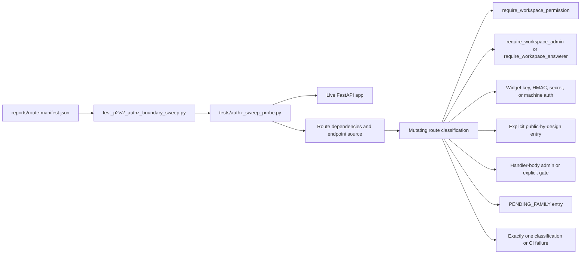
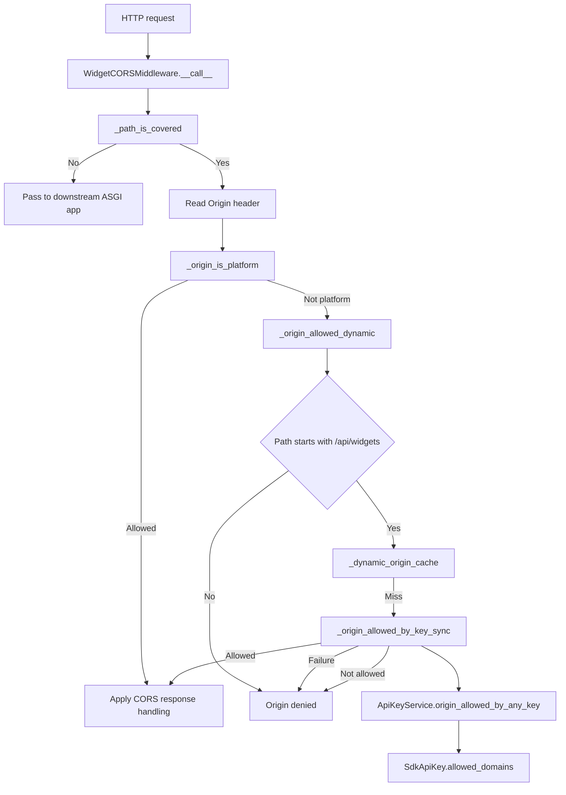
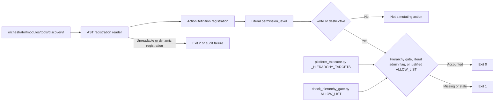
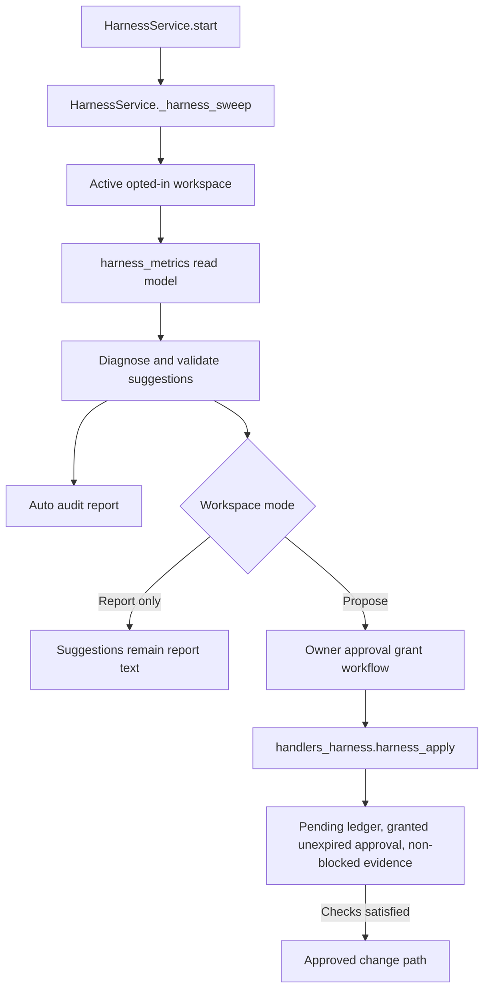

# Security Hardening & AuthZ Sweeps

Relevant source files

The following files were used as context for generating this wiki page:

- [docs/platform-actions/self-management-harness.md](docs/platform-actions/self-management-harness.md)
- [docs/workspace-execution/security-sandboxing.md](docs/workspace-execution/security-sandboxing.md)
- [orchestrator/api/api_keys.py](orchestrator/api/api_keys.py)
- [orchestrator/api/mobile_push.py](orchestrator/api/mobile_push.py)
- [orchestrator/api/widgets/auth.py](orchestrator/api/widgets/auth.py)
- [orchestrator/api/widgets/config.py](orchestrator/api/widgets/config.py)
- [orchestrator/api/widgets/cors.py](orchestrator/api/widgets/cors.py)
- [orchestrator/api/widgets/session.py](orchestrator/api/widgets/session.py)
- [orchestrator/core/database/migrations/043_team_based_document_scoping.sql](orchestrator/core/database/migrations/043_team_based_document_scoping.sql)
- [orchestrator/core/models/sdk_api_keys.py](orchestrator/core/models/sdk_api_keys.py)
- [orchestrator/core/services/api_key_service.py](orchestrator/core/services/api_key_service.py)
- [orchestrator/modules/tools/discovery/actions_harness.py](orchestrator/modules/tools/discovery/actions_harness.py)
- [orchestrator/modules/tools/discovery/handlers_harness.py](orchestrator/modules/tools/discovery/handlers_harness.py)
- [orchestrator/scripts/check_hierarchy_gate.py](orchestrator/scripts/check_hierarchy_gate.py)
- [orchestrator/services/harness_cards.py](orchestrator/services/harness_cards.py)
- [orchestrator/services/harness_changes.py](orchestrator/services/harness_changes.py)
- [orchestrator/services/harness_grants.py](orchestrator/services/harness_grants.py)
- [orchestrator/services/harness_metrics.py](orchestrator/services/harness_metrics.py)
- [orchestrator/services/harness_service.py](orchestrator/services/harness_service.py)
- [orchestrator/services/mobile/digest_now.py](orchestrator/services/mobile/digest_now.py)
- [orchestrator/services/mobile/discovery.py](orchestrator/services/mobile/discovery.py)
- [orchestrator/tests/authz_sweep_probe.py](orchestrator/tests/authz_sweep_probe.py)
- [orchestrator/tests/helpers_harness_changes.py](orchestrator/tests/helpers_harness_changes.py)
- [orchestrator/tests/helpers_harness_grants.py](orchestrator/tests/helpers_harness_grants.py)
- [orchestrator/tests/security/test_prd172_tenant_isolation.py](orchestrator/tests/security/test_prd172_tenant_isolation.py)
- [orchestrator/tests/test_f155_widget_key_limits.py](orchestrator/tests/test_f155_widget_key_limits.py)
- [orchestrator/tests/test_harness_power_mode.py](orchestrator/tests/test_harness_power_mode.py)
- [orchestrator/tests/test_harness_routing_rule.py](orchestrator/tests/test_harness_routing_rule.py)
- [orchestrator/tests/test_p2w2_authz_boundary_sweep.py](orchestrator/tests/test_p2w2_authz_boundary_sweep.py)
- [orchestrator/tests/test_p2w2_cors_boot_guard.py](orchestrator/tests/test_p2w2_cors_boot_guard.py)
- [orchestrator/tests/test_p2w2_widget_fail_closed.py](orchestrator/tests/test_p2w2_widget_fail_closed.py)
- [orchestrator/tests/test_prd008a_cors_coverage.py](orchestrator/tests/test_prd008a_cors_coverage.py)
- [orchestrator/tests/test_prd008a_widget_config_resolver.py](orchestrator/tests/test_prd008a_widget_config_resolver.py)
- [orchestrator/tests/test_prd186_s3_hardening.py](orchestrator/tests/test_prd186_s3_hardening.py)
- [orchestrator/tests/test_prd263_harness_apply_action.py](orchestrator/tests/test_prd263_harness_apply_action.py)
- [orchestrator/tests/test_prd263_harness_changes_registry.py](orchestrator/tests/test_prd263_harness_changes_registry.py)
- [orchestrator/tests/test_prd263_harness_grep_gate.py](orchestrator/tests/test_prd263_harness_grep_gate.py)
- [orchestrator/tests/test_prd263_harness_report_only.py](orchestrator/tests/test_prd263_harness_report_only.py)
- [orchestrator/tests/test_prd263_harness_tool_failure_window.py](orchestrator/tests/test_prd263_harness_tool_failure_window.py)
- [orchestrator/tests/test_prd266_digest_now.py](orchestrator/tests/test_prd266_digest_now.py)
- [orchestrator/tests/test_prd266_discovery.py](orchestrator/tests/test_prd266_discovery.py)
- [orchestrator/tests/test_w1s9_idle_in_tx.py](orchestrator/tests/test_w1s9_idle_in_tx.py)

## Purpose & Scope

This page documents the security checks visible in the supplied source excerpts: the mutating-route AuthZ boundary sweep, dynamic widget CORS, widget authentication, hierarchy-gate CI checker, and HARNESS’s report-only and approval-gated controls. The supplied excerpts do not show implementation details for a git sanitizer, pinned HTTP validator, or template-security checks, so those mechanisms are not described here. [orchestrator/tests/test_p2w2_authz_boundary_sweep.py:1-30](), [orchestrator/api/widgets/cors.py:1-38](), [orchestrator/api/widgets/auth.py:1-14](), [orchestrator/scripts/check_hierarchy_gate.py:1-33](), [orchestrator/services/harness_service.py:1-13]()

Sources: [orchestrator/tests/test_p2w2_authz_boundary_sweep.py:1-30](), [orchestrator/api/widgets/cors.py:1-38](), [orchestrator/api/widgets/auth.py:1-14](), [orchestrator/scripts/check_hierarchy_gate.py:1-33](), [orchestrator/services/harness_service.py:1-13]()

---

## 1. AuthZ Boundary Sweep Harness

`test_p2w2_authz_boundary_sweep.py` treats the committed `reports/route-manifest.json` as the route contract and probes the live FastAPI app in a clean subprocess through `tests/authz_sweep_probe.py`. Every mutating HTTP route—`POST`, `PUT`, `PATCH`, or `DELETE`—must have exactly one declared classification. An unclassified mutating route fails the sweep, making route authorization classification a CI gate rather than a report-only metric. [orchestrator/tests/test_p2w2_authz_boundary_sweep.py:1-10](), [orchestrator/tests/test_p2w2_authz_boundary_sweep.py:30-46]()

### Classification model

The sweep recognizes these classifications:

| Classification | Requirement |
|---|---|
| Workspace permission | Route carries `require_workspace_permission`. |
| Router-wide super-admin | Router is super-admin-locked; the classification is recorded, not relaxed. |
| Workspace admin or answerer | Route uses `require_workspace_admin` or `require_workspace_answerer`; these are recognized gates, not exceptions to be loosened. |
| Own non-hybrid authentication | Route uses its own widget-key, HMAC, secret, or machine-lane authentication and is structurally shown not to use the shared hybrid dependency. |
| Public by design | Route is explicitly enumerated as public, such as invitation acceptance, which verifies a Clerk JWT directly. |
| Handler-body admin gate | Route is enumerated and the endpoint source is checked for the shared `caller_is_admin` helpers. |
| Explicit handler gate | Route retains its own in-handler gate, such as credentials `/resolve`. |
| Temporary pending family | A `PENDING_FAMILY_*` entry represents visible migration debt. When a route gains its gate, the pending entry must be removed; removing an entry without adding a valid classification also fails the exactly-one check. |

The route test also distinguishes stale manifest entries from routes actually served by the app. The shown stale entries are workflow-execution paths that the sweep expects the live app not to serve. [orchestrator/tests/test_p2w2_authz_boundary_sweep.py:9-30](), [orchestrator/tests/test_p2w2_authz_boundary_sweep.py:42-73]()

### Data flow and code entities

**Diagram: Route contract to AuthZ classification**

Sources: [orchestrator/tests/test_p2w2_authz_boundary_sweep.py:1-30](), [orchestrator/tests/test_p2w2_authz_boundary_sweep.py:42-46]()

### Explicitly classified routes

The test source lists public-by-design routes, including `/api/team/accept-invitation` and `/api/v1/mobile/pair`, and separately enumerates routes using their own authentication. The shown own-auth entries include webhook routes, Shopify machine-lane routes, the theme-publish endpoint, and widget SDK endpoints such as `/api/widgets/chat` and `/api/widgets/auth`. This enumeration is part of the test contract; the excerpt does not show the full classification sets or all structural assertions. [orchestrator/tests/test_p2w2_authz_boundary_sweep.py:64-74](), [orchestrator/tests/test_p2w2_authz_boundary_sweep.py:76-123]()

Sources: [orchestrator/tests/test_p2w2_authz_boundary_sweep.py:64-74](), [orchestrator/tests/test_p2w2_authz_boundary_sweep.py:76-123]()

---

## 2. CORS Coverage & Widget Fail-Closed Middleware

`WidgetCORSMiddleware` is a pure ASGI middleware for `/api/widgets/*` and `/api/sites/*`. It avoids `BaseHTTPMiddleware`, which the implementation identifies as unsuitable because it can buffer `StreamingResponse` and SSE connections. Non-HTTP scopes and paths outside the covered prefixes pass through to the next ASGI app. [orchestrator/api/widgets/cors.py:1-12](), [orchestrator/api/widgets/cors.py:49-55](), [orchestrator/api/widgets/cors.py:139-153]()

### Origin policy

The middleware has two origin classes:

- **Platform origins:** Taken from `config.CORS_ALLOW_ORIGINS`; these are first-party origins and can access both covered path families.
- **Merchant origins:** Taken from active public SDK keys’ `allowed_domains`; this lookup applies only to `/api/widgets`.

`/api/sites` is first-party dashboard CRUD and does not consult merchant keys. The implementation identifies JWT cookie authentication—not CORS—as the security boundary for `/api/sites`. [orchestrator/api/widgets/cors.py:22-33](), [orchestrator/api/widgets/cors.py:57-67](), [orchestrator/api/widgets/cors.py:105-116]()

A browser preflight has no `Authorization` header, so the middleware cannot identify the particular SDK key that a subsequent request will use. Instead, `_origin_allowed_dynamic` asks whether the origin is named on any active public key. The lookup reuses the API-key domain matcher, runs in a thread pool, and caches both positive and negative decisions for 60 seconds. The cache is bounded at 512 entries. Lookup failures are not cached and fail closed. [orchestrator/api/widgets/cors.py:35-37](), [orchestrator/api/widgets/cors.py:75-89](), [orchestrator/api/widgets/cors.py:92-132]()

### Preflight flow

For covered `OPTIONS` requests, the middleware checks for an origin and calls `_origin_allowed_dynamic`. A missing origin is rejected with a 400 response path; a disallowed origin is rejected with a 403 response path. Allowed origins proceed through the middleware’s CORS response handling. [orchestrator/api/widgets/cors.py:145-166]()

**Diagram: CORS policy mapped to code entities**

Sources: [orchestrator/api/widgets/cors.py:49-67](), [orchestrator/api/widgets/cors.py:92-136](), [orchestrator/api/widgets/cors.py:139-166]()

---

## 3. Widget Authentication & Fail-Closed Checks

`widget_auth` is the FastAPI dependency for SDK requests. It accepts either a short-lived JWT session token exchanged from an API key or a raw API key validated against the SDK key store. On successful authentication it returns a `WidgetAuthContext` containing the workspace, API key, permissions, optional default agent, and optional team lock. [orchestrator/api/widgets/auth.py:5-13](), [orchestrator/api/widgets/auth.py:46-56]()

### Authentication sequence

1. `_extract_bearer_token` parses the `Authorization` header.
2. Missing or malformed credentials produce an HTTP 401.
3. `_try_jwt` attempts JWT validation using `WIDGET_TOKEN_SECRET` and the configured HS256 algorithm. If the JWT is valid, `widget_auth` parses the workspace and API key identifiers and permissions from its payload.
4. If an `X-Workspace-ID` header is also present, it must agree with the workspace in the JWT; a mismatch produces HTTP 403.
5. If JWT decoding does not succeed, the dependency falls back to `ApiKeyService.validate_api_key`.
6. A missing, revoked, expired, or otherwise invalid raw key produces HTTP 401.

These steps and response conditions are shown in the provided portion of `widget_auth`; the excerpt does not include the remainder of the raw-key branch, so no further behavior is asserted here. [orchestrator/api/widgets/auth.py:62-93](), [orchestrator/api/widgets/auth.py:100-117](), [orchestrator/api/widgets/auth.py:121-184]()

### Relationship between CORS and authentication

CORS preflight authorization and request authentication are separate checks. Preflight uses the dynamic origin policy because it lacks the request’s bearer credential. The actual request uses `widget_auth`, which resolves the credential and produces the widget identity context. The CORS middleware’s merchant-origin lookup is limited to `/api/widgets`; the shown code does not permit a merchant key to enable CORS for `/api/sites`. [orchestrator/api/widgets/cors.py:35-37](), [orchestrator/api/widgets/cors.py:105-116](), [orchestrator/api/widgets/auth.py:100-117]()

Sources: [orchestrator/api/widgets/auth.py:46-56](), [orchestrator/api/widgets/auth.py:62-93](), [orchestrator/api/widgets/auth.py:100-117](), [orchestrator/api/widgets/auth.py:121-184](), [orchestrator/api/widgets/cors.py:105-116]()

---

## 4. Hierarchy Gate Checker

`scripts/check_hierarchy_gate.py` is a CI/pre-push audit for mutating `ActionDefinition` registrations under `orchestrator/modules/tools/discovery/`. It parses registrations using Python’s AST rather than relying on comments or action names. A mutating action has `permission_level` equal to `write` or `destructive`, and must be one of: hierarchy-gated through `_HIERARCHY_TARGETS`, flag-gated with literal `super_admin_only=True` or `admin_only=True`, or explicitly listed in `ALLOW_LIST` with a justification. [orchestrator/scripts/check_hierarchy_gate.py:1-18]()

### Static-analysis contract

The checker fails closed when it cannot interpret a registration. The script documentation states that non-literal action names or permission levels, registrations built outside `registry.register(...)`, and calls that do not provide an `ActionDefinition(...)` stop the audit. A missing `permission_level` also fails; the checker does not assume read permission. An allow-list item that is already gated, or is no longer a mutating registration, is treated as stale and fails the audit. [orchestrator/scripts/check_hierarchy_gate.py:15-27]()

The shown allow-list includes creation actions, workspace-scoped actions, marketplace installs, HARNESS actions, and other explicitly justified mutations. The list’s comments explain why listed actions do not require hierarchy or flag gates; for example, several create actions have no existing target to scope, while `platform_update_widget_config` is described as using a fail-closed whitelist of public widget keys. [orchestrator/scripts/check_hierarchy_gate.py:52-96]()

The command exits with status 0 on success, 1 for unaccounted or stale entries, and 2 when source files cannot be read. [orchestrator/scripts/check_hierarchy_gate.py:28-33]()

**Diagram: Action registration to CI result**

Sources: [orchestrator/scripts/check_hierarchy_gate.py:1-33](), [orchestrator/scripts/check_hierarchy_gate.py:44-54]()

---

## 5. HARNESS Security & Change Boundaries

`HarnessService` describes a weekly workspace-agent review loop. The service reads agent activity, evaluates it against a reference, reports suggested configuration changes, and submits an audit report. Its module documentation states that HARNESS changes nothing directly; in a propose workspace, suggestions can become owner approval cards. [orchestrator/services/harness_service.py:1-13]()

### Scheduling and workspace selection

`HarnessService.start` uses a supplied `AsyncIOScheduler` when one is provided; otherwise it creates and starts a scheduler with an in-memory job store. It registers the workspace sweep and schedules the HARNESS approval-grant sweep. `_register_workspace_jobs` adds a single cron job with `max_instances=1`; `_harness_sweep` queries active workspaces, filters them through `_workspace_opted_in`, and processes eligible workspace IDs sequentially. [orchestrator/services/harness_service.py:63-68](), [orchestrator/services/harness_service.py:74-110](), [orchestrator/services/harness_service.py:112-133]()

### Read, diagnose, suggest, report

The supplied HARNESS documentation describes a run as a sequence: stop as dormant when there are fewer than three active agents; collect weekly counts; diagnose agent metrics against a clean reference; produce validated suggestions; and file an audit report attributed to Auto. Suggestions appear under a report heading that explicitly says they are reported only and that nothing was changed. The documentation distinguishes apply-capable change kinds from report-only kinds; routing and power-mode suggestions are report kinds, not changes to apply. [orchestrator/services/harness_service.py:42-60](), [docs/platform-actions/self-management-harness.md:52-58](), [orchestrator/tests/test_prd263_harness_changes_registry.py:1-15](), [orchestrator/tests/test_prd263_harness_changes_registry.py:62-68]()

`harness_metrics` is a read-only SQL read model that returns raw counts by agent and ISO week. It explicitly does not compute rates or percentages, and an agent with no activity in a week still has a zero-count row. The module description also states that it makes no writes, platform actions, or model calls. [orchestrator/services/harness_metrics.py:1-12](), [orchestrator/services/harness_metrics.py:38-49]()

### Approval-gated application

The HARNESS grep-gate test documents a separation between analysis and execution: gated modules may not name tool executors or import LLM clients. It also records that the former auto-apply loop, approval bypass, and direct apply helper were removed. [orchestrator/tests/test_prd263_harness_grep_gate.py:1-17](), [orchestrator/tests/test_prd263_harness_grep_gate.py:42-76]()

The shown `harness_apply` handler is described as the only HARNESS path that changes an agent setting. Before applying, it requires a pending ledger row, a granted and unexpired approval, and evidence that is not blocked. The visible excerpt ends during the handler’s docstring, so this page does not detail subsequent checks or execution steps. [orchestrator/modules/tools/discovery/handlers_harness.py:150-156]()

**Diagram: HARNESS analysis and approval boundary**

Sources: [orchestrator/services/harness_service.py:63-68](), [orchestrator/services/harness_service.py:74-133](), [orchestrator/services/harness_metrics.py:1-12](), [orchestrator/services/harness_metrics.py:38-49](), [orchestrator/tests/test_prd263_harness_grep_gate.py:1-17](), [orchestrator/modules/tools/discovery/handlers_harness.py:150-156](), [docs/platform-actions/self-management-harness.md:52-58]()

---

## 6. Coverage Limits of the Supplied Source

The supplied source excerpts do not include the implementation or test contents for a git sanitizer, pinned HTTP validator, or template-security checks. Those topics are therefore outside the technical claims made on this page; they require source-level evidence before their behavior, entry points, and test coverage can be documented. The available excerpts do identify related security-test files, but provide no line-level implementation details for those mechanisms. [orchestrator/tests/test_p2w2_authz_boundary_sweep.py:1-30]()

Sources: [orchestrator/tests/test_p2w2_authz_boundary_sweep.py:1-30]()

---