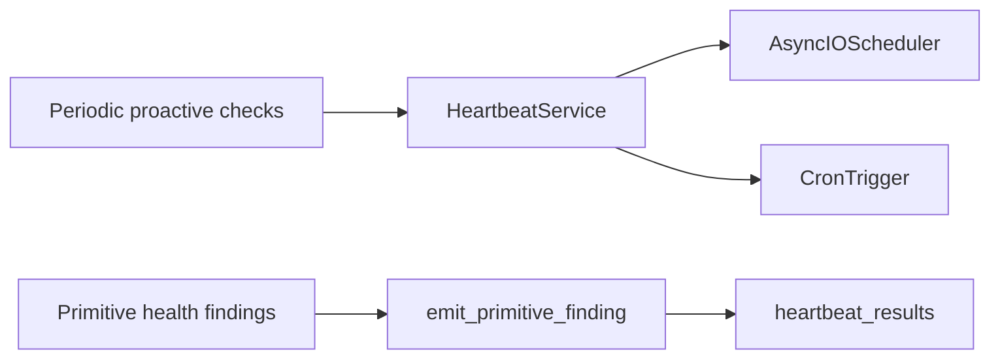
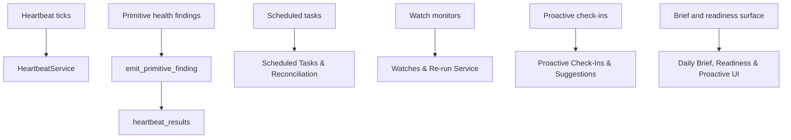

# Heartbeat, Scheduling & Watches

Relevant source files

The following files were used as context for generating this wiki page:

- [orchestrator/core/llm/decisions/evidence.py](orchestrator/core/llm/decisions/evidence.py)
- [orchestrator/core/llm/decisions/judgements.py](orchestrator/core/llm/decisions/judgements.py)
- [orchestrator/modules/coordination/agent_matcher.py](orchestrator/modules/coordination/agent_matcher.py)
- [orchestrator/modules/coordination/assignment_shadow.py](orchestrator/modules/coordination/assignment_shadow.py)
- [orchestrator/services/decision_evidence.py](orchestrator/services/decision_evidence.py)
- [orchestrator/services/heartbeat_service.py](orchestrator/services/heartbeat_service.py)
- [orchestrator/services/report_service.py](orchestrator/services/report_service.py)
- [orchestrator/services/session_end_shadow.py](orchestrator/services/session_end_shadow.py)
- [orchestrator/tests/test_f142c_a_shared_name_never_pins_the_lowest_id.py](orchestrator/tests/test_f142c_a_shared_name_never_pins_the_lowest_id.py)
- [orchestrator/tests/test_planner_capability_routing.py](orchestrator/tests/test_planner_capability_routing.py)
- [orchestrator/tests/test_prd248_s5_extra_hooks.py](orchestrator/tests/test_prd248_s5_extra_hooks.py)
- [orchestrator/tests/test_prd248_seam_tuning_b_evidence_in_the_state.py](orchestrator/tests/test_prd248_seam_tuning_b_evidence_in_the_state.py)
- [orchestrator/tests/test_prd248_seam_tuning_c_ticket_assign.py](orchestrator/tests/test_prd248_seam_tuning_c_ticket_assign.py)

## Purpose and Scope

This parent page maps how scheduled checks and proactive features fit together. The provided code excerpt identifies `HeartbeatService` as the entry point for periodic heartbeat ticks and shows a primitive-finding path that writes health findings to `heartbeat_results` [orchestrator/services/heartbeat_service.py:1-4](), [orchestrator/services/heartbeat_service.py:70-89](), [orchestrator/services/heartbeat_service.py:107-134]().

The child pages cover the detailed implementations for heartbeat execution, scheduled tasks, watches, proactive check-ins, APIs, and their UI. For details, see the relevant child page linked in each section below.

Sources: [orchestrator/services/heartbeat_service.py:1-4](), [orchestrator/services/heartbeat_service.py:70-89](), [orchestrator/services/heartbeat_service.py:107-134]()

---

## Architecture Overview

`HeartbeatService` is documented as managing periodic ticks for the orchestrator and agents. Its imports identify APScheduler’s `AsyncIOScheduler`, `MemoryJobStore`, and `CronTrigger`; its class documentation describes concurrency limits and timezone-aware scheduling that respects active hours [orchestrator/services/heartbeat_service.py:17-19](), [orchestrator/services/heartbeat_service.py:145-152](). The excerpt also shows `emit_primitive_finding`, which validates primitive and status values before writing a finding to `heartbeat_results` [orchestrator/services/heartbeat_service.py:52-62](), [orchestrator/services/heartbeat_service.py:70-89](), [orchestrator/services/heartbeat_service.py:91-134]().

This page treats heartbeat ticks, task scheduling, watches, and proactive check-ins as related parts of the proactive subsystem, while leaving their detailed service flows to the child pages. The diagram maps the heartbeat concepts visible in the excerpt to their code entities; it does not imply implementation details for the other child topics [orchestrator/services/heartbeat_service.py:17-19](), [orchestrator/services/heartbeat_service.py:70-89](), [orchestrator/services/heartbeat_service.py:107-134]().

**Diagram: Heartbeat concepts mapped to code entities**

Sources: [orchestrator/services/heartbeat_service.py:17-19](), [orchestrator/services/heartbeat_service.py:70-89](), [orchestrator/services/heartbeat_service.py:107-134](), [orchestrator/services/heartbeat_service.py:145-152]()

**Diagram: Proactive subsystem topics mapped to code names**

Sources: [orchestrator/services/heartbeat_service.py:70-89](), [orchestrator/services/heartbeat_service.py:107-134]()

| Subsystem | Parent-page role | Details |
|---|---|---|
| Heartbeat | Periodic checks and heartbeat findings | [Heartbeat Architecture](#11.1) |
| Orchestrator and agent heartbeats | Heartbeat execution and decision behavior | [Orchestrator & Agent Heartbeats](#11.2) |
| Scheduled tasks | Task scheduling and reconciliation | [Scheduled Tasks & Reconciliation](#11.3) |
| Watches | Monitors and re-run behavior | [Watches & Re-run Service](#11.4) |
| Proactive check-ins | Check-in and suggestion lifecycle | [Proactive Check-Ins & Suggestions (PRD-268)](#11.6) |
| Brief and readiness | Proactive summaries and UI | [Daily Brief, Readiness & Proactive UI](#11.7) |

Sources: [orchestrator/services/heartbeat_service.py:145-152]()

---

## 11.1 Heartbeat Architecture

`HeartbeatService` is the code entry point identified for periodic heartbeat ticks. The provided excerpt names APScheduler’s `AsyncIOScheduler`, `MemoryJobStore`, and `CronTrigger`; its class documentation describes concurrency limits and timezone-aware scheduling that respects active hours [orchestrator/services/heartbeat_service.py:17-19](), [orchestrator/services/heartbeat_service.py:145-152](). Primitive findings use the existing `heartbeat_results` table and are restricted to the names and statuses declared in `PRIMITIVE_NAMES` and `PRIMITIVE_STATUSES` [orchestrator/services/heartbeat_service.py:52-62](), [orchestrator/services/heartbeat_service.py:107-134]().

For cron conversion, active-hours behavior, trial handling, and primitive-finding details, see [Heartbeat Architecture](#11.1).

Sources: [orchestrator/services/heartbeat_service.py:17-19](), [orchestrator/services/heartbeat_service.py:52-62](), [orchestrator/services/heartbeat_service.py:107-134](), [orchestrator/services/heartbeat_service.py:145-152]()

---

## 11.2 Orchestrator & Agent Heartbeats

The heartbeat module imports `agent_job` and `orchestrator_job` from `services.proactive.heartbeat_bridge`, identifying a bridge between heartbeat scheduling and proactive jobs [orchestrator/services/heartbeat_service.py:24-28](). The excerpt does not show those jobs’ execution details.

For LLM-powered versus shallow modes, tool loops, proactive levels, BoardTask integration, and decision evidence, see [Orchestrator & Agent Heartbeats](#11.2).

Sources: [orchestrator/services/heartbeat_service.py:24-28]()

---

## 11.3 Scheduled Tasks & Reconciliation

This child page covers `ScheduledTaskService`, delivery modes, schedule reconciliation, and scheduling platform actions. Those implementation details are outside the provided code excerpts.

For details, see [Scheduled Tasks & Reconciliation](#11.3).

Sources: [orchestrator/services/heartbeat_service.py:145-152]()

---

## 11.4 Watches & Re-run Service

This child page covers the PRD-204 watch registry, ticker and decider, watch actions, re-run service, and escalation. Those implementation details are outside the provided code excerpts.

For details, see [Watches & Re-run Service](#11.4).

Sources: [orchestrator/services/heartbeat_service.py:145-152]()

---

## 11.5 Heartbeat API Reference

This child page documents endpoints for heartbeat configuration, results, history, manual runs, and orchestrator ticks. The provided heartbeat excerpt shows the service-level finding writer, but does not include API route definitions [orchestrator/services/heartbeat_service.py:70-89](), [orchestrator/services/heartbeat_service.py:107-134]().

For endpoint details, see [Heartbeat API Reference](#11.5).

Sources: [orchestrator/services/heartbeat_service.py:70-89](), [orchestrator/services/heartbeat_service.py:107-134]()

---

## 11.6 Proactive Check-Ins & Suggestions (PRD-268)

This child page covers the PRD-268 proactive runner, read-only check-in loop, suggestion lifecycle, gating and quiet hours, heartbeat bridge, SSE events, and proactive API routers. The heartbeat service imports `agent_job` and `orchestrator_job` from `services.proactive.heartbeat_bridge`; the provided excerpt does not show the runner or suggestion implementation [orchestrator/services/heartbeat_service.py:24-28]().

For details, see [Proactive Check-Ins & Suggestions (PRD-268)](#11.6).

Sources: [orchestrator/services/heartbeat_service.py:24-28]()

---

## 11.7 Daily Brief, Readiness & Proactive UI

This child page covers brief compilation, readiness probes, and the frontend proactive surface. These components are not shown in the provided code excerpts.

For details, see [Daily Brief, Readiness & Proactive UI](#11.7).

Sources: [orchestrator/services/heartbeat_service.py:145-152]()

---