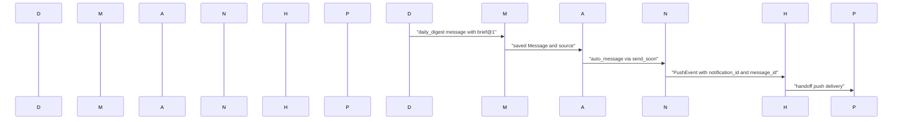

# Daily Brief, Readiness & Proactive UI

<details>
<summary>Relevant source files</summary>

The following files were used as context for generating this wiki page:

- [frontend/components/activity/command-center-history.tsx](frontend/components/activity/command-center-history.tsx)
- [frontend/components/activity/widgets/__tests__/needs-you-widget.test.tsx](frontend/components/activity/widgets/__tests__/needs-you-widget.test.tsx)
- [frontend/components/activity/widgets/activity-widget.tsx](frontend/components/activity/widgets/activity-widget.tsx)
- [frontend/components/activity/widgets/needs-you-widget.tsx](frontend/components/activity/widgets/needs-you-widget.tsx)
- [frontend/components/activity/widgets/playbook-metrics-widget.tsx](frontend/components/activity/widgets/playbook-metrics-widget.tsx)
- [frontend/components/chatbot/__tests__/auto-now-rail.test.tsx](frontend/components/chatbot/__tests__/auto-now-rail.test.tsx)
- [frontend/components/command-center/__tests__/needs-you-counters.test.tsx](frontend/components/command-center/__tests__/needs-you-counters.test.tsx)
- [frontend/hooks/use-auto-now.ts](frontend/hooks/use-auto-now.ts)
- [frontend/hooks/use-kpi-api.ts](frontend/hooks/use-kpi-api.ts)
- [frontend/hooks/use-needs-you.ts](frontend/hooks/use-needs-you.ts)
- [frontend/lib/needs-you-breakdown.ts](frontend/lib/needs-you-breakdown.ts)
- [orchestrator/alembic/versions/llm_usage_agent_name.py](orchestrator/alembic/versions/llm_usage_agent_name.py)
- [orchestrator/api/kpi_api.py](orchestrator/api/kpi_api.py)
- [orchestrator/core/playbook_schedule.py](orchestrator/core/playbook_schedule.py)
- [orchestrator/core/services/auto_reporting.py](orchestrator/core/services/auto_reporting.py)
- [orchestrator/core/services/notification_columns.py](orchestrator/core/services/notification_columns.py)
- [orchestrator/core/services/notification_dispatcher.py](orchestrator/core/services/notification_dispatcher.py)
- [orchestrator/modules/tools/discovery/handlers_auto_reporting.py](orchestrator/modules/tools/discovery/handlers_auto_reporting.py)
- [orchestrator/services/mobile/digest.py](orchestrator/services/mobile/digest.py)
- [orchestrator/services/needs_you.py](orchestrator/services/needs_you.py)
- [orchestrator/services/notification_events/auto_message.py](orchestrator/services/notification_events/auto_message.py)
- [orchestrator/services/notification_events/review_pending.py](orchestrator/services/notification_events/review_pending.py)
- [orchestrator/services/push/fanout.py](orchestrator/services/push/fanout.py)
- [orchestrator/services/push/payload.py](orchestrator/services/push/payload.py)
- [orchestrator/tests/fixtures/prd266_push_signature_vectors.json](orchestrator/tests/fixtures/prd266_push_signature_vectors.json)
- [orchestrator/tests/test_f049_deleted_agent_spend_keeps_its_name.py](orchestrator/tests/test_f049_deleted_agent_spend_keeps_its_name.py)
- [orchestrator/tests/test_f207_decisions_needed_are_never_silently_empty.py](orchestrator/tests/test_f207_decisions_needed_are_never_silently_empty.py)
- [orchestrator/tests/test_f246_needs_you_counts_what_waits.py](orchestrator/tests/test_f246_needs_you_counts_what_waits.py)
- [orchestrator/tests/test_f271_schedule_type_none_is_refused_and_says_how_to_stop_a_timer.py](orchestrator/tests/test_f271_schedule_type_none_is_refused_and_says_how_to_stop_a_timer.py)
- [orchestrator/tests/test_f274_needs_you_rows_name_their_ticket_and_mission.py](orchestrator/tests/test_f274_needs_you_rows_name_their_ticket_and_mission.py)
- [orchestrator/tests/test_prd128_a_notice_never_aborts_the_work_it_reports.py](orchestrator/tests/test_prd128_a_notice_never_aborts_the_work_it_reports.py)
- [orchestrator/tests/test_prd252_needs_you.py](orchestrator/tests/test_prd252_needs_you.py)
- [orchestrator/tests/test_prd266_auto_message.py](orchestrator/tests/test_prd266_auto_message.py)
- [orchestrator/tests/test_prd266_push_payload.py](orchestrator/tests/test_prd266_push_payload.py)
- [orchestrator/tests/test_prd268w2_brief_claim.py](orchestrator/tests/test_prd268w2_brief_claim.py)
- [orchestrator/tests/test_prd268w2_brief_push_message_id.py](orchestrator/tests/test_prd268w2_brief_push_message_id.py)

</details>


## Purpose and scope

This page documents the daily brief and readiness components evidenced in the supplied code, plus the `NeedsYouWidget` proactive surface. The available implementation detail covers `services.brief`, the scheduled mobile digest, brief claims, readiness probe references in tests, and the Needs You service and widget. The requested `suggestion-card`, `calibration-card`, and `readiness-list` are not represented by implementation files in the supplied material, so their behavior cannot be specified here without guessing.

Sources: `orchestrator/services/mobile/digest.py:1-47`(), `orchestrator/tests/test_prd268w2_brief_claim.py:1-33`(), `orchestrator/services/needs_you.py:1-50`(), `frontend/components/activity/widgets/needs-you-widget.tsx:1-28`()

---

## 1. Daily Brief and assembly flow

The supplied implementation shows the brief as a `brief@1` message part built over the daily digest text. `services.mobile.digest.run_digests` coordinates scheduled delivery; it calls `services.digest_service.generate_digest` for the workspace digest and `services.brief.build.build_brief` for the person-specific brief, then posts both in the person's Auto thread. The brief is localized using the phone's language and time zone, and the build reuses the generated digest rather than making a second model call. [orchestrator/services/mobile/digest.py:25-35]()

The scheduled post uses origin `daily_digest`, includes the local date and `via: schedule`, and contains `[text(Auto's Read), brief@1]`. The brief-on-open path shares the same daily claim with scheduled delivery; the test describes `services.brief.claim` and `services.brief.on_open` as the open-side path. [orchestrator/services/mobile/digest.py:15-24](), [orchestrator/services/mobile/digest.py:25-35](), [orchestrator/tests/test_prd268w2_brief_claim.py:1-5]()

### 1.1. Scheduled digest inputs and delivery

The scheduled job determines due people from active iOS or Android devices with a time zone. It selects the most recently seen eligible phone per workspace and person, using the phone's `digest_time` and `locale`; where applicable, the configured default digest time is used. A person is due during the configured catch-up interval after their local digest time. The digest preference can suppress scheduling; absent a preference row, the switch defaults to enabled. [orchestrator/services/mobile/digest.py:7-14](), [orchestrator/services/mobile/digest.py:85-94](), [orchestrator/services/mobile/digest.py:101-119]()

`run_digests` claims work per `(workspace, person, local date)` in `mobile_digest_posts`. The shared claim prevents multiple devices, tabs, workers, or the scheduled job from posting duplicate briefs for that local day. Claims are leases: a stale claim can be taken over if no brief was posted, and the worker checks that it still holds the claim before posting. If building or posting fails, the holder releases its claim so a later attempt can retry. [orchestrator/services/mobile/digest.py:15-24](), [orchestrator/services/mobile/digest.py:33-35]()

Database operations and the digest snapshot run in worker threads, each using its own session. The scheduled runner is best-effort and does not raise; failures are logged without logging the brief text. [orchestrator/services/mobile/digest.py:37-41]()

| Concern | Implementation detail |
|---|---|
| Schedule source | Active iOS/Android devices with a non-empty time zone; the most recently seen eligible device supplies schedule and locale. [orchestrator/services/mobile/digest.py:101-119]() |
| Catch-up interval | `DIGEST_CATCH_UP_MINUTES` is 90 minutes. [orchestrator/services/mobile/digest.py:85-90]() |
| Claim key | Workspace, person, and local date in `mobile_digest_posts`. [orchestrator/services/mobile/digest.py:15-24]() |
| Brief payload | Auto's Read text plus a `brief@1` part. [orchestrator/services/mobile/digest.py:25-35]() |
| Scheduled origin | `daily_digest`, with local date and `via: schedule`. [orchestrator/services/mobile/digest.py:29-35]() |

Sources: `orchestrator/services/mobile/digest.py:7-47`(), `orchestrator/services/mobile/digest.py:85-119`()

### 1.2. Brief claim, open path, and retry behavior

The brief claim is shared between the scheduled digest and the brief-on-open flow. The test describes the intended concurrency contract: concurrent opens and a scheduled run for the same local date produce one message, and each claimant can find that message. It also covers local-date behavior across time zones and daylight-saving changes. [orchestrator/tests/test_prd268w2_brief_claim.py:1-11]()

The claim lease uses `posted_at`. A stale claim without a day's message can be taken over; a claimant that loses the lease while building must not post, and a release only removes the lease still held by that claimant. [orchestrator/tests/test_prd268w2_brief_claim.py:22-26]()

The scheduled digest path and explicit `post_now` path differ: `post_now` generates and posts the same brief for one person without reading or writing the shared claim, so it does not consume the scheduled delivery's daily claim. [orchestrator/services/mobile/digest.py:43-48]()

#### Diagram: Daily brief code path

```mermaid
flowchart TD
    "run_digests" --> "due_people"
    "due_people" --> "claim_brief"
    "claim_brief" --> "generate_digest"
    "generate_digest" --> "build_brief"
    "build_brief" --> "deliver_background_message"
    "deliver_background_message" --> "brief@1"
    "on_open" --> "claim_brief"
    "claim_brief" --> "mobile_digest_posts"
    "post_now" --> "generate_digest"
    "post_now" --> "build_brief"
```

Sources: `orchestrator/services/mobile/digest.py:15-35`(), `orchestrator/services/mobile/digest.py:43-48`(), `orchestrator/tests/test_prd268w2_brief_claim.py:1-5`()

### 1.3. Notification and mobile push handoff

A scheduled digest is posted as Auto's message with origin `daily_digest`; the notification event path recognizes that origin and does not coalesce it with other `auto_message` events. If the message contains a `brief@1` part, its message ID is included in the notice so the push can open the chat at that message. [orchestrator/services/notification_events/auto_message.py:14-22](), [orchestrator/services/notification_events/auto_message.py:46-60](), [orchestrator/services/notification_events/auto_message.py:123-129]()

`announce` accepts only saved `Message` instances from configured announced origins, ignores messages whose `via` is `open`, and hands dispatch to `send_soon`. Its dispatch path uses a separate session and is designed not to raise into the message producer. [orchestrator/services/notification_events/auto_message.py:86-105](), [orchestrator/services/notification_events/auto_message.py:141-155]()

The notification dispatcher treats `suggestion_ready` as a valid event type. Push delivery is a separate fan-out: it checks recipients, eligible phone devices, and push preferences, then creates per-phone payloads. The push handoff is asynchronous when an event loop is running, so the request does not wait for Expo delivery. [orchestrator/core/services/notification_dispatcher.py:120-125](), [orchestrator/services/push/fanout.py:1-7](), [orchestrator/services/push/fanout.py:11-28]()

#### Diagram: Brief message to notification and push entities



Sources: `orchestrator/services/mobile/digest.py:25-35`(), `orchestrator/services/notification_events/auto_message.py:86-97`(), `orchestrator/services/notification_events/auto_message.py:123-129`(), `orchestrator/services/push/fanout.py:1-7`(), `orchestrator/services/push/fanout.py:114-131`()

---

## 2. Readiness probes and contract

The supplied readiness evidence is limited to the brief-claim test fixture. It imports `services.readiness.service`, `services.readiness.items`, and `services.readiness.probes.ITEMS`; the fixture can hold a workspace and substitutes readiness behavior as “all ready” for the claim tests. The probe definitions, production response schema, and readiness API are not included in the supplied file contents, so this page does not infer probe targets or contract fields. [orchestrator/tests/test_prd268w2_brief_claim.py:127-150]()

In the shown test context, readiness is a controlled dependency rather than the subject under test: the fixture holds the workspace and uses readiness-related imports while exercising brief-claim behavior. This establishes that readiness is integrated into the test setup, but not the runtime semantics of individual probes. [orchestrator/tests/test_prd268w2_brief_claim.py:127-150]()

#### Diagram: Readiness references available in the supplied test

```mermaid
flowchart LR
    "test_prd268w2_brief_claim.py" --> "services.readiness.service"
    "test_prd268w2_brief_claim.py" --> "services.readiness.items"
    "test_prd268w2_brief_claim.py" --> "services.readiness.probes.ITEMS"
    "held fixture" --> "readiness held as all ready"
```

Sources: `orchestrator/tests/test_prd268w2_brief_claim.py:127-150`()

---

## 3. The consolidated “Needs You” subsystem

`services.needs_you.needs_you` is the shared source for the count and rows representing work awaiting human action. Its documented families are review, question, approval, stuck, and failed. The service's module contract says viewers do not see questions or approval grants they cannot act on, and each listed row is intended to be something that viewer can open. [orchestrator/services/needs_you.py:1-17](), [orchestrator/services/needs_you.py:46-50]()

The review count excludes mission steps that are owned by the mission's own check, and excludes mission cards counted as plan approvals. The visible SQL also filters review rows to those with execution evidence or an approval action, and counts failed non-step tickets without a time window. [orchestrator/services/needs_you.py:81-99]()

### 3.1. Categories and aggregation

| Family | Meaning in the service |
|---|---|
| `review` | Tickets in Review requiring owner judgment; mission steps and mission plan cards are separated according to their decision owner. [orchestrator/services/needs_you.py:8-10](), [orchestrator/services/needs_you.py:81-94]() |
| `question` | Open questions represented by pending grants of kind `question`. [orchestrator/services/needs_you.py:11-12](), [orchestrator/services/needs_you.py:101-113]() |
| `approval` | Approval grants that can still be given and missions awaiting plan approval. [orchestrator/services/needs_you.py:12-14](), [orchestrator/services/needs_you.py:95-96](), [orchestrator/services/needs_you.py:101-107]() |
| `stuck` | Tickets that cannot progress until the owner acts; reasons include missing host or agent, work not picked up, ended mission, failed mission check, budget pause, and exhausted credit. [orchestrator/services/needs_you.py:15-17](), [orchestrator/services/needs_you.py:67-79]() |
| `failed` | Failed tickets that remain unresolved; a failed mission step is handled by its mission. [orchestrator/services/needs_you.py:16-17](), [orchestrator/services/needs_you.py:81-99]() |

The service defines `ROWS_PER_KIND = 200` and `KINDS` as the five families. Its comments distinguish exact counts from the number of rows listed, and describe the intended row identity and opening target for mission-related items. [orchestrator/services/needs_you.py:59-79]()

### 3.2. Deduplication, authorization, and row targets

The service groups owner decisions according to what must actually be acted on. For example, a mission plan awaiting approval is counted as an approval, while a mission step in Review can be the mission's own responsibility rather than the owner's. A failed mission step is not treated as an independent owner decision when its mission is responsible. [orchestrator/services/needs_you.py:8-17](), [orchestrator/services/needs_you.py:81-99]()

The service distinguishes `opens` targets: a row can open a ticket or a mission. It also defines the stuck reasons that make a mission, rather than an individual step, the decision target. [orchestrator/services/needs_you.py:67-79]()

The integration tests assert that the returned `total` equals the sum of the category counts and the number of rows listed, and verify that review, question, approval, and failed rows identify the intended ticket or mission. [orchestrator/tests/test_prd252_needs_you.py:98-124]()

Sources: `orchestrator/services/needs_you.py:1-17`(), `orchestrator/services/needs_you.py:59-99`(), `orchestrator/tests/test_prd252_needs_you.py:98-124`()

### 3.3. Frontend `NeedsYouWidget`

`NeedsYouWidget` consumes `useNeedsYou` and displays rows grouped into the five families. Its documented behavior is to show one count alongside the rows supplied by the same endpoint, link each item to its action target, and avoid presenting a failed data load as an empty workload. [frontend/components/activity/widgets/needs-you-widget.tsx:3-27](), [frontend/components/activity/widgets/needs-you-widget.tsx:32-39](), [frontend/components/activity/widgets/needs-you-widget.tsx:66-77]()

`ticketRowHref` sends a row to its mission when `opens === 'mission'` and a mission ID exists; otherwise it links to the ticket. `askRowHref` sends mission approvals to the mission, ticket-associated questions or approvals to the ticket, and otherwise uses the family fallback. [frontend/components/activity/widgets/needs-you-widget.tsx:52-64]()

The widget maps stuck reasons to user-facing explanations, including missing CLI host, no assigned agent, work not picked up, ended mission, failed mission check, over-budget pause, and exhausted AI credit. For ended missions it consolidates open steps from the same mission into one row. [frontend/components/activity/widgets/needs-you-widget.tsx:94-107](), [frontend/components/activity/widgets/needs-you-widget.tsx:110-135]()

The tests verify that the displayed count matches the listed links, that rows open the intended board or mission destinations, and that stuck rows explain why progress is blocked. [frontend/components/activity/widgets/__tests__/needs-you-widget.test.tsx:37-61](), [frontend/components/activity/widgets/__tests__/needs-you-widget.test.tsx:63-105]()

#### Diagram: Needs You service to UI code entities

```mermaid
flowchart LR
    "board_tasks" --> "needs_you"
    "orchestration_runs" --> "needs_you"
    "approval_grants" --> "needs_you"
    "needs_you" --> "counts and rows"
    "useNeedsYou" --> "NeedsYouWidget"
    "NeedsYouWidget" --> "ticketRowHref"
    "NeedsYouWidget" --> "askRowHref"
    "ticketRowHref" --> "ticketHref or missionHref"
    "askRowHref" --> "ticketHref or missionHref or fallback"
```

Sources: `orchestrator/services/needs_you.py:81-113`(), `frontend/components/activity/widgets/needs-you-widget.tsx:32-64`()

### 3.4. Surface coverage and available implementation evidence

The supplied files provide implementation detail for the daily brief, readiness references, and `NeedsYouWidget`. They do not include the source for `brief-card`, `suggestion-card`, `calibration-card`, or `readiness-list`; consequently, component props, data hooks, rendering states, and interaction behavior for those components are not documented here. The notification and push sources establish that `suggestion_ready` is a recognized event and describe push eligibility, but do not establish the frontend suggestion-card implementation. [orchestrator/core/services/notification_dispatcher.py:120-125](), [orchestrator/services/push/fanout.py:11-28]()

Sources: `orchestrator/core/services/notification_dispatcher.py:120-125`(), `orchestrator/services/push/fanout.py:11-28`(), `frontend/components/activity/widgets/needs-you-widget.tsx:1-39`()

---