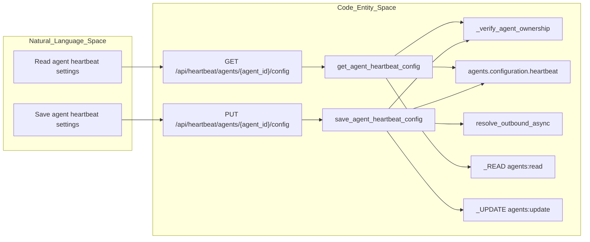
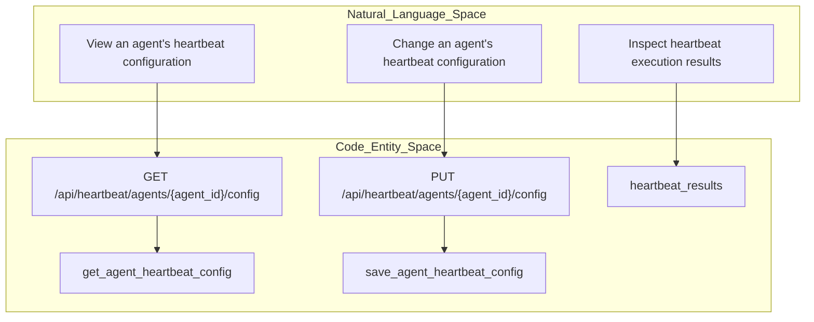

# Heartbeat API Reference

Relevant source files

The following files were used as context for generating this wiki page:

- [docs/PRDS/55-AUTONOMOUS-ASSISTANT-PLATFORM.md](docs/PRDS/55-AUTONOMOUS-ASSISTANT-PLATFORM.md)
- [frontend/components/settings/ChannelsSettingsTab.tsx](frontend/components/settings/ChannelsSettingsTab.tsx)
- [frontend/components/settings/__tests__/channels-settings-local.test.ts](frontend/components/settings/__tests__/channels-settings-local.test.ts)
- [orchestrator/alembic/versions/20260215_add_heartbeat_and_channels.py](orchestrator/alembic/versions/20260215_add_heartbeat_and_channels.py)
- [orchestrator/api/channels.py](orchestrator/api/channels.py)
- [orchestrator/api/heartbeat.py](orchestrator/api/heartbeat.py)
- [orchestrator/channels/manager.py](orchestrator/channels/manager.py)
- [orchestrator/channels/telegram_adapter.py](orchestrator/channels/telegram_adapter.py)
- [orchestrator/core/models/channels.py](orchestrator/core/models/channels.py)
- [orchestrator/tests/test_prd225_polling_answer_bridge.py](orchestrator/tests/test_prd225_polling_answer_bridge.py)

## Purpose and Scope

This section documents the heartbeat API behavior supported by the provided source excerpts: per-agent heartbeat configuration, request authorization, workspace ownership checks, payload validation, webhook URL validation, and the heartbeat-results table schema. The API router uses the `/api/heartbeat` prefix. [orchestrator/api/heartbeat.py:46-49]()

The available excerpt does not show implementations for last-result, history, run-now, or orchestrator-tick endpoints. Those routes and their behavior are therefore not specified here. The migration excerpt does establish that heartbeat execution results are stored in a `heartbeat_results` table. [orchestrator/api/heartbeat.py:1-7](), [orchestrator/alembic/versions/20260215_add_heartbeat_and_channels.py:19-37]()

Sources: [orchestrator/api/heartbeat.py:1-7](), [orchestrator/api/heartbeat.py:46-49](), [orchestrator/alembic/versions/20260215_add_heartbeat_and_channels.py:19-37]()

## API-to-Code Map

### Agent Heartbeat Configuration: API and Implementation

This diagram maps the documented configuration operations to their handlers, authorization dependencies, workspace check, stored agent configuration, and webhook URL validation. [orchestrator/api/heartbeat.py:52-55](), [orchestrator/api/heartbeat.py:94-106](), [orchestrator/api/heartbeat.py:109-160]()

Sources: [orchestrator/api/heartbeat.py:52-55](), [orchestrator/api/heartbeat.py:94-106](), [orchestrator/api/heartbeat.py:109-160]()

### Natural-Language Operations and Route Entities

The API excerpt documents read and update operations for an agent’s heartbeat configuration. It does not show a run-now endpoint or an orchestrator tick route, so those operations are not mapped to route entities here. [orchestrator/api/heartbeat.py:109-160]()

Sources: [orchestrator/api/heartbeat.py:109-160](), [orchestrator/alembic/versions/20260215_add_heartbeat_and_channels.py:19-37]()

## Router and Authorization

The FastAPI router is declared with prefix `/api/heartbeat` and tag `heartbeat`. The module defines `_READ`, `_UPDATE`, and `_EXECUTE` dependencies for `agents:read`, `agents:update`, and `agents:execute`, respectively, plus `_SU` for super-admin access. [orchestrator/api/heartbeat.py:46-55]()

The configuration read route requires `_READ`, while the configuration update route requires `_UPDATE`. Both handlers obtain a hybrid request context and database session through dependencies. The excerpt describes the router’s distinction between workspace-scoped per-agent routes and super-admin observability routes, but does not show the latter routes’ handler implementations. [orchestrator/api/heartbeat.py:30-45](), [orchestrator/api/heartbeat.py:109-145]()

Sources: [orchestrator/api/heartbeat.py:19-25](), [orchestrator/api/heartbeat.py:30-55](), [orchestrator/api/heartbeat.py:109-145]()

## Agent Heartbeat Configuration

### Payload Fields

`HeartbeatConfigPayload` defines the input fields accepted by the agent heartbeat configuration update route. `interval_minutes` defaults to 60 and is constrained to the inclusive range 5–1440. The optional `mode` field is validated against `HEARTBEAT_MODES`; `None` is allowed. [orchestrator/api/heartbeat.py:60-80]()

| Field | Type | Default or constraint |
|---|---|---|
| `enabled` | `bool` | `False` |
| `interval_minutes` | `int` | `60`; minimum 5, maximum 1440 |
| `inherit_active_hours` | `bool` | `True` |
| `active_hours_start` | `str` | `"08:00"` |
| `active_hours_end` | `str` | `"20:00"` |
| `prompt` | `str` | `""` |
| `auto_act` | `bool` | `False` |
| `report_to` | `str` | `"orchestrator"`; comment documents `orchestrator`, `direct`, `channel:<id>`, and `webhook` |
| `webhook_url` | `Optional[str]` | `None` |
| `channel_id` | `Optional[str]` | `None` |
| `mode` | `Optional[str]` | `None`, or a value in `HEARTBEAT_MODES` |

Sources: [orchestrator/api/heartbeat.py:26](), [orchestrator/api/heartbeat.py:60-80]()

### Read Configuration

`GET /api/heartbeat/agents/{agent_id}/config` is handled by `get_agent_heartbeat_config`. The handler verifies that the agent belongs to the current workspace, selects the agent’s `configuration`, reads its nested `heartbeat` object, and returns its fields with defaults for missing values. The returned `mode` is derived with `heartbeat_mode(hb)`. [orchestrator/api/heartbeat.py:94-106](), [orchestrator/api/heartbeat.py:109-137]()

Sources: [orchestrator/api/heartbeat.py:94-106](), [orchestrator/api/heartbeat.py:109-137]()

### Save Configuration and Webhook Validation

`PUT /api/heartbeat/agents/{agent_id}/config` is handled by `save_agent_heartbeat_config`. Before processing the configuration, the handler verifies agent ownership. It trims the supplied `webhook_url`; when the trimmed value is non-empty, it calls `resolve_outbound_async` with `enforce_switch=False`. A refused target produces an HTTP 400 response containing the validation reason. [orchestrator/api/heartbeat.py:140-159]()

The handler constructs a `stored` dictionary from the payload and normalizes an empty webhook URL to `None`. `_kept_mode` implements compatibility behavior for clients that omit the `mode` field: an explicitly supplied field uses the submitted payload, while an omitted field preserves the mode stated by the current configuration. The provided excerpt ends before the rest of the save handler, so it does not establish the subsequent persistence or scheduling behavior. [orchestrator/api/heartbeat.py:83-90](), [orchestrator/api/heartbeat.py:140-161]()

Sources: [orchestrator/api/heartbeat.py:83-90](), [orchestrator/api/heartbeat.py:140-161]()

## Workspace Ownership Check

`_verify_agent_ownership` queries the `agents` table for the requested agent’s `workspace_id`. It raises HTTP 404 when the agent does not exist or its workspace does not match the request context. The same check is called by both the configuration read and update handlers. [orchestrator/api/heartbeat.py:94-106](), [orchestrator/api/heartbeat.py:109-116](), [orchestrator/api/heartbeat.py:140-148]()

Sources: [orchestrator/api/heartbeat.py:94-106](), [orchestrator/api/heartbeat.py:109-116](), [orchestrator/api/heartbeat.py:140-148]()

## Heartbeat Results Storage

The provided Alembic migration creates `heartbeat_results` with an integer primary key and fields for source type, source ID, workspace ID, status, findings, actions taken, tokens used, cost, and creation time. It adds indexes on `workspace_id`, the `(source_type, source_id)` pair, and `created_at`. The migration documents source types as `agent` or `orchestrator`, and the source ID as an agent ID or workspace ID. [orchestrator/alembic/versions/20260215_add_heartbeat_and_channels.py:19-37]()

The migration establishes the results schema, but the supplied API excerpt does not show an endpoint that reads the latest result or returns execution history. It also does not show the code path that writes rows to `heartbeat_results`. [orchestrator/alembic/versions/20260215_add_heartbeat_and_channels.py:19-37](), [orchestrator/api/heartbeat.py:1-7]()

Sources: [orchestrator/alembic/versions/20260215_add_heartbeat_and_channels.py:19-37](), [orchestrator/api/heartbeat.py:1-7]()

## Endpoint Reference

| Method | Endpoint | Description | Authorization |
|---|---|---|---|
| `GET` | `/api/heartbeat/agents/{agent_id}/config` | Reads an agent’s heartbeat configuration. | `agents:read` |
| `PUT` | `/api/heartbeat/agents/{agent_id}/config` | Accepts an agent heartbeat configuration payload and validates a supplied webhook URL. | `agents:update` |

The API excerpt identifies additional route categories—including workspace listing, toggle, execution history, status, analytics, and orchestrator heartbeat—but does not include their route declarations or handler implementations. Exact paths, request/response schemas, and behavior for those endpoints cannot be specified from the supplied lines. [orchestrator/api/heartbeat.py:1-7](), [orchestrator/api/heartbeat.py:30-45](), [orchestrator/api/heartbeat.py:109-160]()

Sources: [orchestrator/api/heartbeat.py:1-7](), [orchestrator/api/heartbeat.py:30-45](), [orchestrator/api/heartbeat.py:109-160]()

---