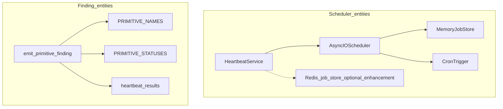
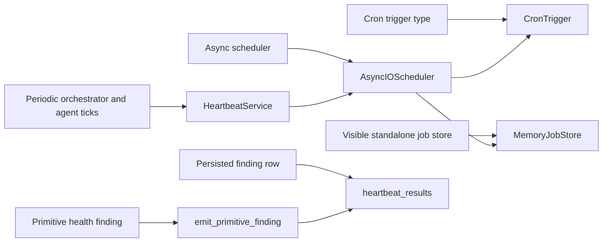
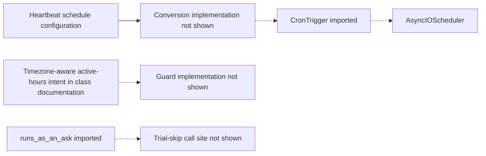
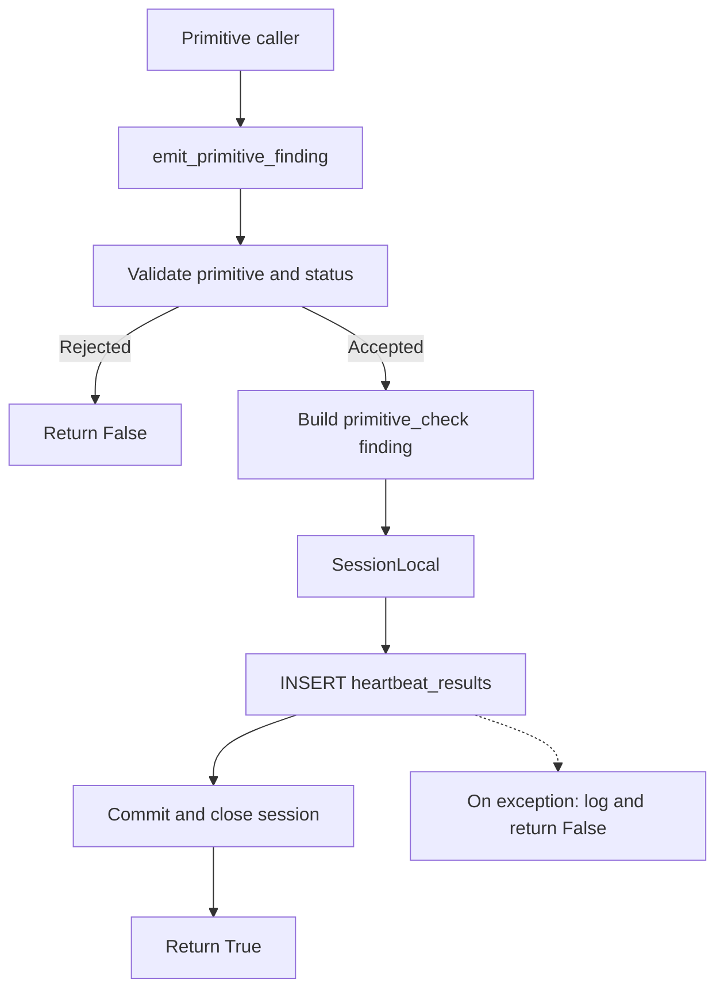

# Heartbeat Architecture

Relevant source files

The following files were used as context for generating this wiki page:

- [orchestrator/core/llm/decisions/evidence.py](orchestrator/core/llm/decisions/evidence.py)
- [orchestrator/core/llm/decisions/judgements.py](orchestrator/core/llm/decisions/judgements.py)
- [orchestrator/modules/coordination/agent_matcher.py](orchestrator/modules/coordination/agent_matcher.py)
- [orchestrator/modules/coordination/assignment_shadow.py](orchestrator/modules/coordination/assignment_shadow.py)
- [orchestrator/services/decision_evidence.py](orchestrator/services/decision_evidence.py)
- [orchestrator/services/heartbeat_service.py](orchestrator/services/heartbeat_service.py)
- [orchestrator/services/report_service.py](orchestrator/services/report_service.py)
- [orchestrator/services/session_end_shadow.py](orchestrator/services/session_end_shadow.py)
- [orchestrator/tests/test_f142c_a_shared_name_never_pins_the_lowest_id.py](orchestrator/tests/test_f142c_a_shared_name_never_pins_the_lowest_id.py)
- [orchestrator/tests/test_planner_capability_routing.py](orchestrator/tests/test_planner_capability_routing.py)
- [orchestrator/tests/test_prd248_s5_extra_hooks.py](orchestrator/tests/test_prd248_s5_extra_hooks.py)
- [orchestrator/tests/test_prd248_seam_tuning_b_evidence_in_the_state.py](orchestrator/tests/test_prd248_seam_tuning_b_evidence_in_the_state.py)
- [orchestrator/tests/test_prd248_seam_tuning_c_ticket_assign.py](orchestrator/tests/test_prd248_seam_tuning_c_ticket_assign.py)

## Purpose and Scope

This page describes the heartbeat implementation evidenced by the available source: `HeartbeatService`’s scheduler setup and state, the APScheduler types it imports, the trial-related import seam, proactive job-runner imports, and primitive health findings written to `heartbeat_results`. The available excerpt does not show the service’s remaining methods, so cron conversion, active-hours enforcement, trial-skip behavior, and job-store configuration beyond the visible initialization are not specified here. [orchestrator/services/heartbeat_service.py:1-28](), [orchestrator/services/heartbeat_service.py:145-165]()

Sources: [orchestrator/services/heartbeat_service.py:1-28](), [orchestrator/services/heartbeat_service.py:145-165]()

---

## System Overview & Architecture

`HeartbeatService` is documented as managing periodic ticks for the orchestrator and agents. It can receive a shared `AsyncIOScheduler`, or create a local scheduler for tests and backward compatibility. Its constructor tracks scheduler ownership, running ticks, a workspace concurrency limit, agent job signatures, and the last durable-probe status. [orchestrator/services/heartbeat_service.py:145-165](), [orchestrator/services/heartbeat_service.py:170-183]()

The module imports `AsyncIOScheduler`, `MemoryJobStore`, and `CronTrigger`. The visible standalone initialization begins by configuring a `MemoryJobStore`; the excerpt ends before the rest of that setup is shown. The class documentation describes Redis-backed job storage as an optional enhancement, but the available lines do not show a Redis job-store implementation or configuration. [orchestrator/services/heartbeat_service.py:17-20](), [orchestrator/services/heartbeat_service.py:145-152](), [orchestrator/services/heartbeat_service.py:170-183]()

A separate diagnostic path, `emit_primitive_finding`, validates primitive health values and writes a `primitive_check` finding into `heartbeat_results`. [orchestrator/services/heartbeat_service.py:42-63](), [orchestrator/services/heartbeat_service.py:70-143]()

### Diagram: Heartbeat Concepts Mapped to Code Entities

Sources: [orchestrator/services/heartbeat_service.py:17-20](), [orchestrator/services/heartbeat_service.py:42-63](), [orchestrator/services/heartbeat_service.py:70-143](), [orchestrator/services/heartbeat_service.py:145-165]()

### Diagram: Natural-Language Responsibilities to Code Entities

Sources: [orchestrator/services/heartbeat_service.py:17-20](), [orchestrator/services/heartbeat_service.py:70-143](), [orchestrator/services/heartbeat_service.py:145-165](), [orchestrator/services/heartbeat_service.py:170-183]()

---

## HeartbeatService Implementation & Job Store

`HeartbeatService.__init__` initializes scheduler ownership and bookkeeping. `_scheduler` starts unset; `_owns_scheduler` distinguishes a locally created scheduler from a shared one; `_running_ticks` tracks tick concurrency; `_max_concurrent_per_workspace` is set to `5`; `_hb_signatures` maps agent IDs to registered-job signatures; and `_last_durable_probe_status` stores the most recently emitted durable-store probe status. [orchestrator/services/heartbeat_service.py:145-165]()

`start(scheduler=None)` accepts a scheduler from `UnifiedScheduler`. When one is supplied, the service records it as shared and sets `_owns_scheduler` to `False`. Without one, the visible code enters standalone mode, described as useful for tests and backward compatibility, and begins constructing a scheduler with a `MemoryJobStore`. The remainder of standalone setup is not present in the available excerpt. [orchestrator/services/heartbeat_service.py:170-183]()

| Entity | Role evidenced in the available source |
|---|---|
| `AsyncIOScheduler` | APScheduler scheduler type stored by `HeartbeatService` and accepted by `start`. [orchestrator/services/heartbeat_service.py:17](), [orchestrator/services/heartbeat_service.py:154-155](), [orchestrator/services/heartbeat_service.py:170-179]() |
| `MemoryJobStore` | Job-store type imported by the module and used in the visible start of standalone setup. [orchestrator/services/heartbeat_service.py:18](), [orchestrator/services/heartbeat_service.py:181-183]() |
| `CronTrigger` | APScheduler trigger type imported by the module; its conversion or use is not shown in the available excerpt. [orchestrator/services/heartbeat_service.py:19]() |
| `_running_ticks` | Per-key tick tracking dictionary. [orchestrator/services/heartbeat_service.py:157]() |
| `_max_concurrent_per_workspace` | Workspace concurrency limit initialized to `5`. [orchestrator/services/heartbeat_service.py:161]() |
| `_hb_signatures` | Agent-ID-to-signature map described as supporting re-addition when configuration changes. [orchestrator/services/heartbeat_service.py:162-164]() |

The module imports `runs_as_an_ask` from `services.credits.asks`, but the available excerpt does not show a call to it or establish how it affects heartbeat execution. [orchestrator/services/heartbeat_service.py:23]()

Sources: [orchestrator/services/heartbeat_service.py:17-24](), [orchestrator/services/heartbeat_service.py:145-165](), [orchestrator/services/heartbeat_service.py:170-183]()

---

## Cron Trigger Conversion & Active Hours Guard

`CronTrigger` is imported by the heartbeat module, and the `HeartbeatService` class documentation says scheduling is timezone-aware and respects active hours. The available excerpt does not include the methods that convert configuration into cron triggers or enforce an active-hours guard; those runtime details therefore cannot be established from the shown lines. [orchestrator/services/heartbeat_service.py:19](), [orchestrator/services/heartbeat_service.py:145-152]()

The class documentation states a maximum of one concurrent heartbeat per agent and five per workspace. The constructor visibly initializes the workspace limit to `5` and creates `_running_ticks` for concurrency tracking. The excerpt does not show the enforcement logic for either limit. [orchestrator/services/heartbeat_service.py:145-161]()

Similarly, `runs_as_an_ask` is imported, but no trial-skip check or call site is visible in the provided excerpt. The import alone does not establish when or whether a heartbeat is skipped. [orchestrator/services/heartbeat_service.py:23]()

### Diagram: Visible Scheduling and Guard Boundaries

Sources: [orchestrator/services/heartbeat_service.py:19](), [orchestrator/services/heartbeat_service.py:23](), [orchestrator/services/heartbeat_service.py:145-152]()

---

## Primitive Findings & Health Monitoring

The module defines a primitive-finding contract for health signals. `PRIMITIVE_NAMES` allows `chat`, `memory`, `rag`, `nl2sql`, `graph`, `missions`, `playbooks`, and `channels`; `PRIMITIVE_STATUSES` allows `green`, `degraded`, and `down`. The source comments explain that a primitive without a real signal should emit nothing, leaving its health tile as `unknown` rather than reporting a false green. [orchestrator/services/heartbeat_service.py:42-63]()

`emit_primitive_finding(workspace_id, primitive, status, detail="")` is decorated with `@off_loop`. It rejects unknown primitive names and invalid statuses, returning `False` for either validation failure. For valid inputs, it opens a `SessionLocal` database session, inserts one row into `heartbeat_results`, commits, closes the session, and returns `True`. Exceptions are logged and converted to `False`; the function’s documentation states that it never raises and that calls from an event loop are handed off to best-effort threads. [orchestrator/services/heartbeat_service.py:70-103](), [orchestrator/services/heartbeat_service.py:105-143]()

### Supported Primitives and Statuses

| Constant | Accepted values |
|---|---|
| `PRIMITIVE_NAMES` | `chat`, `memory`, `rag`, `nl2sql`, `graph`, `missions`, `playbooks`, `channels`. [orchestrator/services/heartbeat_service.py:52-61]() |
| `PRIMITIVE_STATUSES` | `green`, `degraded`, `down`. [orchestrator/services/heartbeat_service.py:62]() |

Sources: [orchestrator/services/heartbeat_service.py:42-63]()

### Diagram: Primitive Finding Data Flow

Sources: [orchestrator/services/heartbeat_service.py:70-143]()

### Finding Payload and Persistence Contract

| Field or column | Value or meaning |
|---|---|
| `finding_type` | Literal value `primitive_check`. [orchestrator/services/heartbeat_service.py:110-115]() |
| `primitive` | Validated member of `PRIMITIVE_NAMES`. [orchestrator/services/heartbeat_service.py:91-97](), [orchestrator/services/heartbeat_service.py:110-115]() |
| `status` | Validated member of `PRIMITIVE_STATUSES`. [orchestrator/services/heartbeat_service.py:98-103](), [orchestrator/services/heartbeat_service.py:110-115]() |
| `detail` | String detail, limited to 500 characters. [orchestrator/services/heartbeat_service.py:110-115]() |
| `findings` | JSON-encoded array containing the single finding dictionary. [orchestrator/services/heartbeat_service.py:116-131]() |
| `source_type` | Inserted as `orchestrator`. [orchestrator/services/heartbeat_service.py:116-125]() |
| `source_id` and `workspace_id` | Both populated from the provided `workspace_id`, converted to a string. [orchestrator/services/heartbeat_service.py:123-131]() |
| `status`, `actions_taken`, `tokens_used` | Row-level values are `success`, `[]`, and `0`, respectively. [orchestrator/services/heartbeat_service.py:123-125]() |

Sources: [orchestrator/services/heartbeat_service.py:70-143]()

---

## Shadow Heartbeat Triage & Proactive Integration

The heartbeat module imports `shadow_heartbeat_triage` under the local alias `_shadow_heartbeat_triage`, and imports `agent_job` and `orchestrator_job` from `services.proactive.heartbeat_bridge`. These imports identify integration points, but the available excerpt does not show where or how they are called. [orchestrator/services/heartbeat_service.py:24-28]()

The module also tracks `_last_durable_probe_status`; its comment says this supports writing a `heartbeat_results` row only when the durable-store probe’s status changes, rather than on every tick. The available excerpt does not show the probe implementation or its call site. [orchestrator/services/heartbeat_service.py:158-160]()

Sources: [orchestrator/services/heartbeat_service.py:24-28](), [orchestrator/services/heartbeat_service.py:158-160]()

---