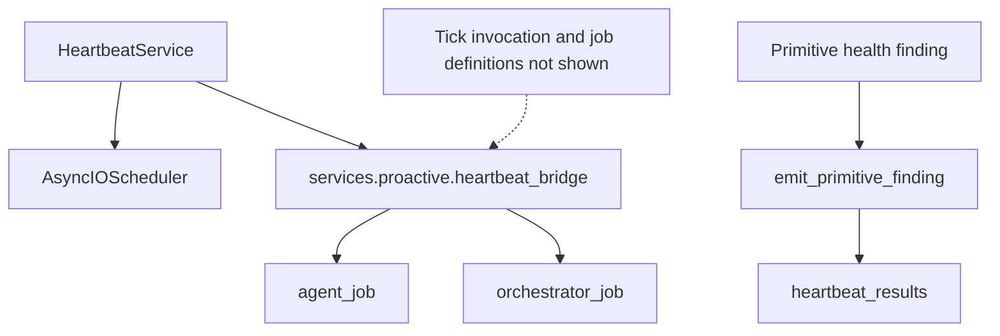
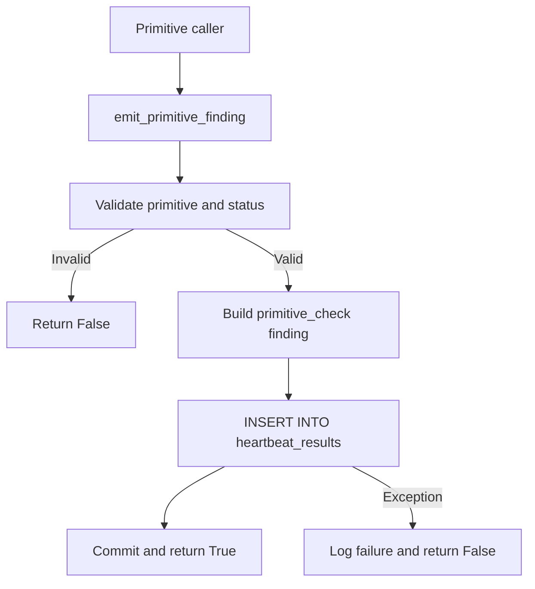
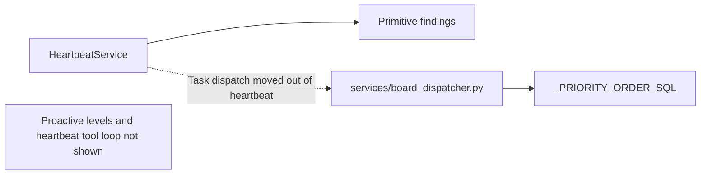
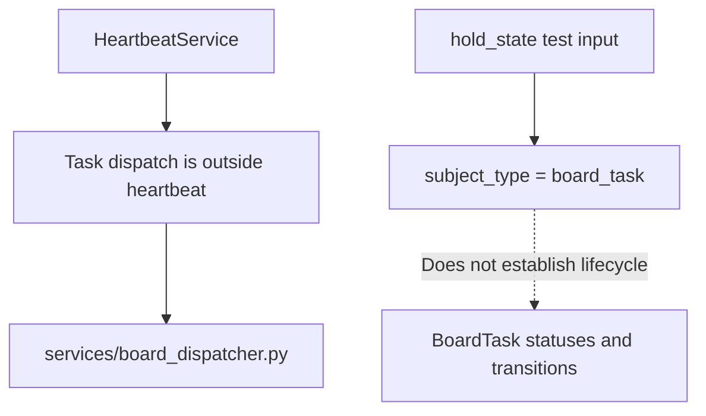
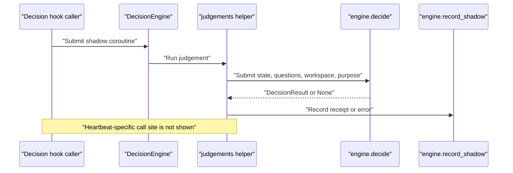
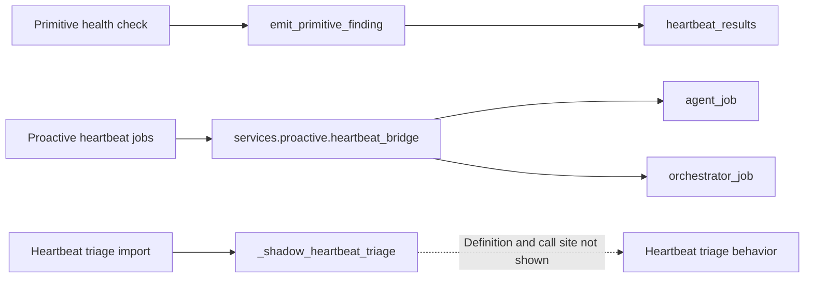
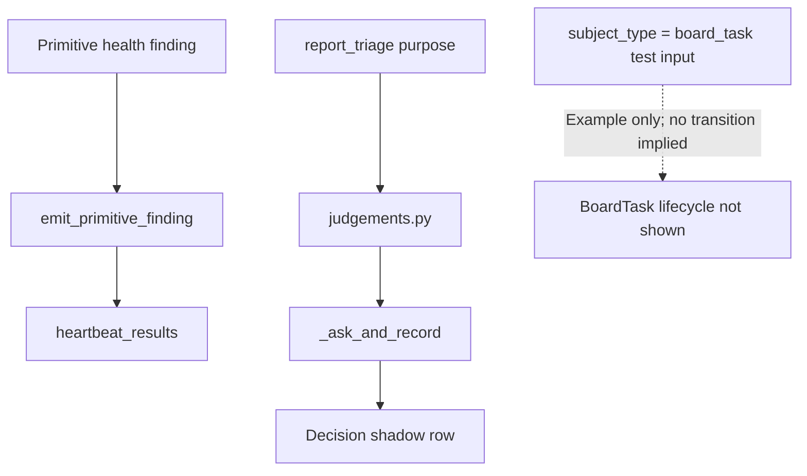

# Orchestrator & Agent Heartbeats

Relevant source files

The following files were used as context for generating this wiki page:

- [docs/PRDS/PRD-248-DECISION-ENGINE-SEAM.md](docs/PRDS/PRD-248-DECISION-ENGINE-SEAM.md)
- [orchestrator/core/llm/decisions/__init__.py](orchestrator/core/llm/decisions/__init__.py)
- [orchestrator/core/llm/decisions/engine.py](orchestrator/core/llm/decisions/engine.py)
- [orchestrator/core/llm/decisions/evidence.py](orchestrator/core/llm/decisions/evidence.py)
- [orchestrator/core/llm/decisions/judgements.py](orchestrator/core/llm/decisions/judgements.py)
- [orchestrator/core/llm/decisions/llm_adapter.py](orchestrator/core/llm/decisions/llm_adapter.py)
- [orchestrator/core/llm/decisions/questions.py](orchestrator/core/llm/decisions/questions.py)
- [orchestrator/core/llm/decisions/rerank.py](orchestrator/core/llm/decisions/rerank.py)
- [orchestrator/core/llm/decisions/typesafe_client.py](orchestrator/core/llm/decisions/typesafe_client.py)
- [orchestrator/evals/__init__.py](orchestrator/evals/__init__.py)
- [orchestrator/evals/operating_graph_uplift.py](orchestrator/evals/operating_graph_uplift.py)
- [orchestrator/modules/coordination/agent_matcher.py](orchestrator/modules/coordination/agent_matcher.py)
- [orchestrator/modules/coordination/assignment_shadow.py](orchestrator/modules/coordination/assignment_shadow.py)
- [orchestrator/modules/tools/discovery/decision_rerank.py](orchestrator/modules/tools/discovery/decision_rerank.py)
- [orchestrator/scripts/eval/decision_shadow/score.py](orchestrator/scripts/eval/decision_shadow/score.py)
- [orchestrator/services/decision_evidence.py](orchestrator/services/decision_evidence.py)
- [orchestrator/services/heartbeat_service.py](orchestrator/services/heartbeat_service.py)
- [orchestrator/services/report_service.py](orchestrator/services/report_service.py)
- [orchestrator/services/session_end_shadow.py](orchestrator/services/session_end_shadow.py)
- [orchestrator/tests/test_f142c_a_shared_name_never_pins_the_lowest_id.py](orchestrator/tests/test_f142c_a_shared_name_never_pins_the_lowest_id.py)
- [orchestrator/tests/test_planner_capability_routing.py](orchestrator/tests/test_planner_capability_routing.py)
- [orchestrator/tests/test_prd177_uplift_eval.py](orchestrator/tests/test_prd177_uplift_eval.py)
- [orchestrator/tests/test_prd248_decision_seam.py](orchestrator/tests/test_prd248_decision_seam.py)
- [orchestrator/tests/test_prd248_s4_tool_rerank.py](orchestrator/tests/test_prd248_s4_tool_rerank.py)
- [orchestrator/tests/test_prd248_s5_extra_hooks.py](orchestrator/tests/test_prd248_s5_extra_hooks.py)
- [orchestrator/tests/test_prd248_seam_tuning_a_version_stamp.py](orchestrator/tests/test_prd248_seam_tuning_a_version_stamp.py)
- [orchestrator/tests/test_prd248_seam_tuning_b_evidence_in_the_state.py](orchestrator/tests/test_prd248_seam_tuning_b_evidence_in_the_state.py)
- [orchestrator/tests/test_prd248_seam_tuning_c_ticket_assign.py](orchestrator/tests/test_prd248_seam_tuning_c_ticket_assign.py)
- [orchestrator/tests/test_prd248_seam_tuning_e_tool_rerank_scores.py](orchestrator/tests/test_prd248_seam_tuning_e_tool_rerank_scores.py)
- [scripts/ralph/customer-night/nights/auto-brain-jev.SUPERVISOR.md](scripts/ralph/customer-night/nights/auto-brain-jev.SUPERVISOR.md)
- [scripts/ralph/customer-night/nights/auto-brain-jev.md](scripts/ralph/customer-night/nights/auto-brain-jev.md)
- [scripts/ralph/customer-night/nights/auto-brain.md](scripts/ralph/customer-night/nights/auto-brain.md)

## Purpose and scope

This page documents what the supplied source establishes about heartbeat scheduling, primitive health findings, the heartbeat-to-proactive bridge, BoardTask dispatch boundaries, and decision-engine judgements. The available heartbeat excerpt shows `HeartbeatService` initialization and `emit_primitive_finding`, but not the scheduler’s tick implementation or the definitions of the imported proactive jobs. Details about heartbeat modes, tool-loop behavior, proactive levels, and BoardTask status transitions are therefore identified as unverified rather than inferred. [orchestrator/services/heartbeat_service.py:27-28]()

Sources: [orchestrator/services/heartbeat_service.py:27-28]()

---

## 1. Overview & Architecture

`HeartbeatService` is described as managing periodic ticks for the orchestrator and agents. Its constructor holds an optional `AsyncIOScheduler`, tracks running ticks and per-agent heartbeat signatures, and sets a maximum of five concurrent heartbeats per workspace. The excerpt imports `agent_job` and `orchestrator_job` from `services.proactive.heartbeat_bridge`, but does not show their definitions or how they are invoked. [orchestrator/services/heartbeat_service.py:27-28](), [orchestrator/services/heartbeat_service.py:145-164]()

The excerpt also defines `emit_primitive_finding`, a best-effort path for writing primitive health findings to `heartbeat_results`. Its code validates primitive names and statuses, then inserts a `primitive_check` object in the existing `findings` JSON payload. [orchestrator/services/heartbeat_service.py:42-62](), [orchestrator/services/heartbeat_service.py:70-89](), [orchestrator/services/heartbeat_service.py:91-142]()

The provided files do not show heartbeat tick registration, the implementation of `agent_job` or `orchestrator_job`, or the heartbeat-specific tool loop. Those behaviors cannot be established from the available excerpts. [orchestrator/services/heartbeat_service.py:27-28](), [orchestrator/services/heartbeat_service.py:145-183]()

**Diagram title: Heartbeat Components and Source Boundaries**

Sources: [orchestrator/services/heartbeat_service.py:17-28](), [orchestrator/services/heartbeat_service.py:70-89](), [orchestrator/services/heartbeat_service.py:106-142](), [orchestrator/services/heartbeat_service.py:145-164]()

---

## 2. LLM-Powered vs Shallow Mode

The supplied heartbeat excerpt does not show an LLM-powered mode, a shallow mode, or the code that chooses between modes. It therefore does not establish mode-selection conditions, fallback behavior, or whether either mode invokes tools. [orchestrator/services/heartbeat_service.py:145-183]()

The concrete non-LLM finding path is `emit_primitive_finding`. It accepts a workspace, primitive, status, and optional detail; rejects values outside the declared primitive and status sets; and writes a `primitive_check` finding to `heartbeat_results`. The helper returns `False` on validation or persistence failure rather than raising into the caller. [orchestrator/services/heartbeat_service.py:52-62](), [orchestrator/services/heartbeat_service.py:70-89](), [orchestrator/services/heartbeat_service.py:91-142]()

Allowed primitive names are `chat`, `memory`, `rag`, `nl2sql`, `graph`, `missions`, `playbooks`, and `channels`; allowed finding statuses are `green`, `degraded`, and `down`. The `detail` value is converted to text and truncated to 500 characters before insertion. [orchestrator/services/heartbeat_service.py:52-62](), [orchestrator/services/heartbeat_service.py:108-115]()

**Diagram title: Primitive Finding Write Path**

Sources: [orchestrator/services/heartbeat_service.py:70-89](), [orchestrator/services/heartbeat_service.py:91-142]()

---

## 3. Proactive Levels & Tool Loop Architecture

The provided heartbeat source does not define proactive levels, a heartbeat tool loop, tool permissions, or loop limits. The imports of `agent_job` and `orchestrator_job` show that the service depends on a proactive heartbeat bridge, but the bridge implementation is not included; no behavior beyond those imported names can be established. [orchestrator/services/heartbeat_service.py:27-28]()

One dispatch boundary is explicit: a comment says board-task pickup priority lives in `services/board_dispatcher.py` in `_PRIORITY_ORDER_SQL`, and that PRD-161 moved task dispatch out of the heartbeat. The dispatcher implementation is not included in the supplied excerpts. [orchestrator/services/heartbeat_service.py:65-67]()

**Diagram title: Heartbeat and Board Dispatch Boundary**

Sources: [orchestrator/services/heartbeat_service.py:27-28](), [orchestrator/services/heartbeat_service.py:65-67](), [orchestrator/services/heartbeat_service.py:70-89]()

---

## 4. BoardTask Integration & Status Transitions

The supplied heartbeat source does not include the `BoardTask` model, board-task routes, dispatcher claim implementation, or task-state transitions. It therefore does not establish which statuses exist or which operations create, claim, or update a BoardTask. [orchestrator/services/heartbeat_service.py:65-67]()

The excerpt does establish that task dispatch was moved out of the heartbeat and that the dispatcher owns the pickup-priority SQL. Separately, a decision-hook test uses `subject_type="board_task"` as input to a hold-risk evidence-state builder. That test example identifies an evidence subject type; it does not demonstrate task dispatch or lifecycle behavior. [orchestrator/services/heartbeat_service.py:65-67](), [orchestrator/tests/test_prd248_s5_extra_hooks.py:106-115]()

**Diagram title: BoardTask Evidence Boundary**

Sources: [orchestrator/services/heartbeat_service.py:65-67](), [orchestrator/tests/test_prd248_s5_extra_hooks.py:106-115]()

---

## 5. Decision Evidence & Judgements (PRD-248 Seam)

### Heartbeat decision hook visibility

The heartbeat file excerpt imports `shadow_heartbeat_triage` under the local name `_shadow_heartbeat_triage`, but does not show its definition or a call site. The import alone does not establish how heartbeat evidence is constructed, which dial controls the hook, or whether a heartbeat tick invokes it. [orchestrator/services/heartbeat_service.py:23-28]()

The PRD-248 judgement module describes decision hooks as typed judgements made beside platform decisions, using plain values rather than ORM rows; it states that these hooks record shadow rows and do not change platform decisions. Its declared `PURPOSE_REPORT` is the report-triage purpose. [orchestrator/core/llm/decisions/judgements.py:1-16](), [orchestrator/core/llm/decisions/judgements.py:25-28]()

### Decision evidence and recording

The shared `_ask_and_record` helper calls `engine.decide` with state, questions, workspace ID, and purpose. It records a result receipt or an error, optionally invokes a finishing callback when a result exists, then attempts `engine.record_shadow(row)` while swallowing recording errors. [orchestrator/core/llm/decisions/judgements.py:74-112]()

For report triage, the judgement module defines questions for whether attention is needed and for severity. Its severity criteria distinguish routine information, something useful to review, a decision or approval, and an urgent issue. The supplied excerpt does not show a heartbeat-specific call to this question builder. [orchestrator/core/llm/decisions/judgements.py:62-67]()

### Decision-engine modes and failure isolation

`DecisionEngine` defines `off`, `shadow`, and `live` modes. Its `Dials` structure defaults `report_triage_mode` to `off`, and `any_on` considers that dial alongside the other decision hooks. The dials are read from the `decision_engine` settings category and cached for a short period. [orchestrator/core/llm/decisions/engine.py:40-45](), [orchestrator/core/llm/decisions/engine.py:61-90](), [orchestrator/core/llm/decisions/engine.py:168-183]()

The engine’s `_as_shadow_only` helper converts `live` to `shadow` for hooks that have no live mode, logging a warning. The decision-hook tests assert that the extra hooks do not have a live mode and that shadow work can run on an event loop or daemon thread without propagating failures. These general decision-engine properties do not establish the behavior of the heartbeat hook itself. [orchestrator/core/llm/decisions/engine.py:129-136](), [orchestrator/tests/test_prd248_s5_extra_hooks.py:118-159]()

### Shadow evidence and evaluation

The decision engine documents shadow rows as JSON Lines written to `DECISION_SHADOW_LOG_PATH`; it also stamps rows with `SEAM_VERSION` to separate evaluations across changes to question or state shape. [orchestrator/core/llm/decisions/engine.py:1-14](), [orchestrator/core/llm/decisions/engine.py:49-54]()

The supplied scorer reads JSONL rows and supports filtering by simulated or real traffic, seam version, and time window. Its documentation describes coverage, agreement, confidence-band calibration, latency percentiles, and the number of turns that would have cleared the configured confidence floor; the excerpt does not establish a heartbeat-specific scoring report. [orchestrator/scripts/eval/decision_shadow/score.py:1-22](), [orchestrator/scripts/eval/decision_shadow/score.py:34-63]()

**Diagram title: Decision Judgement Evidence Flow**

Sources: [orchestrator/core/llm/decisions/judgements.py:1-16](), [orchestrator/core/llm/decisions/judgements.py:74-112](), [orchestrator/services/heartbeat_service.py:23-28]()

### Natural language concepts mapped to code entities

The available code associates primitive health findings with `emit_primitive_finding` and the `heartbeat_results` table. It also identifies a heartbeat-triage import and a report-triage decision purpose, but the supplied excerpts do not show the heartbeat hook’s implementation or connect that import to a particular evidence payload. [orchestrator/services/heartbeat_service.py:27-28](), [orchestrator/services/heartbeat_service.py:70-89](), [orchestrator/services/heartbeat_service.py:106-142](), [orchestrator/core/llm/decisions/judgements.py:25-28]()

| System concept | Code entity | What the supplied code establishes |
|---|---|---|
| Primitive health finding | `emit_primitive_finding` | Validates the primitive and status, then attempts a best-effort database insert. [orchestrator/services/heartbeat_service.py:70-89](), [orchestrator/services/heartbeat_service.py:91-142]() |
| Persisted heartbeat result | `heartbeat_results` | The primitive finding is stored in the existing JSONB `findings` column. [orchestrator/services/heartbeat_service.py:77-85](), [orchestrator/services/heartbeat_service.py:116-134]() |
| Proactive heartbeat bridge | `services.proactive.heartbeat_bridge` | `agent_job` and `orchestrator_job` are imported; their definitions and invocation are not shown. [orchestrator/services/heartbeat_service.py:27-28]() |
| Heartbeat triage import | `_shadow_heartbeat_triage` | The symbol is imported; its definition and call site are not included. [orchestrator/services/heartbeat_service.py:23-28]() |
| Report-triage purpose | `PURPOSE_REPORT` | Declared as `"report_triage"` in the decision judgement module. [orchestrator/core/llm/decisions/judgements.py:25-28]() |
| Decision shadow recording | `_ask_and_record` | Calls `engine.decide`, builds a receipt or error, and attempts to record the shadow row. [orchestrator/core/llm/decisions/judgements.py:74-112]() |
| Board-task evidence subject | `subject_type="board_task"` | Appears as an input example for hold-risk state; it does not establish BoardTask lifecycle behavior. [orchestrator/tests/test_prd248_s5_extra_hooks.py:106-115]() |

Sources: [orchestrator/services/heartbeat_service.py:23-28](), [orchestrator/services/heartbeat_service.py:70-89](), [orchestrator/services/heartbeat_service.py:106-142](), [orchestrator/core/llm/decisions/judgements.py:25-28](), [orchestrator/core/llm/decisions/judgements.py:74-112](), [orchestrator/tests/test_prd248_s5_extra_hooks.py:106-115]()

**Diagram title: Natural Language to Heartbeat Code Entities**

Sources: [orchestrator/services/heartbeat_service.py:23-28](), [orchestrator/services/heartbeat_service.py:70-89](), [orchestrator/services/heartbeat_service.py:106-142]()

**Diagram title: Natural Language to Decision Evidence and BoardTask Example**

Sources: [orchestrator/services/heartbeat_service.py:70-89](), [orchestrator/services/heartbeat_service.py:106-142](), [orchestrator/core/llm/decisions/judgements.py:25-28](), [orchestrator/core/llm/decisions/judgements.py:74-112](), [orchestrator/tests/test_prd248_s5_extra_hooks.py:106-115]()

---